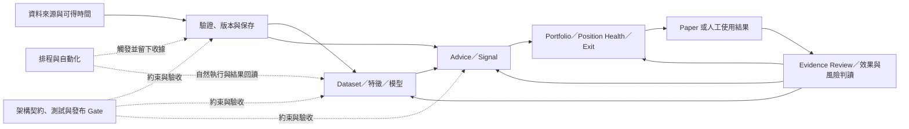

# 開發線路與演進狀態矩陣（2026-10-11）

> 本文件把既有文件治理清冊、Scoped SSOT、Roadmap Gate 與日期化 QA 收據映射成開發線路及其反覆迴圈。全 docs 基線清冊已建立；本矩陣是線路專項核對的第一版，不宣稱每份文件內容都已逐一重讀或所有線路都已完成狀態裁決。
>
> 本輪 35 個 dirty／受保護路徑不作內容證據，依 Git status 排除；目前同步中的完成計畫未開啟。一次批次讀取意外包含 dirty 的 `DOCUMENTATION_STATUS_MATRIX_20261009.md`，輸出遭截斷且已明確排除、不採用。全專案現況權威 `PROJECT_SNAPSHOT.md` 也是 dirty，因此下文的「最近狀態」只代表引用收據記錄的時點，不等於 2026-10-11 即時狀態。

## 判讀方式

每條線分開記錄四件事：

1. **方向／契約**：由 Scoped SSOT 或目標架構定義用途與邊界。
2. **迴圈**：從輸入或計畫，經實作、驗證、實際使用，再回到證據審查或修正的閉環。
3. **現況證據**：只引用有明確日期、範圍、資料／程式版本與結果的收據；計畫、設定存在、合成測試或單次成功都不自動等同全流程驗收。
4. **處置**：錯誤的現行權威內容要以證據修正；正確但已過時的歷史描述保留並標明時點／效力；未解矛盾維持待核，不猜測裁決。

全域文件分類及逐檔 OID／行數清冊見 [DOCUMENT_GOVERNANCE_STATUS_MATRIX_20261011](DOCUMENT_GOVERNANCE_STATUS_MATRIX_20261011.md) 與 [DOCUMENT_GOVERNANCE_PATH_MANIFEST_20261011](DOCUMENT_GOVERNANCE_PATH_MANIFEST_20261011.csv)。文件生命週期及刪除門檻依 [DOCUMENTATION_STRUCTURE](DOCUMENTATION_STRUCTURE.md)；只在沒有 Active 入站引用、沒有歷史保留必要、內容已由更完整文件取代，且屬一次性 debug／patch／單日草稿等條件均成立後才考慮刪除。

## 線路與反覆迴圈

| ID | 開發線路 | 主要迴圈／獨立出口 | 權威與導航入口 | 目前專項核對狀態 |
|---|---|---|---|---|
| L0 | 產品方向、工程 Gate、文件治理 | 產品問題 → Roadmap Gate → 工程交付／證據 → Snapshot 回寫 | [PRODUCT_ROADMAP_POST_REFACTOR](PRODUCT_ROADMAP_POST_REFACTOR.md)、[ROADMAP_6M_ENGINEERING](ROADMAP_6M_ENGINEERING.md)、[VERSION_ROADMAP_V2_1_TO_V4_0](VERSION_ROADMAP_V2_1_TO_V4_0.md) | 路線與 Gate 入口已映射；實際進度須讀 Snapshot，本輪因 dirty 未核。 |
| L1 | 資料來源、讀取、更新、品質與保存 | 來源資格／可得時間 → 擷取 → fail-closed 驗證 → CSV／SQLite → freshness／consumer readback → reconciliation／補救 | Product Roadmap §11；[DATA_FETCHING_LOGIC](../03_data/DATA_FETCHING_LOGIC.md)、[daily_data_update_guide](../03_data/daily_data_update_guide.md)、[HOW_TO_UPDATE_DAILY_DATA](../03_data/HOW_TO_UPDATE_DAILY_DATA.md) | 17 份 `docs/03_data/` 清潔文件已全文核對；最近的各項收據到 10/09，但非即時資料根／DB 狀態。存在 MOPS reconciliation 與 no-data 實跑收據缺口。 |
| L2 | 排程、自動化與運維 | task／trigger／來源與 DB pins → producer → consumer → 自然執行 → 結果回讀 → 失敗恢復／下一輪 | [BALDR_SCHEDULED_AUDIT_RUNBOOK](../07_guides/BALDR_SCHEDULED_AUDIT_RUNBOOK.md)、[SCHEDULE_OPERATIONS_AND_MIGRATION](../07_guides/SCHEDULE_OPERATIONS_AND_MIGRATION.md)、Operations QA Index | 已讀到 10/09 全排程回讀；尚無可核對的 10/10–10/11 自然執行收據。Ready、exit 0 或設定存在不能單獨作為 pipeline closeout。 |
| L3 | Evidence、QA 與效果回饋 | 假設／版本 → 固定資料與時間界線 → 可重播驗收 → 人工 Evidence Review → 接受、限制、降級或重做 | Product Roadmap §10；6M Gate 2；[docs/06_qa/README](../06_qa/README.md)、Evidence Runbooks | 目前只做跨線路映射；各產品主題 QA 的 owner／Gate／樣本成熟度仍要分線檢視。日期化 QA 原件依規則保留，不由檔名或 `Done` 推定可歸檔。 |
| L4 | Advice、Signal 與策略研究 | source／feature → signal／解釋 → 成本與風險檢查 → 使用回饋／前瞻證據 → pruning／保留決策 | Product Roadmap §§7、10、16；6M Gates 1、5；[SCORE_EXPLANATION](../02_features/SCORE_EXPLANATION.md) | 路線已映射，需專項稽核歷史演進、目前 read-only／paper 邊界及 signal 效果證據。 |
| L5 | Portfolio、Position Health 與 Exit | 持倉／策略版本 → 風險預算與判斷 → 人工動作／override → 理由與結果證據 → review | Product Roadmap §§8–10、16；6M Gates 4、6；Final Target Architecture | 路線已映射；R016 指出的兩個 raw caller cutover 未在既有 R029／R031／REC02／05 範圍內收斂，須保留為待辦。不得把建議／狀態機描述成自動平倉授權。 |
| L6 | ML、dataset、特徵與模型生命週期 | custody／可得時間／cutoff → dataset／feature 版本 → fit／calibration → artifact pins → shadow inference → horizon outcomes → hold／promote／retire | Product Roadmap §12；[FINAL_ML_COMPATIBILITY_CONTRACT](../01_architecture/target_architecture_2026_09_22/FINAL_ML_COMPATIBILITY_CONTRACT.md)、[FINAL_TARGET_ARCHITECTURE](../01_architecture/target_architecture_2026_09_22/FINAL_TARGET_ARCHITECTURE.md)、ML QA receipts | 已做第一輪專項時間序。全域 Snapshot 狀態未核；最新個人 H20 收據是有限私人流程證據，並非正式 PIT、全市場資格或 global promotion。 |
| L7 | UI／Workbench、使用者流程與發布接受 | 需求／契約 → Qt／EXE 實作 → offline／合成與自然流程 → 固定版本 journey → 真人驗收 → 回饋 | Product Roadmap §§6、20；Application Manual；Product UX QA Index | 路線已映射；Manual 與多份 UI／QA 文件 dirty，本輪不讀，因此目前完整使用者旅程與發布接受狀態待核。 |
| L8 | 架構、重構與跨域整合 | 現況邊界 → 目標契約 → scoped change → 測試／consumer cutover → integration receipt → release／回滾 | [system_architecture](../01_architecture/system_architecture.md)、[FINAL_TARGET_ARCHITECTURE](../01_architecture/target_architecture_2026_09_22/FINAL_TARGET_ARCHITECTURE.md)、6M Gate 0 | 目標設計入口已確認；現行架構文件 dirty 未讀。Phase 3.3B headline 與 checklist 的完成狀態衝突仍待同範圍收據。 |

Gate 是交付與驗收邊界，線路則是會跨 Gate 演進的領域。因此 ML 可以依賴 Gate 2 的證據、Gate 3 的資料資格與 Gate 7 的條件式 Shadow；排程可以服務多條線路，但每條線仍需各自的 consumer 結果與 closeout。不能用「一個 Gate 完成」或「Graphify 社群」代替線路狀態。

## 已核對的主要演進與狀態切片

### L1 資料來源、讀取、更新與保存

| 時點 | 可核對演進 | 解讀邊界 |
|---|---|---|
| 2026-08-28 | `DATA_UPDATE_PERFORMANCE_BASELINE_2026_08_28.md` 記錄唯讀量測與 isolated staging，CSV 全批讀取／normalize／group 是主要成本，SQLite staging probe 看見 lock／retry。 | 非 production write、worker 或正式 parallelism 授權。 |
| 2026-09-18 | TPEX source-gap diagnostics 後續以官方歷史原件、insert-only SQLite 回補；precaptured readback 記 868 列。 | 證明特定歷史回補，不證明當時 PIT 可得時間或自然排程成功。 |
| 2026-09-18 | maturity annual cache 有 expiry、hash、coverage 與 fail-closed consumer 驗證；`temporary_closure_coverage=not_covered`。 | 每次 consumer evaluation 需重驗；一次有效不代表永久有效，計畫日曆亦不能替代實際價格／成熟結果。 |
| 2026-10-01 | `V2_3_P0_SOURCE_ACCEPTANCE_REGISTER.md` 保留 MOPS 7/27 `limited` 與 8/28 `accepted=0 limited=0` 的差異，明載待 reconciliation。 | 不推定來源資格已接受或撤銷；需核原始 audit input／registry。 |
| 2026-10-09 | 兩批 C-drive cold archive receipts 記 34 根目錄、158,712 檔與 184.62 logical GiB。 | 日期化搬移／保全收據，不代表目前容量、root 狀態或實際配置空間。 |

資料更新權威描述官方 TWSE／TPEx 原始資料 → CSV → SQLite upsert → 指標更新，並保留來源日期、receipt、取消與錯誤邊界。只有精確且已驗證的官方 no-data 回應可作 warning 後繼續；傳輸、解析、日期或其他錯誤 fail closed。現有清潔指南說明了契約，但此次未找到專門的 no-data 實跑 closeout 收據，故該執行分支仍欠一份可核對 evidence。來源可得時間、coverage、授權、PIT 與正式下游資格必須獨立判讀。

重要可核對來源：`docs/00_core/PRODUCT_ROADMAP_POST_REFACTOR.md` §11.1 lines 264–272；`docs/03_data/daily_data_update_guide.md` lines 122–149；`docs/03_data/DATA_FETCHING_LOGIC.md` lines 123–150；`docs/06_qa/V2_3_P0_SOURCE_ACCEPTANCE_REGISTER.md` line 204；`docs/06_qa/SCHEDULER_FRESHNESS_QUICK_BINDING_20261001.md`。

### L2 排程與自動化

| 時點 | 可核對演進 | 解讀邊界 |
|---|---|---|
| 2026-09-29 至 10-01 | 9/29 receipt 記錄 21/21 tasks、wrapper、action 與 schedule 可用；修復後仍要求下一次自然執行。9/30 與 10/01 補記保留 blocked、degraded、research-only 結果。 | 設定完整不等於整條 pipeline 或來源資格通過。 |
| 2026-10-06 | 本機 Codex automation 稽核為 49 項中 46 PAUSED、3 ACTIVE；Windows 21 tasks 最近結果為 12 個 0、2 個 1、7 個 2。 | Codex automation、heartbeat metadata 與 Windows task execution 是不同物件與證據。 |
| 2026-10-07 至 10-08 | 修正鎖、部分資料讀取與背景 launcher 等；10/08 receipt 仍列 Operational log disabled 及新的 background action 待自然 run 驗收。 | 10/08 是當日時點，不能覆蓋後續狀態。 |
| 2026-10-09 | 最後一份已核全排程回讀是 21/21 tasks 存在且啟用、20 Ready、1 Running；Operational log 已啟用。05:40 Forward blocked／exit 2，05:45 learning failed／exit 1。 | 這只證明 10/09 查核與當次失敗；文件預列的 10/10 NextRun 不證明 10/10 或 10/11 成功。 |

排程出口必須按實際 trigger、查核時間、Scheduler 結果、producer 與 consumer 結果逐輪核對。下一份狀態更新應加時間戳並同時記錄上述欄位，而不是重寫舊收據。

重要來源：`docs/07_guides/BALDR_SCHEDULED_AUDIT_RUNBOOK.md`；`docs/07_guides/SCHEDULE_OPERATIONS_AND_MIGRATION.md`；`docs/06_qa/BALDR_SCHEDULE_AUDIT_20261006.md`；`docs/06_qa/BALDR_SCHEDULE_REPAIR_20261007.md`；`docs/06_qa/BALDR_SCHEDULE_REPAIR_20261008.md`；`docs/06_qa/BALDR_SCHEDULE_REMEDIATION_20261009.md`。

### L6 ML、dataset、特徵與模型生命週期

| 時點 | 可核對演進 | 解讀邊界 |
|---|---|---|
| 2026-07 至 08 | Shadow 設計中的 150 features／8 packs 是 research union；62-feature reference 是另一個凍結參照。7/30 工程／8/30 checkpoint 當時記 Formal inputs 0/3、未評 calibration／OOS，alpha 0。 | 不把不同 registry／用途的特徵數相加；不推定 promotion 或投資有效性。 |
| 2026-09-22 至 23 | Final ML compatibility contract 凍結既有 ABI，新增特徵需獨立 registry、dataset 與 model version；9/23 restated v2 研究重建合併 3,496,189 rows。 | Restated／current research data，不是 historical PIT、正式 OOS 或產品放行。 |
| 2026-09-30 至 10-03 | raw source row hook 接線；raw collector 不產 features／labels。特定 Direct/B、CORE19 train/save/new-process inference 有收據。 | Hook 尚缺自然 Task 驗收；rebuild 仍 current-restated／non-PIT，alpha 0，未 promotion。 |
| 2026-10-07 至 08 | Fundamental snapshot 標示 current-observed-only、availability unknown、historical/formal PIT false；F02 收據只核到七個已保存特徵，MA10／MA60 不存在。 | 不把 current observation 升格為歷史可得資料；四均線排列仍待獨立版本與保存／UI／EXE 路徑驗證。 |
| 2026-10-10 | 個人 H20 integration receipt 記 revision 1 enabled、10 筆真實保存推論與產品 readback，10 pending／0 matured，Task 尚未實跑。 | 有限私人研究流程 evidence；不是全市場排序、正式 PIT 或 global promotion。 |

具體修訂候選：`docs/06_qa/SCHEDULER_ML_DAILY_SOURCE_ROW_PROJECTION_20261001.md` line 60 仍稱 hook「尚待實作」，但同檔已連到後續 hook receipt，且 `SCHEDULER_ML_DAILY_SOURCE_ROW_HOOK_20261001.md` 與 rebuild receipt 證明程式 hook 已接線。建議新增日期化 erratum 為「hook 已接線；自然 Task 驗收仍待」，保留 cutoff、PIT 與研究用途限制；不要改寫成自然排程已通過。

ML 待追蹤的分離里程碑：source custody／available-at／cutoff；dataset 與 feature registry/version；artifact／manifest pins；新程序 inference readback；自然排程收據；5／10／20／60 horizon 自然成熟 outcome；正式 hold／promotion／retirement 決策。不得把個人 H20、research restatement、shadow union 或 source-row hook 合併成同一個「ML 已完成」狀態。

重要來源：`docs/00_core/PRODUCT_ROADMAP_POST_REFACTOR.md` §12；`docs/01_architecture/target_architecture_2026_09_22/FINAL_ML_COMPATIBILITY_CONTRACT.md` lines 58–95；`docs/06_qa/BALDR_PERSONAL_MODEL_ACTIVATION_INTEGRATION_20261006.md` lines 102–120；`docs/06_qa/BALDR_CENTRAL_COHORT_NATURAL_BBUI_INTEGRATION_20261007.md` lines 48–54；`docs/06_qa/F02_SAVED_FEATURE_GAP_20261008.md` lines 7–23。

## 待核問題與文件處置

| 項目 | 分類 | 建議處置 | 狀態 |
|---|---|---|---|
| MOPS 7/27 `limited` 與 8/28 `accepted=0 limited=0` | 來源接受權威／receipt reconciliation | 核原始稽核輸入及 registry 後更新現行接受狀態；歷史 receipt 保留。 | 未解 |
| 專名 no-data 分支缺少實跑 closeout receipt | 資料更新證據缺口 | 新增一次具名來源、request diagnostics、response hash、處置步驟與 DB／下游 readback 的驗收收據。 | 待補證據 |
| ML projection 中「hook 尚待實作」 | 過時歷史句子，後續接線已證明 | 以帶日期的 erratum 更正狀態為「已接線、自然 Task 待驗」；保留當時 research／cutoff 界線。 | 可窄幅修正 |
| 10/09 排程 readback 與 10/10／10/11 現況 | 日期快照界線 | 新增當次 readback；不改寫 10/09 原始收據。 | 待新收據 |
| 2025 OOS custody／usage gate | Evidence 使用資格衝突 | 取得現行 signed custody／QA receipt 前，不推定 2025 可作正式 OOS。 | 未解 |
| 歷史 automation 12／15、R002 coverage 8／9 | 歷史文件內部數字張力 | 不猜數；若無原始收據，標明日期／範圍與差異即可。 | 歷史保留 |
| Portfolio／Exit 的兩個 raw caller cutover | consumer 邊界 | 在 R016 exact caller 範圍取得 cutover receipt，並納入相應線路出口。 | 未收斂 |
| Phase 3.3B headline 與 checklist 不一致 | 工程完成狀態衝突 | 取得同範圍驗收 receipt 後修正權威狀態；不能只依 headline 宣稱完成。 | 未解 |
| 補完計畫狀態、dirty Snapshot／架構／Manual／其他 dirty docs | 正在更新的權威或受保護文件 | 本輪不讀、不編輯；待工作樹乾淨或文件 owner 完成後，以新快照重核現況。 | 刻意待核 |
| 外部 Blueprint §7 未日期化「目前已具備」清單 | 權威文件過時風險 | 逐項加日期／receipt，或改為導向 Snapshot／Product／6M scoped SSOT。 | 待核 |

## 下一輪治理順序

1. Snapshot 與相關同步文件乾淨後，先核對 L0 全域狀態，再刷新本表「最近狀態」欄位；本表不取代 Snapshot。
2. 逐線完成 L3–L5、L7–L8 的演進時間序、現行權威、最近 acceptance receipt、開放 Gate 與 stale claim 審查；以 evidence receipt 支持狀態，不把 roadmap 計畫當成現況。
3. 完成來源資格／MOPS、自然排程、ML Task 與成熟 outcome、caller cutover 等待核項目後，再按文件生命週期政策提出精確的保留、日期界線、權威更正、redirect 合併或刪除決議。
4. 所有文件批次確定後才刷新與驗證 Graphify，並核對 HEAD 與來源快照一致。

## 核對來源

- 全域分類與逐檔來源：`DOCUMENT_GOVERNANCE_STATUS_MATRIX_20261011.md`、`DOCUMENT_GOVERNANCE_PATH_MANIFEST_20261011.csv`。
- 線路方向與 Gate：`PRODUCT_ROADMAP_POST_REFACTOR.md`、`ROADMAP_6M_ENGINEERING.md`、`VERSION_ROADMAP_V2_1_TO_V4_0.md`。
- 歷史與證據處置：`DOCUMENTATION_STRUCTURE.md`、`docs/06_qa/README.md` 及各線路日期化 QA receipts。
- 本表引用的日期化 QA 不取代目前狀態權威；Graphify communities 是導航群集，不是穩定的產品線路或工作狀態。
