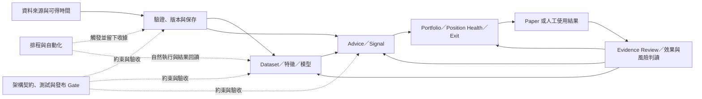

# 開發線路與演進狀態矩陣（2026-10-11）

> 本文件把既有文件治理清冊、Scoped SSOT、Roadmap Gate 與日期化 QA 收據映射成開發線路及其反覆迴圈。全 docs 基線清冊已建立；本矩陣是線路專項核對的第一版，不宣稱每份文件內容都已逐一重讀或所有線路都已完成狀態裁決。
>
> 文件治理清冊基準中的 35 個 dirty／受保護路徑不作內容證據。後續工作樹狀態有變動，dirty／受保護路徑仍只依 status 排除；目前同步中的完成計畫未開啟。一次批次讀取意外包含 dirty 的 `DOCUMENTATION_STATUS_MATRIX_20261009.md`，輸出遭截斷且已明確排除、不採用。全專案現況權威 `PROJECT_SNAPSHOT.md` 仍是 dirty，因此下文的「最近狀態」只代表引用收據記錄的時點，不等於 2026-10-11 即時狀態。

## 判讀方式

每條線分開記錄四件事：

1. **方向／契約**：由 Scoped SSOT 或目標架構定義用途與邊界。
2. **迴圈**：從輸入或計畫，經實作、驗證、實際使用，再回到證據審查或修正的閉環。
3. **現況證據**：只引用有明確日期、範圍、資料／程式版本與結果的收據；計畫、設定存在、合成測試或單次成功都不自動等同全流程驗收。
4. **處置**：錯誤的現行權威內容要以證據修正；正確但已過時的歷史描述保留並標明時點／效力；未解矛盾維持待核，不猜測裁決。

全域文件分類及逐檔 OID／行數清冊見 [DOCUMENT_GOVERNANCE_STATUS_MATRIX_20261011](DOCUMENT_GOVERNANCE_STATUS_MATRIX_20261011.md) 與 [DOCUMENT_GOVERNANCE_PATH_MANIFEST_20261011](DOCUMENT_GOVERNANCE_PATH_MANIFEST_20261011.csv)。文件生命週期及刪除門檻依 [DOCUMENTATION_STRUCTURE](DOCUMENTATION_STRUCTURE.md)；只在沒有 Active 入站引用、沒有歷史保留必要、內容已由更完整文件取代，且屬一次性 debug／patch／單日草稿等條件均成立後才考慮刪除。

## 線路與反覆迴圈

| ID | 開發線路 | 主要迴圈／獨立出口 | 權威與導航入口 | 目前專項核對狀態 |
|---|---|---|---|---|
| L0 | 產品方向、工程 Gate、文件治理 | 產品問題 → Roadmap Gate → 工程交付／證據 → Snapshot 回寫 | [PRODUCT_ROADMAP_POST_REFACTOR](PRODUCT_ROADMAP_POST_REFACTOR.md)、[ROADMAP_6M_ENGINEERING](ROADMAP_6M_ENGINEERING.md)、[VERSION_ROADMAP_V2_1_TO_V4_0](VERSION_ROADMAP_V2_1_TO_V4_0.md) | 路線與 Gate 入口已映射；實際進度須讀 Snapshot，本輪因 dirty 未核。 |
| L1 | 資料來源、讀取、更新、品質與保存 | 來源資格／可得時間 → 擷取 → fail-closed 驗證 → CSV／SQLite → freshness／consumer readback → reconciliation／補救 | Product Roadmap §11；[DATA_FETCHING_LOGIC](../03_data/DATA_FETCHING_LOGIC.md)、[daily_data_update_guide](../03_data/daily_data_update_guide.md)、[HOW_TO_UPDATE_DAILY_DATA](../03_data/HOW_TO_UPDATE_DAILY_DATA.md) | 17 份 `docs/03_data/` 清潔文件已全文核對；最近的各項收據到 10/09，但非即時資料根／DB 狀態。存在 MOPS reconciliation 與 no-data 實跑收據缺口。 |
| L2 | 排程、自動化與運維 | task／trigger／來源與 DB pins → producer → consumer → 自然執行 → 結果回讀 → 失敗恢復／下一輪 | [BALDR_SCHEDULED_AUDIT_RUNBOOK](../07_guides/BALDR_SCHEDULED_AUDIT_RUNBOOK.md)、[SCHEDULE_OPERATIONS_AND_MIGRATION](../07_guides/SCHEDULE_OPERATIONS_AND_MIGRATION.md)、Operations QA Index | 已讀到 10/09 全排程回讀；尚無可核對的 10/10–10/11 自然執行收據。Ready、exit 0 或設定存在不能單獨作為 pipeline closeout。 |
| L3 | Evidence、QA 與效果回饋 | 假設／版本 → 固定資料與時間界線 → 可重播驗收 → 人工 Evidence Review → 接受、限制、降級或重做 | Product Roadmap §10；6M Gate 2；[docs/06_qa/README](../06_qa/README.md)、Evidence Runbooks | Gate 2 可有 35/35 純工程完成，但外部接受、人工 review、授權與時間成熟度仍分開；10/10 最新乾淨補完收據仍列自然結果及產品接受待驗。QA 日期收據不能當現況 SSOT。 |
| L4 | Advice、Signal 與策略研究 | source／feature → signal／解釋 → 成本與風險檢查 → 使用回饋／前瞻證據 → pruning／保留決策 | Product Roadmap §§7、10、16；6M Gates 1、5；[SCORE_EXPLANATION](../02_features/SCORE_EXPLANATION.md) | 已完成第一輪專項核對；10/10 收據仍列 P07 策略規則／executor、多策略共振、正常 UI consumer 與 P11 自然 outcome／公平比較未完成。Gate 5 尚需 forward／paper 證據與可回復 pruning 決議。 |
| L5 | Portfolio、Position Health 與 Exit | 持倉／策略版本 → 風險預算與判斷 → 人工動作／override → 理由與結果證據 → review | Product Roadmap §§8–10、16；6M Gates 4、6；Final Target Architecture | 已完成第一輪專項核對：Paper selected route 是 bounded synthetic 接線，Formal／自然 Task／migration 未驗；Position Health 仍 proposal-only／degraded；Exit root operational readback pending。R016 仍列兩個 exact raw caller 未 cutover。 |
| L6 | ML、dataset、特徵與模型生命週期 | custody／可得時間／cutoff → dataset／feature 版本 → fit／calibration → artifact pins → shadow inference → horizon outcomes → hold／promote／retire | Product Roadmap §12；[FINAL_ML_COMPATIBILITY_CONTRACT](../01_architecture/target_architecture_2026_09_22/FINAL_ML_COMPATIBILITY_CONTRACT.md)、[FINAL_TARGET_ARCHITECTURE](../01_architecture/target_architecture_2026_09_22/FINAL_TARGET_ARCHITECTURE.md)、ML QA receipts | 已做第一輪專項時間序。全域 Snapshot 狀態未核；10/11 時序補記確認個人 H20 的 10/07 有界效果與產品讀回，但自然 outcome 尚未成熟、Task 未實跑；不是正式 PIT、全市場資格或 global promotion。 |
| L7 | UI／Workbench、使用者流程與發布接受 | 需求／契約 → Qt／EXE 實作 → offline／合成與自然流程 → 固定版本 journey → 真人驗收 → 回饋 | Product Roadmap §§6、20；Application Manual；Product UX QA Index | 已完成第一輪專項核對：F17 有局部產品接線，但完整 Main／H20／EXE／真人驗收未完成；P13／P14 仍待接受。UX 索引已補入 10/10 bounded G 讀回，並明示其一般報告 guard 與完整驗收限制；本機 package 收據仍只適用舊 tree。 |
| L8 | 架構、重構與跨域整合 | 現況邊界 → 目標契約 → scoped change → 測試／consumer cutover → integration receipt → release／回滾 | [system_architecture](../01_architecture/system_architecture.md)、[FINAL_TARGET_ARCHITECTURE](../01_architecture/target_architecture_2026_09_22/FINAL_TARGET_ARCHITECTURE.md)、6M Gate 0 | 已完成第一輪專項核對：FINAL 是目標設計權威，不是實作證據；R031／R027／R028 closeout 僅有日期與範圍界線。現行 `system_architecture.md` dirty 未讀；Phase 3.3B 完成度標籤已加歷史 erratum，實際 Epic 驗收仍待同範圍收據。 |

Gate 是交付與驗收邊界，線路則是會跨 Gate 演進的領域。因此 ML 可以依賴 Gate 2 的證據、Gate 3 的資料資格與 Gate 7 的條件式 Shadow；排程可以服務多條線路，但每條線仍需各自的 consumer 結果與 closeout。不能用「一個 Gate 完成」或「Graphify 社群」代替線路狀態。

## 依開發線路追蹤工作的方式

開始一項工作時，先指定一條主要線路及它依賴的線路，從上表找到 scoped authority、時間線和最近一份適用收據。線路矩陣回答「為什麼演進、沿途做過什麼、哪些證據仍有效、下一個出口是什麼」；Snapshot 與 scoped authority 才回答當下全域狀態及現行契約，QA／Archive 收據保留其固定日期、版本和驗收範圍。

每輪工作依相同閉環更新：

1. **定義問題與出口**：記錄所屬線路、受影響依賴、現行契約，以及能證明完成的具體結果。
2. **實作與工程驗證**：保留 commit／source pins、設定與 artifact 版本、測試母體、命令和結果；合成測試只證明它覆蓋的工程範圍。
3. **自然使用與結果回讀**：如依賴排程、真實來源、真實操作或時間成熟，另記自然觸發、producer、consumer、結果／缺口與觀測時間；設定存在、exit 0 或成熟樣本尚未到期都不能代替此出口。
4. **回饋與現況更新**：以新收據更新該線路的時間線、依賴狀態和下一出口；只有全域目前狀態真的改變時才同步 Snapshot，不覆寫舊收據的歷史時點。

| 狀態層 | 要回答的問題 | 可接受的證據邊界 |
|---|---|---|
| 契約／規劃 | 要解決什麼，輸入、責任與停止條件是什麼？ | Roadmap、Scoped SSOT、架構契約；不代表已實作。 |
| 工程接線／驗證 | 哪個版本完成哪些程式、測試或合成驗收？ | 固定 commit／source、母體、命令與結果的 QA 收據；不自動代表自然使用。 |
| 自然執行／回讀 | 實際 trigger 是否啟動正確 producer，consumer 是否讀到同一輪結果？ | 日期、run identity、artifact／receipt pins、producer 與 consumer 結果；單看 Ready 或 exit code 不足。 |
| outcome／資格 | 結果是否已成熟，來源與時間界線是否合格？ | 固定 horizon、來源 custody／available-at、成本與 benchmark、資格裁定；未成熟或 current-observed 不升格為 PIT。 |
| 產品／發布接受 | 使用者在指定版本與流程中是否完成接受？ | 指定版本、資料母體、操作旅程及真人／發布收據；工程通過不能替代。 |

線路之間要保留明示依賴：ML 的 dataset／feature／模型結論依賴資料線的來源 custody、可得時間與版本，依賴排程線的自然 run readback，也依賴 evidence 線的成熟 outcome；資料更新可被多個排程觸發，但每個 downstream consumer 都要各自回讀；Portfolio、Advice 與 UI 接受則須分別證明其依賴的策略、風險、結果及使用旅程。任何一條上游線路未達標，都記為該線路的 blocker 或 qualification boundary，不用跨線的工程通過補足。

遇到舊文件時，按[文件生命週期規則](DOCUMENTATION_STRUCTURE.md)裁決：目前權威有錯就以可核對證據修正；當時正確、如今已過時的 receipt 保留原文並標日期／限制，必要時在現行 authority 加 erratum 或替代入口；已被取代的操作入口加短 redirect。只有符合該規則的全部刪除條件且依賴已解除時才刪除，不以關鍵字重複、日期較舊或 Graphify 社群相似作為刪檔理由。

## 已核對的主要演進與狀態切片

### L0 產品方向、工程 Gate 與治理

| 時點 | 可核對演進 | 解讀邊界 |
|---|---|---|
| 2026-06-15 | [舊 Roadmap 移交](LEGACY_ROADMAP_CARRYOVER.md)建立逐項完成、轉交、取代或取消的承接規則。 | 舊 Month 1–3 是歷史標籤；不得直接映射成目前進度，也不由舊計畫推定 Excel／PDF 等未完成範圍已交付。 |
| 2026-07-11 | [重構後產品 Roadmap](PRODUCT_ROADMAP_POST_REFACTOR.md)把治理資料、Advice、Portfolio、Exit 與 forward／paper／live 證據閉環放進產品方向。 | 方向與產品 Gate 不是完成狀態，也不授權自動下單或正式 ML。 |
| 2026-07-12 | [6 個月工程 Roadmap](ROADMAP_6M_ENGINEERING.md)定義 Gate 0–6 的工程順序與出口，Gate 7 另有前置條件。 | Gate 是驗收邊界，不是進度回報；月份是相對順序，沒有固定日曆起始日。 |
| 2026-09-15 | [V2.1–V4.0 成熟度 Roadmap](VERSION_ROADMAP_V2_1_TO_V4_0.md)分開產品方向、工程順序與成熟度階梯。 | Replay 不等於 forward、shadow 不等於正式能力；成熟度 Roadmap 不是目前狀態 SSOT。 |
| 2026-09-17 | Product Roadmap 補齊產品 Gate 與證據生命週期界線，區分歷史回放、OOS、shadow、paper 與 live。 | V5／V6 UX 或契約工作不能替代 V4 投資證據；產品 Gate 與工程出口不可混為一談。 |
| 2026-10-08 | Legacy Roadmap 再確認它只負責舊工作移交與結案，後續狀態回到專責文件。 | 不另建平行的舊工作 Roadmap，也不將歷史月份當成現行優先序。 |

目前的可讀權威入口是 [DEVELOPMENT_ROADMAP](DEVELOPMENT_ROADMAP.md)：產品方向／產品 Gate 看 Product Roadmap，工程順序看 6M Roadmap，長期成熟度看版本 Roadmap，舊工作承接看 Legacy Roadmap。全域進度仍待乾淨 Snapshot 再確認；本線路矩陣不自行裁決目前優先 Gate。可讀的 10/10 QA 收據列出 P12 真實自動化執行／時序門檻、P13 同版本完整旅程與真人驗收、P14 新建置接受等候選出口，但排序與當前責任人仍以最新狀態權威為準。

### L1 資料來源、讀取、更新與保存

| 時點 | 可核對演進 | 解讀邊界 |
|---|---|---|
| 2026-07-14 | [PIT repair runbook](../07_guides/PIT_HISTORICAL_DATA_REPAIR_RUNBOOK.md)記錄已 materialize 的 2026-06 月營收 mapping 與 exact source/version pair。 | 只供限縮 legacy compatibility；新來源須有 v2 provenance，不能拿 snapshot 當新來源模板。 |
| 2026-08-28 | [資料更新效能基線](../06_qa/DATA_UPDATE_PERFORMANCE_BASELINE_2026_08_28.md)記錄唯讀量測與 isolated staging；CSV 全批讀取／normalize／group 是主要成本，SQLite probe 看見 lock／retry。 | 非 production write、worker 或正式 parallelism 授權。 |
| 2026-09-15 | [PIT taxonomy QA](../06_qa/PIT_TAXONOMY_DAILY_SOURCE_QA_2026_09_15.md)與[Industry caller QA](../06_qa/PIT_INDUSTRY_CALLER_ACCEPTANCE_QA_2026_09_15.md)核對官方 taxonomy、caller 接線及 `5371` 身分缺件。 | `1,931/1,932` exact join；`5371 → 3718` lifecycle 尚未接到該 caller；屬 research／prospective 證據，不是 historical PIT 或 formal credit。 |
| 2026-09-18 | TPEX source-gap diagnostics 後以官方歷史原件、insert-only SQLite 回補，precaptured readback 記 868 列；maturity annual cache 同時加 expiry、hash、coverage 與 fail-closed consumer 驗證。 | 是特定歷史回補與 cache 契約；`temporary_closure_coverage=not_covered`，不能推定當時 PIT 可得時間或自然排程成功。 |
| 2026-09-21 至 24 | [Scheduled Data Contract 修復](../06_qa/SCHEDULED_DATA_CONTRACT_REPAIR_2026_09_21.md)記錄 candidate DB 與月營收 1,841 列受控 apply；[Formal Data Repair](../06_qa/FORMAL_DATA_REPAIR_2026_09_23.md)記錄補回九個交易日 14,869 列、排除兩表各 2,942 列並完成該次 readback。 | 月營收當時仍 `current-observed-only`；修復收據不代表目前 DB 狀態、來源公告時間或 historical PIT。 |
| 2026-09-30 至 10-01 | [Scheduled Operations Repair](../06_qa/SCHEDULED_OPERATIONS_REPAIR_20260930.md)記錄自然 Quick／Freshness／官方事件 readback；[Source Acceptance and Quarterly Catalog](../06_qa/FUNDAMENTAL_SOURCE_ACCEPTANCE_AND_QUARTERLY_CATALOG_20261001.md)記錄月營收候選及季度 capture。 | Quick／Freshness 缺精確 run/hash 綁定；月營收單位、owner acceptance、正式 apply 未接受；MOPS 7/27 `limited` 與 8/28 `accepted=0 limited=0` 仍待 reconciliation。 |
| 2026-10-06 至 09 | [Storage Asset Register](../03_data/STORAGE_ASSET_REGISTER_20261006.md)記錄兩批冷封存共 34 個根目錄、158,712 檔、約 184.62 logical GiB。 | 日期化資產收據；終態對照未重算全量 SHA，容量數不是即時空間。 |
| 2026-10-08 至 09 | [F17 Full-N fact bundle](../06_qa/F17_FULL_N_FACT_BUNDLE_20261008.md)固定 258 列含納入／排除的官方處置事實；[pinned SQLite read session](../06_qa/PINNED_SQLITE_READ_SESSION_20261008.md)驗證單次私有副本讀取；[F12 index](../06_qa/BALDR_F12_INDEX_INTEGRATION_REVIEW_20261009.md)與[Main integration](../06_qa/BALDR_F12_MAIN_INTEGRATION_REVIEW_20261009.md)記錄營收查詢接線。 | F17 仍 current-only、official available-at 未知且未接完整 F17；SQLite 僅驗單次副本 reader，尚未接 provider／正常設定／UI。F12 收據不等於完整來源、完整 Main／收藏旅程、跨程序原版重開或真人接受。 |
| 2026-10-09 至 11 | [F12 durable raw archive](../06_qa/BALDR_F12_DURABLE_RAW_ARCHIVE_V2_20261009.md)與[月營收來源 review](../06_qa/BALDR_F12_MONTHLY_REVENUE_SOURCE_REVIEW_20261009.md)記錄 exact archive reopen、合成 query/readback 與有限路由更新。 | 仍 `current-observed-only`、availability unknown、PIT false；完整 Main／收藏、正常更新閉環及正式 PIT 尚未完成。 |

資料更新權威描述官方 TWSE／TPEx 原始資料 → CSV → SQLite upsert → 指標更新，並保留來源日期、receipt、取消與錯誤邊界。只有精確且已驗證的官方 no-data 回應可作 warning 後繼續；傳輸、解析、日期或其他錯誤 fail closed。現有清潔指南說明了契約，但此次未找到專門的 no-data 實跑 closeout 收據，故該執行分支仍欠一份可核對 evidence。來源可得時間、coverage、授權、PIT 與正式下游資格必須獨立判讀。

重要可核對來源：`docs/00_core/PRODUCT_ROADMAP_POST_REFACTOR.md` §11.1 lines 264–272；`docs/03_data/daily_data_update_guide.md` lines 122–149；`docs/03_data/DATA_FETCHING_LOGIC.md` lines 123–150；`docs/06_qa/V2_3_P0_SOURCE_ACCEPTANCE_REGISTER.md` line 204；`docs/06_qa/SCHEDULER_FRESHNESS_QUICK_BINDING_20261001.md`。

### L2 排程與自動化

| 時點 | 可核對演進 | 解讀邊界 |
|---|---|---|
| 2026-09-21 | [Scheduled Data Contract Repair](../06_qa/SCHEDULED_DATA_CONTRACT_REPAIR_2026_09_21.md)修復五項晨間鏈路契約並核既有 task。 | Task exit 0 與 Evidence `degraded` 可同時成立；沒有 formal credit、Evidence confirm 或 broker action。 |
| 2026-09-29 | [Scheduled Operations Repair](../06_qa/SCHEDULED_OPERATIONS_REPAIR_20260929.md)盤點 21 個 Windows task，21/21 registration 可用。 | `configuration_ready=true` 只證明排程接線；來源、容量、PIT、Paper 與中斷原因仍有 blocker。 |
| 2026-09-30 至 10-01 | [Scheduled Operations Repair](../06_qa/SCHEDULED_OPERATIONS_REPAIR_20260930.md)補入自然 Quick、Freshness、Official Events 等 readback。 | Quick／Freshness 缺精確 run/hash 綁定；Paper no-work、candidate receipt、部分 sidecar 不能合成全鏈成功。 |
| 2026-10-03 | [剩餘排程診斷](../06_qa/SCHEDULER_REMAINING_DIAGNOSIS_20261003.md)記錄信用資料來源先回 no-data、後續網路失敗與受控 candidate 恢復／freshness readback。 | 這是特定日期的受控恢復，不代表自然排程後續輪次或其他來源全數健康。 |
| 2026-10-05 | [Heartbeat chain repair](../06_qa/HEARTBEAT_CHAIN_REPAIR_20261005.md)修正每日鏈容量與接線。 | 收據明示屬工程／隔離驗證，不是新的自然排程或正式訓練。 |
| 2026-10-06 | [BALDR Schedule Audit](../06_qa/BALDR_SCHEDULE_AUDIT_20261006.md)建立 21 個 Windows task 與 Codex automation 的日期化清冊。 | Windows 最近結果為 12 個 0、2 個 1、7 個 2；Codex automation、heartbeat metadata 與 Windows task execution 是不同證據。 |
| 2026-10-07 | [Schedule Repair 10/07](../06_qa/BALDR_SCHEDULE_REPAIR_20261007.md)修 Direct 時窗、來源與 Paper／Forward 流程。 | 受控研究鏈完成不等於自然排程、Paper terminal 或正式模型鏈驗收。 |
| 2026-10-08 | [Schedule Repair 10/08](../06_qa/BALDR_SCHEDULE_REPAIR_20261008.md)將四個固定 task action 改為背景 launcher，保存 stdout／stderr 與 started／terminal receipts。 | 262 passed、4 skipped 是工程回歸；當時 Operational log disabled，launcher 待自然 run。 |
| 2026-10-09 | [Schedule Remediation](../06_qa/BALDR_SCHEDULE_REMEDIATION_20261009.md)回讀 21 tasks、啟用 Operational log 並更新兩個 heartbeat prompt。 | 20 Ready、1 Running；Forward blocked／exit 2，learning failed／exit 1；`fit_completion_verified=false`，不能由 NextRun 欄位推定後續成功。 |

排程出口必須按實際 trigger、查核時間、Scheduler 結果、producer 與 consumer 結果逐輪核對。下一份狀態更新應加時間戳並同時記錄上述欄位，而不是重寫舊收據。

重要來源：`docs/07_guides/BALDR_SCHEDULED_AUDIT_RUNBOOK.md`；`docs/07_guides/SCHEDULE_OPERATIONS_AND_MIGRATION.md`；`docs/06_qa/BALDR_SCHEDULE_AUDIT_20261006.md`；`docs/06_qa/BALDR_SCHEDULE_REPAIR_20261007.md`；`docs/06_qa/BALDR_SCHEDULE_REPAIR_20261008.md`；`docs/06_qa/BALDR_SCHEDULE_REMEDIATION_20261009.md`。

### L6 ML、dataset、特徵與模型生命週期

| 時點 | 可核對演進 | 解讀邊界 |
|---|---|---|
| 2026-07 至 08 | Shadow 設計中的 150 features／8 packs 是 research union；62-feature reference 是另一個凍結參照。7/30 工程／8/30 checkpoint 當時記 Formal inputs 0/3、未評 calibration／OOS，alpha 0。 | 不把不同 registry／用途的特徵數相加；不推定 promotion 或投資有效性。 |
| 2026-09-22 至 23 | Final ML compatibility contract 凍結既有 ABI，新增特徵需獨立 registry、dataset 與 model version；9/23 restated v2 研究重建合併 3,496,189 rows。 | Restated／current research data，不是 historical PIT、正式 OOS 或產品放行。 |
| 2026-09-30 至 10-03 | [ML raw PIT repair](../06_qa/SCHEDULER_ML_RAW_REPAIR_20260930.md)與[daily source-row hook QA](../06_qa/SCHEDULER_ML_DAILY_SOURCE_ROW_HOOK_20261001.md)記錄 raw source-row hook 接線及特定 Direct/B、CORE19 train/save/new-process inference。 | Hook 收據只證明隔離工程接線，沒有觸發正式 `.cmd`／Task；rebuild 仍 current-restated／non-PIT，alpha 0，未 promotion。 |
| 2026-10-07 至 08 | Fundamental snapshot 標示 current-observed-only、availability unknown、historical/formal PIT false；F02 收據只核到七個已保存特徵，MA10／MA60 不存在。 | 不把 current observation 升格為歷史可得資料；四均線排列仍待獨立版本與保存／UI／EXE 路徑驗證。 |
| 2026-10-10 | [Product Completion Status](../06_qa/BALDR_PRODUCT_COMPLETION_STATUS_20261010.md)記錄固定來源 S4 的 bounded H20 Main：10 檔 cohort、2382 下鑽／返回及同一 capture 的 120 筆 OHLC／684 bp 對照通過。 | 一般報告仍 partial、完整四端點為 false；這項 UI／個人切片不等於自然 Task、已成熟 horizon outcome、EXE、PIT 或 global promotion。 |
| 2026-10-11（回註 10/07 個人 H20） | 個人 H20 integration receipt 記 revision 1 enabled、10 筆保存預測與產品 readback，10 pending／0 matured；Task 尚未實跑。 | 有界私人 current-observed 研究流程 evidence；不是全市場排序、正式 PIT 或 global promotion。 |

`docs/06_qa/SCHEDULER_ML_DAILY_SOURCE_ROW_PROJECTION_20261001.md` 原 line 60 的「hook 尚待實作」已由 2026-10-11 日期化 erratum 釐清為早期階段描述；後續 hook 與 rebuild receipt 證明程式 hook 已接線，自然 Task 驗收仍待。cutoff、PIT 與研究用途限制保留，沒有改寫成自然排程已通過。

ML 待追蹤的分離里程碑：source custody／available-at／cutoff；dataset 與 feature registry/version；artifact／manifest pins；新程序 inference readback；自然排程收據；5／10／20／60 horizon 自然成熟 outcome；正式 hold／promotion／retirement 決策。不得把個人 H20、research restatement、shadow union 或 source-row hook 合併成同一個「ML 已完成」狀態。

每次專注 ML 配置時，將候選配置作為新的日期化版本記錄，至少核對：資料集／revision 與 source hash、可得時間及訓練 cutoff；有序 feature／label registry、版本 hash、單位／缺值與 transform；模型 family、hyperparameter／training identity、split／purge／embargo 與 calibration；artifact manifest／bytes hash 及 loader／library 相容性；推論 mode、候選身分與 shadow／formal／production 權限；最後再連到自然 run 和各 horizon outcome。這些欄位用來比較「哪個設定改了、它消費什麼、在哪個版本驗證、結果是否成熟」，不把計畫設定或重新建出的 restated dataset 冒充正式歷史 PIT。

重要來源：`docs/00_core/PRODUCT_ROADMAP_POST_REFACTOR.md` §12；`docs/01_architecture/target_architecture_2026_09_22/FINAL_ML_COMPATIBILITY_CONTRACT.md` lines 58–95；`docs/06_qa/BALDR_PERSONAL_MODEL_ACTIVATION_INTEGRATION_20261006.md` lines 102–120；`docs/06_qa/BALDR_CENTRAL_COHORT_NATURAL_BBUI_INTEGRATION_20261007.md` lines 48–54；`docs/06_qa/F02_SAVED_FEATURE_GAP_20261008.md` lines 7–23。

### L3 Evidence／QA 與回饋閉環

6M Gate 2 的設計要求真實週期 review、append-only action item、人工核准與 recovery；replay、dry-run 或單次排程 exit 0 不可替代 forward evidence。`GATE_2_TO_7_ENGINEERING_CONTROL_CENTER.md` 記錄 35/35 純工程項目完成，但仍固定 `formal_product_closeout=false`，並將 owner、人工審核、時間成熟及授權分開。`GATE_2_TO_7_EXTERNAL_VALIDATION_REGISTER.md` 是歷史收據，最後列出的 Formal Week 7 為 2026-08-30、credit 0；應保留原始時點，後續另開日期化 revision。

| 時點 | 可核對演進 | 解讀邊界 |
|---|---|---|
| 2026-07-12 | [Gate 2–7 純工程 closeout](../06_qa/GATE_2_TO_7_PURE_ENGINEERING_CLOSEOUT_2026_07_12.md) 及 [Engineering Control Center](../06_qa/GATE_2_TO_7_ENGINEERING_CONTROL_CENTER.md) 記錄 35/35 工程項目。 | 純工程結案不等於外部驗證、正式產品資格或 Gate 結案；控制中心仍記 `formal_product_closeout=false`。 |
| 2026-07-21／22 | [Gate 2 資料治理整合稽核](../06_qa/GATE_2_DATA_GOVERNANCE_CONSOLIDATION_AUDIT_2026_07_22.md) 建立 P0 source、Gate 2 工程整合及 Gate 3／4 範圍基線。 | 是唯讀日期快照；13 個 P0 source deferred、正式 Gate 2 credit 0/3、production scheduler false 不代表今天狀態。 |
| 2026-08-30 | [Weekly Approval Refresh](../06_qa/EVIDENCE_WEEKLY_APPROVAL_REFRESH_2026_08_30.md) 封裝 10 筆自然週紀錄供人工審查。 | 封裝本身不是 owner／reviewer 核准，也沒有正式 credit；後續需新週期證據。 |
| 2026-09-05 | [Gate 2–7 Control Center](../06_qa/GATE_2_TO_7_ENGINEERING_CONTROL_CENTER.md) 更新人工審查投影。 | 核准顯示 3/3 不等於正式證據 credit；缺 decision-time snapshot 時，不能由 scheduler 或 replay 代替人工／自然證據。 |
| 2026-10-09 | [排程修復 QA](../06_qa/BALDR_SCHEDULE_REMEDIATION_20261009.md) 區分 task 存在／啟用與業務產出：Forward blocked、learning failed。 | Scheduler 的 Ready／exit code 不足以證明 producer 與 consumer 結果。 |
| 2026-10-10 | [產品完成度收據](../06_qa/BALDR_PRODUCT_COMPLETION_STATUS_20261010.md) 與[真人驗收清單](../06_qa/BALDR_COMPOSITE_HUMAN_CHECK_20261010.md) 保留自然時序證據、同版本 EXE、完整旅程與真人接受缺口。 | 合成 UI 測試不等於真實資料、H20、真人或發布接受。 |

最新可讀的 10/10 乾淨產品補完收據仍把自然結果、下一次真排程、產品接受與新版本 EXE 列為待驗；合成旅程通過不等於真人或發布接受。狀態線路應保留政策／Gate、工程通過、外部 evidence、產品接受、release 接受五個獨立欄位。重要來源：`docs/00_core/ROADMAP_6M_ENGINEERING.md` lines 148–194；`docs/06_qa/GATE_2_TO_7_ENGINEERING_CONTROL_CENTER.md` lines 85–113；`docs/06_qa/GATE_2_TO_7_EXTERNAL_VALIDATION_REGISTER.md` lines 155–164；`docs/06_qa/BALDR_PRODUCT_COMPLETION_STATUS_20261010.md` lines 20–23、44–53；`docs/06_qa/BALDR_COMPOSITE_HUMAN_CHECK_20261010.md` lines 1–9、28–36。

### L4 Advice、Signal、策略與 Backtest

Advice 契約要求來源理由、風險、證據層級、策略版本與資料截止日，且必須能拒絕輸出；歷史 replay 只供研究／缺口診斷，不計 forward gate。Gate 1 可停在 read-only／paper，不授權自動交易；Gate 5 要求真實 evidence cadence、paper／Portfolio outcome、凍結的 Experiment Contract、足夠樣本，以及可回復的保留／限制／降權／退休決議。

| 時點 | 可核對演進 | 解讀邊界 |
|---|---|---|
| 2026-01-02 | Baseline 策略設計保存舊 promote 門檻與操作流程。 | 已標為歷史快照；不拿舊 walk-forward 百分比作現行 Gate。 |
| 2026-09-06 | Backtest execution/save 契約記錄 next-session-open、成本與 Registry 行為。 | 固定組合逐檔研究不等於共享現金 Portfolio。 |
| 2026-09-08 至 10 | V4 effectiveness read model／producer 有工程接線收據。 | 正式 DB ready outcome 當時為 0；不代表投資有效性或 promotion。 |
| 2026-09-10 | V4.1 calibration slice 為 research-only；正式 evidence DB 0 成熟 observations、0 folds、`not_evaluable`。 | challenger Brier 與原方法相同，保留原方法；無正式推薦或 promotion 接線。 |
| 2026-10-08 至 11 | F02 已保存特徵有七項，MA10／MA60 缺失；UX21 有 outcome adapter／唯讀 UI 局部接線補記。 | 不等於四均線完成、自然投資 outcome 或正式資格。 |
| 2026-10-10 | 最新乾淨產品成熟度收據仍列 P07 規則／executor、多策略共振／UI consumer 與 P11 自然 outcome／公平比較未完成；真人驗收仍待。 | 固定合成效能與自動化旅程不得升格為策略績效或真人接受。 |

`docs/02_features/BACKTEST_LAB_FEATURES.md` 原「判斷策略好壞」描述已窄幅改成歷史回放個股／條件診斷，並明示不單獨構成訊號或策略有效性證據。其餘舊 Strategy 設計、Backtest FAQ／checklist／Registry 規格已有歷史標記或 redirect，應保留。下一個獨立出口是 Gate 5 的 OOS + forward／paper 比較及有 rollback 的 pruning 決議；Gate 1 UI／真人接受另行驗收。

重要來源：`docs/00_core/PRODUCT_ROADMAP_POST_REFACTOR.md` §§5–7、10、16；`docs/00_core/ROADMAP_6M_ENGINEERING.md` Gates 1、5；`docs/02_features/BACKTEST_LAB_FEATURES.md`；`docs/06_qa/V4_EFFECTIVENESS_READ_MODEL_2026_09_08.md`；`docs/06_qa/V4_1_RECOMMENDATION_CALIBRATION_VERTICAL_SLICE_2026_09_10.md`；`docs/06_qa/BALDR_PRODUCT_COMPLETION_STATUS_20261010.md`。

### L5 Portfolio、Paper、Position Health 與 Exit

Product Roadmap §8–9 與 Gate 4／6 的出口分別要求 versioned policy、相同 universe／成本／限制比較、完整 Position Health 轉移矩陣、人工 override 與可追溯 evidence；不接 broker、不自動賣出、不以缺資料判正常。目標架構指定 create-only artifact 為真值、SQLite 為可重建索引，但仍是目標設計，不能當成完成收據。

| 時點 | 可核對演進 | 解讀邊界 |
|---|---|---|
| 2026-07-12 | [V2.5 Position Health baseline](../09_archive/V2_5_POSITION_HEALTH_BASELINE_2026_07_12.md)記錄三筆 Paper allocation 均為 WATCH，thesis／invalidation／horizon／review date 欄位仍空。 | Research-only、不寫 positions DB、不允許自動動作；不是正式 closeout 或 Exit 指令。 |
| 2026-09-08 | [Position Health source-to-caller gap map](../06_qa/V4_POSITION_HEALTH_SOURCE_CALLER_GAP_MAP_2026_09_08.md)與[transition evaluator contract](../06_qa/V4_POSITION_HEALTH_TRANSITION_EVALUATOR_CONTRACT_2026_09_08.md)記錄 provider／proposal-only evaluator 接線。 | 三筆來源仍缺可證 entry lineage、thesis、PIT condition 與 Decimal metrics；readback degraded，只有 reviewer-backed approval 能改 recorded state。 |
| 2026-09-15 | [Position Health Increment 1 QA](../06_qa/POSITION_HEALTH_INCREMENT_1_QA_2026_09_15.md)記錄 Portfolio／Workbench typed read model 與 15 項測試通過。 | 使用隔離 fixture／read service，`research_only=true`；缺件降 WATCH／unknown，不接正式寫入或 broker。 |
| 2026-09-22 | [Paper EOD credit candidate policy QA](../06_qa/PAPER_EOD_CREDIT_CANDIDATE_POLICY_QA_2026_09_22.md)為特定 candidate-only `credit_transactions` 定義 freshness 排除，並記錄一次唯讀 `ready_with_warnings`。 | 不證明 writer 或當晚 EOD 已執行，也不擴及其他資料列。 |
| 2026-10-02 | [Exit date／dry-run QA](../06_qa/EVIDENCE_DRY_RUN_READONLY_EXIT_DATE_QA_20261002.md)修正 dry-run 對來源 SQLite 寫入與 Pacific／Taipei 日期不一致。 | 修正後 dry-run repository read-only，但 root-owned operational readback 仍 pending。 |
| 2026-10-06 | [B06 Portfolio](../06_qa/BALDR_B06_PORTFOLIO_SUMMARY_20261006.md)、[B09 Portfolio](../06_qa/BALDR_B09_PERSONAL_PORTFOLIO_20261006.md)與[第二波整合收據](../06_qa/BALDR_SECOND_WAVE_INTEGRATION_20261006.md)接受 selected route／path 的 bounded synthetic 接線。 | P1／P2 有合成 custody、readback、market-alias guard；Formal 資格、真實資料、migration、自然 Task 與完整 Paper 鏈仍未驗。 |

目前最新可讀證據只支持局部工程／合成接線；Paper 下一出口是同一 identity／日期綁定的 producer、capture、ledger、benchmark、consumer readback。Position Health 還需自然且可核 fill 的 entry lineage、thesis、PIT condition、Decimal metrics、verified calendar、完整轉移矩陣及 reviewer approval。Exit 需具名 operational readback。R016 報告的 227 passed／1 skipped 不構成 repo-wide raw-reader closure；其 10/11 overlay 列出兩個待核 caller：`app_module/user_declared_holding_research.py:774–807`、`ui_qt/views/portfolio_view.py:2947–3000`。來源程式目前有 dirty WIP，故此處僅記錄 clean report 的狀態，待 WIP 定稿後再核對。

重要來源：`docs/00_core/PRODUCT_ROADMAP_POST_REFACTOR.md` §§8–9、16；`docs/00_core/ROADMAP_6M_ENGINEERING.md` Gates 4、6；`docs/01_architecture/target_architecture_2026_09_22/REFACTOR_REPORTS/R016_CONSUMER_CUTOVER_IMPLEMENTATION_REPORT.md` lines 5–16、41–42、98–104；`docs/06_qa/V4_POSITION_HEALTH_SOURCE_CALLER_GAP_MAP_2026_09_08.md` lines 21–46、62–76；`docs/06_qa/POSITION_HEALTH_INCREMENT_1_QA_2026_09_15.md` lines 5–27、39–50；`docs/06_qa/EVIDENCE_DRY_RUN_READONLY_EXIT_DATE_QA_20261002.md` lines 3–22。

### L7 Workbench、UI 與發布接受

UI receipts 分清 Main／EXE、合成母體／完整母體、正常 consumer／隔離研究視圖、真人操作與來源資格。

| 時點 | 可核對演進 | 解讀邊界 |
|---|---|---|
| 2026-07-06 | [V2.0 Workbench Phase 1](../09_archive/V2_0_WORKBENCH_PHASE1_CLOSEOUT_2026_07_06.md)完成 sample-only、read-only prototype。 | 主 UI Phase 2、真實 DB reader、background feed、production scheduler 尚未完成。 |
| 2026-07-07 | [V2.1 Workbench Phase 2](../09_archive/V2_1_WORKBENCH_PHASE2_CLOSEOUT_2026_07_07.md)完成 Qt read-only shell、Action Items 與 Operating Loop。 | Weekly history 0/3、multi-day dry-run 1/3，V2.2 real-evidence loop／scheduler approval 未完成。 |
| 2026-09-12 至 21 | [V4.2 handoff](../09_archive/V4_2_C_DAILY_DECISION_WORKBENCH_QA_HANDOFF_2026_09_12_HISTORY.md)、[MainWindow cross-page journey](../09_archive/CROSS_PAGE_DECISION_JOURNEY_MAINWINDOW_2026_09_15.md)及[V5 readability acceptance](../09_archive/V5_READABILITY_ACCEPTANCE_2026_09_21.md)逐步驗證 fail-closed UI、指定 Main journey 與 frozen-worktree readability。 | 主要使用 synthetic／bounded fixtures；不證明正式資料、策略、交易、真實成交、真人顯示器或正式 Gate。 |
| 2026-10-06 | UX24 engineering seal、[第二波整合](../06_qa/BALDR_SECOND_WAVE_INTEGRATION_20261006.md)與[Final Authorized Union](../06_qa/BALDR_FINAL_AUTHORIZED_UNION_20261006.md)記錄有限 UI engineering scope；union 是分兩次重驗後的結論。 | 522 collected／521 executed；512 passed／7 failed／2 skipped 後另驗原七節點，最終 519 passed／2 skipped／1 deselected；不是單次全綠，也不含 Native／真人接受。 |
| 2026-10-09 | [F17 normal production UI review](../06_qa/BALDR_F17_NORMAL_PRODUCTION_UI_REVIEW_20261009.md)有真 worker／producer／writer 部分接線，完整 Main／H20／EXE／真人接受仍待。 | 不把隔離研究視圖或真 worker 接線擴大為完整產品接受。 |
| 2026-10-10 | [Composite Human Check](../06_qa/BALDR_COMPOSITE_HUMAN_CHECK_20261010.md)使用 1000／1256 合成來源；[Product Completion Status](../06_qa/BALDR_PRODUCT_COMPLETION_STATUS_20261010.md)仍列 P13、P14 未完成，Q13 p95 高於 300ms candidate 門檻。 | 自動旅程通過不等於真人或 H20／2382；packaging 固定於舊 `a8c81...` tree，不代表後續 commit／Native／公開接受。 |

10/10 導覽將 G 原保存來源 bounded Main 讀回列為較新證據，並把 O attempt02 標為歷史失敗；G 的一般報告唯讀 guard 仍阻擋。此處保留各驗收 checkpoint 的先後，不選任一組未帶日期數字冒充現況；最新全域狀態仍待 clean Snapshot 與 Manual 核實。

重要來源：`docs/06_qa/PRODUCT_UX_QA_INDEX.md` lines 3–16、31–52；`docs/06_qa/BALDR_F17_NORMAL_PRODUCTION_UI_REVIEW_20261009.md` lines 11–35；`docs/06_qa/BALDR_COMPOSITE_HUMAN_CHECK_20261010.md` lines 7–20、28–36；`docs/06_qa/BALDR_PRODUCT_COMPLETION_STATUS_20261010.md` lines 10、20–25、44–53、79；`docs/06_qa/BALDR_LOCAL_MAIN_PACKAGING_20261007.md` lines 3–9、19–32。

### L8 架構、重構與跨域整合

目標架構 README 與 `FINAL_TARGET_ARCHITECTURE.md` 指定 FINAL 為唯一目標設計權威，同時明示不表示已實作；`REFACTOR_VALIDATION_MATRIX.md` 描述計畫中的驗收 bundle。

| 時點 | 可核對演進 | 解讀邊界 |
|---|---|---|
| 2026-09-22 | [R001 baseline inventory](../09_archive/REFACTOR_BASELINE_R001_20260922_HISTORY.md)建立唯讀 caller／artifact／TMP 基線；[Final Target Architecture](../01_architecture/target_architecture_2026_09_22/FINAL_TARGET_ARCHITECTURE.md)凍結唯一目標設計。 | R001 未跑 tests、production workflow 或 artifact loader；目標設計明言尚未全域實作。 |
| 2026-09-25 至 27 | [R031 final closeout](../06_qa/R031_FINAL_REFACTOR_CLOSEOUT_20260925.md)及[Final Migration Sequence](../01_architecture/target_architecture_2026_09_22/FINAL_MIGRATION_SEQUENCE.md)記錄各自 R031／R027／R028 有界結果。 | R031 是 `ENGINEERING_SCOPE_COMPLETE_WITH_RETAINED_BLOCKERS`；R028 scoped migration accepted 不改寫 R027 strict INCONCLUSIVE，也不代表全 repo 完成。 |
| 2026-10-06 | [R01 final validation](../09_archive/SYSTEM_ARCHITECTURE_R01_VALIDATION_EXCERPT_20261006.md)與[第二波 P2／M03 integration](../06_qa/BALDR_SECOND_WAVE_INTEGRATION_20261006.md)完成指定 registry、read-budget 與 selected producer slices 的工程驗證。 | 522 collected／521 executed；分次重驗得 519 passed／2 skipped／1 deselected；未跑完整 1,284 測試、真實資料或正式模型。B09／B10 舊架構附錄需由後續具名收據界定，不能當現況。 |
| 2026-10-11 | [R016 consumer cutover report](../01_architecture/target_architecture_2026_09_22/REFACTOR_REPORTS/R016_CONSUMER_CUTOVER_IMPLEMENTATION_REPORT.md)補記兩個 raw reader 仍無 exact caller cutover receipt。 | 227 passed／1 skipped 是 synthetic saved-result consumer scope；不證明 repo-wide raw-reader closure。 |

現行狀態仍待 dirty `system_architecture.md` 清潔後核；本矩陣只採 clean target／migration／QA 收據。下一出口是為 R016 的兩個 caller 指定 owner，完成 exact migration、fail-closed readback 及 named regression；之後再按 frozen source 清冊驗 consumer 路由。R031／R01 的日期化 scoped acceptance 不能升格為「全架構重構完成」。發布也須分列準備、固定 tree 的本機 package、後續提交未重驗及真人／公開接受。

重要來源：`docs/01_architecture/target_architecture_2026_09_22/README.md` lines 3–19；`FINAL_TARGET_ARCHITECTURE.md` lines 3–7、20；`REFACTOR_VALIDATION_MATRIX.md` lines 3–5；`FINAL_MIGRATION_SEQUENCE.md` lines 3–29；`REFACTOR_REPORTS/R031_FINAL_REFACTOR_CLOSEOUT_20260925.md` lines 63–67、107–119；`docs/06_qa/BALDR_LOCAL_MAIN_PACKAGING_20261007.md` lines 3–32。

## 待核問題與文件處置

| 項目 | 分類 | 建議處置 | 狀態 |
|---|---|---|---|
| MOPS 7/27 `limited` 與 8/28 `accepted=0 limited=0` | 來源接受權威／receipt reconciliation | 核原始稽核輸入及 registry 後更新現行接受狀態；歷史 receipt 保留。 | 未解 |
| 專名 no-data 分支缺少實跑 closeout receipt | 資料更新證據缺口 | 新增一次具名來源、request diagnostics、response hash、處置步驟與 DB／下游 readback 的驗收收據。 | 待補證據 |
| ML projection 中「hook 尚待實作」 | 過時歷史句子，後續接線已證明 | 2026-10-11 已加日期化 erratum 為「已接線、自然 Task 待驗」；保留當時 research／cutoff 界線與原始收據。 | 已窄幅修正 |
| Backtest 文件「判斷策略好壞」措辭 | 研究 UI 描述容易被誤讀為有效性證據 | 改成歷史回放的個股／條件貢獻診斷，明示不單獨證明訊號／策略有效。 | 已修正 |
| UX Index 的 H20 導覽晚於 10/10 bounded G readback | 舊 O attempt02 失敗記錄曾排在候選位置 | 索引新增 G 最近 bounded 收據、O 標成歷史；保留完整 H20／P13 未接受界線。 | 已更新 |
| 10/09 handoff 與 10/10 產品狀態證據 | 導覽時點較舊，不是內容錯誤 | 6M Roadmap 增列 10/10 狀態 receipt 入口，保留 10/09 handoff 作歷史交接。 | 已增列 |
| 10/09 排程 readback 與 10/10／10/11 現況 | 日期快照界線 | 新增當次 readback；不改寫 10/09 原始收據。 | 待新收據 |
| 2025 OOS custody／usage gate | Evidence 使用資格衝突 | 取得現行 signed custody／QA receipt 前，不推定 2025 可作正式 OOS。 | 未解 |
| 歷史 automation 12／15、R002 coverage 8／9 | 歷史文件內部數字張力 | 不猜數；若無原始收據，標明日期／範圍與差異即可。 | 歷史保留 |
| Portfolio／Exit 的兩個 raw caller cutover | consumer 邊界 | 在 R016 exact caller 範圍取得 cutover receipt，並納入相應線路出口。 | 未收斂 |
| Phase 3.3B headline 與 checklist 不一致 | 歷史計畫的完成度標籤衝突 | Archive 標題與狀態已改為「完成度待核」，原始 100% 聲明及清單保留；取得同範圍驗收 receipt 前不宣稱已驗收。 | 已加 erratum；完成度仍待證 |
| Antigravity 專案入口漏列 Scoped SSOT 與目標架構 | Agent 閱讀入口與根目錄規範不同步 | `.agent/rules/00_project_entry.md` 已補 Product Roadmap、External Reference Blueprint、target architecture／唯一 FINAL 設計入口及 skills registry。 | 已同步；限該入口 |
| Antigravity execution rule 的 process guard | 聲稱 shared context 有新規則、execution 摘要未同步 | `docs/agents/shared_context.md` 正在編輯，依狀態排除；核實來源規則與確切條件後再同步 `.agent/rules/10_development_execution.md`，不從摘要推測內容。 | 待來源乾淨／核實 |
| QA README 的 374 份內容文件計數 | 文件盤點數字依賴另一份 dirty 矩陣 | 目前計數引用 `DOCUMENTATION_STATUS_MATRIX_20261009.md`；該矩陣 dirty 未讀，待清潔後同口徑重算，之前不覆寫數字。 | 待核 |
| Root 層四份外部資料／MOPS Markdown 候選 | 文件位置與引用路由 | 多個相關 root 文件及 `PROJECT_INVENTORY.md`／`PROJECT_NAVIGATION.md` 目前 dirty，內容與引用未核；此輪不移動或刪除，待來源清潔後再依生命週期規則裁決。 | 刻意待核 |
| 補完計畫狀態、dirty Snapshot／架構／Manual／其他 dirty docs | 正在更新的權威或受保護文件 | 本輪不讀、不編輯；待工作樹乾淨或文件 owner 完成後，以新快照重核現況。 | 刻意待核 |
| 外部 Blueprint §7 baldr 能力比較 | 研究文字可能被誤讀成現況 | 現有章節已明示是研究描述、未核 2026-10-11 HEAD／runtime／QA，不是現況驗收；保留比較內容，不升格為功能證據。 | 已有範圍警語；暫不改 |

## 下一輪治理順序

1. Snapshot 與相關同步文件乾淨後，先核對 L0 全域狀態，再刷新本表「最近狀態」欄位；本表不取代 Snapshot。
2. 完成資料來源資格／MOPS、自然排程、ML Task 與成熟 outcome、Paper／Exit operational readback、R016 exact caller cutover、Gate 5 forward evidence、真人／新版本 EXE 接受等獨立出口。
3. 依文件生命週期政策處理待修措辭與導覽入口；保留不同時點正確的歷史收據。只有 owner／Gate 結案、替代入口明確、依賴解除或保留 redirect 後，才評估搬入 Archive 或刪除。
4. 所有線路、文件批次與變更定稿後才刷新與驗證 Graphify，並核對 HEAD 與來源快照一致。

## 核對來源

- 全域分類與逐檔來源：`DOCUMENT_GOVERNANCE_STATUS_MATRIX_20261011.md`、`DOCUMENT_GOVERNANCE_PATH_MANIFEST_20261011.csv`。
- 線路方向與 Gate：`PRODUCT_ROADMAP_POST_REFACTOR.md`、`ROADMAP_6M_ENGINEERING.md`、`VERSION_ROADMAP_V2_1_TO_V4_0.md`。
- 歷史與證據處置：`DOCUMENTATION_STRUCTURE.md`、`docs/06_qa/README.md` 及各線路日期化 QA receipts。
- 本表引用的日期化 QA 不取代目前狀態權威；Graphify communities 是導航群集，不是穩定的產品線路或工作狀態。
