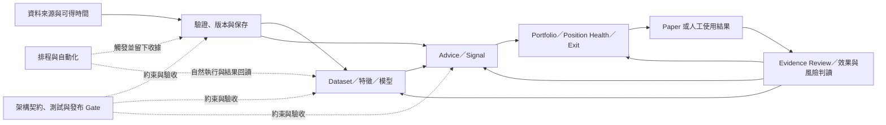

# 開發線路與演進狀態矩陣（2026-10-11）

> 本文件把既有文件治理清冊、Scoped SSOT、Roadmap Gate 與日期化 QA 收據映射成開發線路及其反覆迴圈。全 docs 基線清冊已建立；本矩陣是線路專項核對的第一版，不宣稱每份文件內容都已逐一重讀或所有線路都已完成狀態裁決。
>
> 文件治理清冊基準中的 35 個 dirty／受保護路徑不作內容證據。後續工作樹狀態有變動，dirty／受保護路徑仍只依 status 排除；目前同步中的完成計畫未開啟。一次批次讀取意外包含 dirty 的 `DOCUMENTATION_STATUS_MATRIX_20261009.md`，輸出遭截斷且已明確排除、不採用。全專案現況權威 `PROJECT_SNAPSHOT.md` 仍是 dirty，因此下文的「最近狀態」只代表引用收據記錄的時點，不等於 2026-10-11 即時狀態。

## 判讀方式

每條線分開記錄四件事：

1. **方向／契約**：由 Scoped SSOT 或目標架構定義用途與邊界。
2. **迴圈**：從輸入或計畫，經實作、驗證、實際使用，再回到證據審查或修正的閉環。
3. **現況證據**：只引用有明確日期、範圍、資料／程式版本與結果的收據；計畫、設定存在、合成測試或單次成功都不自動等同全流程驗收。
4. **處置**：錯誤的現行權威內容要以證據修正；正確但已過時的歷史描述保留並標明時點／效力；未解矛盾維持待核，不猜測裁決。

全域文件分類及逐檔 OID／行數清冊見 [DOCUMENT_GOVERNANCE_STATUS_MATRIX_20261011](DOCUMENT_GOVERNANCE_STATUS_MATRIX_20261011.md) 與 [DOCUMENT_GOVERNANCE_PATH_MANIFEST_20261011](DOCUMENT_GOVERNANCE_PATH_MANIFEST_20261011.csv)。文件生命週期及刪除門檻依 [DOCUMENTATION_STRUCTURE](DOCUMENTATION_STRUCTURE.md)；只在沒有 Active 入站引用、沒有歷史保留必要、內容已由更完整文件取代，且屬一次性 debug／patch／單日草稿等條件均成立後才考慮刪除。

## 線路與反覆迴圈

| ID | 開發線路 | 主要迴圈／獨立出口 | 權威與導航入口 | 目前專項核對狀態 |
|---|---|---|---|---|
| L0 | 產品方向、工程 Gate、文件治理 | 產品問題 → Roadmap Gate → 工程交付／證據 → Snapshot 回寫 | [PRODUCT_ROADMAP_POST_REFACTOR](PRODUCT_ROADMAP_POST_REFACTOR.md)、[ROADMAP_6M_ENGINEERING](ROADMAP_6M_ENGINEERING.md)、[VERSION_ROADMAP_V2_1_TO_V4_0](VERSION_ROADMAP_V2_1_TO_V4_0.md) | 路線與 Gate 入口已映射；實際進度須讀 Snapshot，本輪因 dirty 未核。 |
| L1 | 資料來源、讀取、更新、品質與保存 | 來源資格／可得時間 → 擷取 → fail-closed 驗證 → CSV／SQLite → freshness／consumer readback → reconciliation／補救 | Product Roadmap §11；[DATA_FETCHING_LOGIC](../03_data/DATA_FETCHING_LOGIC.md)、[daily_data_update_guide](../03_data/daily_data_update_guide.md)、[HOW_TO_UPDATE_DAILY_DATA](../03_data/HOW_TO_UPDATE_DAILY_DATA.md) | 17 份 `docs/03_data/` 清潔文件已全文核對；最近的各項收據到 10/09，但非即時資料根／DB 狀態。存在 MOPS reconciliation 與 no-data 實跑收據缺口。 |
| L2 | 排程、自動化與運維 | task／trigger／來源與 DB pins → producer → consumer → 自然執行 → 結果回讀 → 失敗恢復／下一輪 | [BALDR_SCHEDULED_AUDIT_RUNBOOK](../07_guides/BALDR_SCHEDULED_AUDIT_RUNBOOK.md)、[SCHEDULE_OPERATIONS_AND_MIGRATION](../07_guides/SCHEDULE_OPERATIONS_AND_MIGRATION.md)、Operations QA Index | 已讀到 10/09 全排程回讀；尚無可核對的 10/10–10/11 自然執行收據。Ready、exit 0 或設定存在不能單獨作為 pipeline closeout。 |
| L3 | Evidence、QA 與效果回饋 | 假設／版本 → 固定資料與時間界線 → 可重播驗收 → 人工 Evidence Review → 接受、限制、降級或重做 | Product Roadmap §10；6M Gate 2；[docs/06_qa/README](../06_qa/README.md)、Evidence Runbooks | Gate 2 可有 35/35 純工程完成，但外部接受、人工 review、授權與時間成熟度仍分開；10/10 最新乾淨補完收據仍列自然結果及產品接受待驗。QA 日期收據不能當現況 SSOT。 |
| L4 | Advice、Signal 與策略研究 | source／feature → signal／解釋 → 成本與風險檢查 → 使用回饋／前瞻證據 → pruning／保留決策 | Product Roadmap §§7、10、16；6M Gates 1、5；[SCORE_EXPLANATION](../02_features/SCORE_EXPLANATION.md) | 已完成第一輪專項核對；10/10 收據仍列 P07 策略規則／executor、多策略共振、正常 UI consumer 與 P11 自然 outcome／公平比較未完成。Gate 5 尚需 forward／paper 證據與可回復 pruning 決議。 |
| L5 | Portfolio、Position Health 與 Exit | 持倉／策略版本 → 風險預算與判斷 → 人工動作／override → 理由與結果證據 → review | Product Roadmap §§8–10、16；6M Gates 4、6；Final Target Architecture | 已完成第一輪專項核對：Paper selected route 是 bounded synthetic 接線，Formal／自然 Task／migration 未驗；Position Health 仍 proposal-only／degraded；Exit root operational readback pending。R016 仍列兩個 exact raw caller 未 cutover。 |
| L6 | ML、dataset、特徵與模型生命週期 | custody／可得時間／cutoff → dataset／feature 版本 → fit／calibration → artifact pins → shadow inference → horizon outcomes → hold／promote／retire | Product Roadmap §12；[FINAL_ML_COMPATIBILITY_CONTRACT](../01_architecture/target_architecture_2026_09_22/FINAL_ML_COMPATIBILITY_CONTRACT.md)、[FINAL_TARGET_ARCHITECTURE](../01_architecture/target_architecture_2026_09_22/FINAL_TARGET_ARCHITECTURE.md)、ML QA receipts | 已做第一輪專項時間序。全域 Snapshot 狀態未核；10/11 時序補記確認個人 H20 的 10/07 有界效果與產品讀回，但自然 outcome 尚未成熟、Task 未實跑；不是正式 PIT、全市場資格或 global promotion。 |
| L7 | UI／Workbench、使用者流程與發布接受 | 需求／契約 → Qt／EXE 實作 → offline／合成與自然流程 → 固定版本 journey → 真人驗收 → 回饋 | Product Roadmap §§6、20；Application Manual；Product UX QA Index | 已完成第一輪專項核對：F17 有局部產品接線，但完整 Main／H20／EXE／真人驗收未完成；P13／P14 仍待接受。UX 索引已補入 10/10 bounded G 讀回，並明示其一般報告 guard 與完整驗收限制；本機 package 收據仍只適用舊 tree。 |
| L8 | 架構、重構與跨域整合 | 現況邊界 → 目標契約 → scoped change → 測試／consumer cutover → integration receipt → release／回滾 | [system_architecture](../01_architecture/system_architecture.md)、[FINAL_TARGET_ARCHITECTURE](../01_architecture/target_architecture_2026_09_22/FINAL_TARGET_ARCHITECTURE.md)、6M Gate 0 | 已完成第一輪專項核對：FINAL 是目標設計權威，不是實作證據；R031／R027／R028 closeout 僅有日期與範圍界線。現行 `system_architecture.md` dirty 未讀；Phase 3.3B headline 與 checklist 衝突仍待同範圍收據。 |

Gate 是交付與驗收邊界，線路則是會跨 Gate 演進的領域。因此 ML 可以依賴 Gate 2 的證據、Gate 3 的資料資格與 Gate 7 的條件式 Shadow；排程可以服務多條線路，但每條線仍需各自的 consumer 結果與 closeout。不能用「一個 Gate 完成」或「Graphify 社群」代替線路狀態。

## 已核對的主要演進與狀態切片

### L1 資料來源、讀取、更新與保存

| 時點 | 可核對演進 | 解讀邊界 |
|---|---|---|
| 2026-08-28 | `DATA_UPDATE_PERFORMANCE_BASELINE_2026_08_28.md` 記錄唯讀量測與 isolated staging，CSV 全批讀取／normalize／group 是主要成本，SQLite staging probe 看見 lock／retry。 | 非 production write、worker 或正式 parallelism 授權。 |
| 2026-09-18 | TPEX source-gap diagnostics 後續以官方歷史原件、insert-only SQLite 回補；precaptured readback 記 868 列。 | 證明特定歷史回補，不證明當時 PIT 可得時間或自然排程成功。 |
| 2026-09-18 | maturity annual cache 有 expiry、hash、coverage 與 fail-closed consumer 驗證；`temporary_closure_coverage=not_covered`。 | 每次 consumer evaluation 需重驗；一次有效不代表永久有效，計畫日曆亦不能替代實際價格／成熟結果。 |
| 2026-10-01 | `V2_3_P0_SOURCE_ACCEPTANCE_REGISTER.md` 保留 MOPS 7/27 `limited` 與 8/28 `accepted=0 limited=0` 的差異，明載待 reconciliation。 | 不推定來源資格已接受或撤銷；需核原始 audit input／registry。 |
| 2026-10-09 | 兩批 C-drive cold archive receipts 記 34 根目錄、158,712 檔與 184.62 logical GiB。 | 日期化搬移／保全收據，不代表目前容量、root 狀態或實際配置空間。 |

資料更新權威描述官方 TWSE／TPEx 原始資料 → CSV → SQLite upsert → 指標更新，並保留來源日期、receipt、取消與錯誤邊界。只有精確且已驗證的官方 no-data 回應可作 warning 後繼續；傳輸、解析、日期或其他錯誤 fail closed。現有清潔指南說明了契約，但此次未找到專門的 no-data 實跑 closeout 收據，故該執行分支仍欠一份可核對 evidence。來源可得時間、coverage、授權、PIT 與正式下游資格必須獨立判讀。

重要可核對來源：`docs/00_core/PRODUCT_ROADMAP_POST_REFACTOR.md` §11.1 lines 264–272；`docs/03_data/daily_data_update_guide.md` lines 122–149；`docs/03_data/DATA_FETCHING_LOGIC.md` lines 123–150；`docs/06_qa/V2_3_P0_SOURCE_ACCEPTANCE_REGISTER.md` line 204；`docs/06_qa/SCHEDULER_FRESHNESS_QUICK_BINDING_20261001.md`。

### L2 排程與自動化

| 時點 | 可核對演進 | 解讀邊界 |
|---|---|---|
| 2026-09-29 至 10-01 | 9/29 receipt 記錄 21/21 tasks、wrapper、action 與 schedule 可用；修復後仍要求下一次自然執行。9/30 與 10/01 補記保留 blocked、degraded、research-only 結果。 | 設定完整不等於整條 pipeline 或來源資格通過。 |
| 2026-10-06 | 本機 Codex automation 稽核為 49 項中 46 PAUSED、3 ACTIVE；Windows 21 tasks 最近結果為 12 個 0、2 個 1、7 個 2。 | Codex automation、heartbeat metadata 與 Windows task execution 是不同物件與證據。 |
| 2026-10-07 至 10-08 | 修正鎖、部分資料讀取與背景 launcher 等；10/08 receipt 仍列 Operational log disabled 及新的 background action 待自然 run 驗收。 | 10/08 是當日時點，不能覆蓋後續狀態。 |
| 2026-10-09 | 最後一份已核全排程回讀是 21/21 tasks 存在且啟用、20 Ready、1 Running；Operational log 已啟用。05:40 Forward blocked／exit 2，05:45 learning failed／exit 1。 | 這只證明 10/09 查核與當次失敗；文件預列的 10/10 NextRun 不證明 10/10 或 10/11 成功。 |

排程出口必須按實際 trigger、查核時間、Scheduler 結果、producer 與 consumer 結果逐輪核對。下一份狀態更新應加時間戳並同時記錄上述欄位，而不是重寫舊收據。

重要來源：`docs/07_guides/BALDR_SCHEDULED_AUDIT_RUNBOOK.md`；`docs/07_guides/SCHEDULE_OPERATIONS_AND_MIGRATION.md`；`docs/06_qa/BALDR_SCHEDULE_AUDIT_20261006.md`；`docs/06_qa/BALDR_SCHEDULE_REPAIR_20261007.md`；`docs/06_qa/BALDR_SCHEDULE_REPAIR_20261008.md`；`docs/06_qa/BALDR_SCHEDULE_REMEDIATION_20261009.md`。

### L6 ML、dataset、特徵與模型生命週期

| 時點 | 可核對演進 | 解讀邊界 |
|---|---|---|
| 2026-07 至 08 | Shadow 設計中的 150 features／8 packs 是 research union；62-feature reference 是另一個凍結參照。7/30 工程／8/30 checkpoint 當時記 Formal inputs 0/3、未評 calibration／OOS，alpha 0。 | 不把不同 registry／用途的特徵數相加；不推定 promotion 或投資有效性。 |
| 2026-09-22 至 23 | Final ML compatibility contract 凍結既有 ABI，新增特徵需獨立 registry、dataset 與 model version；9/23 restated v2 研究重建合併 3,496,189 rows。 | Restated／current research data，不是 historical PIT、正式 OOS 或產品放行。 |
| 2026-09-30 至 10-03 | raw source row hook 接線；raw collector 不產 features／labels。特定 Direct/B、CORE19 train/save/new-process inference 有收據。 | Hook 尚缺自然 Task 驗收；rebuild 仍 current-restated／non-PIT，alpha 0，未 promotion。 |
| 2026-10-07 至 08 | Fundamental snapshot 標示 current-observed-only、availability unknown、historical/formal PIT false；F02 收據只核到七個已保存特徵，MA10／MA60 不存在。 | 不把 current observation 升格為歷史可得資料；四均線排列仍待獨立版本與保存／UI／EXE 路徑驗證。 |
| 2026-10-07（10/11 時序補記） | 個人 H20 integration receipt 記 revision 1 enabled、10 筆保存預測與產品 readback，10 pending／0 matured；Task 尚未實跑。 | 有界私人 current-observed 研究流程 evidence；不是全市場排序、正式 PIT 或 global promotion。 |

`docs/06_qa/SCHEDULER_ML_DAILY_SOURCE_ROW_PROJECTION_20261001.md` 原 line 60 的「hook 尚待實作」已由 2026-10-11 日期化 erratum 釐清為早期階段描述；後續 hook 與 rebuild receipt 證明程式 hook 已接線，自然 Task 驗收仍待。cutoff、PIT 與研究用途限制保留，沒有改寫成自然排程已通過。

ML 待追蹤的分離里程碑：source custody／available-at／cutoff；dataset 與 feature registry/version；artifact／manifest pins；新程序 inference readback；自然排程收據；5／10／20／60 horizon 自然成熟 outcome；正式 hold／promotion／retirement 決策。不得把個人 H20、research restatement、shadow union 或 source-row hook 合併成同一個「ML 已完成」狀態。

重要來源：`docs/00_core/PRODUCT_ROADMAP_POST_REFACTOR.md` §12；`docs/01_architecture/target_architecture_2026_09_22/FINAL_ML_COMPATIBILITY_CONTRACT.md` lines 58–95；`docs/06_qa/BALDR_PERSONAL_MODEL_ACTIVATION_INTEGRATION_20261006.md` lines 102–120；`docs/06_qa/BALDR_CENTRAL_COHORT_NATURAL_BBUI_INTEGRATION_20261007.md` lines 48–54；`docs/06_qa/F02_SAVED_FEATURE_GAP_20261008.md` lines 7–23。

### L3 Evidence／QA 與回饋閉環

6M Gate 2 的設計要求真實週期 review、append-only action item、人工核准與 recovery；replay、dry-run 或單次排程 exit 0 不可替代 forward evidence。`GATE_2_TO_7_ENGINEERING_CONTROL_CENTER.md` 記錄 35/35 純工程項目完成，但仍固定 `formal_product_closeout=false`，並將 owner、人工審核、時間成熟及授權分開。`GATE_2_TO_7_EXTERNAL_VALIDATION_REGISTER.md` 是歷史收據，最後列出的 Formal Week 7 為 2026-08-30、credit 0；應保留原始時點，後續另開日期化 revision。

最新可讀的 10/10 乾淨產品補完收據仍把自然結果、下一次真排程、產品接受與新版本 EXE 列為待驗；合成旅程通過不等於真人或發布接受。狀態線路應保留政策／Gate、工程通過、外部 evidence、產品接受、release 接受五個獨立欄位。重要來源：`docs/00_core/ROADMAP_6M_ENGINEERING.md` lines 148–194；`docs/06_qa/GATE_2_TO_7_ENGINEERING_CONTROL_CENTER.md` lines 85–113；`docs/06_qa/GATE_2_TO_7_EXTERNAL_VALIDATION_REGISTER.md` lines 155–164；`docs/06_qa/BALDR_PRODUCT_COMPLETION_STATUS_20261010.md` lines 20–23、44–53；`docs/06_qa/BALDR_COMPOSITE_HUMAN_CHECK_20261010.md` lines 1–9、28–36。

### L4 Advice、Signal、策略與 Backtest

Advice 契約要求來源理由、風險、證據層級、策略版本與資料截止日，且必須能拒絕輸出；歷史 replay 只供研究／缺口診斷，不計 forward gate。Gate 1 可停在 read-only／paper，不授權自動交易；Gate 5 要求真實 evidence cadence、paper／Portfolio outcome、凍結的 Experiment Contract、足夠樣本，以及可回復的保留／限制／降權／退休決議。

| 時點 | 可核對演進 | 解讀邊界 |
|---|---|---|
| 2026-01-02 | Baseline 策略設計保存舊 promote 門檻與操作流程。 | 已標為歷史快照；不拿舊 walk-forward 百分比作現行 Gate。 |
| 2026-09-06 | Backtest execution/save 契約記錄 next-session-open、成本與 Registry 行為。 | 固定組合逐檔研究不等於共享現金 Portfolio。 |
| 2026-09-08 至 10 | V4 effectiveness read model／producer 有工程接線收據。 | 正式 DB ready outcome 當時為 0；不代表投資有效性或 promotion。 |
| 2026-09-10 | V4.1 calibration slice 為 research-only；正式 evidence DB 0 成熟 observations、0 folds、`not_evaluable`。 | challenger Brier 與原方法相同，保留原方法；無正式推薦或 promotion 接線。 |
| 2026-10-08 至 11 | F02 已保存特徵有七項，MA10／MA60 缺失；UX21 有 outcome adapter／唯讀 UI 局部接線補記。 | 不等於四均線完成、自然投資 outcome 或正式資格。 |
| 2026-10-10 | 最新乾淨產品成熟度收據仍列 P07 規則／executor、多策略共振／UI consumer 與 P11 自然 outcome／公平比較未完成；真人驗收仍待。 | 固定合成效能與自動化旅程不得升格為策略績效或真人接受。 |

`docs/02_features/BACKTEST_LAB_FEATURES.md` 原「判斷策略好壞」描述已窄幅改成歷史回放個股／條件診斷，並明示不單獨構成訊號或策略有效性證據。其餘舊 Strategy 設計、Backtest FAQ／checklist／Registry 規格已有歷史標記或 redirect，應保留。下一個獨立出口是 Gate 5 的 OOS + forward／paper 比較及有 rollback 的 pruning 決議；Gate 1 UI／真人接受另行驗收。

重要來源：`docs/00_core/PRODUCT_ROADMAP_POST_REFACTOR.md` §§5–7、10、16；`docs/00_core/ROADMAP_6M_ENGINEERING.md` Gates 1、5；`docs/02_features/BACKTEST_LAB_FEATURES.md`；`docs/06_qa/V4_EFFECTIVENESS_READ_MODEL_2026_09_08.md`；`docs/06_qa/V4_1_RECOMMENDATION_CALIBRATION_VERTICAL_SLICE_2026_09_10.md`；`docs/06_qa/BALDR_PRODUCT_COMPLETION_STATUS_20261010.md`。

### L5 Portfolio、Paper、Position Health 與 Exit

Product Roadmap §8–9 與 Gate 4／6 的出口分別要求 versioned policy、相同 universe／成本／限制比較、完整 Position Health 轉移矩陣、人工 override 與可追溯 evidence；不接 broker、不自動賣出、不以缺資料判正常。目標架構指定 create-only artifact 為真值、SQLite 為可重建索引，但仍是目標設計，不能當成完成收據。

- **Portfolio／Paper：** B06／B09 與第二波收據只接受 selected routes／paths 的 bounded synthetic 接線；P1 ledger／P2 producer 有 synthetic custody、readback 與 market-alias guard。Formal 資格、真實資料啟用、migration、自然 Task 與完整 Paper 鏈仍未驗。下一出口需用同一 identity／日期綁定端到端 producer、capture、ledger、benchmark、consumer readback。
- **Position Health：** 9/08 source-to-caller readback 為 3 active positions、0 proposals、degraded；entry identity、thesis、PIT condition、Decimal metrics 不足。9/15 typed read model 處理通過，但 `research_only=true`；缺件時降為 WATCH／unknown 是正確結果。下一出口需自然且可核 fill 的 entry lineage、有效 thesis、PIT condition、Decimal metrics、verified calendar、完整轉移矩陣及 reviewer-backed approval。
- **Exit：** 10/02 dry-run QA 修正 SQLite 寫入及 Taipei／Pacific 日期錯位，改成 source read-only 並以 producer Taipei date 驗 artifact；root-owned operational readback 仍 pending。下一出口是同一來源 bytes 未變、日期與 artifact identity 正確且 readback 通過的具名收據。
- **R016 cutover：** 227 passed／1 skipped 是合成 saved-result consumers 的工程接受，不是全 repo raw-reader closure。兩個仍未解 exact caller 是 `app_module/user_declared_holding_research.py:774–807` 與 `ui_qt/views/portfolio_view.py:2947–3000`；需指定 owner，分別提交 exact caller cutover／fail-closed readback receipt。

重要來源：`docs/00_core/PRODUCT_ROADMAP_POST_REFACTOR.md` §§8–9、16；`docs/00_core/ROADMAP_6M_ENGINEERING.md` Gates 4、6；`docs/01_architecture/target_architecture_2026_09_22/REFACTOR_REPORTS/R016_CONSUMER_CUTOVER_IMPLEMENTATION_REPORT.md` lines 5–16、41–42、98–104；`docs/06_qa/V4_POSITION_HEALTH_SOURCE_CALLER_GAP_MAP_2026_09_08.md` lines 21–46、62–76；`docs/06_qa/POSITION_HEALTH_INCREMENT_1_QA_2026_09_15.md` lines 5–27、39–50；`docs/06_qa/EVIDENCE_DRY_RUN_READONLY_EXIT_DATE_QA_20261002.md` lines 3–22。

### L7 Workbench、UI 與發布接受

UI receipts 分清 Main／EXE、合成母體／完整母體、正常 consumer／隔離研究視圖、真人操作與來源資格。10/09 F17 有真 worker／producer／writer 的部分接線，但完整 Main、原 H20、EXE 與真人接受仍未完成；10/10 composite human check 使用 1000／1256 合成來源，明示自動旅程通過不等於真人或 H20／2382 驗收。10/10 最新產品狀態仍將 P13 full product acceptance、P14 new-code portable acceptance 列為未完成；Q13 p95 也仍高於 300ms candidate 門檻。

兩個導覽入口已窄幅更新：`PRODUCT_UX_QA_INDEX.md` 將 10/10 G 原保存來源 bounded Main 讀回列為較新證據，並把 O attempt02 標為歷史失敗；`ROADMAP_6M_ENGINEERING.md` 增列 10/10 日期化產品狀態收據，保留 10/09 handoff。G 的一般報告唯讀 guard 仍阻擋，不能據此宣稱完整接受。本機 Main packaging 收據固定驗收於舊 `a8c81...` tree，main 後來前進到 `30563564...`；乾淨安裝與空資料根 offscreen 啟動不等於後續 commit、Native、真人或公開發布接受。

重要來源：`docs/06_qa/PRODUCT_UX_QA_INDEX.md` lines 3–16、31–52；`docs/06_qa/BALDR_F17_NORMAL_PRODUCTION_UI_REVIEW_20261009.md` lines 11–35；`docs/06_qa/BALDR_COMPOSITE_HUMAN_CHECK_20261010.md` lines 7–20、28–36；`docs/06_qa/BALDR_PRODUCT_COMPLETION_STATUS_20261010.md` lines 10、20–25、44–53、79；`docs/06_qa/BALDR_LOCAL_MAIN_PACKAGING_20261007.md` lines 3–9、19–32。

### L8 架構、重構與跨域整合

目標架構 README 與 `FINAL_TARGET_ARCHITECTURE.md` 指定 FINAL 為唯一目標設計權威，同時明示不表示已實作；`REFACTOR_VALIDATION_MATRIX.md` 描述的是計畫中的驗收 bundle。`FINAL_MIGRATION_SEQUENCE.md` 與 9/25 R031 closeout 僅證明其各自日期與範圍內的 R031／R027／R028 狀態，不能推作目前 code tree 或全 repo 依賴清理。

現行架構比較仍待 `system_architecture.md` 乾淨後再核；乾淨架構 README 提醒該文第 16 節混有穩定契約、QA 摘要及日期狀態。本輪不以 target design 代替 current implementation。發布文件須分開列「準備」「固定 tree 的本機 package」「後續提交未重驗」「真人／公開接受」，避免把一次 package receipt 升格為目前 release。

重要來源：`docs/01_architecture/target_architecture_2026_09_22/README.md` lines 3–19；`FINAL_TARGET_ARCHITECTURE.md` lines 3–7、20；`REFACTOR_VALIDATION_MATRIX.md` lines 3–5；`FINAL_MIGRATION_SEQUENCE.md` lines 3–29；`REFACTOR_REPORTS/R031_FINAL_REFACTOR_CLOSEOUT_20260925.md` lines 63–67、107–119；`docs/06_qa/BALDR_LOCAL_MAIN_PACKAGING_20261007.md` lines 3–32。

## 待核問題與文件處置

| 項目 | 分類 | 建議處置 | 狀態 |
|---|---|---|---|
| MOPS 7/27 `limited` 與 8/28 `accepted=0 limited=0` | 來源接受權威／receipt reconciliation | 核原始稽核輸入及 registry 後更新現行接受狀態；歷史 receipt 保留。 | 未解 |
| 專名 no-data 分支缺少實跑 closeout receipt | 資料更新證據缺口 | 新增一次具名來源、request diagnostics、response hash、處置步驟與 DB／下游 readback 的驗收收據。 | 待補證據 |
| ML projection 中「hook 尚待實作」 | 過時歷史句子，後續接線已證明 | 2026-10-11 已加日期化 erratum 為「已接線、自然 Task 待驗」；保留當時 research／cutoff 界線與原始收據。 | 已窄幅修正 |
| Backtest 文件「判斷策略好壞」措辭 | 研究 UI 描述容易被誤讀為有效性證據 | 改成歷史回放的個股／條件貢獻診斷，明示不單獨證明訊號／策略有效。 | 已修正 |
| UX Index 的 H20 導覽晚於 10/10 bounded G readback | 舊 O attempt02 失敗記錄曾排在候選位置 | 索引新增 G 最近 bounded 收據、O 標成歷史；保留完整 H20／P13 未接受界線。 | 已更新 |
| 10/09 handoff 與 10/10 產品狀態證據 | 導覽時點較舊，不是內容錯誤 | 6M Roadmap 增列 10/10 狀態 receipt 入口，保留 10/09 handoff 作歷史交接。 | 已增列 |
| 10/09 排程 readback 與 10/10／10/11 現況 | 日期快照界線 | 新增當次 readback；不改寫 10/09 原始收據。 | 待新收據 |
| 2025 OOS custody／usage gate | Evidence 使用資格衝突 | 取得現行 signed custody／QA receipt 前，不推定 2025 可作正式 OOS。 | 未解 |
| 歷史 automation 12／15、R002 coverage 8／9 | 歷史文件內部數字張力 | 不猜數；若無原始收據，標明日期／範圍與差異即可。 | 歷史保留 |
| Portfolio／Exit 的兩個 raw caller cutover | consumer 邊界 | 在 R016 exact caller 範圍取得 cutover receipt，並納入相應線路出口。 | 未收斂 |
| Phase 3.3B headline 與 checklist 不一致 | 工程完成狀態衝突 | 取得同範圍驗收 receipt 後修正權威狀態；不能只依 headline 宣稱完成。 | 未解 |
| 補完計畫狀態、dirty Snapshot／架構／Manual／其他 dirty docs | 正在更新的權威或受保護文件 | 本輪不讀、不編輯；待工作樹乾淨或文件 owner 完成後，以新快照重核現況。 | 刻意待核 |
| 外部 Blueprint §7 未日期化「目前已具備」清單 | 權威文件過時風險 | 逐項加日期／receipt，或改為導向 Snapshot／Product／6M scoped SSOT。 | 待核 |

## 下一輪治理順序

1. Snapshot 與相關同步文件乾淨後，先核對 L0 全域狀態，再刷新本表「最近狀態」欄位；本表不取代 Snapshot。
2. 完成資料來源資格／MOPS、自然排程、ML Task 與成熟 outcome、Paper／Exit operational readback、R016 exact caller cutover、Gate 5 forward evidence、真人／新版本 EXE 接受等獨立出口。
3. 依文件生命週期政策處理待修措辭與導覽入口；保留不同時點正確的歷史收據。只有 owner／Gate 結案、替代入口明確、依賴解除或保留 redirect 後，才評估搬入 Archive 或刪除。
4. 所有線路、文件批次與變更定稿後才刷新與驗證 Graphify，並核對 HEAD 與來源快照一致。

## 核對來源

- 全域分類與逐檔來源：`DOCUMENT_GOVERNANCE_STATUS_MATRIX_20261011.md`、`DOCUMENT_GOVERNANCE_PATH_MANIFEST_20261011.csv`。
- 線路方向與 Gate：`PRODUCT_ROADMAP_POST_REFACTOR.md`、`ROADMAP_6M_ENGINEERING.md`、`VERSION_ROADMAP_V2_1_TO_V4_0.md`。
- 歷史與證據處置：`DOCUMENTATION_STRUCTURE.md`、`docs/06_qa/README.md` 及各線路日期化 QA receipts。
- 本表引用的日期化 QA 不取代目前狀態權威；Graphify communities 是導航群集，不是穩定的產品線路或工作狀態。
