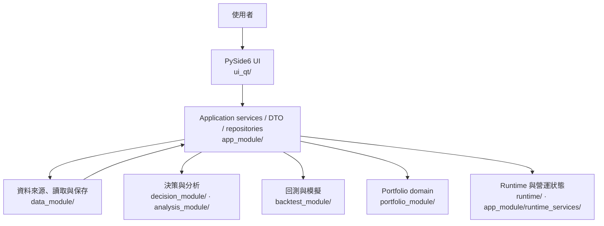

# 目前系統架構

> 本文件是 current 模組、資料流與責任邊界的入口，不記錄逐日進度。完成度看 [PROJECT_SNAPSHOT](../00_core/PROJECT_SNAPSHOT.md)，產品方向看 [Product Roadmap](../00_core/PRODUCT_ROADMAP_POST_REFACTOR.md)，目標實作設計唯一權威是 [FINAL_TARGET_ARCHITECTURE](target_architecture_2026_09_22/FINAL_TARGET_ARCHITECTURE.md)。

## 系統用途

原回測PF以有語意版本的nullable分析值傳遞，零分母／無配對不顯假零或金額；batch／optimizer／保存與舊比較隔離沿[current分冊](current/decision_research_portfolio.md)，不遷移正式資料或升級舊值。

新單股研究結果沿原 analyzer、Registry 保存與歷史卡讀回；七項原指標以 `single-backtest-performance.v1` 綁原值、狀態、實際計算期間與表格證據。舊資料缺版本不回填，新版本不授績效資格或 Decimal 核心精度；詳見[決策與研究 current 分冊](current/decision_research_portfolio.md)。

baldr 是台股研究與投資決策系統。它收集與治理市場資料，提供市場觀察、推薦、回測、研究證據與持倉檢視。Advice、Paper、Live 與 broker execution 是不同權限；架構中有研究或 shadow 模組不等於產品 Gate 已通過。

## 分層與實際模組

決策擷取的終態 reader 位於 application 層，重用原 producer receipt／artifact 與檔案守衛，供 Runtime 營運狀態及 Workbench 共用；Qt 不自行讀檔或根據 passed 字串授成功。原件、時鐘、讀取預算、取消及保存未知的契約見[Runtime 與排程](current/data_storage_runtime.md#runtime-與排程)，不改正式 Task 或資料根。



`financial_module/` 提供金融數值單位；`ml_module/` 與 `development_module/` 承載受限制的研究／模型流程。這些 package 在 repo 中存在，但其產品資格仍須按 Snapshot、產品 Gate 與具名 QA 判讀。

依賴方向由 UI 經 application 到領域與資料邊界。Qt 不成為 domain 計算 owner；資料 reader 不自行決定 Advice；Runtime 不持有推薦公式。`ui_qt/main.py` 是 Qt 主程式入口，Windows 啟動由 `baldr_launcher.py` 導入既有 composition。

法人固定批次唯讀路徑沿 UpdateView → UpdateService → `institutional_daily_snapshot` → 原capture／parser，原件、時鐘及資格由application reader核驗，widget只呈現。TPEx可另明選`institutional_source_use`的外部SHA契約，重用DailySourceUseAcceptance，固定官方文件／市場／schema／股數／diagnostics；一次接受與逐批品質小時分離，generic P0 v1決議及其他來源資格不變。具體保存／讀回界線見[資料架構](current/data_storage_runtime.md#讀寫與保存契約)。

## 九個工作區與閱讀路徑

保存母體的四路同 callback Projection Group V3 是 application backend 的 opt-in seam；MA／KDJ／volatility 與 F07 facts 共用 exact verified parent，來源 ledger、population 及 canonical digest 綁同 session。既有 V2、UI／query／bookmark 仍依各自入口，未由新增 backend 宣稱完整比較工作流完成。責任邊界見[UI 與應用流程](current/application_and_workspaces.md)。

目前 UI 有決策工作台、市場探索、推薦分析、策略回測／Research Lab、觀察清單、個股研究、持倉管理、數據更新及 Runtime Observatory。Daily Decision Desk 位於「市場探索 > 市場總覽」；決策工作台的來源導覽回到同一畫面。

依問題閱讀：[UI 與應用流程](current/application_and_workspaces.md)、[決策、研究與 Portfolio](current/decision_research_portfolio.md)、[資料、保存與 Runtime](current/data_storage_runtime.md)。使用者操作流程以 [Application Manual](../07_guides/APPLICATION_MANUAL.md) 為準。

## 主要資料流

```text
TWSE／TPEX 與其他明示來源
  → data_module/ 的 raw source／SQLite 更新
  → app_module/ provider 與 use case
  → decision_module／analysis_module／backtest_module／portfolio_module
  → DTO、Research Run／Evidence 或受控保存結果
  → ui_qt/ 工作區呈現
```

更新、查詢、推薦、回測與持倉各走明示 application service。Recommendation 與市場 read model 先核對決策日、資料可得日、品質與來源，再交給領域計算；UI 呈現已形成的 DTO，不暗中補資料或重算。保存研究以 manifest、source identity 與原始 bytes 綁定，重讀指定版本，不以最新資料取代舊結果。

配置研究封存的個股路徑共用 Main 注入的 scenario workspace，以帳種、portfolio、artifact 三項參照讀取原帳戶投影；不經目前手動持倉補值。已保存情境可明確追加 typed reference 至既有 Registry SQLite 的獨立配置研究表，正常 Registry 選列以引用 SHA 及原件重新交叉核對再回 Portfolio；不假造回測 metadata 或改舊 run。canonical hash、來源及原時鐘守衛見[決策／研究／持倉分冊](current/decision_research_portfolio.md)。

## 儲存與排程

正式資料路徑以 `data_module/config.py` 的 `TWStockConfig` 為準。`DATA_ROOT` 預設 `D:/Min/Python/Project/FA_Data`，可由 `DATA_ROOT` 覆蓋；主要市場資料庫是 `<DATA_ROOT>/sqlite/twstock.db`。`OUTPUT_ROOT` 也由同一設定管理。SQLite-first 是一般讀取優先序，raw CSV 保留來源、備份及明示 fallback。

Windows Scheduler 與受控 CLI wrappers 分別執行資料更新、Evidence dry-run 或經批准的工作。Runtime Observatory 只讀 Runtime 與排程狀態，不啟動任務。正式市場資料寫入、Evidence write-mode、策略 lifecycle 與 broker execution 使用分離權限；排程狀態或零錯誤碼不授予產品接受。

儲存、source cutoff、snapshot identity、SQLite 讀寫與 runtime custody 的穩定細節見[資料、保存與 Runtime 分冊](current/data_storage_runtime.md)。

每日新來源保存的小時可用性、批次／版本釘定與來源用途接受依[每日快照契約](../03_data/DAILY_SOURCE_SNAPSHOT_CONTRACT.md)；接入沿既有 data reader／更新服務邊界，隔離抓取成功不等同正常 UI、正式排程或完整產品接受。

Research Lab Registry的雙run期間診斷由application exact reader負責metadata／附件／日曆版本核對，Qt controller只固定選取與背景讀回世代，不擁有PnL計算或來源資格；詳[研究與Portfolio邊界](current/decision_research_portfolio.md)。

日曆用途接受可由正常Main明示的外部SHA固定binding注入；配置只固定既有typed錨點，仍由原表單選exact batch，失敗只隔離daily用途。Main設定副本與worker生命週期見[主程式邊界](current/application_and_workspaces.md#研究畫面與保存身份)。

原next-open執行輸入沿正常保存入口明示寫入additive V3附件，內嵌原V1／V2文件並重用同一Registry staging／CAS／恢復流程；public reader讀回原None／0、有效成本與lot，pair沿原capture比對。V3預設讀前16MiB上限與取消／完整性守衛保留；輸入hash不授金融來源或implementation資格。

日曆完整JSON transport與daily batch沿原calendar parser分層：data保存HTTP完整原件識別，application提供create-only批次與外部manifest／receipt SHA、獨立用途接受錨點的exact reader。原Registry頁可明示artifact或daily source；daily pin固定雙SHA、兩個typed接受錨點與aware cutoff，沿同一pair reader前後讀回。正常Main／fresh已用隔離合成錨點限定驗證，真來源接受與正式Main配置仍缺；批次小時不授歷史PIT／績效資格，詳[每日版本契約](../03_data/DAILY_SOURCE_SNAPSHOT_CONTRACT.md#日曆完整json批次increment21)。

## 重要不變條件

- 不破壞正式 raw source；資料遷移或全量重建走備份、確認及可復原流程。
- 未知或晚於決策日的來源保持 unknown／missing；不得以未來資料回填歷史決策。
- 策略、回測、Portfolio、成本與風控等金融核心使用 Decimal 或整數單位；float 只在隔離的分析／展示邊界。
- UI 不重做領域計算；唯讀畫面不建立資料庫、schema、producer 或 scheduler。
- Replay、OOS、shadow、forward、paper、live 與 production 是不同證據狀態；局部 QA 不代表產品 Gate 通過。
- Investment Advice 不建立 broker order、不自動平倉、不自動 Promote／Demote／Retire。

## 舊書籤導向

以下相容錨點接住曾引用 current 架構內文的連結；穩定細節已整理到主題分冊。逐日增量與驗收流水由文件治理封存副本及對應 QA 收據追溯。

<a id="daily-decision-desk"></a><a id="4-daily-decision-desk"></a>[Daily Decision Desk 工作區與 UI 邊界](current/application_and_workspaces.md#工作區責任)

<a id="homepage-navigation-and-research-context-boundary"></a>[首頁導航與研究 context 邊界](current/application_and_workspaces.md#九個頂層工作區)

<a id="personal-h20-artifact-and-lineage-boundary"></a><a id="ml-lineage-reader-dependency-boundary"></a><a id="natural-maturity-proof-and-model-loader-boundary"></a>[模型研究、來源與證據權限](current/decision_research_portfolio.md#evidence-與模型權限)

<a id="111-immutable-ml-publication-retention"></a>[不可變研究 artifact 與保存身份](current/data_storage_runtime.md#讀寫與保存契約)

---

## 歷史與目標架構

- 日期化架構變更、當時狀態與具名 QA 摘要：`docs/09_archive/documentation_productization_20261012/originals/docs/01_architecture/system_architecture.md` 的原 bytes；效力與替代入口由同批治理 manifest 說明。
- Current → Target 領域背景：[target_system_architecture.md](target_system_architecture.md)。
- Target package、契約、依賴與遷移設計：[FINAL_TARGET_ARCHITECTURE.md](target_architecture_2026_09_22/FINAL_TARGET_ARCHITECTURE.md)。Target-only 設計不代表 current package 已存在或已完成。
