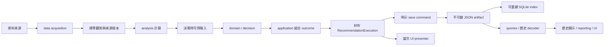
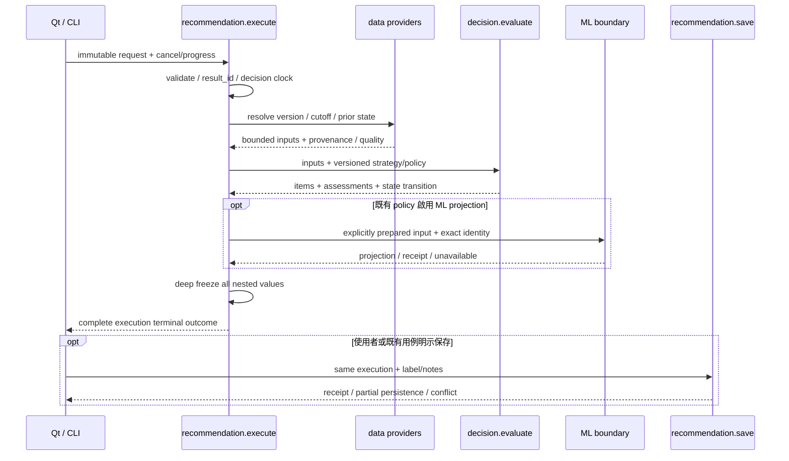
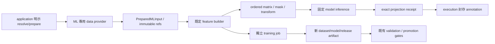

# 最終資料流

> 設計定案（2026-09-22 基線）；完整目標尚未全域完成，部分 bounded slices 已有日期化驗收。本分冊展開唯一權威 [FINAL_TARGET_ARCHITECTURE](FINAL_TARGET_ARCHITECTURE.md)；資料、模型與正式權限保持既有治理。圖中是目標通信，不代表現況全已符合。

## 1. 主路徑與協調位置



Application 並非直到 domain 結束才參與：`execute.py` 在前面建立身分、選取來源與 policy、準備輸入，呼叫 domain，再組合輸出。圖中的 application 節點強調結果組合責任；各階段 I/O 與計算由同一用例明示排程。資料更新 job 也可預先計算技術資料，推薦只讀已發布版本，不強制每次推薦重新計算全市場。

| 階段 | 輸入 → 輸出 | owner／禁止事項 |
|---|---|---|
| acquisition | vendor response → `SourceObservation` | data source adapter；保留原資料與來源版本，不做 factor eligibility |
| calculation | 有序歷史觀測＋指標參數 → 技術數值＋warmup／missing | analysis；app job 安排物化，data writer 發布；不得讀未來資料 |
| preparation | request/cutoff＋provider → `MarketSlice`／必要 prior state | app execute；data reader 負責具名 SQLite/CSV fallback，不在 domain 暗查 |
| domain | 標準事實＋技術值＋strategy/policy → `DecisionBatch` | decision；filter／因子解讀／ranking／reasons；不保存、不呼叫 ML |
| application outcome | DecisionBatch＋context＋ML outcome → execution | app；在 worker 返回前遞迴封存，失敗/取消/品質分開 |
| persistence | execution → canonical bytes/hash → receipt | app save/codec/persistence＋data artifact store；create-only，不讀 live service |
| read presentation | 保存 bytes＋metadata → execution/read view → UI/report | app query/codec 與 presenter；SQL index 不能補算業務真值 |

## 2. 單次推薦時序與凍結點



來源可得時間、母體、排序 policy、config、regime 與 negative evidence 在執行中取得；save 不再次推導。若輸入在封存後被修改，execution 必須完全不變。UI 不能回寫 item、ML projection 或 config，也不能把顯示欄位當 canonical payload。

regime prior state 的更新由 app 依原 policy 持久化，記錄預期 state version 與 transition outcome；當次結果仍保存當次決策使用的 state。遷移須保留多日確認、cooldown、同日重跑語意，並明示並行衝突政策。

## 3. 保存與復原

```text
save_execution
→ 驗證 completed／准許的保存種類及 result identity
→ codec 產生 canonical bytes、schema revision、payload hash
→ data store 以 exclusive/create-only 發布 artifact
→ SQLite transaction 登錄 index 與可變 metadata
→ SaveReceipt
```

同 ID/hash 重試回傳同一結果的 receipt；異 hash 拒絕。若只有 artifact 成功，保留它並回報待補索引，重試驗證原 bytes/hash 後補索引。若 artifact 缺失或校驗失敗，index 不得假裝結果可用。JSON 與 SQLite 無跨介質原子性，不能用「交易」一詞掩蓋中斷窗口。

label／notes／persisted_at 的修改不改 execution hash；後續 watchlist、journal、delivery ACK 各是獨立命令。ACK 失敗不重算推薦、不抹掉已保存 execution。沒有明示保存時不得因重構新增自動保存。

## 4. 歷史讀取與歷史重算分流

| 使用目的 | 精確路徑 | 身分與版本 |
|---|---|---|
| 看當年的推薦 | index 定位 → 原 artifact 校驗 → 對應 schema decoder → read view | 保留原 result_id/hash；缺欄顯示未知，無當前 data/ML lookup |
| 重播當年的策略 | saved profile/config → historical data preparation → evaluator → 新 execution | 新 result_id、parent ref、historical date、policy/algorithm/source versions |
| 推薦組合回測 | 日期序列逐日重播 → signal／配置 → backtest 撮合/成本 → portfolio result | 每日 execution refs 與 backtest run ID 分開；不是今日名單批次回測 |
| 匯出報告 | query 或傳入 sealed execution → report presenter/export | 明示使用的 result_id；不重新計算分數或模型 annotation |

日期解析沿用能處理數字 `YYYYMMDD` 的 `parse_stock_dates()`；特徵以 available time 與決策 cutoff 控制。歷史資料修訂或模型更新不覆寫舊結果；確實重算就記錄新來源版本。沒有 PIT membership 時沿用現有禁用／降級，不能用今日成分冒充歷史母體。

目前 interactive 與 DataFrame replay 的 lookback、max_stocks、候選不足、exception 與 filter 行為不同。目標共用 evaluator、canonical items 與 codec，但將必要差異放在**具名版本 policy**；遷移不承諾兩模式的結果相同。未知差異先保留基線並驗證，不直接刪舊條件。

## 5. ML 獨立路徑



這條路徑不是 rule `MarketSlice` 的隱式加欄。`PreparedMLInput` 綁定 execution/candidates、decision cutoff、source/dataset snapshot、feature/transform/model contract；provider 可以取得 ML 專用資料，但 build/infer 不能暗讀更新中的 latest DB。Rule 與 ML 不同輸入可有不同 hash，對共同來源與 cutoff 的一致性須可驗。

初輪凍結 builder 的既有讀取模式是暫時例外；依 [ML 契約](FINAL_ML_COMPATIBILITY_CONTRACT.md) 保留原序列／必要更新互斥，無法證明版本時拒絕 projection 並記原因。不得僅因 envelope 有 hash 就聲稱內部所有讀取受控。既有 immutable receipt 的發布副作用需明示，rule selection 不受本次架構重構重新排序。

訓練與新增 feature 是獨立、明示版本化工作；畫面顯示新 confidence 不自動改 matrix schema、不觸發 retraining、不切換 active model。模型不相容／quarantine／缺 feature 的拒絕或降級保留原 policy。

## 6. 失敗不再靠空列表或最新狀態解讀

| 情境 | 必須保留的 outcome | 禁止做法 |
|---|---|---|
| 合法零候選 | completed＋零 items＋assessments／品質 | 當成 exception 或展示上一輪為新結果 |
| 取消／worker error | 本次 cancelled／failed＋身分與原因 | 由 `[]` 推論，或從 service.last_* 補成成功 |
| SQLite→CSV fallback | 使用的來源、原因、cutoff、品質 | 靜默換 source 卻保留原 snapshot 標記 |
| 一支股票無法計算 | 按原 policy 的排除／部分結果與可查理由 | 無痕 continue 後聲稱完整覆蓋 |
| ML unavailable | rule outcome＋ML 狀態／receipt outcome | 把缺值填 0 或即時取新模型修補 |
| artifact 成功／index 失敗 | partial persistence＋同 ID/hash 可恢復 | 重新推薦、覆寫 JSON 或清空 output |
| schema／identity conflict | 明示 unsupported／conflict，保留原 bytes | 猜型別、截斷未知欄位後再保存 |

## 7. 遷移對照

現有 `run_recommendation→list`、UI 保存 builder、scheduled snapshot 與 DataFrame replay dict 只在 [遷移序列](FINAL_MIGRATION_SEQUENCE.md) 列出的範圍暫留；新 caller 一律接完整 execution。歷史 schema decoder 與必要模型 class-path reader 可以長期存在，因其不形成第二套評分引擎。

本分冊的驗收是：可以沿一次 result_id 查到 request、輸入版本、policy、domain outcome、ML receipt、保存 outcome 與任何後續 command；不需讀某個 service 的「最後一次」狀態。
