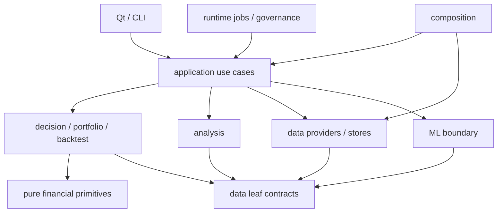

# 最終目標架構：單一實作權威

> 決議日期：2026-09-22。狀態：**設計定案，尚未實作**。程式核對基線為 `f3c3f23eb813fad0a6c40e5180034fcf429b715f`；原評估基線 `574de045` 至此僅有其他任務的操作手冊提交。
>
> 本文件是後續實作 agent 的**唯一目標架構決策來源**，取代本目錄先前六份設計草案。以下五份 FINAL 分冊展開本決議，不各自建立另一套架構。原草案保留為審查歷史，不能授權實作。`target_system_architecture.md` 保留領域背景與導覽，涉及 package、契約、依賴或遷移順序時以本文件為準。
>
> 現況仍以 [system_architecture.md](../system_architecture.md) 與 [PROJECT_SNAPSHOT](../../00_core/PROJECT_SNAPSHOT.md) 為準；產品權限、正式來源接受、ML promotion 與工程優先序仍由既有 Scoped SSOT 管理。本決議不宣稱那些 Gate 已通過。

## 1. 閱讀入口與決策範圍

| 文件 | 用途 |
|---|---|
| 本文件 | 最終裁決、具名 owner、目標結構與核心契約 |
| [FINAL_DATA_FLOW](FINAL_DATA_FLOW.md) | 執行順序、保存、歷史讀取、重算與獨立 ML 路徑 |
| [FINAL_EXTENSIBILITY_MODEL](FINAL_EXTENSIBILITY_MODEL.md) | 常見變更的起點、影響邊界與三項實際推演 |
| [FINAL_ML_COMPATIBILITY_CONTRACT](FINAL_ML_COMPATIBILITY_CONTRACT.md) | 不得改動的數值／身分／模型契約及演進實驗 |
| [FINAL_ARCHITECTURE_INVARIANTS](FINAL_ARCHITECTURE_INVARIANTS.md) | 可直接放入實作 prompt 的可驗證規則 |
| [FINAL_MIGRATION_SEQUENCE](FINAL_MIGRATION_SEQUENCE.md) | 五個依序執行的區塊與過渡機制退休帳 |

已核准架構的工作切片另見 [REFACTOR_IMPLEMENTATION_DAG](REFACTOR_IMPLEMENTATION_DAG.md)、[REFACTOR_MODEL_ASSIGNMENTS](REFACTOR_MODEL_ASSIGNMENTS.md)、[REFACTOR_EXECUTION_ORDER](REFACTOR_EXECUTION_ORDER.md)、[REFACTOR_VALIDATION_MATRIX](REFACTOR_VALIDATION_MATRIX.md)、[REFACTOR_RISK_REGISTER](REFACTOR_RISK_REGISTER.md) 與 [31 份 task specs](REFACTOR_TASKS/README.md)。它們是執行契約與排程，不是新的架構權威；task 只有在 orchestrator 明示 release 後才開始。

審查輸入已完整讀取：[現況評估](SYSTEM_ARCHITECTURE_ASSESSMENT.md)、原六份設計草案、[紅隊審查](ARCHITECTURE_RED_TEAM_REVIEW.md)、[必要變更](ARCHITECTURE_REQUIRED_CHANGES.md)，並回查原始碼。以下 `RT` 對應紅隊編號，`RC` 對應必要變更編號。兩份外部審查原文保留不修改；獨立程式複核不是外部審查的替代品。

## 2. 逐項裁決

### RT-1 CRITICAL／RC-2：factor mapping 放在 application

**PARTIALLY ACCEPT。** 接受「factor 的業務解讀與公式必須同 owner」；不接受把供應商欄名、SQL、HTTP 或資料源 fallback 一起搬進 domain。現有 [decision factors](../../../decision_module/factors/factor_adapters.py) 已提供可沿用的領域入口，無須先移出再搬回。

最終分工：data 把 vendor 資料轉為有單位、可得時間、來源版本的標準事實；`decision_module/factors/` 把標準事實解讀為因子輸入、分數、eligibility 與理由。app 選定資料版本並傳入，不維護第二份 factor 公式或語意 mapping。**修改最終設計**：取消草案 `app_module/adapters/factors`；領域轉譯留 factor 旁。驗證同一份標準事實透過不同 source adapter 得到相同領域結果。

### RT-2 CRITICAL／RC-1：schema 與責任拆分順序

**ACCEPT。** 先拆 engine 再決定 canonical contract 會製造一次性轉換。最終先鎖基線，再建立 typed contracts、唯一 codec 與最小完整 execution capture；接著遷移 callers，最後拆 I/O／domain。**修改最終設計**：採本文件第 9 節五區塊順序。這不是只交換章節名稱；區塊 4 的前置驗收必須包含區塊 2 的 roundtrip 與區塊 3 的跨 run isolation。

### RT-3 HIGH／RC-5：新增欄位需要散落修改

**PARTIALLY ACCEPT。** 漏改 codec 導致欄位遺失是真實風險；「所有跨層修改都是散彈槍手術」則不成立，新增業務語意與新增畫面呈現本來有不同 owner。不採無約束 `extended_attributes: dict`，也不建立全系統動態欄位平台。

**修改最終設計**：新格式使用白名單 typed dataclass 的 schema 驅動 codec，直接遍歷契約欄位，沒有第二份手工 row mapping。新增非索引可選 scalar 修改 owner contract、固定位置的格式 revision 常數、產值處與需要顯示的 presenter，不改 save、repository 或 replay。revision 是相容資訊，不是另一份欄位定義。序列化規則見第 6 節；未知 schema 不靜默丟欄。舊格式的明示 mapping 留在唯讀 decoder，不能把新欄位回寫舊格式。

### RT-4 HIGH／RC-3：深度凍結未定義

**ACCEPT。** `frozen=True` 不會凍結內部 dict/list；`MappingProxyType` 包住原 dict 也會跟著原 dict 變動。**修改最終設計**：採 frozen dataclass、tuple、遞迴新建 backing dict 的 `MappingProxyType`；封存時不得保留輸入 mutable alias。拒收 DataFrame、ndarray、任意物件與未轉換的巢狀 mutable collection。不得引入第三方不可變框架作為本輪前置。驗證須從原輸入與輸出兩端嘗試巢狀變更，而非只測欄位 assignment 失敗。

### RT-5 MEDIUM／RC-6：ML 在 projection 中暗讀資料

**ACCEPT（風險與邊界），初輪不強行改寫 builder。** rule `MarketSlice` 不保證涵蓋 ML 所需長窗口、基本面或其他 feature。最終 ML 可以有自己的 data provider，但資料取得必須是 app 明示安排的 preparation，產生獨立 `PreparedMLInput` 與可驗證 snapshot identity；projection 接受該準備結果，不在內部偷偷讀取更新中的 DB。

**修改最終設計**：明確區隔 rule input 與 ML input，兩者對齊 decision-time 與 candidate/result identity；不要求資料內容或 hash 相同。初輪 frozen builder 仍以既有 provider／讀取時序運作，列為有退出條件的例外。若不能保證資料版本穩定，不得宣稱同一 snapshot；維持受控更新互斥或依既有失敗 policy 回報 unavailable，不能事後用最新值補齊。詳見 ML 分冊。

### RT-6 MEDIUM／RC-4：拆成 application_module 與 infrastructure_module

**REJECT（新增兩個根模組的方案）。** app 成為雜物堆的風險成立，但根目錄改名會擴大 import 遷移，且把「業務 job」一律當基礎設施會再度模糊 owner。程式已有 [decision_service_composition](../../../app_module/decision_service_composition.py) 等接線點，不需要另建 DI 框架。

**修改治理方式，不採根模組拆分**：保留 `app_module`，use case 與其 codec／adapter 依功能放在一起；業務資料取得與儲存機制歸 data，純計算歸 analysis/domain。`jobs` 只容納具名的跨服務排程用例；不得以 `manager`、`utils`、`adapters` 空泛分類吸收未知責任。每個新增檔案必須說明服務哪個 use case。

### RT-7 LOW：composition 與 runtime 邊界

**PARTIALLY ACCEPT。** 接受只有 composition 建立服務與管理連線生命週期；不把現有 runtime 治理能力縮成純 CLI bootstrap。runtime 保留排程、run/step 身分、取消、重試、capability 與 observability，不能持有推薦公式。Qt／CLI 入口呼叫具名 composition factory 一次；runtime 接受已組好的 job。**修改最終設計**：第 3、4 節固定建立與呼叫的方向，避免重複實例化。

### RC-7 EXPERIMENT：UpdateService 搬移與 ML computation hash

**NEEDS IMPLEMENTATION EXPERIMENT。** 不能由「UpdateService 不在直接清單」推論沒有間接 feature timing 影響，也不能要求 source bytes 已變卻仍冒用舊 hash。[Direct store](../../../data_module/portfolio_ml_direct_numeric_store.py) 的 stable identity 納入明確依賴路徑、檔案 SHA256 與 compiled-source fingerprint；另有執行中程式完整性檢查。

**設計有條件限制**：初輪保留相關計算／物化路徑。搬移前在隔離資料上比較依賴 identity、輸出 bytes／row order／mask、可得時間與 resume 行為；結果決定「可透明移動」或「新 computation identity／新 run」。本次沒有執行該實驗，不能寫成已通過。精確程序與失敗處置在 ML 分冊。

## 3. 目標結構與唯一 owner

沿用 modular monolith。以下是**目標路徑**，不表示檔案已存在，也不要求一次搬完所有既有模組；只有有實際責任需要的子目錄才建立。既有不受本次責任調整影響的模組維持原位。

```text
financial_module/                  金額／比例／數量等基礎數值
data_module/
  contracts/market.py               SourceObservation、MarketSlice、availability 純契約
  sources/                         vendor 取得與標準欄位轉換
  readers/                         snapshot／SQLite／CSV 讀取與明示 fallback
  result_artifact_store.py          推薦 artifact bytes 與 SQLite 索引機制
  ...                              既有治理／儲存；ML 敏感檔先凍結
analysis_module/
  technical_analysis/              指標公式、參數、warmup、批次計算
decision_module/
  recommendation/contracts.py      RecommendationItem、CandidateAssessment、DecisionBatch
  recommendation/evaluate.py       filter → factor → ranking → reasons
  recommendation/filters.py        具名篩選政策；需要時才拆多檔
  recommendation/ranking.py        排序、tie-break 與母體政策
  factors/                         factor 契約、語意轉譯、公式、eligibility
  strategies/contracts.py           StrategySpec/Meta、StrategyExecutor、signal schema
  strategies/registry.py            沿用現有唯一 ID 註冊／選取語意
  strategies/<strategy_id>.py       具名策略實作
  market/                          regime／industry 純政策與狀態轉移
  advice/                          Advice 純政策（不等於 broker execution）
backtest_module/                   撮合、成本、資金與歷史績效核心
portfolio_module/                  配置、健康、退出與持倉領域政策
ml_module/                         feature／label／訓練／推論／模型契約
  prepared_input_contract.py        PreparedMLInput 純輸入契約，不依賴 app execution 型別
app_module/
  recommendation/
    contracts.py                   Request、Context、RecommendationExecution、SaveReceipt
    execute.py                     準備輸入、呼叫決策、組合 ML、封存單次結果
    codec.py                       新格式 typed codec＋按版本選用歷史 decoder
    persistence.py                 結果 repository adapter，呼叫 data artifact store
    save.py                        保存命令與 identity／冪等政策
    queries.py                     歷史查詢、驗證與讀取投影
    replay.py                      歷史日期準備／重算，呼叫同一決策入口
    ml_adapter.py                  顯式準備／呼叫 frozen ML／投影結果
    ports.py                       僅真正外部 I/O seams；不為純函式建 interface
  jobs/                            具名 update／materialization 等跨服務用例
  ...                              research／portfolio／evidence／watchlist 等既有用例
  decision_service_composition.py   沿用具名 composition，不建立通用 service locator
runtime/                           排程、取消、重試、run observability 與權限控制
ui_qt/                             Qt 互動、worker、view-model 與欄位呈現
development_module/                開發診斷；正式 runtime 不依賴工具或 scripts
scripts/                           CLI 入口，呼叫 application／runtime
```

本結構沿用 repository 實際根名，不另建同義根模組。新增 `market_module`、`advice_module`、`application_module`、`infrastructure_module` 均不在本決議內。

| 開發者問題 | 第一個 owner／入口 | 不屬於它的責任 |
|---|---|---|
| 原始資料從哪裡進來？ | data source adapter；`TWStockConfig` 決定 roots | 不評分、不取得正式來源資格 |
| 指標在哪裡算？ | `analysis_module/technical_analysis/` | 不決定寫入時間或推薦權重 |
| 商業規則在哪裡？ | decision、portfolio、backtest 對應純政策 | 不連 DB／HTTP／Qt |
| 新策略在哪裡？ | `decision_module/strategies/` | 註冊/執行與研究 promotion 分開 |
| 推薦在哪裡協調？ | `app_module/recommendation/execute.py` | 不持有第二套因子／排序公式 |
| 推薦真值是什麼？ | 單次 `RecommendationExecution`；規則列為 `RecommendationItem` | UI dict、SQL index、報告均非真值 |
| 結果保存在哪裡？ | recommendation save → persistence → data artifact store | 不在 UI 組 DTO 或讀 service 最新狀態 |
| 歷史在哪裡處理？ | queries 讀保存結果；replay 重新執行 | 不把兩者混稱同一次執行 |
| UI 轉換在哪裡？ | `ui_qt/views/recommendation/` 的 presenter／model | 不重新算 score、填 provenance 或拼保存物件 |
| ML 從哪裡讀？ | 受治理的 data provider，由 ML preparation 明示使用 | 不從 UI／當前表格推導 training schema |

## 4. 依賴方向與允許的通信



箭頭表示允許依賴，不是每個模組必須全部相依。嚴格規則如下：

- `data_module/contracts/*` 是無 I/O、無 app/domain import 的 leaf；領域依賴此契約不等於依賴 repository。供應商與格式差異在 data 解碼一次，業務解讀在 domain 完成一次。
- analysis 不依賴 decision／app；domain 不 import app、Qt、concrete readers、stores、scripts 或 ML trainer。`__init__.py` 不得藉廣泛 re-export 讓 leaf import 觸發 I/O。
- app orchestration 可呼叫具體 domain 函式；在 data、ML、持久化等真實變動邊界使用狹義 port。跨領域 use case 用明示輸入／輸出與 reference 組合，不採 event bus 或全域 service locator。
- data 中的純 ML record storage 可以依賴 `ml_module` 的純 feature／label／training-record 契約；該 leaf 不反向 import store／trainer。ML 業務 code 可使用 data provider。按**實際 leaf module DAG** 驗證，禁止用「兩個根 package 互 import 合理」容忍循環。凍結中的既有反向依賴見 ML 分冊與退休帳。
- composition 是 concrete service 建立與資源 lifecycle 唯一位置；runtime 接受 job／callback，不能在執行途中另建 domain service。既有專用 composition 可保留多個，但同一 entrypoint 的資源只能有一個 owner。
- reporting／AI／MCP 透過 app query/command；資料讀取權不授予 promotion、交易或正式 writer 權限。

## 5. 權威契約與封存時點

### 5.1 業務列、執行聚合與身分

| 契約 | owner／內容 | 明確排除 |
|---|---|---|
| `SourceObservation`／`MarketSlice` | data leaf；標準欄位、unit、資料日、available time、revision、snapshot/source refs | vendor key、開放 DB handle、推薦權重；不做涵蓋全系統的超級 DTO |
| `RecommendationItem` | decision；stock identity、規則分數、factor contributions、rank/universe、理由、可選信心 | calibration/model receipt、UI label、保存時間 |
| `CandidateAssessment` | decision；每個候選的 eligibility、filter outcomes、reasons、liquidity／缺資料判斷 | UI 另算的 Why Not 清單 |
| `DecisionBatch` | decision；ordered items、assessments、regime/必要狀態轉移 | result_id 發號、DB 寫入、ML 呼叫 |
| `RecommendationExecution` | app；request/context、`decision: DecisionBatch \| None`、terminal status、quality/events、ML projection/receipt refs | service 的可變 latest state、DataFrame、保存 label；不再複製一份 DecisionBatch 欄位 |
| `SaveReceipt` | app；result_id、payload_hash、artifact schema、位置、persisted_at 與 index 狀態 | 另一份推薦欄位列表 |

每個 execution 中 `stock_code` 唯一；跨執行列鍵是 `(result_id, stock_code)`。`result_id` 沿用 `rec_<uuid>`，在執行與 ML receipt 之前建立；runtime `run_id`、replay parent、portfolio/evidence ID 各自保留並明示 reference，不得互換。

Context 最少保存 as-of date、實際 decision_at、source/data snapshot refs、config/profile/strategy/policy 版本、universe policy、資料品質與算法版本。歷史未知值為 unknown／None，不借現在時間或目前來源補值。`RecommendationDTO` 現有 calibration 欄位屬 app/ML projection，不得整包改名移入 decision。初輪委派 adapter；目標由 canonical row 加既有 ML projection contract 組合，UI/query 用 reference 呈現。

`completed` 必須有 `DecisionBatch`，即使 items 為空；failed/cancelled 可無 decision，任何 partial decision 只能作診斷。`execution.items` 等便利存取若存在只能是唯讀委派，不建立第二份儲存欄位。`StrategySpec`、`StrategyMeta`、`StrategyExecutor` 與目前 `DailySignalFrame` 的純 schema／建構規則一併歸 `decision_module/strategies/contracts.py`，backtest/app 共用；不能只搬策略卻反向 import app 的 signal 契約。DataFrame 可留在隔離的計算輸入／signal 邊界，不進 sealed execution。

### 5.2 用例介面與結果語意

```text
execute(request, cancel, progress) -> RecommendationExecution
save_execution(execution, label, notes) -> SaveReceipt
load_execution(result_id) -> execution + 保存 metadata + receipt
recompute(saved_request_or_profile, historical_date, policy_version) -> 新 execution
```

- execution 在 worker 返回前封存，不能到 save 時才讀 `last_*` 或重新偵測 regime。`completed` 可有零列；`failed`、`cancelled` 各有明示狀態與原因，不能由空 list 推斷。
- validation 於執行前失敗回傳結構化拒絕，不借上一輪 execution；已開始的 invocation 保有本次身分與 terminal outcome。failed/cancelled 的診斷可被記錄，但不能當 completed recommendation 發布。
- `execute` 不是宣稱無副作用：既有 ML immutable projection receipt 可在執行內發布，其 outcome/ref 必須可見。取消後已存在的 receipt 不刪除，重試依既有身分契約處理。
- regime confirmation/cooldown 是真正業務狀態：用明示 prior state 與 transition 保留，app 負責持久化／並行衝突；不能為了「stateless」讓狀態消失。
- quality、terminal status、ML availability、persistence success 是四種不同維度。UI last-good-result 保留政策不能把舊結果誤標成新 run。

### 5.3 深度不可變與數值邊界

封存只容許明示 contract 的 frozen dataclass、tuple、遞迴複製後的 `MappingProxyType`、str/int/bool/None、Decimal、enum、date 與 aware datetime。mapping keys 限 str，巢狀值使用同一 allowlist；所有 backing dict 是新建且不外露。row、config、context、ML projection 都適用。對已知 mutable legacy DTO 必須轉成既有型別的 immutable snapshot，不能只套外層 frozen decorator。

核心新計算用 Decimal 或具單位整數，bp 類型不可冒充任意精度分數。舊 score 的 precision、rounding 與 tie-break 是遷移基線；封裝時可在已測邊界以十進位字串表示既有數值，但不能先量化到 bp 再聲稱行為等價。仍需保留的浮點算法列入具名 legacy 數值例外，獨立驗證後退休；ML／NumPy 分析邊界的既有浮點矩陣另依其凍結契約，不套用金融存檔轉換。

## 6. 單一 schema 與保存模型

### 6.1 一份欄位定義，兩種明確版本責任

`app_module/recommendation/codec.py::{encode_execution, decode_execution}` 為唯一入口。wire 頂層固定 `schema_version="recommendation-execution.v1"` 與整數 `schema_revision`（初版為 1）；兩者都進 canonical payload/hash。decoder 只接受明示支援的版本／revision，不由目前 dataclass 反推舊資料版本。新增可選欄位增加 revision；語意不相容則增加 major。

field schema 來自白名單契約型別的 dataclass fields／annotations；root header 的 `EXECUTION_SCHEMA_REVISION` 與支援 revision 範圍固定定義於 `app_module/recommendation/contracts.py`，每次保存欄位演進明示更新。這是一個格式版本宣告，不能增加第二份 scalar 清單。直接遍歷 fields，不使用會對 MappingProxyType 做不相容 deepcopy 的通用 `dataclasses.asdict()`，亦不使用 `__dict__`、任意 import 字串或 pickle。converter 只處理第 5.3 節明示型別，嚴格檢查 null、單位、range 與必要欄位；contract 自己定義業務驗證。未知型別／schema 回報錯誤，不跳過欄位。

| 類型 | wire 表示 |
|---|---|
| bp、股數、整數計量 | JSON integer，契約保留 unit |
| Decimal | 十進位字串，禁止經 float 中轉 |
| 時間 | 含 offset 的 ISO 8601；日期使用 ISO date |
| tuple／immutable mapping | JSON array／object；decode 後遞迴重新封存 |
| 可選缺值 | JSON null；與 0、空字串、not_available 分開 |

canonical encoder 使用固定欄位／key 排序、UTF-8、固定 separators、有限合法數值；日期、Decimal 字串規則隨 schema 固定。`payload_hash` 是精確 canonical payload bytes 的 hash，不含 hash 自己與可變 metadata。不得混用此 hash、source hash 或 ML computation identity。

新增 typed optional scalar：在 owner contract 加 default、validation，更新上述 app contract 的 root revision 宣告；codec 自動涵蓋，不逐欄改寫，也不新增 nested schema registry。相同 major 的舊 artifact 缺新 optional 欄，依明示 default 解讀；不改原 bytes／原 hash。新 artifact 的 schema revision 必須可辨識，舊 reader 遇到不支援 revision 拒絕完整 decode，不能讀了再回存成少欄版本。改名、刪除、改型別、改unit／含義則需要新 schema 與明示 decoder。跨版本 read view 與原始 payload/hash 分開，不宣稱 re-encode 後仍等於舊 artifact。

舊中文 keys、`RecommendationDTO.to_dict/from_dict`、historical snapshot mapping 統一委派 codec 的 legacy decoder／明示舊 export，後者不得成為新 writer。新 contract 沒有泛用業務 `extended_attributes`；既有 factor contributions 是具名、具 version/unit 的領域資料，不是任意欄位逃生口。

### 6.2 保存、索引與故障復原

唯一可供新用例使用的保存政策：**create-only，same result_id + same payload_hash 冪等；same ID + different hash 拒絕**。label、notes、persisted_at 是另存 metadata；改名透過 metadata command，不修改 execution，也不改其 hash。

`recommendation/persistence.py` 負責 codec 與 repository port；`data_module/result_artifact_store.py` 承接既有 JSON／SQLite 寫入與索引機制，只接收 bytes、hash、index metadata，不 import app DTO。以 [RecommendationRepository](../../../app_module/recommendation_repository.py) 已有 create-only／orphan recovery 為起點，不重寫為 ORM 或泛用 repository。

artifact 是結果真值，SQLite 是可重建查詢索引；兩者不是同一原子 transaction。payload durable publish 後 index commit；中斷時以 ID/hash 核對補索引，異 hash conflict 必須可見。同 ID 競爭要靠 exclusive create／交易唯一性驗證，不能靠先 exists 再寫。索引失敗回報 partial persistence，不重新算推薦、不覆寫 artifact。原 legacy replace API 僅限過渡 caller，不能由新 save 間接使用。

一般新欄位無須 SQL migration；只有真的要篩選／排序／索引才增加可重建 projection。原 artifact、原資料、既有模型均保留。正式 schema migration 不在 import／app 啟動時自動執行。

## 7. 歷史、其他領域與相容邊界

- **歷史顯示**：queries→decoder→已保存 execution；不查今天價格、regime、模型或重新評分。舊資料沒有 confidence 就顯示未知。
- **歷史重算**：app replay 準備每個歷史 decision-time 的 input，呼叫相同 evaluator，產生新 result_id，記錄 parent refs 與版本。現有 [DataFrame provider](../../../app_module/recommendation_dataframe_provider.py) 的 lookback、max_stocks、缺資料處理與互動推薦不同；先把差異明示為 versioned policy，不能因共用 engine 就偷偷統一行為。
- **Backtest／Portfolio**：signal／成交／成本／配置與 ledger 有各自契約。推薦只是輸入 reference，不能把整個 ledger 嵌成 execution 的另一份真值。策略 lifecycle 與 promotion 由 app 用例保存／治理，策略純實作不能自行批准。
- **Evidence／Journal／Watchlist**：延伸命令使用 result_id 與自己的 outcome／ACK；主保存成功而 ACK 失敗須可重試且可辨識。不可宣稱所有 legacy Journal API 已 append-only。
- **ML**：維持 shadow/quarantine/production permission、既有特徵與模型選擇邏輯。規則 top-N 不因重構被 calibration 重排。來源 observation/availability 歸 data，feature/label/training record 歸 ML leaf；assembly／發布時序歸 app job。初輪 source-path 凍結是過渡例外，不是最終正確分層的證據。
- **歷史 decoder／joblib class-path 支援**是長期讀取契約，可留在目標系統；不保留第二套推薦或訓練引擎。刪除需另有 artifact 支援範圍與移轉決議，單靠 repo import=0 不足。

## 8. 本次程式複核的決策依據

| 已存在的程式／symbol | 證據對最終契約的影響 |
|---|---|
| [RecommendationService.run_recommendation](../../../app_module/recommendation_service.py) | 大型 app orchestration 仍有 list/latest-state 相容輸出；rule DecisionBatch/assessment/item/rule-context facts 不再由其 `last_*`／matrix 重建（R019 REC-01 窄 bridge CLOSED），完整 execution 是必要邊界。私有 source-orchestration body 與 invocation capture 仍保留；clock/error/progress 屬 app execution telemetry，ML availability/projection receipt capture 由 TMP-ML-01／R026 列管。 |
| `RecommendationSaveRequest.build_result／_regime_snapshot`（歷史 `app_module/recommendation_save_coordinator.py`，見[恢復 mapping](../../09_archive/DOCUMENTATION_REORGANIZATION_MANIFEST_20261006.md#壞鏈處理)） | save 仍讀 service state 並重新 detect regime；必須改為保存執行時快照 |
| [RecommendationDTO／RecommendationResultDTO](../../../app_module/dtos/__init__.py) | 業務列、ML projection、wire mapping 混合；不能直接整包搬入 decision |
| [RecommendationRepository.save_result／save_result_create_only](../../../app_module/recommendation_repository.py) | 普通路徑可 replace；新 API 明確指定 create-only，不能混稱現況已不可變 |
| [RecommendationDataFrameProvider.__call__](../../../app_module/recommendation_dataframe_provider.py) | 內部 DataFrame row-dict engine／bridge 與獨立 policy；遷移後退役這條內部計算路徑並保留原 replay policy。外層 `RecommendationSnapshotDTO.recommendations` v1 list 是 live compatibility projection，現存 portfolio 與 factor-manifest consumers 須保持可用。 |
| [StrategyRegistry](../../../decision_module/strategies/registry.py)／[StrategyExecutor](../../../decision_module/strategies/contracts.py) | 已證明策略變動點存在；沿用 registry 契約，無需新 plugin bus |
| [market_regime_detector](../../../decision_module/market_regime_detector.py) | 多日確認與 cooldown 有持久狀態；抽 I/O 不能刪狀態 |
| [Direct computation dependency list](../../../data_module/portfolio_ml_direct_numeric_store.py) | 搬檔可能更換 identity；不能把 re-export 當作 ML 透明相容證明 |

## 9. 定案順序、未完成驗證與交付邊界

```text
1 基線、caller／artifact／ML 凍結盤點
→ 2 canonical contracts + schema-driven codec + 最小完整 capture
→ 3 callers／save／queries／replay 改接完整 execution
→ 4 分離 data I/O、analysis 計算、domain 規則
→ 5 移除過渡 runtime、驗證依賴與三項擴充情境
```

每個暫時 wrapper、last-state capture、legacy numeric boundary、dual-read 比對與 source-path 例外，都必須進入 [退休帳](FINAL_MIGRATION_SEQUENCE.md)，記錄 owner、caller 與可執行刪除條件；未列管不得新增。目標狀態沒有新舊雙引擎，且依賴違規不能靠整包 allowlist 消失。

過渡只允許「舊 public façade → 新 use case → 私有 app source-orchestration body／capture」的單向呼叫；該 body 不得保留第二份 rule evaluator，new execute 不能反過來呼叫已委派它的 façade。ML／數值獨立 Gate 尚未收口時，五區塊推薦遷移可記其範圍完成，但不得宣稱全系統最終依賴與數值邊界已全部達成。

**Scope clarification（2026-09-24）**：R019 的 `TMP-REC-01` closure 僅涵蓋 legacy state/matrix → canonical rule DecisionBatch、assessment、item、rule-context bridge；不是 private body 或完整 execution capture 的移除。Source orchestration 留在 app；invocation clocks/error/progress capture 由 app execution telemetry 邊界列管，ML availability/projection receipt capture 按 `TMP-ML-01`／R026 列管。`TMP-REC-02` 的 list/latest-state 與 v1 event/callback sidecar 仍是分開驗收的 compatibility output。

本次完成的是來源審查與設計推演；深凍結攻擊測試、schema codec roundtrip、保存中斷／並行恢復、模型 load/prediction parity、UpdateService timing/hash 實驗都屬後續實作驗收，**本次未執行**。既有 ML boundary guard 在先前現況查核為 525 檔、4 項違規、exit 1；此設計沒有修正它，也不把它算通過。

三項最終變更影響測試的逐步推演與通過條件在 [擴充模型](FINAL_EXTENSIBILITY_MODEL.md)。狀態為「設計上符合，須由遷移區塊 5 示範驗收」，不等於程式已符合。

## 10. 本輪文件交付查核

- 六份 FINAL 已建立；RT-1–7 與 RC-1–7 全部有裁決。兩份紅隊原文保留不改，六份先前草案均標示已被取代。
- 六份 FINAL 的 58 個本地連結及新增導航的 12 個連結通過；23 個 Markdown 表格欄數、code fences 與尾端空白檢查通過。
- 18 條 INV、五個遷移 blocks 的八項必要內容與 R001 歷史 baseline 所列九項具名暫時機制退休條件完成結構核對；截至 2026-09-24，現行退休帳為 11 個 ID（REC-01..06、NUM-01、ML-01/02、STR-01、RGM-01）。兩項獨立來源複核及跨文件一致性複核已整合。
- `git diff --check` 通過；只有 Git 的 LF/CRLF 提示。tracked 差異限三份架構／文件導航，新增及標記內容位於本設計目錄；shared state 另追加本任務紀錄。
- 沒有 production Python、UI、資料或模型異動；沒有執行 pytest、mypy、模型載入／訓練或 R7 實驗。Manual 與原有未追蹤 `=` 檔的 SHA256 保持前次基線；未 stage、commit 或 push。

本輪不修改 Snapshot、Roadmap、產品方向或 Manual 的完成狀態，因為只有架構文件定案。下一個安全接手點是遷移 Block 1 的受控基線盤點；實作須再次核對當時程式與工作區。
