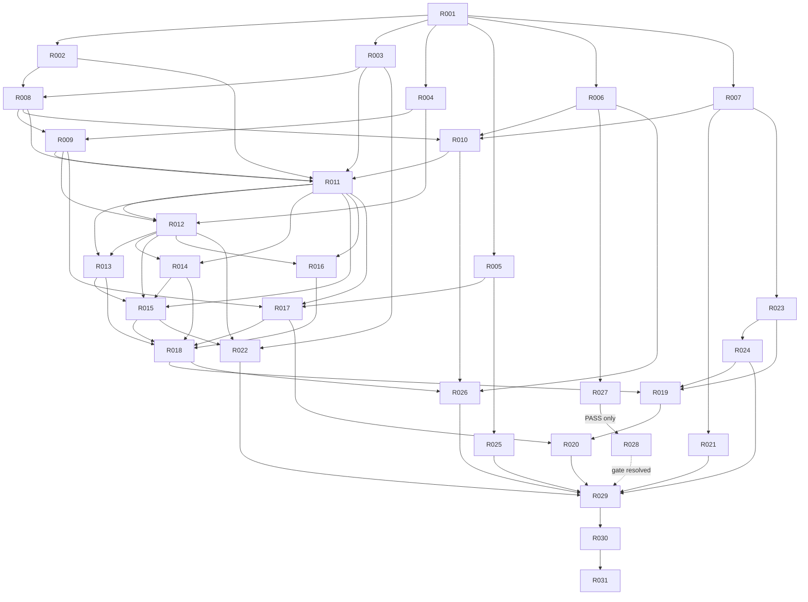

# 重構實作 DAG

> 狀態：實作任務契約，尚未執行。唯一架構權威是 [FINAL_TARGET_ARCHITECTURE](FINAL_TARGET_ARCHITECTURE.md) 及其五份 FINAL 分冊；本文件只決定工作切片、依賴與驗收，不重新設計架構。

## 1. 規劃基線與證據

- 規劃時 HEAD：`f3c3f23eb813fad0a6c40e5180034fcf429b715f`。工作區已有架構文件變更與未追蹤 `=`；後續 coding agent 必須重新記錄自己的起始 HEAD／dirty files，不可覆寫它們。
- 現況核心：`RecommendationService.run_recommendation()` 位於 1,891 行服務內，回傳 list 並寫入多個 `last_*`；Qt、scheduled snapshot、personalization、QA scripts 及大量測試直接使用此形狀。
- 保存現況：`RecommendationSaveRequest.build_result()` 讀 live service state，`_regime_snapshot()` 在保存時重查；`RecommendationRepository` 同時有 replace 與 create-only 路徑。
- replay 現況：`RecommendationDataFrameProvider` 產生獨立簡化 dict；不能只換 DTO 就宣稱共用 evaluator。
- 策略現況：`StrategySpec`／`StrategyExecutor`／`DailySignalFrame`／registry／executors 在 `app_module`，Backtest、UI、optimizer 與 scripts 都是 caller。
- ML 現況：推薦 calibration 在 `RecommendationService` 內明示查 `MLHistoricalSnapshotProvider`、計算 features 並發布 receipt；Direct computation 另有 15 條 source identity 凍結清單。
- 已存在的 graphify 圖只作導航；所有 task scope、caller 與測試均由本次原始碼 `rg` 複核。

## 2. DAG

`R028` 是條件節點。若 `R027` 未通過，不能執行 `R028`；依第 4 節 `AB-ML-01` 升級決策。`R029` 可以在保留列管中的 `TMP-ML-02` 下完成「推薦遷移收口」，但不得宣稱整體 ML／numeric 邊界完成。

## 3. 任務登錄

### R001 — 凍結基線、caller 與 artifact 清冊

- **Purpose / architectural objective**：為所有後續切片建立可重跑的 source、caller、artifact、temporary-component 與 dirty-worktree 基線；落實 Block 1 與 INV-01／17。
- **Prerequisites**：無。
- **Files likely involved**：新增 `docs/06_qa/REFACTOR_BASELINE_*` 或等價 QA artifact；只讀掃描 `app_module/`、`ui_qt/`、`scripts/`、`tests/`、ML manifests；不得修改 production。
- **Explicitly out of scope**：任何 contract、計算、資料、模型或 caller 變更。
- **Legacy behavior to preserve / requirements**：精確登錄 direct、dynamic、string scheduler、tests、serialized class path 與外部支援狀態；記錄九個既定 TMP 項目。
- **Tests / acceptance / rollback**：清冊含 symbol、mode、writer 權限、owner、預定 task；搜尋可重跑且結果有上限；缺 owner 即任務失敗。純文件切片可整體回滾。
- **Risk / touches**：低；ML=唯讀盤點；persistence=唯讀；UI=唯讀。

### R002 — 推薦語意與數值 characterization

- **Purpose / architectural objective**：凍結 normal、empty、missing、degraded、filter、ranking、order、Decimal／既有 float 與 negative-evidence 對外行為。
- **Prerequisites**：R001。
- **Files likely involved**：新增 `tests/test_recommendation_refactor_characterization.py` 與小型 fixtures；引用既有 `test_task_loop_03_contract.py`、ranking、fundamental、negative-evidence tests。
- **Explicitly out of scope**：修改 `RecommendationService`、修 bug、改 precision。
- **Legacy behavior to preserve / requirements**：同固定輸入記錄 items、順序、score quantum、screening matrix、why-not、liquidity、warnings 與 result identity 以外的穩定內容；不 snapshot 不相關 internals。
- **Tests / acceptance / rollback**：測試在原程式通過且能對刻意 order／rounding／missing 漂移失敗；fixtures 不用正式資料。只刪新增測試即可回滾。
- **Risk / touches**：中；ML=只覆蓋現有 rule/annotation 邊界；persistence=否；UI=否。

### R003 — terminal outcome、取消與 hidden-state characterization

- **Purpose / architectural objective**：鎖定 completed-empty、validation failure、exception、cancel、stale callback、A/B 交錯及 last-good UI 行為，為完整 execution 與深凍結提供 oracle。
- **Prerequisites**：R001。
- **Files likely involved**：新增 `tests/test_recommendation_execution_state_characterization.py`；參考 execution coordinator、Qt worker 與現有 coordinator tests。
- **Explicitly out of scope**：先引入新 status contract 或修改 UI。
- **Legacy behavior to preserve / requirements**：記錄哪些行為是既有相容，哪些是 FINAL 明定的後續一致性修正；測試不得把空 list 當唯一 terminal oracle。
- **Tests / acceptance / rollback**：涵蓋執行 A→B→延遲取 A、取消前後、callback request correlation、原輸入 mutation；新增測試在現況能明確描述 gap。回滾只移除測試。
- **Risk / touches**：中；ML=receipt side effect 時序只讀；persistence=否；UI=characterization。

### R004 — 保存、舊格式與故障復原 characterization

- **Purpose / architectural objective**：凍結 DTO roundtrip、legacy keys、replace/create-only 差異、orphan recovery、並行衝突、label metadata、watchlist／ACK soft failure。
- **Prerequisites**：R001。
- **Files likely involved**：新增 `tests/test_recommendation_persistence_characterization.py`；重用 DTO、save coordinator、personalization save tests。
- **Explicitly out of scope**：發布新 schema、搬 repository、刪 replace API。
- **Legacy behavior to preserve / requirements**：所有 I/O 使用 `tmp_path`；保留原 bytes/hash 與未知 bytes fail-closed；明列 save-time regime 重查為待修一致性 gap。
- **Tests / acceptance / rollback**：同 ID/hash、異 hash、file-only、index-only、legacy Chinese/English keys、rename 不應被誤當 payload parity；測試獨立於未來 codec helper。回滾刪新增測試。
- **Risk / touches**：高；ML=保存 receipt references；persistence=是；UI=否。

### R005 — replay／portfolio replay characterization

- **Purpose / architectural objective**：凍結 interactive 與 DataFrame replay 的差異、歷史日期解析、lookback、candidate limit、排序、例外跳過、PIT 與 portfolio refs。
- **Prerequisites**：R001。
- **Files likely involved**：新增 `tests/test_recommendation_replay_characterization.py`；重用 historical replay、portfolio backtest、timeline tests。
- **Explicitly out of scope**：讓 replay 與 interactive 結果相同、改 backtest 撮合／成本。
- **Legacy behavior to preserve / requirements**：每個 mode 各自對原 oracle；數字 `YYYYMMDD`、future-row exclusion、空 snapshot、factor manifest 必須入 baseline。
- **Tests / acceptance / rollback**：能辨識 policy 差異與真正 regression；無正式回測寫入。回滾移除新增測試。
- **Risk / touches**：高；ML=否；persistence=歷史 manifest 唯讀；UI=否。

### R006 — ML compatibility／artifact ABI 基線

- **Purpose / architectural objective**：把 FINAL ML 契約的 schema、order、dtype、scale、mask、row/fold refs、source identity、checkpoint 與 class path 轉成可執行清冊和小型 oracle。
- **Prerequisites**：R001。
- **Files likely involved**：新增 `docs/06_qa/REFACTOR_ML_COMPATIBILITY_BASELINE.md`、小型 `tests/test_refactor_ml_compatibility_baseline.py`；唯讀使用現有 manifests／fixtures。
- **Explicitly out of scope**：重訓、全量 rebuild、反序列化未知模型、改 15 條 source list。
- **Legacy behavior to preserve / requirements**：精確區分 stable identity 與 runtime integrity；登錄 joblib qualified paths；未知磁碟資產標 unknown。
- **Tests / acceptance / rollback**：既有 loader、feature computation、direct dependency/checkpoint、shadow boundary focused tests通過；原資料 bytes 不變。回滾只移除新增清冊／測試。
- **Risk / touches**：高；ML=是（唯讀）；persistence=ML artifact 唯讀；UI=否。

### R007 — data leaf observation／availability contracts

- **Purpose / architectural objective**：建立無 I/O、無 app/domain import 的 `data_module/contracts/market.py`（或 FINAL 指定等價路徑），承載 SourceObservation、MarketSlice、availability/source refs。
- **Prerequisites**：R001。
- **Files likely involved**：新 `data_module/contracts/`、contract tests；最多更新窄 `__init__`，不得廣泛 re-export。
- **Explicitly out of scope**：遷移現有 providers、factor 公式、推薦 service、ML schema。
- **Legacy behavior to preserve / requirements**：unit、date、available_at、revision、source refs 明示；不建立超級 DTO，不接受 live handles/DataFrame 作 sealed evidence。
- **Tests / acceptance / rollback**：import smoke 證明無 I/O／逆向 import；immutability、unknown/None/zero 與 time-zone validation。未有 consumer 前可整體回滾。
- **Risk / touches**：中；ML=只提供可依賴 leaf；persistence=否；UI=否。

### R008 — canonical recommendation／execution contracts與深凍結

- **Purpose / architectural objective**：建立 `RecommendationItem`、`CandidateAssessment`、`DecisionBatch`、Request、Context、Execution、terminal status 與 root schema header。
- **Prerequisites**：R002、R003、R007。
- **Files likely involved**：新 `decision_module/recommendation/contracts.py`、`app_module/recommendation/contracts.py`、contract tests。
- **Explicitly out of scope**：改 evaluator、codec、existing DTO、保存與 caller。
- **Legacy behavior to preserve / requirements**：Execution 只組合一個 `DecisionBatch | None`；completed-empty 合法；遞迴 defensive copy＋tuple＋新 backing `MappingProxyType`；既有 score 型別不量化。
- **Tests / acceptance / rollback**：兩端 nested mutation、duplicate stock_code、status/decision 組合、aware datetime、result_id/ref validation 全覆蓋；新檔未被 production 使用前可回滾。
- **Risk / touches**：高；ML=只保存 typed refs；persistence=契約；UI=否。

### R009 — schema-driven codec與歷史 decoder

- **Purpose / architectural objective**：實作唯一 `encode_execution/decode_execution`，固定 `schema_version`＋`schema_revision`，並集中 legacy DTO/JSON decode。
- **Prerequisites**：R004、R008。
- **Files likely involved**：新 `app_module/recommendation/codec.py`、codec tests；舊 DTO 僅加委派 seam，不移除 class。
- **Explicitly out of scope**：repository I/O、SQL schema、consumer migration、任意 `extended_attributes`。
- **Legacy behavior to preserve / requirements**：Decimal 字串、int units、aware ISO time、null≠0、canonical bytes/hash；未知 revision/type 拒絕；不得用 `asdict()` 或 `__dict__`。
- **Tests / acceptance / rollback**：all-field roundtrip、optional revision、legacy Chinese/English keys、unknown revision、old bytes first-hash/read-view、canonical deterministic bytes。新 writer 尚未發布前可回滾。
- **Risk / touches**：高；ML=projection refs 不複製 schema；persistence=格式；UI=否。

### R010 — PreparedMLInput 與 ML boundary contract

- **Purpose / architectural objective**：建立 ML-owned 純 `PreparedMLInput`、app adapter interface 與 execution binding，尚不更改 frozen provider call order。
- **Prerequisites**：R006、R007、R008。
- **Files likely involved**：新 `ml_module/prepared_input_contract.py`、新 `app_module/recommendation/ml_adapter.py` 的 contract shell、tests。
- **Explicitly out of scope**：讀 DB、呼叫 builder/model、移動或改 frozen source、重算 feature。
- **Legacy behavior to preserve / requirements**：綁 result/candidate/date/cutoff/dataset/source/feature/model identity；ML contract 不 import app execution。
- **Tests / acceptance / rollback**：immutability、candidate uniqueness、source snapshot/hash、unknown availability、rule/ML snapshot independence；純新增可回滾。
- **Risk / touches**：高；ML=是；persistence=refs only；UI=否。

### R011 — execute use case、invocation capture 與 list façade

- **Purpose / architectural objective**：讓新 `execute()` 回傳完整 frozen execution，同時以單向 façade 保持舊 list API；建立 TMP-REC-01/02/06 與 TMP-NUM-01 的可追蹤實作。
- **Prerequisites**：R002、R003、R008、R009、R010。
- **Files likely involved**：新 `app_module/recommendation/execute.py`；`recommendation_service.py` 抽私有原 body/capture；`application_ports.py`；focused tests。
- **Explicitly out of scope**：抽純 evaluator、遷移 consumer、改算法、改 ML provider 時序、保存。
- **Legacy behavior to preserve / requirements**：呼叫只允許 public list façade→execute→私有 legacy body/capture；result_id 在 receipt 前；同 invocation 序列化 capture，不從另一 run 的 last_* 組合。
- **Tests / acceptance / rollback**：R002/003 oracle、A/B 交錯、failed/cancelled/empty、deep freeze、list projection parity、無遞迴；舊入口仍通過。可切回原 public body並移除新路徑，artifact 未發布。
- **Risk / touches**：極高；ML=保留既有行為；persistence=否；UI=間接契約。

### R012 — create-only result artifact store、save 與 query

- **Purpose / architectural objective**：建立 codec→persistence adapter→data artifact store 的唯一新保存路徑，並以 query 讀取同一 execution。
- **Prerequisites**：R004、R009、R011。
- **Files likely involved**：新 `app_module/recommendation/{ports,persistence,save,queries}.py`、`data_module/result_artifact_store.py`；調整 `recommendation_repository.py`／save coordinator 作 legacy delegate。
- **Explicitly out of scope**：刪 legacy replace、遷移 Qt/CLI、改業務值、泛用 repository framework。
- **Legacy behavior to preserve / requirements**：create-only；same ID/hash 冪等、異 hash拒絕；label/notes/persisted_at metadata 分離；file→index 中斷可恢復；store 只接 bytes/hash/index metadata。
- **Tests / acceptance / rollback**：R004 oracle、並行 exclusive create、orphan recovery、index rebuild、legacy read、rename不改hash、unknown bytes fail-closed。發布新 schema 後回滾只能停 writer並保留 reader/artifacts。
- **Risk / touches**：極高；ML=receipt refs保存；persistence=是；UI=否。

### R013 — Qt recommendation consumer 遷移

- **Purpose / architectural objective**：Qt worker/view 只傳完整 execution，presenter 顯示 read model，保存不再重組 DTO／讀 last_*。
- **Prerequisites**：R011、R012。
- **Files likely involved**：`ui_qt/views/recommendation/execution_coordinator.py`、`recommendation_view.py`，必要 presenter/model 與 UI tests。
- **Explicitly out of scope**：修改 engine、repository、推薦算法、無關 Update tab。
- **Legacy behavior to preserve / requirements**：request freeze、progress/cancel、stale callback、last-good display、current selection、watchlist soft failure與使用者訊息。
- **Tests / acceptance / rollback**：coordinator、recommendation presenter/metadata/profile tests，加 A→B→save A、cancelled不套partial；執行 repo 規定三項 UI checks。舊 façade仍在時可切回 caller。
- **Risk / touches**：高；ML=顯示既有 projection；persistence=save caller；UI=是。

### R014 — scheduled snapshot 與 QA CLI caller 遷移

- **Purpose / architectural objective**：排程入口使用 execution/save command，停止逐欄組 `RecommendationResultDTO` 或讀 last_*；QA script改驗新入口。
- **Prerequisites**：R011、R012。
- **Files likely involved**：`scripts/scheduled/run_scheduled_recommendation_snapshot.py`、相關 wrapper tests、`qa_validate_recommendation_tab.py`、phase/pattern QA scripts。
- **Explicitly out of scope**：改 calendar custody、candidate publication順序、scheduler註冊、ML訓練。
- **Legacy behavior to preserve / requirements**：decision clock、calendar fail-closed、result先保存再forward candidate、固定 threshold metadata、status/exit code。
- **Tests / acceptance / rollback**：scheduled wrapper全檔、help bootstrap、calendar custody、QA隔離root；repo search證明production scheduled無last_*。舊 façade存在時可切回。
- **Risk / touches**：高；ML=projection receipt透傳；persistence=是；UI=否。

### R015 — personalization producer／save／ACK 遷移

- **Purpose / architectural objective**：personalization 從完整 execution取得 scope、result與receipt；save/readback/ACK各自 outcome，不重建推薦。
- **Prerequisites**：R011、R012、R013、R014；本任務是 TMP-REC-03 的最後保存 caller closure。
- **Files likely involved**：`scripts/run_personalization_recommendation.py`、`app_module/personalization_save_adapter.py`、`recommendation_save_coordinator.py` 的 legacy adapter surface、integration tests。
- **Explicitly out of scope**：改 personalization calibration、label contract、delivery authority或journal CAS。
- **Legacy behavior to preserve / requirements**：create-only、retry exact readback、candidate/model hashes、ACK failure不抹save、scope CAS與舊 personal artifact讀取。
- **Tests / acceptance / rollback**：完整 personalization save integration、calibration projection/receipt、ACK failure/retry；repo production caller不讀 producer.last_run_context。舊 adapter保留時可回切。
- **Risk / touches**：極高；ML=是；persistence=是；UI=間接 host integration。

### R016 — saved-result query consumers 遷移

- **Purpose / architectural objective**：Evidence、Decision Desk、Advice、watchlist/research reader 經 `queries.py` 讀 verified execution/read view，不各自 decode DTO。
- **Prerequisites**：R011、R012。
- **Files likely involved**：`advice_composer.py`、`decision_desk_service.py`、`watchlist_analysis_service.py`、`evidence_event_importers.py`、`historical_evidence_replay.py`、相關 tests。
- **Explicitly out of scope**：改 advice政策、evidence event語意、portfolio配置、UI版面。
- **Legacy behavior to preserve / requirements**：result_id/source_trace、舊 artifacts可讀、無live data/model lookup、缺欄顯示unknown、query不重新推論。
- **Tests / acceptance / rollback**：evidence pipeline/read model、advice composer、decision desk、watchlist source tests；舊 DTO projection parity。歷史 decoder永久保留，可回切query adapter。
- **Risk / touches**：高；ML=只讀已存 refs；persistence=read；UI=間接。

### R017 — replay canonical bridge

- **Purpose / architectural objective**：把 legacy replay dict封裝成 typed child execution與parent refs，建立 TMP-REC-04；此時仍保留原 replay算法。
- **Prerequisites**：R005、R009、R011。
- **Files likely involved**：`recommendation_dataframe_provider.py`、`recommendation_replay_service.py`、`recommendation_portfolio_dtos.py`、replay tests。
- **Explicitly out of scope**：共用 interactive evaluator、改lookback/max_stocks/skip policy、改backtest。
- **Legacy behavior to preserve / requirements**：每日期新result_id、parent/profile/config/policy版本；橋接不可將missing補0或讓confidence憑空出現。
- **Tests / acceptance / rollback**：R005全部oracle、typed roundtrip、child ref、empty/error；舊外層snapshot projection保持。可移除bridge回舊dict。
- **Risk / touches**：高；ML=否；persistence=可選child refs，不發布新正式writer；UI=backtest間接。

### R018 — 推薦 input preparation／provider 抽離

- **Purpose / architectural objective**：把 source選擇、cutoff、market/fundamental/PIT讀取與fallback從大型 service抽成app/data providers，產生標準輸入；不動決策算法。
- **Prerequisites**：R013–R017、R007、R011。
- **Files likely involved**：新 `app_module/recommendation/ports.py`／input preparation modules、既有 market data/frame/fundamental/PIT providers、`recommendation_service.py`。
- **Explicitly out of scope**：抽filter/ranking、改source priority、動ML frozen讀取、搬technical publication。
- **Legacy behavior to preserve / requirements**：available_at、cutoff、readonly DB、SQLite→CSV、historical frame、PIT membership、config/universe fingerprints與quality/warnings完全相同。
- **Tests / acceptance / rollback**：R002、PIT、fundamental、market provider tests；provider fake證明 orchestration顯式；同source failure結果相同。每個seam可切回原injector，禁止半套default constructor。
- **Risk / touches**：極高；ML=保持原分支；persistence=否；UI=否。

### R019 — 純推薦 evaluator 抽離

- **Purpose / architectural objective**：將 filters、factor interpretation、ranking、reasons與candidate assessments置於 `decision_module/recommendation/`，直接產生 DecisionBatch；依 bounded gate 關閉 TMP-REC-01 的 legacy state/matrix→canonical **rule** bridge。此 scope 不移除 app private source-orchestration body 或 execution telemetry capture。
- **Prerequisites**：R018、R023、R024。
- **Files likely involved**：新 `decision_module/recommendation/{evaluate,filters,ranking,reasons}.py`、`recommendation_service.py`、ranking/run-support modules與tests。
- **Explicitly out of scope**：資料讀取、save/UI、replay policy統一、ML annotation、數值重寫。
- **Legacy behavior to preserve / requirements**：filter順序、score/rounding/tie-break、universe/quantile、negative evidence順序、部分股票exception、合法空結果；純domain無I/O。
- **Tests / acceptance / rollback**：R002 exact parity、no-I/O fake inputs、look-ahead反例、DecisionBatch invariants；public service與新execute均呼叫唯一evaluator。C3B/C3C2/C3C3 bounded `ACCEPTED_SCOPE` 後，REC-01 窄 rule bridge CLOSED；private source orchestration 與 clock/error/progress capture 由 app 管理，ML availability/projection receipt capture 由 `TMP-ML-01`／R026 管理。偏差即回切該slice並保留diff。
- **Risk / touches**：極高；ML=rule selection不得改；persistence=否；UI=否。

### R020 — replay 共用 evaluator與版本化 policy

- **Purpose / architectural objective**：讓interactive/replay使用同一 evaluator，差異只在具名 policy/input preparation；退休 TMP-REC-04與重複engine body。
- **Prerequisites**：R017；R019 evaluator core bounded `ACCEPTED_SCOPE`。不要求 `TMP-REC-02` list/latest-state 或 v1 event/callback compatibility outputs 退場，也不要求 ML telemetry/capture 遷移（由 `TMP-ML-01`／R026 列管）。
- **Files likely involved**：`recommendation_dataframe_provider.py`、`recommendation_replay_service.py`、new replay policy、portfolio backtest integration tests。
- **Explicitly out of scope**：消除已證實的mode差異、改撮合/成本/portfolio算法。
- **Legacy behavior to preserve / requirements**：原lookback/max_stocks/fast filter/skip semantics版本化；同mode對其原oracle，不跨mode強求相等。
- **Tests / acceptance / rollback**：R005 parity、future append、numeric dates、empty/missing、factor manifest、完整portfolio replay；repo無第二評分實作。可在新policy後切回bridge，不能留下雙engine。
- **Risk / touches**：極高；ML=否；persistence=歷史refs；UI=backtest間接。

### R021 — StockScreener concrete I/O 移至 data provider

- **Purpose / architectural objective**：移動 `decision_module/stock_screener_sqlite_reader.py` 的I/O至data，StockScreener只消費注入provider與標準frames。
- **Prerequisites**：R007、R001。
- **Files likely involved**：`data_module`新reader、`decision_module/stock_screener*.py`、`app_module/decision_data_providers.py`／composition、existing screener tests。
- **Explicitly out of scope**：改screening公式、fallback policy、輸出schema、其他SQLite readers。
- **Legacy behavior to preserve / requirements**：mode=ro/query_only、column order、None觸發fallback、empty代表成功且不fallback、CSV行為。
- **Tests / acceptance / rollback**：sqlite reader/first/provider/task-loop tests；dependency search證明decision無sqlite3/file I/O。alias若需要必須登錄並由R029移除。
- **Risk / touches**：高；ML=否；persistence=read-only data；UI=間接市場頁。

### R022 — regime policy／state transition 與 I/O 分離

- **Purpose / architectural objective**：MarketRegimeDetector以明示prior state計算transition，app RegimeService負責history load/save與並行語意；保存使用execution-time regime。
- **Prerequisites**：R003、R012、R015；保存 caller closure 完成後才可清除 save-time re-detect。
- **Files likely involved**：`decision_module/market_regime_detector.py`／kernels/contracts、`app_module/regime_service.py`、composition、regime/walkforward/save tests。
- **Explicitly out of scope**：改regime公式、threshold、confirmation/cooldown、刪history。
- **Legacy behavior to preserve / requirements**：多日確認、同日重跑、target-date後history忽略、isolated walkforward不寫、來源失敗；save不重新detect。
- **Tests / acceptance / rollback**：多日序列、same-day、historical mode、concurrent state version、run A後來源變更再save A；domain無file I/O。可回切state adapter，execution schema不可覆寫。
- **Risk / touches**：極高；ML=regime refs不改；persistence=state file；UI=市場regime間接。

### R023 — fundamental／monthly-revenue data contracts與factor owner

- **Purpose / architectural objective**：data只產生來源/availability records，decision fundamental adapters擁有factor語意；移除該垂直切片data→decision factor DTO逆向依賴。
- **Prerequisites**：R007、R001。
- **Files likely involved**：`data_module/fundamental_*`、`monthly_revenue_*`、`decision_module/factors/fundamental_adapters.py`、factor tests。
- **Explicitly out of scope**：statement/valuation（R024）、更換資料源、重算正式資料、改factor值。
- **Legacy behavior to preserve / requirements**：available_date、revision、quality/missing理由、Decimal/int/string units、future row skip與source custody。
- **Tests / acceptance / rollback**：fundamental data/availability/factor/revenue pack tests；同標準facts得到原FactorRecord；data slice不import decision_module。adapter可逐入口回切但不得雙算。
- **Risk / touches**：高；ML=既有fundamental exclusion不變；persistence=data records；UI=否。

### R024 — statement／valuation contracts與剩餘 factor reverse edges

- **Purpose / architectural objective**：完成statement/valuation source records與domain mappings，移除data對factor policy/DTO的剩餘依賴，保留每個來源語意。
- **Prerequisites**：R023。
- **Files likely involved**：`data_module/fundamental_statement_*`、`statement_semantic_mapping.py`、`valuation_*`、company/availability entrypoints；decision statement/valuation adapters/policy；tests。
- **Explicitly out of scope**：重抓MOPS、apply正式migration、改valuation policy門檻、全庫data逆向邊的非factor領域。
- **Legacy behavior to preserve / requirements**：PIT available date、statement aliases、diagnostic codes、unit/scale、valuation source priority與missing policy。
- **Tests / acceptance / rollback**：statement semantic/factor pack、availability、valuation data/policy/adapters；dependency guard只針對已遷移symbol，不加廣泛豁免。
- **Risk / touches**：高；ML=不改feature eligibility；persistence=data contracts；UI=否。

### R025 — strategy contracts／registry／executors 移至 decision

- **Purpose / architectural objective**：將 StrategySpec/Meta/Executor、DailySignalFrame、registry與三個executors歸decision；app/backtest/UI只消費domain contract。
- **Prerequisites**：R005、R001。
- **Files likely involved**：新 `decision_module/strategies/`；現 `app_module/strategy_spec.py`、`daily_signal.py`、`strategy_registry.py`、`strategies/`；Backtest、optimizer、UI、scripts imports及tests。
- **Explicitly out of scope**：改策略公式、threshold、signal shape、lifecycle/promotion、建立plugin discovery。
- **Legacy behavior to preserve / requirements**：registry duplicate拒絕、three IDs/meta、DailySignalFrame validation、fixed/quantile/look-ahead、StrategySpec persistence。若建立TMP-STR-01 re-export，R029明確移除或轉永久serialized alias。
- **Tests / acceptance / rollback**：strategy threshold/params/backtest/walkforward/UI strategy list；repo caller清冊全遷移，無central if/elif。可保留app re-export回滾，不能保留兩registry。
- **Risk / touches**：高；ML=否；persistence=strategy spec roundtrip；UI=是。

### R026 — explicit PreparedMLInput 推論流程

- **Purpose / architectural objective**：app明示prepare/resolve資料與模型，build/infer只消費PreparedMLInput；退休TMP-ML-01但保留永久ml_adapter。
- **Prerequisites**：R006、R010、R018、R011。
- **Files likely involved**：`app_module/recommendation/ml_adapter.py`、execute/composition、`recommendation_service.py` legacy calibration branch、provider/feature consumer tests；凍結ML檔僅在契約必要時觸及。
- **Explicitly out of scope**：重訓、改features/order/model、移動15條Direct source、讓ML改rule top-N。
- **Legacy behavior to preserve / requirements**：原call order或等價固定snapshot、candidate/date/cost/receipt、active pointer resolve時點、quarantine/unavailable降級、receipt先發布副作用。
- **Tests / acceptance / rollback**：source update barrier、future rows、model race、receipt failure、projection parity、loader/feature schema；ML_COMPATIBILITY_RISK：任何輸入差異即停止，舊data仍由原schema/provider解讀。可切回TMP-ML-01分支。
- **Risk / touches**：極高；ML=是；persistence=receipt；UI=annotation間接。

### R027 — technical publication／ML identity 隔離實驗

- **Purpose / architectural objective**：執行 FINAL ML §7 的小型實驗，判定 `UpdateService.calculate_technical_indicators` 能否透明移至app job。
- **Prerequisites**：R006。
- **Files likely involved**：新增隔離 experiment tests/harness與QA報告；唯讀原 `update_service.py`、Direct dependency identity；不得改production。
- **Explicitly out of scope**：實際搬移、正式資料、scheduler、full rebuild、改hash清單。
- **Legacy behavior to preserve / requirements**：獨立process、原/候選不共用新helper；比較path/SHA/source-code fingerprint、runtime integrity、numeric bytes、row/mask、publication timing、resume正反例。
- **Tests / acceptance / rollback**：產生 PASS 或 FAIL/INCONCLUSIVE；只有全部identity/timing/output條件成立才PASS。實驗檔可刪，證據保留。
- **Risk / touches**：極高；ML=是；persistence=隔離fixture；UI=否。

### R028 — 條件式 technical publication orchestration 遷移

- **Purpose / architectural objective**：只有R027 PASS時，將跨服務technical publication協調移至具名app job，data保留reader/writer，維持原identity。
- **Prerequisites**：R027=PASS；若非PASS，本task blocked並觸發AB-ML-01。
- **Files likely involved**：`app_module/update_service.py`、新具名job、`data_module/prospective_technical_shadow_producer.py`／composition、affected tests。
- **Explicitly out of scope**：公式、warmup、writer格式、Direct 15 paths、checkpoint/hash定義、正式scheduler啟用。
- **Legacy behavior to preserve / requirements**：原publication/commit/cancel順序、numeric bytes、feature materialization clock、resume behavior。
- **Tests / acceptance / rollback**：重跑R027全部oracle及update focused tests；ML_COMPATIBILITY_RISK必填。任一差異切回原path；不能重新hash冒充等價。
- **Risk / touches**：極高；ML=是；persistence=technical publication；UI=Update間接。

### R029 — 退休 legacy runtime paths與temporary components

- **Purpose / architectural objective**：在所有consumer與共用evaluator完成後，移除無caller的 canonical-rule last_* reconstruction、list/save/replay bridges、重複 pure rule body、DTO/import wrappers；保留仍需的 app source orchestration/capture 與永久 decoder/class alias，依各自 TMP 退出。
- **Prerequisites**：R013–R016、R020–R026；R027 gate已記錄，R028完成或TMP-ML-02仍明示列管。
- **Files likely involved**：`recommendation_service.py`、`application_ports.py`、DTO/save/replay wrappers、strategy reexports、tests與retirement ledger。
- **Explicitly out of scope**：刪歷史decoder、未知joblib alias、強迫退休TMP-ML-02、改算法。
- **Legacy behavior to preserve / requirements**：四步刪除gate：所有caller遷移、相容驗證、repo search為零、relevant tests通過；動態/string/serialized另查。
- **Tests / acceptance / rollback**：canonical rule output 不從跨 invocation/latest last_* 重建、無雙 engine/registry 或重複內部 DataFrame row-dict bridge；保留的 execution telemetry capture 有明確 owner/TMP；old artifacts仍load；TMP-REC-01..06、TMP-NUM-01、TMP-ML-01/02、TMP-STR-01及TMP-RGM-01均列明status／owner與closed/retained理由。TMP-RGM-01依 caller／support gate 決定退役或具名保留；TMP-ML-02仍按R028／AB-ML-01列管。小切片回滾，不恢復共享hidden state。
- **Risk / touches**：極高；ML=保留ABI；persistence=legacy read；UI=caller已遷移。

### R030 — architecture guards 與三項 extensibility acceptance

- **Purpose / architectural objective**：把INV-02/03/11/14/16/17變成窄dependency/schema guards，並以confidence、新strategy、新technical feature測試局部性。
- **Prerequisites**：R029。
- **Files likely involved**：新增/調整 `scripts/check_*boundary.py`、boundary tests、三組synthetic fixtures；不發布產品功能。
- **Explicitly out of scope**：真正新增confidence產品欄、production strategy/model、廣泛allowlist。
- **Legacy behavior to preserve / requirements**：confidence fixture只需contract revision＋calculator＋presenter，codec/save/replay body不改；strategy經registry；technical feature不改old ML v1/hash。
- **Tests / acceptance / rollback**：guards能對刻意逆向import、duplicate map、last_*、unknown codec type失敗；三推演均通過。guard若揭露既有違規須列baseline owner，不能靜默豁免。
- **Risk / touches**：中；ML=compat fixture；persistence=codec locality；UI=presenter fixture。

### R031 — 最終 relevant regression、文件與接手封存

- **Purpose / architectural objective**：執行跨slice checkpoint、關閉風險與TMP狀態、同步目前架構／操作文件，產生可審核交接；不冒充產品Gate。
- **Prerequisites**：R030。
- **Files likely involved**：QA closeout、`system_architecture.md`、`target_system_architecture.md`、DOCUMENTATION_INDEX、需要時APPLICATION_MANUAL；不改功能。
- **Explicitly out of scope**：修失敗測試、formal promotion、資料接受、自然evidence、commit/push由任務另行授權。
- **Legacy behavior to preserve / requirements**：完整相關suite而非任意全庫；old artifacts/ML loader/replay/UI flows有證據；仍開放的TMP/blocked gate清楚。
- **Tests / acceptance / rollback**：Validation Matrix所有checkpoint綠或具名known baseline；`git diff --check`、changed compile/mypy/UI checks、ML boundary；文件不把工程完成寫成production批准。文件可回滾，不能刪測試證據。
- **Risk / touches**：中；ML=驗證；persistence=驗證；UI=驗證。

## 4. ARCHITECTURE_BLOCKER

目前靜態檢查**未發現 FINAL 架構與程式庫不可實作的直接矛盾**。以下是預先定義、只有實驗觸發時才成立的 blocker，coding agent 不得自行選架構分支：

### AB-ML-01 — technical publication 搬移不是透明變更

- **Trigger**：R027 發現 stable computation identity、runtime integrity、numeric bytes／mask／row refs、publication timing 或 checkpoint resume 任一差異，或結果無法證明。
- **Evidence required**：原／候選 exact paths、SHA256、compiled fingerprints、輸出hash、時序barrier與resume正反例。
- **Escalated decision**：在「保持原路徑並持續TMP-ML-02」與「核准新computation identity、新run／artifact及舊checkpoint處置」間作決定。
- **Blocked tasks**：R028。R029只能關閉推薦範圍，不能聲稱TMP-ML-02已退休。

任何後續agent若發現新的嚴重矛盾，必須以相同格式新增 blocker，停止受影響分支，不能在task內改 FINAL 架構。
