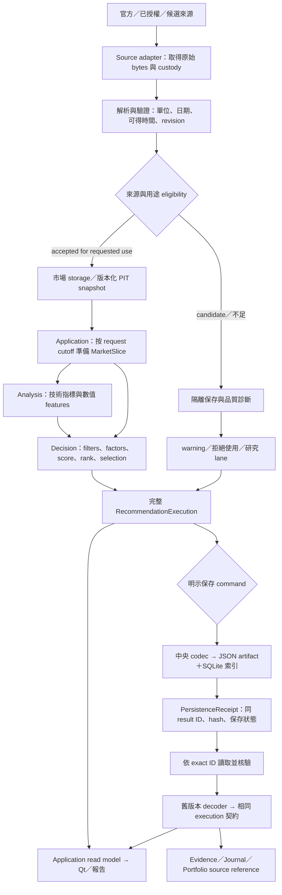
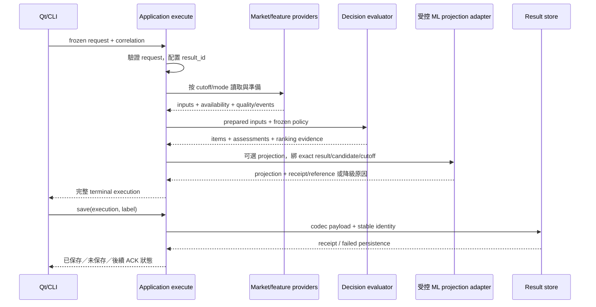
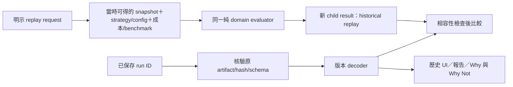
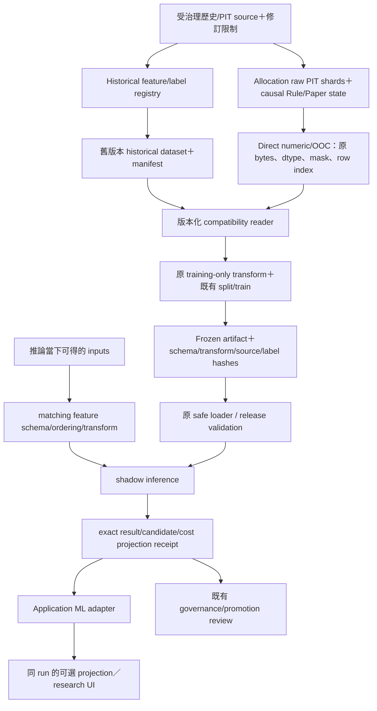

> **已被取代，僅供審查歷史（2026-09-22）**：本草案不再作為實作依據。請閱讀 [FINAL_DATA_FLOW.md](FINAL_DATA_FLOW.md)；所有目標架構決策以 [FINAL_TARGET_ARCHITECTURE](FINAL_TARGET_ARCHITECTURE.md) 為準。下文保留原稿供核對紅隊引用，與 FINAL 衝突的條文全部失效。

# 目標資料流與追溯

> 2026-09-22；待實作設計。契約 owner 以 [TARGET_ARCHITECTURE](TARGET_ARCHITECTURE.md) 為準。圖中的箭頭表示資料／控制流，不能當作 Python import 許可。

## 1. 從來源到保存與 UI

資料更新先寫受治理 storage，與推薦完成後保存結果是兩種不同 writer。pipeline 的「result → persistence」不代表來源只能在推薦完成後保存，也不授權所有執行自動寫 recommendation DB。

### 每個邊界到底交付什麼

| 邊界 | 傳遞內容 | 不可遺失／不可補造 |
|---|---|---|
| source → acquisition | 原始內容、來源 ID、requested/observed period、capture clock、raw hash、授權／用途狀態 | capture time 不能假作 publication/available time |
| parser → normalized store | key、value/unit、as-of、available time、revision、quality、raw reference | missing 與真實 0 分開；舊 raw 不覆寫 |
| reader → application | `MarketSlice`：rows／cutoff／source versions／coverage／fallback events／fingerprint | latest available date 與 request decision time 分開；候選不能替 formal 認證 |
| analysis → decision | typed feature frame＋parameter/calculator identity＋warmup／missing mask | 不在 decision 隱式重新抓取新資料；numpy float 僅留分析邊界 |
| decision → application | `RecommendationItem` 與全部 `CandidateAssessment` | 未入選、例外降級、母體／排名方法不丟失 |
| app → result | frozen request、decision/data clocks、regime、quality/events、provenance refs、items | 此次結果不再依賴 service 最新狀態 |
| result → storage | 版本化 payload、result_id、內容 hash、少數查詢索引 | precision、排序、null、unknown reason、原 identity 保留 |
| storage → replay/UI | 原 schema decoder、驗證狀態、original artifact reference | 未知 schema 不猜、不自動改寫；舊缺欄位標 unavailable |

`MarketSlice` 是 request 內有界輸入，不要求把全市場 DataFrame 每個 stage 複製一份。大量 rows 可引用 immutable artifact／唯讀 batch；資料內容變動須產生不同 fingerprint。

## 2. 推薦執行的時序

既有 calibration 先發布 immutable inference receipt 的行為仍保留在 ML adapter。Result store 不重算 projection，也不在保存時重抓 regime。UI 的 stale callback 只影響是否顯示；不能讓別的 run 的 receipt 接到目前 rows。

### terminal／品質／保存是三個維度

| 情境 | Execution | Quality／events | Persistence／UI |
|---|---|---|---|
| 全部候選被合法篩除 | completed，items 空，assessments 完整 | 明示各 filter／top-N 原因 | 可保存空結果，不能顯示「執行失敗」 |
| SQLite 失敗而既有 policy 允許 CSV | completed 或依資料不足失敗 | source fallback、來源版本／時間、degraded | UI 與保存均見同一原因；不得偽稱 SQLite observed |
| 個股計算失敗且原 policy 允許跳過 | completed，其他 rows 保留 | 個股 stage/code/error reference；維持原跳過語意 | Why Not 可見；不能只留 log |
| config／治理例外 | pre-start typed error，或 started 後 failed | 保留明確 code；不降成合法空候選 | 不發布可採用 items |
| 使用者取消 | cancelled；合作式收尾 | 已發生 events 與最後 stage | 不套用 partial rows；不偽裝 completed |
| calibration 缺／hash mismatch／隔離 | rule 結果照原 policy | 撤回未驗證模型欄位、保留理由與 reference | rule top-N 不改，不能補成有機率 |
| JSON 保存失敗／DB index 失敗 | execution 仍完成 | persistence error 不重寫 business quality | receipt=failed/pending recovery，不宣稱已保存 |
| 結果保存成功、delivery ACK 失敗 | execution 與 result durable | ACK 是另一 command outcome | 明示尚未送達，不能推導 adopted/skipped |

新 typed reason event 保留 `code`、category、stage、subject、參數、quality／severity、來源與 error reference。runtime log、negative evidence、wire payload、UI 使用同一事件；中文顯示由 presenter 轉譯，機器 code 保持穩定。舊未知 code 保留原文與安全 fallback，不丟棄也不升格健康。

## 3. 保存與跨儲存恢復

現有 recommendation JSON 與 SQLite index 無法形成單一檔案系統／資料庫原子交易。目標採本地 manifest-last／create-only 的有限協定，沿用既有 create-only 與 identical orphan retry 的能力，不引入分散式 transaction framework。

1. 在記憶體完成同一 codec 的 deterministic serialization，固定 result_id／schema／payload hash。使用者標籤與後續 notes 若可變，與 immutable execution body 分開。
2. 對新格式結果，以同目錄暫存／原子發布或既有 exclusive create 政策寫 JSON；同 identity 同內容可重用，異內容拒絕。
3. SQLite transaction 寫入 index 與 expected hash／狀態；成功才回 durable receipt。實作須以平台實際 flush／replace 行為驗證，不能僅因 rename 成功宣稱所有 crash point 安全。
4. 檔案存在但 index 未提交：列 orphan/pending，以 exact ID/hash 恢復，禁止掃「最新一筆」替代。index 有但 artifact 缺失／hash 不符：讀取回完整性錯誤，不從今日行情重建。
5. Projection receipt、result artifact、delivery journal 分屬不同 store。以 references／pending 狀態串接並按各自 idempotency 重試；不虛構跨 store 已原子 commit。

這是**新寫入契約**；舊 `save_result` 的 replace API 暫保原行為及其保護，migration step 必須列明 caller 切換。不得因目標偏好 immutable 而直接重寫舊 DB、取消既有人工刪改功能或改舊 JSON bytes。

## 4. 歷史讀取與重新執行要分開

**歷史顯示**讀保存事實，不讀最新指標或現在模型。舊資料缺 source evidence，能顯示就保留 `legacy_unproven`；不可用現有 source state 補成 verified。

**重新計算**產生新 identity，保留 source_run_id／snapshot refs／algorithm version。只有原輸入與舊算法／policy 可取得且 hash／contract 相容，才可宣稱 replay parity；其餘是新的研究執行。無 PIT 產業成分、晚到修訂、缺 available time 時保留 blocker，不用當前映射或修復後資料倒填歷史。

推薦 portfolio replay 以每個決策日的候選結果形成持倉，保留 prefilter／candidate_limit／warmup，再由 backtest core 計算既有撮合、成本、cash、position、benchmark。它與「今日名單批次回測」維持不同 mode。`日期` 為數字 YYYYMMDD 時仍走既有明確 parser；不可改成裸 epoch 解析。

## 5. ML 獨立資料流

這個圖只表示共同邊界；historical calibration 和 allocation release 使用各自 reader、schema、trainer、loader，不改成一個萬用 matrix。

- Training source hash 與 inference source hash 可以不同，但必須各自保存；相同的是模型要求的 feature/transform contract，不是強迫兩者共用來源 hash。
- 訓練資料、labels、scaler/imputer、split／purge／embargo 原算法不改；校準不能用未成熟 outcomes 或 test sample 擬合。
- 推論是可選投影，失敗回既有 rule policy；不把 shadow prediction 自動接成 filter／rank。
- 舊 numeric store 由原 schema reader 消費；新 feature 使用新 manifest 或明示 immutable extension，不在原 binary 插欄。
- Promotion、formal input acceptance、natural maturity 是既有獨立 gate，不由架構遷移取得。

完整 dtype、feature order、mask、模型相容策略見 [ML_COMPATIBILITY_PLAN](ML_COMPATIBILITY_PLAN.md)。

## 6. 開發者如何回答「這個值從哪裡來」

以推薦 `confidence_score` 為例：UI column → application read model 的 field reference → result_id/candidate → canonical item 的欄位與 method/version → evidence refs／feature inputs → source snapshot/version/available time/hash。若它只是規則匹配程度，不能連到 calibration probability 或以百分比勝率解釋。

「為什麼推薦它」：同一 execution 的 frozen config/profile、eligible universe、score contribution、rank／tie-break、selected assessment；「為什麼沒選另一檔」：同一母體中的 assessment／filter threshold／missing/fallback reason。不能以另一輪最新 matrix 或模型回答。

## 更新記錄

- 2026-09-22：定義來源、決策、保存、歷史顯示／重算、ML 與異常資料流。
