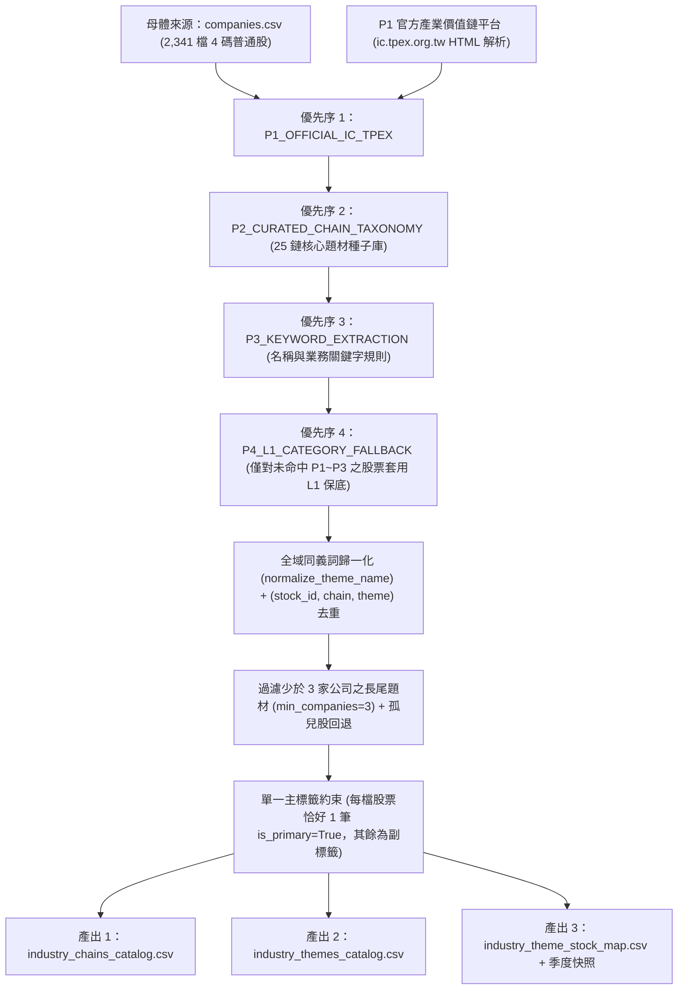
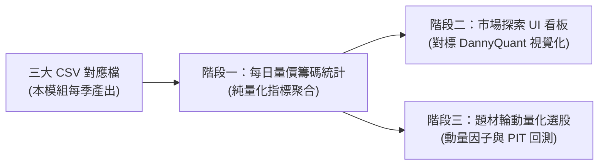

# 台股 L2 產業鏈與題材萃取、對應與分配設計文件 (`INDUSTRY_THEME_MAP_DESIGN`)

- **狀態**：原獨立萃取模組維持；後繼每日聚合已有定向驗證，市場探索接線開發中，未接選股／回測。現況與限制見[5.3](#53-後繼每日研究實作2026-10-18)。
- **核心程式位置**：[`decision_module/industry_theme_map.py`](../../decision_module/industry_theme_map.py)
- **對應單元測試**：[`tests/test_industry_theme_map.py`](../../tests/test_industry_theme_map.py)
- **設定與路徑來源**：直接讀取 [`data_module/config.py`](../../data_module/config.py) 的 [`TWStockConfig`](../../data_module/config.py#L229)，不重複建構設定常數。

---

## 1. 定位與設計原則

1. **獨立單檔、不干擾現有系統**：
   - 本階段僅聚焦於**「把產業與題材提取出來的方法」**與**「記錄產業、題材與股票的對應及分配規則」**。
   - 萃取邏輯仍封裝於單一檔案 [`decision_module/industry_theme_map.py`](../../decision_module/industry_theme_map.py)。每日聚合與 UI 沿5.3新增 application／view 邊界，沒有重寫萃取或接入每日選股。
2. **季度／手動更新即可（無須每日辨識或嵌入外部 LLM API）**：
   - 公司所屬的供應鏈與 L2 題材屬於慢變結構（一季或半年檢視一次即可）。
   - 透過本模組產出三張標準化 CSV 檔案後，未來每日行情統計只需直接讀取這三張 CSV 對齊成交量、漲跌幅與三大法人買賣超，無須每天重新萃取題材，零額外 API 負擔與維護成本。

---

## 1.1 參考來源與業界做法對標（Reference & Benchmark）

本模組之產業結構、題材分類層級與未來指標設計，主要對標市場成熟量化分析平台與官方權威資料源：

1. **核心參考架構：DannyQuant（丹尼量化）「產業地圖／題材總覽」**
   - **參考來源**：[DannyQuant 產業地圖 (https://www.dannyquant.com/industry-map/themes)](https://www.dannyquant.com/industry-map/themes)
   - **借鏡設計重點**：
     - **25 條產業鏈大分類**：將全市場股票收斂至 25 條標準產業鏈主軸（如半導體、電子零組件、通訊網路、電腦及週邊、機械設備、生技醫療、綠能環保等）。
     - **L2 題材細分（去重與長尾過濾）**：跨越交易所傳統 L1 粗分類，提煉出貼近市場資金邏輯的細分題材（如 `先進封裝(CoWoS)`、`玻纖布/玻纖紗`、`銅箔基板CCL`、`AI伺服器`、`光通訊/CPO` 等），並執行「全域去重、合併同義詞、過濾少於 3 家公司的長尾」，避免題材過度發散。
     - **純粹量價籌碼四大量化維度**：不依賴主觀新聞情緒 API，聚焦於四個確定性量價籌碼指標：
       1. 價格漲跌幅（%）
       2. 成交金額與金額放大倍數（資金熱度）
       3. 三大法人合計買賣超張數（主力動向）
       4. 買賣家數比／同類齊發度（如 20 買 / 3 賣，衡量族群共振強度）
     - **看板層次與模組規劃**：
       - 今日盤勢解讀：資金最聚焦題材、同類齊發題材、賣壓集中題材、鏈別觀察。
       - 值得關注題材 vs 資金流出 / 賣壓集中清單。
       - 三大法人題材熱度排行（累計張數與買賣家數比）。
       - 熱門題材成交金額排行與成分股清單。
       - 25 條產業鏈目錄（每條鏈之前四大題材與代表成分股）。

2. **官方權威來源：櫃買中心與證交所「產業價值鏈資訊平台」**
   - **參考來源**：[產業價值鏈資訊平台 (`ic.tpex.org.tw`)](https://ic.tpex.org.tw/)
   - **借鏡設計重點**：
     - 依據官方定義之上中下游供應鏈拓撲（`上游`、`中游`、`下游`）與官方公司成分股分類，作為分配證據之最高優先序 (`P1_OFFICIAL_IC_TPEX`)。


---

## 2. Python 程式位置與核心元件對照

| 元件／函式 | 位置 | 職責說明 |
| --- | --- | --- |
| [`get_theme_map_paths`](../../decision_module/industry_theme_map.py#L644) | `decision_module/industry_theme_map.py` | 從 `TWStockConfig` 解析 `meta_data` 目錄與三大輸出 CSV 檔案路徑。 |
| [`STANDARD_25_CHAIN_SPECS`](../../decision_module/industry_theme_map.py#L36) | `decision_module/industry_theme_map.py` | 定義台股 25 條標準產業鏈、官方 `ic.tpex.org.tw` 代碼、L1 分類映射與上中下游結構。 |
| [`SYNONYM_MERGE_RULES`](../../decision_module/industry_theme_map.py#L280) | `decision_module/industry_theme_map.py` | 全域同義詞與別名歸一化字典（如 `CoWoS`、`先進封裝` 統一收斂為 `先進封裝(CoWoS)`）。 |
| [`CURATED_THEME_BASKETS`](../../decision_module/industry_theme_map.py#L345) | `decision_module/industry_theme_map.py` | 內建 25 條產業鏈之高辨識度 L2 題材與核心概念股種子庫。 |
| [`THEME_KEYWORD_RULES`](../../decision_module/industry_theme_map.py#L618) | `decision_module/industry_theme_map.py` | 公司名稱／業務關鍵字規則（無須呼叫外部 LLM）。 |
| [`parse_ic_tpex_chain_html`](../../decision_module/industry_theme_map.py#L698) | `decision_module/industry_theme_map.py` | 解析官方櫃買中心／證交所「產業價值鏈資訊平台 (`ic.tpex.org.tw`)」單頁 HTML 的上中下游區塊與子題材公司清單。 |
| [`IndustryThemeMapService`](../../decision_module/industry_theme_map.py#L769) | `decision_module/industry_theme_map.py` | 執行四階萃取與分配 (`refresh_theme_mapping`)、PIT 快照讀取 (`load_pit_mapping`)、個股查詢 (`inspect_stock_themes`) 與題材查詢 (`inspect_theme_constituents`)。 |

---

## 3. 三大產出檔案位置與欄位契約

所有檔案預設存放於 `TWStockConfig.meta_data_dir`（預設為 `D:/Min/Python/Project/FA_Data/meta_data/`）：

### 3.1 檔案一：產業檔案 (`industry_chains_catalog.csv`)

- **預設路徑**：`<DATA_ROOT>/meta_data/industry_chains_catalog.csv`
- **用途**：記錄台股 25 條標準產業鏈（L1.5 供應鏈主軸）、上中下游範圍定義、對應之官方 `ic.tpex.org.tw` 產業鏈代碼與證交所/櫃買 L1 分類。

| 欄位名稱 | 型別 | 說明 | 範例 |
| --- | --- | --- | --- |
| `chain_id` | `str` | 產業鏈固定編號 (`CHAIN_01`..`CHAIN_25`) | `CHAIN_01` |
| `chain_order` | `int` | 顯示與排列順序 (`1`..`25`) | `1` |
| `chain_name` | `str` | 標準產業鏈名稱 | `半導體` |
| `official_ic_codes` | `str` | 對應官方 `ic.tpex.org.tw` 產業鏈代碼（`;` 分隔） | `D000` |
| `mapped_l1_categories` | `str` | 對應 `companies.csv` 的 `industry_category`（`;` 分隔） | `半導體業;半導體` |
| `default_theme_name` | `str` | 該產業鏈之保底 L2 題材名稱 | `IC設計` |
| `default_chain_tier` | `str` | 保底預設上中下游位置 (`上游`/`中游`/`下游`/`整合`) | `上游` |
| `upstream_summary` | `str` | 上游關鍵節點定義 | `矽智財IP/ASIC、EDA、IC設計...` |
| `midstream_summary` | `str` | 中游關鍵節點定義 | `晶圓代工(先進與成熟製程)...` |
| `downstream_summary` | `str` | 下游關鍵節點定義 | `先進封裝(CoWoS/3DIC)、IC封裝測試...` |
| `active_theme_count` | `int` | 該產業鏈下有效 L2 題材數量（`>= 3` 家公司） | `9` |
| `mapped_company_count` | `int` | 歸屬於該產業鏈之不重複公司總家數 | `245` |
| `snapshot_date` | `str` | 快照基準日 (`YYYY-MM-DD`) | `2026-10-16` |

### 3.2 題材檔案 (`industry_themes_catalog.csv`)

- **預設路徑**：`<DATA_ROOT>/meta_data/industry_themes_catalog.csv`
- **用途**：記錄全域去重、同義詞合併並過濾少於 3 家公司長尾後的標準 L2 題材清單（目前預設產出 90 個核心題材，涵蓋 25 條產業鏈）。

| 欄位名稱 | 型別 | 說明 | 範例 |
| --- | --- | --- | --- |
| `theme_id` | `str` | 題材唯一鍵 (`<chain_name>::<theme_name>`) | `電子零組件::玻纖布/玻纖紗` |
| `chain_name` | `str` | 所屬之 25 大標準產業鏈 | `電子零組件` |
| `theme_name` | `str` | 歸一化後之標準 L2 題材名稱 | `玻纖布/玻纖紗` |
| `default_chain_tier` | `str` | 該題材在供應鏈中的主要階層 (`上游`/`中游`/`下游`/`整合`) | `上游` |
| `synonyms_merged` | `str` | 已合併至此題材之同義詞／別名（`;` 分隔） | `玻璃纖維布;玻纖布;玻纖紗` |
| `keyword_rules` | `str` | 用於輔助辨識此題材之關鍵字規則（`;` 分隔） | `玻纖;玻璃纖維` |
| `extraction_sources` | `str` | 實際命中此題材之分配方法來源（`;` 分隔） | `P2_CURATED_CHAIN_TAXONOMY;P3_KEYWORD_EXTRACTION` |
| `company_count` | `int` | 題材成分股總家數（必 `>= min_companies`） | `4` |
| `primary_company_count` | `int` | 以此題材作為主標籤 (`is_primary=True`) 之公司家數 | `3` |
| `sample_stock_ids` | `str` | 代表性成分股代號前 5 檔（`;` 分隔） | `1802;1815;5340;1303` |
| `sample_stock_names` | `str` | 代表性成分股名稱前 5 檔（`;` 分隔） | `台玻;富喬;建榮;南亞` |
| `snapshot_date` | `str` | 快照基準日 (`YYYY-MM-DD`) | `2026-10-16` |

### 3.3 產業題材股票對應檔案 (`industry_theme_stock_map.csv`)

- **預設路徑**：
  - 最新對應表：`<DATA_ROOT>/meta_data/industry_theme_stock_map.csv`（同步寫入相容別名 `<DATA_ROOT>/meta_data/industry_chains_latest.csv`）
  - 季度歷史快照：`<DATA_ROOT>/meta_data/industry_chain_snapshots/industry_theme_stock_map_<YYYYMMDD>.csv`
  - 快照索引清單：`<DATA_ROOT>/meta_data/industry_chain_snapshots/manifest.json`
- **用途**：記錄每一檔 4 碼普通股對應至哪一條產業鏈、哪一個上中下游階層、哪一個 L2 題材，以及其具體分配方法 (`assignment_method`) 與證據來源 (`evidence_note`)。

| 欄位名稱 | 型別 | 說明 | 範例 |
| --- | --- | --- | --- |
| `snapshot_date` | `str` | 季度映射基準日 (`YYYY-MM-DD`) | `2026-10-16` |
| `available_date` | `str` | PIT 可見日 (`YYYY-MM-DD`)，防止歷史回測偷看未來題材分類 | `2026-10-16` |
| `stock_id` | `str` | 4 碼普通股代號 | `2330` |
| `stock_name` | `str` | 公司簡稱 | `台積電` |
| `market_type` | `str` | 市場別 (`twse` 上市 / `tpex` 上櫃) | `twse` |
| `l1_industry_category` | `str` | `companies.csv` 原始證交所/櫃買 L1 分類 | `半導體業` |
| `chain_name` | `str` | 分配後之標準 25 條產業鏈名稱 | `半導體` |
| `chain_tier` | `str` | 供應鏈位置 (`上游`/`中游`/`下游`/`整合`) | `中游` |
| `theme_name` | `str` | 分配後之標準 L2 題材名稱 | `晶圓代工` |
| `is_primary` | `bool` | 是否為該公司之唯一主標籤（每檔股票必有且僅有一筆 `True`） | `True` |
| `assignment_method` | `str` | 四階分配方法代碼（見第 4 節） | `P2_CURATED_CHAIN_TAXONOMY` |
| `source_name` | `str` | 來源識別碼 | `curated_ic_taxonomy` |
| `source_tier` | `str` | 證據等級 (`T1` 官方/權威種子、`T2` 規則/L1保底) | `T1` |
| `pit_mode` | `str` | 時間點模式 (`quarterly_snapshot`) | `quarterly_snapshot` |
| `evidence_note` | `str` | 分配依據明細 | `official_ic_curated_taxonomy_v1` |

---

## 4. 產業與題材的萃取方法及股票分配邏輯



### 4.1 四階萃取與分配優先序 (`assignment_method`)

1. **`P1_OFFICIAL_IC_TPEX`（官方產業價值鏈平台節點解析）**：
   - 來源：櫃買中心／證交所共同維護之「[產業價值鏈資訊平台 (`ic.tpex.org.tw`)](https://ic.tpex.org.tw/)」。
   - 方法：[`parse_ic_tpex_chain_html`](../../decision_module/industry_theme_map.py#L698) 解析頁面中之 `<div class="chain-title-panel">上游|中游|下游</div>` 與 `<div id="companyList_<SUBCODE>" title="<細分題材>">`，直接提取官方定義之供應鏈位置與細分題材成分股。
2. **`P2_CURATED_CHAIN_TAXONOMY`（台股 25 鏈與高辨識度 L2 題材種子庫）**：
   - 來源：[`CURATED_THEME_BASKETS`](../../decision_module/industry_theme_map.py#L345)。
   - 方法：針對官方 L1 分類無法細分之市場核心概念（如 `先進封裝(CoWoS)`、`矽智財IP/ASIC`、`玻纖布/玻纖紗`、`銅箔基板CCL`、`ABF/BT載板`、`散熱模組`、`AI伺服器`、`光通訊/CPO`、`低軌衛星/太空`、`機器人/自動化`、`無人機`、`重電/電線電纜` 等），建立結構化多標籤種子庫。
   - 多標籤支援：同一家公司可同時歸屬於多個供應鏈角色（例如 `2330` 台積電同時具備 `晶圓代工`、`先進封裝(CoWoS)`、`光罩`；`1303` 南亞同時具備 `塑膠原料`、`玻纖布/玻纖紗`、`銅箔基板CCL`）。
3. **`P3_KEYWORD_EXTRACTION`（確定性關鍵字萃取規則）**：
   - 來源：[`THEME_KEYWORD_RULES`](../../decision_module/industry_theme_map.py#L618)。
   - 方法：掃描 `companies.csv` 母體之公司名稱與分類特徵（如含「玻纖」、「散熱」、「不鏽鋼」、「金控」、「銀行」、「保險」等），自動補齊細分題材標籤。
4. **`P4_L1_CATEGORY_FALLBACK`（證交所/櫃買 L1 分類保底分配）**：
   - 來源：[`L1_CATEGORY_TO_DEFAULT_THEME`](../../decision_module/industry_theme_map.py#L228)。
   - 方法：**僅針對尚未在 P1、P2、P3 命中任何題材的普通股**（或因長尾過濾而失去唯一題材之股票），依其在 `companies.csv` 的原始 `industry_category` 分配至對應之 25 大產業鏈與保底 L2 題材。此規則確保：
     - 已明確歸類為 `晶圓代工` 的 `2330` 台積電**不會**被錯誤塞入半導體保底的 `IC設計`；
     - 同時保證全市場 2,341 檔 4 碼普通股 100% 都有歸屬的產業鏈與題材，不會產生孤兒股。

### 4.2 全域同義詞合併、去重與長尾過濾規則

- **同義詞合併 (`normalize_theme_name`)**：
  - 透過 [`SYNONYM_MERGE_RULES`](../../decision_module/industry_theme_map.py#L280) 將不同來源的同義詞統一收斂（例如 `CoWoS` / `先進封裝` / `3DIC封裝` $\rightarrow$ `先進封裝(CoWoS)`；`CCL` / `銅箔基板` $\rightarrow$ `銅箔基板CCL`；`矽光子` / `CPO` $\rightarrow$ `光通訊/CPO`）。
- **唯一鍵去重**：
  - 以 `(stock_id, chain_name, theme_name)` 為唯一鍵去重；若同一檔股票在同一題材被多個方法命中，保留優先序較高（`P1 > P2 > P3 > P4`）之紀錄。
- **長尾過濾 (`min_companies = 3`)**：
  - 統計每個 `(chain_name, theme_name)` 的不重複公司家數，自動剔除少於 3 家公司的長尾題材；若某檔股票因長尾題材被剔除而沒有任何剩餘題材，自動觸發第二輪 `P4_L1_CATEGORY_FALLBACK` 回退至該鏈主幹題材。
- **單一主標籤約束 (`is_primary`)**：
  - 每檔股票的所有題材列中，依優先序與種子庫宣告順序將第一順位標記為 `is_primary = True`，其餘延伸題材標記為 `is_primary = False`。
  - 未來若需要「不重複計數的全市場板塊統計」，可篩選 `is_primary == True`；若需要「概念股完整清單與題材熱度看板」，則使用全部對應列。

---

## 5. 操作方式與未來交接給 Codex 的使用指南（Future Usage Guide & Roadmap）

### 5.1 檔案維護週期與 CLI 指令（一季或半年一次）

本模組產出之三大 CSV 檔案為**靜態結構資料**，無須每日排程執行；建議於**每季財報公布後**或**官方產業鏈更新時**（約一季至半年一次）執行維護即可：

```powershell
# 1. 建置／更新三大 CSV 檔案（離線使用內建 25 鏈與題材庫 + companies.csv）
$env:PYTHONUTF8=1
.\.venv\Scripts\python.exe -m decision_module.industry_theme_map build-files --snapshot-date 2026-10-16

# 2. （可選，每季一次）連線向官方 ic.tpex.org.tw 抓取最新產業鏈節點並更新三大 CSV 檔案
.\.venv\Scripts\python.exe -m decision_module.industry_theme_map build-files --snapshot-date 2026-10-16 --fetch-official-ic

# 3. 查詢單一股票（例如 2330）被分配到的產業鏈、L2 題材與分配依據
.\.venv\Scripts\python.exe -m decision_module.industry_theme_map inspect-stock --stock-id 2330

# 4. 查詢單一題材（支援同義詞，例如 CoWoS 或 玻纖布）的所有概念股清單
.\.venv\Scripts\python.exe -m decision_module.industry_theme_map inspect-theme --theme-name CoWoS

# 5. 檢查三大檔案路徑與快照狀態
.\.venv\Scripts\python.exe -m decision_module.industry_theme_map status
```

---

### 5.2 未來三階段使用路徑（交接給 Codex 推進指引）

未來 Codex 或後續開發任務推進時，**不需要重寫或更動本模組的萃取邏輯**，而是以三大 CSV 檔案為基礎，按以下三階段逐步落實：



#### 階段一：每日量價籌碼統計聚合服務（`decision_module` / `app_module`）

- **目標**：每日盤後批次計算各題材的純量價籌碼指標，無須呼叫外部 LLM API，盤後運算秒級完成。
- **資料輸入**：
  1. 題材對應表：讀取 `industry_theme_stock_map.csv`（或透過 `load_pit_mapping` 取得指定日快照）。
  2. 當日行情：`daily_prices`（股價、漲跌幅、成交金額、5 日均量）。
  3. 籌碼流向：`institutional_flows`（外資、投信、自營商買賣超張數與金額）。
- **四大核心指標演算法**：
  1. **價格漲跌幅（%）**：成分股漲跌幅之等權或成交金額加權平均。
  2. **成交金額與放大倍數**：題材內所有成分股成交金額加總（億元），以及當日成交金額相較於過去 5 日均量的放大倍數。
  3. **三大法人合計買賣超**：題材成分股的外資、投信、自營商買賣超張數與金額加總。
  4. **買賣家數比／同類齊發度**：統計成分股中法人買超家數 vs 賣超家數（例如「20 買 / 3 賣」）以及上漲家數比率，精準衡量族群共振強度。
- **Python 調用契約範例**：
  ```python
  from data_module.config import TWStockConfig
  from decision_module.industry_theme_map import IndustryThemeMapService

  config = TWStockConfig()
  theme_service = IndustryThemeMapService(config)

  # 讀取符合當日 PIT (available_date <= as_of_date) 的股票對應表
  mapping_rows, snap_date, avail_date, pit_status, warnings = (
      theme_service.load_pit_mapping(as_of_date="2026-10-16")
  )

  # 依 (chain_name, theme_name) 分組取得概念股清單，即可對齊 daily_prices 與 institutional_flows
  # 範例：分組後計算各題材之合計成交額、平均漲跌幅與法人買賣家數比
  ```

#### 階段二：市場探索 UI 看板整合（`ui_qt/views/`）

- **目標**：在現有 `ui_qt` 介面的「市場探索」分頁下，新增或擴充「題材總覽／產業地圖」檢視，介面佈局完全對標 DannyQuant：
  1. **今日盤勢解讀看板（頂部資訊卡）**：
     - **資金最聚焦題材**（成交金額放大、法人買超居前）。
     - **同類齊發族群**（法人買超家數佔比極高之族群，如「鋼鐵」、「電子製造服務EMS」）。
     - **賣壓集中題材**（法人顯著賣超、下跌家數佔比高，如「先進封裝(CoWoS)」）。
     - **鏈別觀察**（分析資金主要集中在 25 條中的哪幾條產業鏈）。
  2. **焦點清單與排行（中部卡片群）**：
     - 「值得關注題材」vs「資金流出題材」卡片。
     - 「三大法人題材熱度排行」清單（顯示合計張數與買賣家數比）。
     - 「熱門題材成交金額排行」（顯示成交億元、佔比與概念股檔數）。
  3. **產業鏈題材目錄（底部 25 條產業鏈卡片）**：
     - 呈現 25 條標準產業鏈卡片，每張卡片列出前 3~4 大代表題材與漲跌幅。
     - 點擊任一題材卡片可彈出或切換至「概念股清單與籌碼明細」，並標示各成分股所屬上中下游階層與分配依據。

#### 階段三：題材輪動量化選股與策略回測（`strategy_module` / `decision_module`）

- **目標**：將題材熱度轉化為量化因子，提升突破與動量選股勝率，並確保回測安全：
  1. **題材動量與共振濾網**：
     - 在個股技術面策略（如突破新高、量縮整理出量）之上，疊加「所屬題材同類齊發度高（法人買家數比 > 70%）」與「資金流入前 20%」之濾網，過濾孤軍奮戰的個股，提高勝率。
  2. **嚴格杜絕未來函數（PIT-Compliant Backtesting）**：
     - 回測引擎在執行歷史特定日期 `T` 之模擬時，統一呼叫 `theme_service.load_pit_mapping(as_of_date=T)`。
     - 系統保證僅回傳 `available_date <= T` 之季度快照，絕不引用未來才被歸納的題材標籤。


---

### 5.3 後繼每日研究實作（2026-10-18）

後繼M1新增`TPExThemeFlowReader`，只把具名TPEx diagnostics固定批次的同日三原net股數投影到既有`ThemeFlowObservation`，不建正式DB、不推TWD金額或授歷史資格。多股public port在原每日驗證內核一次重驗全批，保持雙SHA、EOF、單位／合計、可用時鐘、用途及變動守衛；缺股、非TPEx與異日不補零或借日。QA185–188限定通過原API相容／精度／時鐘與用途守衛及真原件新程序；10/19資料與原10/16映射中890個TPEx代號的交集為763，66題材僅部分覆蓋，原90題材逐列核原整數及缺件。這些是明示TPEx部分診斷，不能叫完整題材或市場總流向。Source另以精確TPEx flow-only v2 manifest接原snapshot reader，QA200限定compile／61PASS與2個環境symlink略過／85／25-0-4／mypy1082；真v2 public／正常Main與新程序尚待。固定08仍只有原題材價量，09沒有v2，不提前將法人卡列為完成；新10/19日報另可在原法人唯讀頁明選。

2026-10-19後續Source補已載入版本的股票反查：只查snapshot.mapping，代號精確四碼／名稱片段，列出多題材及同名股票供明選，再核當前identity與原成員定位。沿原stockSelected與Main context，不加reader、金融公式或外部資料。換版／失敗／取消／關閉清舊結果；QA133–134正常Source與新程序限定通過，固定05的QA136–140再驗受改EXE／新程序並封存交付，固定04保持。法人／合格日曆與歷史PIT的三階段依賴不由此解除。

依使用者的 Active Resolution Gate 修正，人工產品簽核不阻塞無關開發；真實金融來源、歷史PIT、自然成熟及私人帳資格仍各自保留。143固定包不變，以下為後繼Source成果。

- [`ThemeDailyService`](../../app_module/theme_daily_service.py)只讀既有映射與 typed observations，不寫資料或自動建立今日分類。拒絕replay-only／bootstrap映射，逐列核快照／可用日期，並要求額外精確的mapping可用時鐘；只檢查首列或manifest日期不夠。`historical_pit_eligible`固定false，日期對齊不授來源用途／歷史資格。
- [`SQLiteThemeMarketReader`](../../app_module/theme_daily_sqlite_reader.py)只讀明選SHA版本，拒絕WAL／SHM／journal旁檔，使用mode=ro與query_only，前後核hash。只接受保存完成後的可用小時，不從DB日期推定公告時間。日價差沿共用方向解析，正的絕對價差缺方向時保持未提供。
- [`read_theme_research_snapshot`](../../app_module/theme_research_snapshot.py)載入自選本機版本：manifest schema為`baldr.theme_research_snapshot.v1`，含`data_date`、`saved_completed_at`、`mapping`與`prices`各自的相對`path`／`sha256`。檔案須在同包內；mapping CSV上限4MiB、價格DB上限64MiB、manifest上限32KiB。保存批次先轉台北，再將小時向上取整；到點前拒讀。這是成功批次可用時間，非官方發布timestamp或歷史PIT證明。

| 指標 | 口徑、單位與缺件 |
|---|---|
| 題材平均漲跌 | 已知有方向價差／前收的等權平均，單位%；逐題材揭露有效檔數／成員數。缺方向、零或無效前收不補值。 |
| 成交金額 | 已知成員的TWD原金額合計；缺部分時覆蓋率不足，不稱全題材完整總額；全缺為None。 |
| 五日量能倍數 | 同一全體成員今日成交股數／前五交易日平均成交股數。缺已核日曆、任一成員或任一日資料時不可用；不取後一筆或最近五筆補日。 |
| 法人合計 | 外資（含原來源外資自營）／投信／自營商原股數合計，三分項有缺則該股不可用；TWD金額分欄，不以股價推算。 |
| 共振 | 上漲家數／漲跌幅已知家數；法人買超家數比另列。不另造綜合強度分數。 |
| 多標籤 | 同題材同股去重；不同題材可各計一次。題材總數或跨題材案例加總不是全市場真N，亦不能把重疊題材金額相加當全市場總額。 |

原單元／映射及只讀接線52項已通過，真實本機單日1949檔／2537映射列形成90題材／25鏈，五次純聚合中位0.026秒。工程量測使用明示離線cutoff，沒有提前授日常可用性；法人與五日曆未包含於該量測，相關欄位不可用。新增snapshot／UI與獨立複核的實際狀態見[本輪QA](../06_qa/BALDR_THEME_DAILY_QA_20261018.md)，不能由後端PASS宣稱UI或完整M1–M4完成。

### 5.4 後繼呈現與研究筆記

後繼Source補上原階段二的產業鏈卡片目錄（固定10未含）。預設收合，沿同一頁scroll area展開全部presentation.chains，每鏈列原題材數與去重成員數，名稱序前三題材作捷徑；完整90題材仍沿原篩選器，不把前三解讀為績效排行。只在原mean_return_pct為有限Decimal且returns覆蓋全部正數members時顯示，真零／負值保留；部分或缺值顯示未提供及原x/N，不新增計算。Qt按鈕保存建立時的來源／鏈／題材屬性，由具名QObject接收槽交既有filter；點擊再核identity、busy、closed與原題材列。換版、失敗、取消、關閉清除／停用舊控制，無新reader、DTO、Journal寫入或市場資格；實際技術接受以本輪QA為準。

固定08補雙向觀察排行：`build_theme_research_presentation(snapshot, *, ascending=False)`維持預設高到低，明選低到高時從全體合格題材重新取五名，不倒排已截出的高端五名。先按鏈／題材名稱穩定排序，再直接比較Decimal／整數原值，不用負號等算術建立排序鍵，避免呼叫端精度設定改變順序。同值兩方向均按名稱升冪；零／負值及完整欄位覆蓋守衛保持。UI沿既有排行類型選排序方向，四張摘要維持高端，不將低值自動解讀為下跌或賣超；07未含；Source與固定EXE分別接受，見[QA176起](../06_qa/BALDR_THEME_DAILY_QA_20261018.md#題材雙向排行qa176177)。

回訪比較只投影已載入清單中的精確直接父子修訂；兩者須非同一修訂，且完整snapshot SHA與資料日一致。非模態視窗並列唯讀原文，保存時間各列原值；切換、刷新、背景忙碌或關閉清除舊比較。缺父版或身份不符不猜補，不新增來源讀取、Journal寫入、文字評分或績效／PIT資格。

`theme_research_presentation`只選相關欄位覆蓋完整且值存在的題材，依精確Decimal／整數排序，穩定取前五；零與負值不丟棄。鏈目錄去重，跨題材重疊不加總為全市場績效。`IndustryThemeMapView`呈現四類觀察、排行、25鏈目錄及成員；Main沿既有ResearchStockContextDTO開一般個股並返回同一來源頁，不混合題材行情與一般價庫。

`ThemeResearchNoteService`沿既有Journal的ACTION_NOTE追加修訂，保存原文、精確snapshot身份與獨立資料日tag；`created_at`為實際保存時鐘，決策日期及股票／推薦身份保持未知。每篇新筆記有獨立實體根，同快照可保存多篇；追加修訂沿原根，過時祖先仍由原Journal修訂鏈拒絕。讀歷史後以原history token提交，並行改動會拒絕過時保存。Widget背景保存固定送出時來源，回訪原文唯讀，再開來源須核原SHA；關閉時等待已送出的寫入完成，不能由全域取消丟棄。服務信任caller提供已由reader明選讀回的typed snapshot，不自行認證官方來源或磁碟防竄改。驗證狀態仍以本輪QA逐項為準。

## 6. 關聯文件索引

- 模組架構定位：[`docs/01_architecture/system_architecture.md`](../01_architecture/system_architecture.md)
- 資料儲存與 `meta_data` 檔案契約：[`docs/01_architecture/current/data_storage_runtime.md`](../01_architecture/current/data_storage_runtime.md)
- 專案目前狀態快照：[`docs/00_core/PROJECT_SNAPSHOT.md`](../00_core/PROJECT_SNAPSHOT.md)
- 功能與文件映射表：[`docs/00_core/FEATURE_DOCUMENT_MAP.json`](../00_core/FEATURE_DOCUMENT_MAP.json)
- QA 驗證收據：[`docs/06_qa/INDUSTRY_THEME_MAP_STANDALONE_QA_20261016.md`](../06_qa/INDUSTRY_THEME_MAP_STANDALONE_QA_20261016.md)
