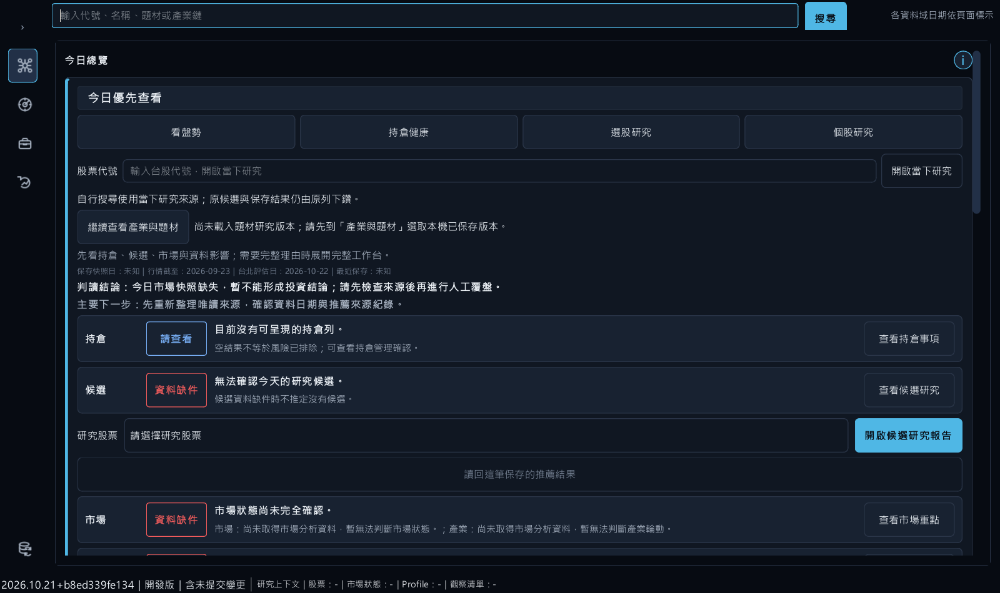

# Baldr V2｜自動化驗收一頁摘要

2026-10-21（America/Los_Angeles）。最終工程裁決：**`PRODUCT_RC_READY_WITH_LIMITATIONS`**。包含 `b8ed339f` 已驗功能與本次首頁日期修復；本機來源版研究 RC：**`PRODUCT_RC_AUTOMATED_VERIFIED_OWNER_UAT_PENDING`**，僅涵蓋下列已核實的功能。Owner UAT 不作日常開發或 RC 準備的前置條件；不要求現在逐頁點測。

**四軌分開記錄：**`CODE_AND_CONTRACT_VERIFIED`、`AUTOMATED_GUI_E2E_VERIFIED` 均限定所列版本／資料／動作；原生 Windows 軌為 `NATIVE_SMOKE_NOT_EXECUTED`（既有停止指示維持），Owner 軌為 `OWNER_UAT_NOT_PERFORMED`。離屏 GUI 不代表原生桌面或真人驗收。

| 研究旅程 | 已自動核實的功能 | 仍受限的分支 |
|---|---|---|
| 總覽／線索→個股→保存→返回 | 保存推薦與歷史報告的保存、重開、返回；真正 `main()` 啟動與首頁缺件提示／入口停用 | QA162隔離樣本缺首頁狀態；本輪真reader回1列並保留degraded／stale，未新驗正常Main正向首頁全旅程 |
| 題材→成員→個股→返回 | 固定題材版本、成員導航、保存重開及原選列返回；題材日與行情日分列 | 限已核實樣本，不代表全市場或歷史 PIT |
| 選股→比較→個股→返回 | 兩股價格母體查詢／比較；共用收藏真 writer／strict 重讀；歷史／最新往返與 Alt+Left 恢復原 query／page／row | 月營收正式 binding 缺件，未驗跨來源正向旅程 |
| 判斷→Paper／Forward→覆盤 | Journal 保存／重開、當時與現在對照；帳種隔離與缺資格拒絕；Paper 前置頁返回 | 通用正向建帳未實作且缺合法帳戶／同日行情／現金；不造 NAV，Forward 成熟度另核 |
| 策略→回測→保存→比較 | 原有回測執行與 Registry 保存／重開；目前 Main 的相容比較120日／240列、不相容拒絕與返回 | 固定研究資料，不代表 Alpha 或金融資格；本輪不重新執行策略 |

正常來源 `main()` 已驗17路由、1280×760／125% DPI，以及1500×900、1440×900、1920×1080首頁。Registry 補驗的功能步驟完成，但整輪因守衛阻止 urllib3 本機 IPv6 能力探測而 FAIL；原 FAIL 保留，不能稱整輪通過。詳見[四軌與原始證據範圍](BALDR_V2_PRODUCT_ACCEPTANCE_20261020.md#自動化優先與四軌驗收2026-10-21-owner-override)。

首頁原狀態存在於正式 `FA_Data/output`，不是缺少生成器或未接線。修正 reader 將行情截止日錯比決策日的缺陷後，真來源仍保留10/21決策、10/20資料日與10/22過時限制，未取得Paper或正式推薦資格。QA171編譯、75項定向、85項Workbench、更新頁25／0／4及mypy1108檔通過；真來源四檔保持不變。[工程收尾診斷與裁決](BALDR_V2_PRODUCT_ACCEPTANCE_20261020.md#最終工程收尾診斷2026-10-21)已完成，金融待辦另管，不再重複阻塞檢查。

**版本與使用界線。** 來源入口仍是 `ui_qt/main.py`；既有 `eefd2163ad95` EXE、啟動器與恢復點保留，該包未包含後繼兩項鍵盤及本次首頁日期修復，沒有為本輪重建 Trial。月營收／Paper 真來源、今日候選、歷史 PIT、自然 Forward 與 ML promotion 均不由自動 GUI 升格。完整五旅程所有分支仍未宣告通過；正式發布另需授權。

**可查視覺證據。** 下圖是 QA162 的離屏125%首頁，缺來源有明確提示；[QA159價格原查詢返回畫面](assets/baldr-v2-price-return-qa159.png)另保留同列回訪證據。

**日後可選的三項體驗回饋，無須現在回答：** 首頁入口是否容易找到？歷史資料日與當下查詢是否清楚區分？缺件提示是否說明可做的下一步？這些不是必做 UAT 或候選前置條件。
