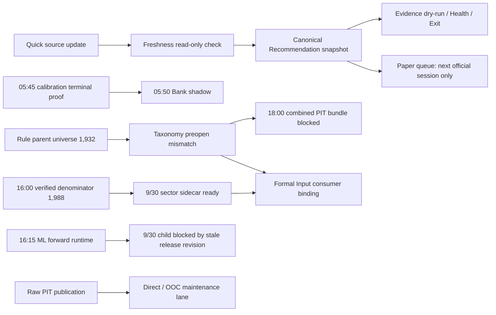

# 排程問題全面修復與執行驗收（2026-09-30）
<!-- Markdown 結構重建：以保留的損壞原件為文字來源；非空白原文未修改。 -->

## 2026-10-01 後續收據與範圍更正

本節為較新 readback；下文原 9/30 task matrix 的「尚未到」與當時 latest 說明保持歷史觀測，不再代表目前狀態。Task 的註冊時鐘、程式修復、受控 probe、自然 trigger 與 business qualification 仍分開判讀。

- **Paper 1418 更正**：使用者已明確說沒有 1418 持倉；repo／隔離 snapshot `paper-main-20260930` 的 1418=3,000 shares 是由 machine research seed 初始化，不是使用者實際持倉。Evidence／Position Health 的 `paper_position_identity_unproven:1418` 與 `human_thesis_required_before_health_transition_validation` 是這個 machine-seeded Paper lane 的研究品質診斷，不得要求使用者補 1418 成交、entry 或 thesis，也不能從此推論使用者的其他持倉為空。`portfolio_alert_snapshot_quality_not_ready`、`risk_prompt_snapshot_quality_not_ready` 仍是獨立 source-quality gaps；不得藉由刪 seed、造欄位或把 seed 說成 user holding 清除它們。
- **9/30 Pacific 16:15（10/1 Taipei 07:15）Paper／ML runtime 未終態**：唯讀 inventory `output/qa/scheduled_task_inventory_20261001T002916Z_940402272834.json` 為 52,144 bytes、SHA-256 `9bbe91e9c6b1cc723222e87cd92a9751e8ff9985de9f3d7f4f76c2946193e374`，觀測時鐘 `2026-10-01T00:29:16.0923064Z`（10/1 Taipei 08:29:16、08:30 cutoff 前 44 秒），於該時鐘檢查 21/21 exact root task paths、0 errors。inventory acquisition 約在 00:29:24Z；aware timestamp 正規化見保留原件的[UTC addendum](../../output/qa/scheduled_task_inventory_utc_addendum_20261001T003155Z_a1ac85cf0b7b.json)，原 inventory bytes 未改。Paper portfolio 與 ML forward Task 均 Ready、`LastTaskResult=3221225786`（`0xC000013A`）；當次 runtime 為 `waiting_for_taipei_cutoff`、`terminal=false`，heartbeat stale，latest 仍是前一日。Paper XML 未明列 ExecutionTimeLimit，ML forward 為 PT2H，兩者無 delay，operational logging disabled；這些設定不是中止原因證據。無同次 terminal 可結案，原因仍 unknown，不推斷 timeout、source blocker、passed 或 failed；cutoff 後沒有可引用的 same-run terminal，不能由已到 08:30 推定成功。Paper EOD 06:00 no-work 是不同 Task。
- **05:15 Evidence／05:25 capture**：9/30 自然 05:15 `latest_status.json` 為 `degraded`、`exit_code=0`，SHA-256 `6217e7983df9a13bd81aa6c30cf76a411313001fdc4445e3cc8cbda8fbef4c6b`；natural maturity warning 為 `INSUFFICIENT_SAMPLE`，source coverage 另有兩個 portfolio/risk snapshot-quality blockers。9/30 自然 05:25 capture 已持久化並通過讀回：run `20260930T122502721503Z-9dd2d94b9b6c`，D-root status SHA-256 `a3e3e0eec25471d03b4a156d2525882a406aaebf9bae9e0cea29927e90b455fd`，`status=passed`、`capture_mode=eod_research`、`research_only=true`、`natural_authority=false`、`preopen_authority=false`。因此 05:25 可以在 seed degraded 時留下低階研究 capture；這不代表 Health transition、verified/PIT 或 Formal qualification 通過。
- **Freshness**：受控 read-only probe 以 same-buffer status SHA 與 append-only history record 綁定 Quick run `20260930-32560`，範圍只為 `terminal_receipt_identity_only`。Freshness probe exit 0、status `degraded`、network fallback 0，保留 `monthly_revenue_expected_period_not_available`、`quarterly_statement_expected_period_not_available` 及兩項 current observations freshness warnings；16 項輸入 before/after 一致。此為受控 probe，不取代下一個自然 Freshness Task，詳見[Freshness QA](SCHEDULER_FRESHNESS_QUICK_BINDING_20261001.md)。
- **基本面研究**：目前使用的 TWSE+TPEx 月營收 live candidate 為 `output/fundamental_research_candidates/20260930T221743808050Z-4148c176e04b4b958b305ed9e971b987/`，完整 1,978-key research scope；兩個官方 response 完成於 `2026-09-30T22:17:45.393277Z`／`2026-09-30T22:17:48.275856Z`，候選完成於 `2026-09-30T22:17:48.394676Z`（10/1 Taipei 06:17:48），date-only availability 保守為 10/2。no-apply recovery preview 為新增 availability 1,978、舊 mapping 1,832、合併 3,810、衝突 0；正式 source/unit acceptance 仍 false。較早 8 月 MOPS availability diagnostic 是 15/15 queries、3,150 events、最大單窗 703 rows；該 legacy artifact 無成功 HTTP raw entity sidecar。另一個最近完整 7 日 MOPS run `run_20260930T221808809646Z` 是受控 standalone collector capture，並非自然 weekly wrapper child；6 successful queries（2 markets × F26/F27/F28）、36 events／36 projection rows、0 duplicate/future/invalid/failed/official-no-data。artifact 57,850 bytes、SHA `7a50834e63d9429ef23b3716c38cd69d75b6881df1309a25a20fd574fa70f57d`，raw receipt SHA `49b37a3f4619dcee4f592f53866819a84a78bf93b56f8a1c4b57328d85affbce`，保存 6 HTTP entities、16,506 bytes。季度 OpenAPI collector 10/1 Taipei 07:41–07:42 由受控 standalone CLI 實際執行一次 26 GET（2 catalog + 24 數值；尚非自然 weekly child），raw 3,960 rows、preview 3,952 rows；6 個 TPEx key-review 與 TPEx balance `ins`／`mim` 2 個 schema-review rows 原樣保留，非 official no-data。CLI 首次 live outer exit 1 是 readback 後 Windows cp1252 輸出錯誤；collector terminal/raw 已離線重驗，ASCII-safe 修正由 mock 驗證，沒有為修補再抓 HTTP。這些仍是 research-only；一般金額單位、issuer coverage、歷史 announcement availability 與 Formal/PIT qualification 未成立。細節見[基本面 QA](SCHEDULER_FUNDAMENTAL_BOOTSTRAP_20260930.md)、[來源／季度 catalog QA](FUNDAMENTAL_SOURCE_ACCEPTANCE_AND_QUARTERLY_CATALOG_20261001.md)與[季度 capture QA](SCHEDULER_QUARTERLY_OPENAPI_RESEARCH_CAPTURE_20261001.md)。
- **PIT taxonomy**：10/1 自然 07:00:29 台北 caller 因 missing capture-attempt path 被 guard 擋住；`network_attempted=false`、`new_attempt_created=false`，不是新 network capture。07:12–07:13 另以 saved config 建立 late proof；既存 10/1 split bundle 完整唯讀 validation 通過後，隔離 same-day reuse 於 07:19:48 台北成功 readback，`machine_verified_candidate`、0 HTTP／0 new attempt、Formal flags false。原自然 Task 的 blocked latest 未被覆寫，不能追認成 pass；late proof 足以支援本次同日研究 reuse，不能推出跨日 eligibility。official denominator 1,988、Rule candidate 1,932、intersection 1,931；Rule scope 仍不相容。詳見[同日 reuse／taxonomy QA](SCHEDULER_FORMAL_BOOTSTRAP_REPAIR_20260930.md)與[8183 proof QA](PIT_8183_TERMINATION_EVIDENCE_RESEARCH_20261001.md)。
- **ML**：9/30 原始雙市場 candidate 上的受控單日 row projection 已寫入 repo isolated candidate，1,972 rows、9,004,111 bytes；source/raw/receipts、revision 與 DB 11 項指紋零差異（DB 為 metadata-only）。status `completed_research_only`；沒有 feature/label、unit claim、PIT cutoff、Direct/OOC 或 Formal eligibility。`awaiting_terminal_revision_validation` 僅為中間 completion receipt；CLI final verification 和外層 readback 已另保存。每日 projection hook 已接至 runner／`.cmd`，46 passed／1 skipped、py_compile、scoped mypy 通過；尚無真實 wrapper 或自然 Task 同次收據驗收。詳見[projection QA](SCHEDULER_ML_DAILY_SOURCE_ROW_PROJECTION_20261001.md)、[hook QA](SCHEDULER_ML_DAILY_SOURCE_ROW_HOOK_20261001.md)及[revision-aware rebuild plan](ML_REVISION_AWARE_REBUILD_EXECUTION_PLAN_20261001.md)。

狀態：部分完成。截至 2026-09-30 05:04:20.581929 PDT 已完成本輪可驗證的 Quick、Freshness、Official events、Paper no-work、Evidence #3 工程鏈與 BankTaiwan #2 barrier 驗收；原生 21-task inventory 的設定／trigger 基準時間為 04:53:25 PDT，後續 Task 與 business 結果以各自 terminal readback 補充，不代表 21 項全數通過。自然 Quick `20260930-32560` exit 0、`passed_with_warnings`；自然 Freshness exit 0 但 `degraded`、4 warnings，且只與 Quick 有日期／時間關聯，沒有 run_id／status hash 的精確綁定。Official events 9/30 `published`，status 回報 `publication_scope=formal_historical`；其中巢狀 `corporate_action_adjustment_custody` 僅為 `prospective_only=true`，且 `formal_source_contract_eligible=false`、`historical_pit_eligible=false`，未解除 ML formal／historical source gate。Paper EOD 僅安全 no-work、無 selected source／fill；不代表 9/30 執行成功。Evidence #2 為歷史工程失敗，Evidence #3 工程驗收通過但 business `degraded`／readiness=`not_ready`，尚有 portfolio/risk gaps，以及機器初始化 Paper seed 的 1418 identity warning（不是使用者持倉或待補資料）。Bank #2 的同次 upstream terminal barrier 與 bounded 輸出驗收通過，但 child 以 exit 2 `failed_dependency` 結束，未建候選或訓練；Formal market revision／source contract gate 未解除。Paper queue、Formal denominator resolver、月營收與季報候選已有 bounded QA 證據，仍不代表正式 apply 或 Formal credit。排程程式與契約回歸已驗；資料來源、PIT、machine-only Paper seed identity 等缺件依各 lane 保留；只有已確認為使用者真實持倉的 thesis 欄位缺漏才是使用者資料待補，不以 Task Ready、no-op 或測試數字宣稱全鏈完成。

## 範圍與分工

附件列出 Quick／技術指標驗收、BankTaiwan snapshot source projection、Recommendation 同次選取、Paper／Position Health 日期語意、Paper queue 過期 session、machine-only Paper seed identity／真實持倉 thesis 邊界、fundamental PIT 缺件，以及全部 Windows Task 的實際驗收，共七項。`/root` 僅負責審核、規劃與驗收判定；三個 Luna/max subagents 分工為：`/root/scheduler_data` 負責
Quick／Freshness／Evidence 實機證據與 Task 清冊；`/root/recommendation_contracts` 負責 Recommendation bridge 與 Bank barrier／摘要；`/root/paper_health` 負責
Paper／Formal、fundamental 與 ML/PIT 唯讀盤點及本報告、中央文件同步。各 lane 的資料、receipt 與尚待補足的真實輸入分開判讀。 本輪沒有修改 Windows Task 定義、trigger、principal 或電源設定，也沒有傳入
`--confirm`、降低 gate、刪改原始資料、執行交易或 lifecycle action。Bank snapshot source 與 operational latest／attempt JSON 各維持 8 MiB；Exit actual artifact
verifier 使用獨立 32 MiB 上限，Bank raw CLI stdout artifact 新增獨立 16 MiB 上限，兩者均不改 source projection scope，也不套用至 operational JSON。既有 UI/layout dirty
paths 與其他 agent 的未提交內容均保留。

## Windows Task inventory 與正式資料根

2026-09-30 的唯讀主機清冊有 21 個 Task：20 個 daily、1 個 weekly，初始均為 Enabled／Ready。`\baldr-data-update-quick-daily` 的 Action 是 `cmd.exe /c "C:\Projects\PythonProjects\technical_analysis\scripts\scheduled\run_daily_data_update_quick.cmd"`，自然觸發時間為本機 04:20。程式根與 wrapper 使用同一
checkout 及 `.venv` Python；HKCU 的 DATA_ROOT／OUTPUT_ROOT／profile／window 覆寫未設定，正式資料根依 `TWStockConfig` 為 `D:\Min\Python\Project\FA_Data`，輸出根為其
`output` 子目錄，Quick 使用 10 個官方交易日窗口。Quick 的正式 status、history、log、產業 capture／projection marker 路徑均由該 `OUTPUT_ROOT` 導出。 完整清冊統計與管理範圍已更正於操作手冊
§9.9.4：aggregate `register` 管理 18 個 daily，`register-all` 為這 18 個 daily 加 1 個 weekly；ML forward 與 BankTaiwan shadow 是清冊中另外兩個由專用路徑管理的 daily
Task。因此整份主機清冊為 20 daily 加 1 weekly，共 21。這是文件數量／ownership 對齊，不是重新註冊或修改 Task 的授權。 第一次受控 Quick 於 01:07:35 PDT 觸發前的容量觀測有 325,402,796,032 bytes
可用；原容量 gate 要求至少 216,895,848,448 bytes。後續受控重跑前只讀檢查仍有 325,396,099,072 bytes，可用量高於原 gate。正式 DB 以 `mode=ro`、`query_only=1`、明確交易做 bounded 查詢；重跑前
`PRAGMA data_version` 在 3 秒觀測內維持 2。該次 preflight 讀到共用 `output/release_v4/.ml_heavy_chain.lock` 有舊 marker、無 `.owner.json`，且限定 process scan 未見
Quick、ML、Paper、Recommendation 或 freshness writer；這是當時的唯讀觀測，不代表後續鎖狀態。04:20 自然 Quick 隨後由正常 reservation gate 取得同一把鎖並執行至 04:34
terminal；任務結束後也只記錄該次觀測，不推論此刻鎖狀態。marker 檔存在本身不作為 writer 判斷。

## Quick 第一次受控執行：失敗收據與部分提交

2026-09-30 01:07:35 PDT 以 `Start-ScheduledTask` 手動觸發既有 Quick Task；這不是 04:20 自然排程。`run_id=20260930-43992`，開始時間 `01:07:36.537 PDT`，終止時間
`01:09:16.946 PDT`，Task terminal result 為 1、runner status 為 `failed`。未修改 Task 定義。該 run 維持 wrapper 的 10 個官方交易日 `2026-09-15` 至 `2026-09-30`
與原安全容量 gate。 TWSE 個股／TPEx、daily SQLite、TAIEX 與部分產業同步先後完成；技術指標步驟因 industry parser 失敗而未執行，`technical_publication_receipt` 為
`blocked/daily_update_not_successful`。真實 9/30 daily source files 當時第一次建立，`daily_price/20260930.csv` 為 92,962 bytes、TPEx 同日檔為 80,415
bytes；SQLite `daily_prices` 同日有 1,972 列，2330 收盤 2480.0；`market_indices` 的 TAIEX 有 1 列。這些數字只描述該次更新後的來源，不表示後續 technical／freshness 已通過。
Industry 更新接受 9/15、9/17、9/18、9/21、9/22、9/23、9/24、9/30 的真實官方回應，9/29 有既有有效 marker 而安全略過。執行前全域有 3,108 個 unknown legacy date keys，其中 9/15–9/24
的窗口交集有 8 日；不能把初始 3,108 全數稱為窗口外日期。9/16 的官方回應解析失敗，因此該日期在第一次 run 中繼續 unknown／failed。CSV／SQLite 對已提交日期範圍精確對齊，marker `batch_scope_status=partial`
並明列 9/16 failed／unknown；這不是整個 10 日窗口成功。正式 `industry_indices` 在列出的窗口日各有 75 列，既有 9/16 列未由此次失敗資料覆寫。失敗後沒有觸發 Freshness。 9/16 官方 TWSE MI_INDEX 原始
response 的唯一 capture 為 `output/industry_capture/twse/2026-09-16/00a204d7b8aaa4cc0181/raw_response.bin`，SHA-256
`00a204d7b8aaa4cc01818b7cfde3f9087844099d226c4ff60a8aaeca93322f84`。rejected observation 為 `f5646614918e71abafde.json`，HTTP
200、`parse_status=rejected`、原因「漲跌欄缺少明確方向」。TWSE 原始欄位 `指數／收盤指數／漲跌(+/-)／漲跌點數／漲跌百分比(%)／特殊處理註記` 的第 43 列是
`觀光餐旅類指數／100.95／空白／--／--／空白`。這些缺欄沒有宣稱為零、平盤或具歷史 PIT 可得性；原始 response 與 rejected receipt 永久保留，不以新 receipt 取代。

## Parser 修補與隔離回歸

修補只接受一種新增情形：先解析 points 與 percent；方向經 HTML unescape、tag stripping 與 whitespace trim 後仍空白，而且兩個數值均為 `None`，才將方向、點數、百分比都保留為 NULL。空方向但任一欄有數值（包含
0）、只缺一個數值、非空未知方向、收盤缺值或來源日期不吻合仍失敗；明確 `+`／`-` 的既有契約維持。CSV 空欄到 SQLite 必須精確讀回 `NULL`，rowset SHA 與 projection marker 必須相符，不以 `fillna(0)` 改值。 最終
focused
regression：`tests/test_twse_industry_index_capture.py`、`tests/test_scheduled_data_update_runner.py`、`tests/test_scheduled_cmd_scripts_no_confirm.py`
合計 **92 passed、1 skipped**。新增測試覆蓋真實拒絕列、HTML whitespace、缺方向與數值／零值混合拒絕、close/date 負控、CSV→SQLite NULL 與 marker rowset SHA 精確 readback，以及 marker
只按已捕獲日期的 CSV／SQLite rowset 判斷：其他日期追加不使已驗日期失效、捕獲日期列被改仍失效、未捕獲日期不取得驗證信用、同日期 rejected＋accepted receipts 不誤走 recovery。full-CSV `csv_sha256` 仍需
strict 64 位 SHA-256，並留作歷史 custody。`mypy` 四個來源檔 0 issues；七個變更 Python 檔 `py_compile` 通過；八個 scope paths 的 `git diff --check` exit 0。隔離
regression 只驗工程契約，不代替正式 Task 實跑。

## Quick 第二次受控執行

root 已審核 nullable parser diff、原始列／hash 與 regression，並核准以原 10 日窗口重跑既有 Task。觸發前 recheck：Task Enabled／Ready，Action 與既有 wrapper 相符；限定 writer
scan 為空；owner metadata 不存在；D 可用空間 `325,396,099,072` bytes，大於從前次真實 status 讀回的原 gate `216,895,848,448` bytes；正式 SQLite 唯讀／bounded data_version
為 `2 → 2`；9/30 daily source 與 TAIEX 資料仍在。之前的 Quick latest、log 及 industry CSV preimages 建立於 ignored workspace，current/source SHA 與 preimage
完全相同。 第二次手動觸發記錄在 `.tmp_scheduler_all_repair_20260930/qa_evidence/quick_task_trigger_attempt_02.json`。Task LastRun 為 `2026-09-30 01:23:10 PDT`，`run_id=20260930-36924`，於 01:38:33.973 PDT terminal；13 steps 為 12 passed、1 warning、0 failed，Task LastResult=0。這仍是 04:20 自然排程前的人工觸發，沒有修改
Task 定義。warning 來自 Phase3C optional margin sources，不代表主 Quick 失敗。 第二次 run 的 9/16 新 observation
`output/industry_capture/twse/2026-09-16/00a204d7b8aaa4cc0181/observations/9021931573866abb2b60.json` 已由真實 TWSE HTTP 200 response
接受，captured_at `2026-09-30T08:23:23.336996Z`，75 rows、response date verified、receipt SHA-256
`9021931573866abb2b60563cd90a6ab259aecc6b055ce69196b8eedaa443a6c4`，raw SHA-256
`00a204d7b8aaa4cc01818b7cfde3f9087844099d226c4ff60a8aaeca93322f84`。觀光餐旅類指數列仍為收盤 `100.95`、漲跌／點數／百分比皆 NULL。原 rejected observation
`f5646614918e71abafde.json` bytes 未改；新 observation 使用同一內容 SHA 的 raw response，解析器變更才讓該次重新取得的回應成功。 `update_industry_index` 與
`sync_industry_index_to_sqlite` 在同一 Quick log 都 pass。新 marker
`output/industry_capture/twse/projection_commits/76/761e0381f9d280ab3c7c441ba9de47efc4674a3f68d6cbd42836a369350eda44.json` 的 file SHA-256 為
`18fa2deea68f4ccbf59ee65b582804b757c2e824eec9ca6d1a16bd781fa685e3`，內部 content SHA 為
`68c8db92de8989ab29165ee730c76d1e2bdf1b90224b6c015771ede5b9677ed7`。其兩筆 source receipts 是本次 9/16 與先前已取得的 9/29；marker 共 150
rows。Capture、CSV、SQLite 的 canonical rowset SHA 均為 `36fa3a45274f2115dab09bbfc62473745a78f0486a79f051aaf9aa378aaa4b2b`，CSV projection SHA 與
marker 一致；9/16 查詢使用 `idx_industry_indices_date`，來源列的三個缺值在 SQLite 仍是 NULL。marker 為 `complete_for_captured_dates`、failed／unknown
日期空、`available_at`／`published_at` null、`historical_pit_eligible=false`。這完成 9/16 parser→capture→CSV／SQLite marker 子鏈，但當時 Quick2 還需 terminal 與
Freshness readback。 Quick2 更新券商分點 SQLite 後，照原設定完成 Phase3C 重試；optional margin source 有缺件，沒有跳過來源 gate。technical publication receipt 為
`published`，SHA `sha256:814cb8f4161d7dc52c5635b6ce1728aa569661d5f861742dccd76297c7520660`；9/30 technical output 為 1,967 rows，rowset SHA
`sha256:24ecb98a00bd86af6d0a08639b9642b9a3fdf0833dd206a954ad280b4ee574e8`。正式來源契約與 historical PIT 均為 false。此值來自 publication receipt，不把整段
SQLite transaction 的 236,988 寫入列數誤報為當日 coverage。

### Marker 日期範圍驗證修正

Quick2 後的 code review 發現，已驗證日期會因 CSV 追加其他日期而被整檔 SHA 比對錯誤撤銷，可能令 same-day rerun 對同一日期的 rejected＋accepted observation 落入歧義 recovery。最小修正保留
marker 的原始整份 CSV SHA 作 custody、要求該 SHA 格式正確、保留 marker/capture identity、內部 content SHA、source/日期/重複守門，但改以已 capture 日期的精確 CSV rowset 與 SQLite
rowset readback 驗證當前有效性。回歸證明只追加其他日期不會撤銷原 capture 日期、改動已 capture 列仍失效、追加日期不會取得未捕獲日期的驗證信用，rejected＋accepted sibling 不會讓有效 explicit marker 被誤送去
recovery；既有 recovery ambiguity 負控仍 fail closed。沒有擴大 marker 所授予的日期範圍，也沒有掃描整份正式 DB。

### Quick 第三次受控執行與 Freshness 當日讀回

第三次人工觸發記錄 `.tmp_scheduler_all_repair_20260930/qa_evidence/quick_task_trigger_attempt_03.json`：原 `baldr-data-update-quick-daily` Task於本機
`01:49:51` 觸發，LastResult=0，02:01:51.659 PDT 終止；run_id=`20260930-47556`，status=`passed_with_warnings`，13 steps 為 12 passed、1 warning、0
failed，原 10 個官方交易日窗口為 `2026-09-15..2026-09-30`。這次仍早於自然 04:20 trigger，不能當自然排程 run 證據。latest status SHA-256
`e01db7f463a816fc2281d16ad68953afb8cf558907a96d547505777c4daa12be`；log SHA-256
`cb6016a86edc77c2e3e7b48d06ee7263d14a667eb4acc749248071f5b5ce8353`。 Quick3 的 industry source status 為 `verified_projection_noop`；10 個窗口日期
`2026-09-15/16/17/18/21/22/23/24/29/30` 全部在
`verified_skipped_dates`，`capture_manifests`、`failed_dates`、`pending_projection_dates`、`recovered_dates`、`unverified_legacy_dates` 與
`updated_dates` 均空。CSV SHA 與第三次觸發前 preimage 均為 `3f9e7cffbed4b1b1c9d0eadab95061ea3bd701de6eb9d8e9caac524603886632`；projection marker SHA 仍為
`18fa2deea68f4ccbf59ee65b582804b757c2e824eec9ca6d1a16bd781fa685e3`。使用 marker verifier 做指定窗口日期查證得到 10/10；正式 SQLite bounded query-only
readback 的 `data_version` 為 2→2，9/30 daily_prices=1,972、technical_indicators=1,967、industry_indices=75。因 Quick2 technical witness 的
source-start 不符合 exact 10-day source window，Quick3 依既有 gate bounded recompute，沒有跳過 guard。 Quick3 technical publication receipt
`D:\Min\Python\Project\FA_Data\output\scheduled\technical_indicator_publication\2026-09-30\83727c0f5d842c1c\receipt.json` 為
`published`，receipt SHA `sha256:1ee1deffe7442791d46e854aac13d547c16f012b261d41601545bbf884cb90f8`；9/30 output 為 1,967 rows，rowset SHA 同為
`sha256:24ecb98a00bd86af6d0a08639b9642b9a3fdf0833dd206a954ad280b4ee574e8`。完整 universe 與當日 eligible coverage 以不同分母呈現：Freshness 的
publication-linked coverage 為 1,967/1,967 eligible symbols、10,000 bp；receipt 的
`formal_source_contract_eligible=false`、`historical_pit_eligible=false`。Quick 自身唯一 warning 是 optional Phase3C margin sources：16 日查詢 0
success、31 skipped、1 retry；TWSE MI_MARGN 未提供符合條件資料，TPEx 缺 detail table。status 的 Quick cut-off flag 為
`waiting_for_cutoff=true`，因此當日來源已觀測不表示交易日已完成收盤，也不是自然 04:20 驗收。 Quick3 terminal 後於本機 `02:08:36.731` 對既有 `baldr-data-freshness-check-daily`
做一次人工 `Start-ScheduledTask`；未改 Task definition。觸發前 create-only 保存舊 9/29 latest bytes 至
`.tmp_scheduler_all_repair_20260930/qa_evidence/preimages/freshness_latest_status_pre_manual_trigger_20260930_0206PDT.json`，SHA 與舊 latest
相同：`e3b56b3d3d33b847394f0981b788022a3f8a67f06d1b0fbd64b93df19a74235e`。Freshness Task 於 `02:08:36` LastRun、02:08:52 PDT
terminal，LastResult=0、Ready，NextRun 為自然 `05:00`；此次人工執行不作為自然 05:00 排程證據。新 latest status
`D:\Min\Python\Project\FA_Data\output\scheduled\data_freshness\latest_status.json` SHA-256
`15fb57d53ac9a7f5c507ac74d9a2547803dd12df986a5da1998e15dcda5b2703`，checked_at `02:08:37 PDT`、`read_only=true`、`status=degraded`、`errors=[]`。它讀到 Quick checked_at `02:01:51`、Quick date/expected date=`2026-09-30`、Quick
status=`passed_with_warnings`，但 freshness JSON 本身沒有 Quick run_id；以同次 Quick latest hash與 checked_at 綁定 run `20260930-47556`。 Freshness
expected official session=`20260930`，TWSE annual calendar cache 為 current、9/30 planned open（cache SHA
`sha256:cecb797f3a9ef1af9836f10b56afc75b31b104aa05ce0f6ec4668320b1ad90e1`，有效至 10/5 23:15Z）。Freshness source-status counts 為 current
8、not_applicable 11、partial 2、stale 3、unknown 2。degraded 警告與真正缺口如下：
-  正式月營收 expected `2026-08`、實際正式 period `2026-06`，available_at `2026-07-15`；現有 2026-08 snapshot 是 candidate-only／待公告覆蓋驗證，current-only
  observations 有 980 TWSE、861 TPEx 公司列，available_at 9/21、`published_at=null`，仍為 partial 且不代表歷史 PIT。
-  正式季報 expected `2026-Q2`、正式表實際 `2024-Q1`，available_at `2026-06-17`；`fundamental_statement_availability.csv` 缺失。9/8 取得的 2026-Q2 current
  observations 有 TWSE 1,083、TPEx 889 公司列，`published_at=null`、partial，不可提升成正式 PIT。
-  候選 `credit_transactions` 仍只有 9/29、落後 expected 9/30；institutional flows 為 9/30 current candidate，兩者都不授予正式來源信用。以上與 Quick 的 optional margin
  warning 呼應。

Freshness warning codes 為
`monthly_revenue_expected_period_not_available`、`quarterly_statement_expected_period_not_available`、`source_freshness_degraded:fundamental.current_monthly_observations`、`source_freshness_degraded:fundamental.current_statement_observations`。這次
Quick/Freshness 收據不執行 candidate fundamentals apply，也不修改上述可得性／PIT狀態。自然 Quick `20260930-32560` 已 terminal；05:00 Freshness 尚未到，最新 freshness
status 是 Quick 前的 02:08:37 PDT 觀測。Recommendation 的 9/30 人工 trigger 與 Paper frozen source readback 已完成，但自然 05:10 與 Paper EOD consumer
仍須各自證明同次來源身份、日期與 downstream readback。

## 尚待串接的排程與資料缺口（9/30 原始盤點；現況以 10/1 addendum 為準）

在 3,110 個現有 industry CSV date keys 中，Quick3 所查的 10 個窗口日皆已驗證；因此窗口外有 3,100 個 date keys 未納入這輪驗收。這一數值描述窗口外日期集合，不宣稱所有窗口外日期目前均是 unknown，也不將首次盤點的全域
3,108 個 unknown legacy dates 誤報為窗口外數字；本輪未做全 DB 掃描或窗口外 reverify。這次 Freshness status 已完成當日人工鏈路 readback；自然時鐘
04:20／05:00、Recommendation、Paper、BankTaiwan 與 Position Health consumers 仍依各自 receipt 做驗收，不能把人工觸發寫成自然排程通過。 Fundamental 缺件只用正式 expected-period
calendar、可取得的官方公告與現有 revision lineage 判讀。當下的觀測或回補不能改標成歷史 `available_at`／PIT；沒有官方來源、owner input 或修訂 artifact 時保留 missing／pending，本文不代填持倉
thesis 或 fundamental 值。

## Recommendation 同次來源與 Paper frozen export

2026-09-30 02:19:12 PDT 人工觸發既有 `baldr-recommendation-snapshot-daily`，Task LastTaskResult=0、runner
`passed`，result_id=`rec_49b04a59aa234283a8e47263de718f3a`；這早於自然 05:10，不作自然排程驗收。canonical artifact 為 1,054,060 bytes、SHA-256
`2974e493d5d47fbfbf73372763192e3766a3842560cad1a1bd79bb3afec6ac30`，payload SHA-256
`47f3e3d941d1d93ce6bc6d29eaf9eba5a0cd4bebc1ed113e27dc56f89097ad89`；read-only SQLite index／codec query readback 與該 result、artifact 及 payload
identity 相符。 scheduled wrapper 在 `EXPORT_PAPER_FROZEN_SOURCE` 未設定時預設啟用 Paper frozen export；明確設成 `0` 才 opt-out。此次 create-only frozen file 為
`D:\Min\Python\Project\FA_Data\output\recommendation\runs\paper_frozen_rec_49b04a59aa234283a8e47263de718f3a.json`，6,052 bytes、SHA-256
`1316143c94788d05da1a710e4525f8f55023abaa81f262326eb3486c2540e5d2`，保留 canonical result／artifact／payload hashes 與 9/30 decision
identity，exported_at 為 02:19:37 PDT。此檔供下一合法官方 session 的研究用 Paper 消費，不回填歷史日期，不新增 recommendation index；Python CLI 預設關閉，Shadow learning
不傳此旗標。後續 EOD no-work receipt 未選取此 9/30 source，因它尚非當日到期來源。 `baldr-recommendation-snapshot-daily` 的來源 bridge focused tests 為 35
passed，py_compile、runner mypy 與 `git diff --check` 通過；Paper parser same-file readback、canonical execution get/list 唯一性、官方
calendar／clock／idempotency 及 blocked exit/log 均有負控。改動只影響 scheduled CMD 預設 export routing；Python CLI 預設、Shadow 呼叫、canonical selector 及歷史結果不變。

## Raw PIT／Direct-OOC 容量與鏈路界線

只讀 wrapper/code review 確認 `run_ml_raw_pit_refresh.cmd` 直接呼叫 raw PIT builder，market SQLite 使用 `mode=ro`／`query_only`；成功時向
`D:\Min\Python\Project\FA_Data\output\release_v4\ml_pit_year_shards` 建立 immutable publication 與 latest pointer，本身不 launch Direct
training。raw 與 Direct/OOC 共用 `D:\Min\Python\Project\FA_Data\output\release_v4\.ml_heavy_chain.lock` reservation；scheduled capacity policy
固定為 200 GiB safety reserve、35 GiB persistent-new 上限、40 GiB temporary peak，需至少 `295,279,001,600` bytes free。當下觀測 D free=`325,370,044,416`
bytes (~303.1 GiB)，高於該總門檻約 30.1 GB；這個單次讀值不替代 natural trigger 前與 reservation 後的容量重查。 9/29 raw PIT 與 Direct latest statuses 記錄的 free 約 274
GB、required `295,279,001,600` bytes，並各自以 `blocked_insufficient_storage` 終止；這是該次執行時的有效觀測，不表示 9/30 當下仍低於容量門檻。第一次受控 Quick 01:07:35 PDT 觸發前的
lock preflight 只看到共用 lock 的 9/7 marker bytes、無 owner sidecar；同一把 lock 隨後曾由自然 Quick `20260930-32560` 正常取得，故該舊 preflight 不代表 Quick 完成後的鎖狀態。限定
raw builder／Direct maintenance process scan 在該次 preflight 為 0。現有 raw pointer mtime 9/7、publication=`pit-6874d65ee70d4f84cf41f5d1`；其
decision_at 字串為 PDT 9/6 17:30，換算業務時鐘是台北 9/7 08:30。Direct latest run=`direct-ooc-dca07415569065ee4e35266b`、training_as_of 為台北 9/7。Quick 自然
source 已於 04:34 terminal；最新 Freshness proof 仍是 02:08、早於自然 Quick。 獨立 `baldr-ml-direct-chain-maintainer` 的 05:30 wrapper 會解析最新 raw pointer，呼叫
`maintain_ml_direct_v3_refresh_chain.py --watch-formal-inputs`；若 05:05 raw task 成功發布新 date pointer，05:30 Task 可能啟動較新的 Direct/OOC chain，向隔離
release_v4 Direct store/training outputs 寫入新的候選產物與 pointer。runner 明示來源 DB
read-only、`formal_oos_allowed=false`、`production_alpha_bp=0`、`broker_order_allowed=false`；但這仍可能是長時間模型工作與正式隔離 store 更新，不等同只讀盤點。本輪未人工觸發
raw／Direct、不啟動訓練、不重建或替換產物；後續任何執行須以同次 natural Quick/Freshness proof、reservation/owner liveness、容量重查、source/custody、exact pointer identity 及
direct continuation status 作 gate，並先由 root 判定是否授權長鏈。

## 21-task 初始自然時鐘與 02:12 PDT inventory

此表保留約 2026-09-30 02:12 PDT 的初始唯讀 inventory：21 個 Task 均 Enabled／Ready、principal=archi、MultipleInstances=IgnoreNew；表中 Action 是原 Task 的 `.cmd`
basename，實際 Action 為 `cmd.exe /c "C:\Projects\PythonProjects\technical_analysis\scripts\scheduled\<basename>"`。它是歷史基線；本輪後續受控／自然執行的最新狀態以下方「最新已核驗矩陣」為準。Task history 的
LastResult 僅是 Scheduler process exit，不能代替 business receipt。輸出根簡寫
DROOT=`D:\Min\Python\Project\FA_Data\output`，REPO=`C:\Projects\PythonProjects\technical_analysis\output`，SHADOW=`D:\Min\Python\Project\FA_Data_Shadow`。

| 本機自然時鐘／Task（Action） | Task LastRun／LastResult／NextRun（PDT） | 最新 business receipt：身份／日期／root／terminal | 本輪處理或保留理由 |
|---|---|---|---|
| 04:20 `baldr-data-update-quick-daily` (`run_daily_data_update_quick.cmd`) | 9/30 01:49:51／0／9/30 04:20 | `20260930-47556`，9/30；DROOT/scheduled/data_update_quick；`passed_with_warnings`，13 steps=12 pass+1 warning | 人工受控 Quick3 驗收 10/10 industry marker no-op、technical publication/readback；optional margin warning 保留；自然 run 未到。 |
| 04:50 `baldr-official-market-events-daily` (`run_official_market_event_backfill.cmd`) | 9/29 04:50:01／0／9/30 04:50 | status file 無 run_id；as_of=9/29；DROOT/scheduled/official_market_events；`published`，4 new events | 9/30 自然 trigger 尚未到；當前 custody mismatch 在後續 promotion evidence blocker 中仍待解。 |
| 05:00 `baldr-data-freshness-check-daily` (`run_daily_data_freshness_check.cmd`) | 9/30 02:08:36／0／9/30 05:00 | checked_at=9/30 02:08:37；DROOT/scheduled/data_freshness；`degraded`、errors=[]，bound to Quick3 latest hash/checked_at | 人工唯讀 freshness 已驗；正式月營收／季報缺件與 candidate observations 保持 partial，不 promote；自然 run 未到。 |
| 05:05 `baldr-ml-raw-pit-refresh-daily` (`run_ml_raw_pit_refresh.cmd`) | 9/29 05:05:01／0／9/30 05:05 | run `raw-pit-20260929T120503172966Z-26220-804d9dd8e552444997e756087371a4b5`；DROOT/scheduled/ml_raw_pit_refresh；`blocked_insufficient_storage` | 9/29 capacity snapshot 不代表目前仍不足；raw latest pointer仍是 9/6。本輪不人工觸發；05:05 要等 natural Quick/Freshness、新容量及 source gates。 |
| 05:10 `baldr-recommendation-snapshot-daily` (`run_recommendation_snapshot.cmd`) | 9/30 02:19:12／0／9/30 05:10 | `rec_49b04a59aa234283a8e47263de718f3a`，decision 9/30；DROOT/recommendation/runs；`passed`，SQLite/index/codec verified，Paper frozen export SHA `1316143c94788d05da1a710e4525f8f55023abaa81f262326eb3486c2540e5d2` | 人工受控 bridge 已驗；Paper consumer 尚待實際 EOD 同次 readback；自然 run 未到。 |
| 05:15 `baldr-evidence-pipeline-dry-run-daily` (`run_evidence_pipeline_dry_run.cmd`) | 9/30 02:30:21／0／9/30 05:15 | 9/30 status `degraded`, `exit_code=0`, SHA `6ae38879dfe9fec3c37165fc5cdff36b902ffc0dce0fe5c1192b15a940cd88a3`；DROOT/scheduled/evidence_pipeline_dry_run；report SHA `8e885f50...0198a` | 早於 05:15 的受控執行已綁定 canonical `rec_49b04a59aa234283a8e47263de718f3a`／payload `47f3e3...ad89`，formal status SHA `141b6fb...f5c6`。Position Health 與 market-source 9/30 receipts 有讀回；fundamental expected-period unavailable、`portfolio_alert_not_ready`、`risk_prompt_not_ready` 兩個 blocking gaps；Paper 1418 identity warning 指向 machine-initialized research seed，不是使用者持倉，不要求使用者補成交或 thesis。這筆早期受控 receipt 不是自然 05:15 驗收，也不標 `ready`；較新的 05:15 latest 與 05:25 capture readback 見本文件 10/1 addendum。 |
| 05:17 `baldr-ml-promotion-evidence-daily` (`run_ml_promotion_evidence.cmd`) | 9/29 05:17:01／0／9/30 05:17 | status `blocked`；DROOT/scheduled/ml_promotion_evidence；blocker `formal_ooc_corporate_action_custody_stale:manifest_hash,manifest_file_hash,canonical_events_hash` | 保留 official-event/direct OOC custody mismatch；不得更新 compatible pointer 以掩蓋缺件。 |
| 05:18 `baldr-ml-promotion-authority-daily` (`run_ml_promotion_authority.cmd`) | 9/29 05:18:01／0／9/30 05:18 | status `skipped_evidence_unavailable`；DROOT/release_v4/ml_promotion_authority；blocker `compatible_promotion_evidence_pointer_missing` | 正確依賴前一步未通過；不簽章、不調整 alpha。 |
| 05:20 `baldr-ml-allocation-copilot-daily` (`run_ml_allocation_copilot.cmd`) | 9/29 05:20:01／0／9/30 05:20 | status `passed_rule_only`；DROOT/scheduled/ml_allocation_copilot；inference `not_run`、pipeline `blocked` | raw PIT source revision 不滿足歷史 PIT；保留 Rule-only，不升 promotion／執行。 |
| 05:25 `baldr-decision-evidence-capture-daily` (`run_decision_evidence_capture.cmd`) | 9/29 05:25:01／0／9/30 05:25 | run `20260929T122502643654Z-93776653cf45`，9/29；DROOT/scheduled/decision_evidence_capture；`passed` | 最新成功為前一資料日；9/30 自然 Task 尚未到，不回填舊日。 |
| 05:30 `baldr-ml-direct-chain-maintainer` (`run_ml_direct_chain_maintenance.cmd`) | 9/29 05:30:01／0／9/30 05:30 | status `blocked_insufficient_storage`；DROOT/scheduled/ml_direct_chain_maintenance；該次 free=274,047,062,016、required=295,279,001,600 B | 容量值只代表9/29；current gate另測且高於門檻，但 Task/來源/鎖需自然時重驗。本輪未啟動 Direct/OOC chain。 |
| 05:40 `baldr-forward-outcomes-daily` (`run_forward_outcomes_daily.cmd`) | 9/29 05:40:01／0／9/30 05:40 | `20260929T124002685877Z`，9/29；DROOT/scheduled/forward_outcomes；`passed_with_warnings` | warning `legacy_incomplete_identity_skipped_without_backfill` 保留；不補造舊 identity。 |
| 05:45 `baldr-recommendation-calibration-learning-daily` (`run_recommendation_calibration_learning.cmd`) | 9/29 05:45:01／1／9/30 05:45 | `daily-recommendation-learning:2026-09-29:scheduled-snapshot-de6a8a0d67e36b88-eff4d2a`；SHADOW/recommendation_learning；`failed_dependency` | prospective price-up technical source not ready；adjustment available after decision。Bank 必須等此 run terminal/receipt，而不是只依 05:50 時鐘。 |
| 05:50 `baldr-recommendation-calibration-learning-banktaiwan-shadow-daily` (`run_banktaiwan_recommendation_learning_daily.cmd`) | 9/29 05:50:01／2／9/30 05:50 | `2026-09-29-attempt-001-6821bf733216`；SHADOW_BankTaiwan/scheduled/recommendation_learning_banktaiwan；`failed_dependency`，receipt SHA `302c047e...` | 02:12 當時 blocker `recommendation_pipeline_status_missing_or_invalid`；後續 9/30 受控 run 另見「最新驗證矩陣」。 |
| 06:00 `baldr-paper-execution-eod-replay-daily` (`run_paper_execution_daily_isolated.cmd`) | 9/29 06:00:02／2／9/30 06:00 | 9/30 舊操作 receipt `paper_execution_2026-09-30_none_20260930T080135737801Z.json`，SHA `4d882558...f24619`；repo/output/paper_execution_eod_replay；舊 mapper `skipped_no_pending_recommendation` | 舊 mapper 把 invalid source 標成 skip；後續 code 修正及 03:13 EOD no-work 實跑另見「最新驗證矩陣」。 |
| 16:00 `baldr-pit-sector-membership-preopen-capture-daily` (`run_pit_sector_membership_preopen_capture.cmd`) | 9/29 16:00:01／2／9/30 16:00 | status `degraded`；REPO/formal_daily_publications/scheduler/pit_preopen_capture；blocker `rule parent full symbols differ from verified denominator` | 保留 fail-closed taxonomy denominator mismatch；不重建/縮 universe。 |
| 16:15 `baldr-paper-portfolio-daily` (`run_paper_portfolio_daily.cmd`) | 9/29 16:15:01／0／9/30 16:15 | repo isolated snapshot `paper-main-20260930` terminal，1418=3,000 shares；source seed/result仍 `scheduled_rec_20260712_051002`；DROOT Paper latest status mtime 9/7 | 1418 列是 machine-initialized research seed，不是使用者真實持倉；不可要求使用者補該代號成交或 thesis，也不推論其他持倉為空。snapshot 仍不證交易、entry 或 9/30 EOD success；seed 的研究 identity／Health 證據仍需工程驗收。 |
| 16:15 `baldr-ml-allocation-forward-daily` (`run_ml_allocation_forward_daily.cmd`) | 9/29 16:15:01／2／9/30 16:15 | REPO `output/v4_ml_forward_scheduler/latest_status.json` 仍是 9/27 00:30:00Z、SHA `a467d8dc75e65fc4d057e5b4a65cb86f78b1e0aa4cf55b9bf3a0b89f70991fae`；`skipped_non_trading_day`，無 run_id／child_run_id | 9/29 Task LastResult=2 沒有同次 9/30 receipt 綁定；不得以 9/27 的非交易日 skip 代替今日 forward 執行，亦無 9/30 child error 可定位。 |
| 18:00 `baldr-formal-pit-sidecar-postcutoff-daily` (`run_formal_pit_sidecar_postcutoff.cmd`) | 9/29 18:00:01／2／9/30 18:00 | status `blocked`；REPO/formal_daily_publications/scheduler/pit_sidecar；blocker `pit_taxonomy_preopen_bundle_missing` | 正確等待 preopen bundle；不得重抓同日或以候選補正式 archive。 |
| 21:25 `baldr-formal-input-producer-daily` (`run_formal_input_producer_daily.cmd`) | 9/29 21:25:02／2／9/30 21:25 | observed 9/29 21:25:17；REPO/formal_daily_publications/scheduler；`candidate_only`，exit_code=2 | 這筆實際 receipt 保留當時的 `formal_rule_history_source_file_missing` 與其餘 blockers；後續窄 resolver 僅由隔離 workflow regression 驗證，當日沒有 rerun Formal producer。 |
| 每週日 18:00 `baldr-v2-2-weekly-collection` (`run_v2_2_weekly_collection.cmd`) | 9/27 18:00:00／0／10/04 18:00 | `v2_2_weekly_collection_20260927.json`；DROOT/scheduled/v2_2_weekly_collection；`pending_human_review`、write_intent=false | 本週已成功產生待人工判讀 sidecar；不為本輪提前重跑、不轉成 Gate 通過。 |

Matrix 重點依賴順序：Quick→Freshness→Recommendation→Evidence dry-run／Paper consumer；official market events→promotion evidence→authority／copilot；forward outcomes／prospective sources→05:45 calibration→05:50 Bank shadow；16:00 sector preopen→18:00 PIT sidecar→21:25 Formal Input；raw PIT publication→05:30 Direct/OOC watcher。Task trigger 時鐘不代表上游完成；Bank 的 05:50 必須以同一 upstream run 的 terminal state、receipt identity 與 snapshot source hash 作 barrier，不能只看上游 `latest_status` 存在或舊 projection。Paper／Formal 各自仍受 session、source hash、calendar、clock 與 consumer readback gate 限制。

## 21-task 最新已核驗矩陣（native inventory 04:53:25 PDT；獨立 terminal readback 更新至 05:04:20.581929 PDT）

下表以原生唯讀 inventory
`C:\Projects\PythonProjects\technical_analysis\.tmp_scheduler_all_repair_20260930\qa_evidence\native_task_inventory_21_20260930T045325PDT_73905fea.json`（52,389 bytes，SHA-256
`a450b66ea2ed9cc800a4911cb15ee7ffaee8b0d8d1597b47265a4cc5da3150b0`；觀測時間 04:53:25.700747 PDT／11:53:25.701152Z）作 Task trigger／Action、Enabled／State、LastRun／LastResult／NextRun、principal、settings 與 trigger 基準，含 21/21 unique tasks。各 Task 在此快照後的執行結果另以對應 native terminal query／immutable receipt 補充；對未取得後續 readback 的列，只代表 04:53:25 快照。這不是 21 項全數通過，也不將文件編輯時間當成 Task 狀態。
| Task／Action | 最新 Task state；LastRun／Result／NextRun（PDT） | 最新已核驗 business identity／狀態 | 判讀 |
|---|---|---|---|
| `baldr-data-update-quick-daily`／`run_daily_data_update_quick.cmd` | Ready；9/30 04:20:01／0／10/1 04:20 | `run_id=20260930-32560`；status `D:\Min\Python\Project\FA_Data\output\scheduled\data_update_quick\latest_status.json`（358,115 B）SHA `090b51920e6523570730e1b46ac592f0879a63631661817cd558042301775180`，04:20:02.123199–04:34:06.188968 PDT、13 steps（12 passed／1 warning）、0 errors。Technical publication `D:\Min\Python\Project\FA_Data\output\scheduled\technical_indicator_publication\2026-09-30\dd7f624a43b71208\receipt.json`（79,843 B）SHA `0fcf43eac8a3ab5ad695bd355513ff747bb9654042960abc8bbb0f375b95d7f3`，1,967 rows，rowset SHA `24ecb98a00bd86af6d0a08639b9642b9a3fdf0833dd206a954ad280b4ee574e8`，available_at 04:34:06.188968 PDT，formal/PIT=false | 自然 Quick technical publication/readback 通過；industry 10 日 marker 均 verified-skip，沒有重寫整份 industry CSV。唯一 warning 是 Phase3C candidate-only margin/credit 子來源缺少 9/30 有效資料，保留 1 項 retry、沒有新增資料列；不是月營收／季報警告。其後自然 Freshness 已 terminal，但 Freshness 未保存 Quick run_id／status hash，僅可確認其 Quick checked_at/date/status 的時間關聯。 |
| `baldr-official-market-events-daily`／`run_official_market_event_backfill.cmd` | Ready；9/30 04:50:01／0／10/1 04:50 | latest `D:\Min\Python\Project\FA_Data\output\scheduled\official_market_events\latest_status.json`（2,242 B）SHA `35843b730cca7fa5ee9f7db389b1fe2e2d275db6460f073a6c97b8931c0426c9`；mtime 04:52:06.9649726 PDT；as_of=9/30、`published`、28,725 canonical events／1 new／52 raw requests | 自然 04:50 Task terminal 0；status 回報 `publication_scope=formal_historical`。僅巢狀 `corporate_action_adjustment_custody` 標示 `prospective_only=true`，且其 `formal_source_contract_eligible=false`、`historical_pit_eligible=false`；不解除 ML formal／historical source gate。Manifest body 未獨立讀取，manifest hashes 僅記錄為 status 所報值。 |
| `baldr-data-freshness-check-daily`／`run_daily_data_freshness_check.cmd` | Ready；9/30 05:00:01／0／10/1 05:00 | latest `D:\Min\Python\Project\FA_Data\output\scheduled\data_freshness\latest_status.json`（95,104 B）SHA `8e52aa9d8e5ebd499cc422d3ed94e33ac02e8a0b0fea2ed18e4fb4fa5564bff1`；mtime 05:00:20.783 PDT、checked_at 05:00:01、read_only=true、`degraded`、0 errors／4 warnings | 自然 Freshness terminal 0；技術 coverage 1,967/1,967 eligible、10,000bp。正式月營收 Jun vs expected Aug、季報 2024-Q1 vs expected 2026-Q2，current observations partial，TDCC weekly unknown。status 只記 Quick checked_at 04:34:06/date/status，沒有 run_id/hash，故不宣稱 exact run binding。 |
| `baldr-ml-raw-pit-refresh-daily`／`run_ml_raw_pit_refresh.cmd` | Ready；9/29 05:05:01／0／9/30 05:05 | run `raw-pit-20260929T120503172966Z-26220-804d9dd8e552444997e756087371a4b5`，`blocked_insufficient_storage` | 9/29 status 不作今日容量判斷；today raw latest 未證明更新。 |
| `baldr-recommendation-snapshot-daily`／`run_recommendation_snapshot.cmd` | Ready；9/30 02:19:12／0／9/30 05:10 | canonical `rec_49b04a59aa234283a8e47263de718f3a`；9/30 frozen source SHA `1316143c94788d05da1a710e4525f8f55023abaa81f262326eb3486c2540e5d2` | 受控同次 selection/export/readback passed；9/30 frozen source供下一官方 session。 |
| `baldr-evidence-pipeline-dry-run-daily`／`run_evidence_pipeline_dry_run.cmd` | Ready；9/30 04:13:13／0／9/30 05:15 | latest status SHA `5b2cd9dc52d52add1ec0a39e34116885c1c5260e2c09009039d7a72a7504b0ca`，`degraded`、`exit_code=0`、readiness `not_ready` | Evidence#3 工程鏈已終態；仍有 `portfolio_alert_not_ready`、`risk_prompt_not_ready` 兩項 snapshot-quality gaps，以及指向 machine-initialized Paper seed 的 1418 identity warning，非 business ready、非使用者持倉待補。較新 readback 見本文件 10/1 addendum。 |
| `baldr-ml-promotion-evidence-daily`／`run_ml_promotion_evidence.cmd` | Ready；9/29 05:17:01／0／9/30 05:17 | DROOT/scheduled/ml_promotion_evidence，blocked：`formal_ooc_corporate_action_custody_stale:manifest_hash,manifest_file_hash,canonical_events_hash` | 保留 source-custody mismatch，不更新 compatible pointer。 |
| `baldr-ml-promotion-authority-daily`／`run_ml_promotion_authority.cmd` | Ready；9/29 05:18:01／0／9/30 05:18 | DROOT/release_v4/ml_promotion_authority，`skipped_evidence_unavailable` | 前一步 evidence 不相容；不簽章、不調整 alpha。 |
| `baldr-ml-allocation-copilot-daily`／`run_ml_allocation_copilot.cmd` | Ready；9/29 05:20:01／0／9/30 05:20 | DROOT/scheduled/ml_allocation_copilot，`passed_rule_only`、inference `not_run`、pipeline `blocked` | 維持 Rule-only。 |
| `baldr-decision-evidence-capture-daily`／`run_decision_evidence_capture.cmd` | Ready；9/29 05:25:01／0／9/30 05:25 | `20260929T122502643654Z-93776653cf45`，9/29，`passed` | 最新 readback 仍是前一資料日；不回填 9/30。 |
| `baldr-ml-direct-chain-maintainer`／`run_ml_direct_chain_maintenance.cmd` | Ready；9/29 05:30:01／0／9/30 05:30 | DROOT/scheduled/ml_direct_chain_maintenance，9/29 `blocked_insufficient_storage` | recovery plan blocked，未手動啟動長鏈；現有 Direct/OOC pins 不一致。 |
| `baldr-forward-outcomes-daily`／`run_forward_outcomes_daily.cmd` | Ready；9/29 05:40:01／0／9/30 05:40 | `20260929T124002685877Z`，9/29，`passed_with_warnings` | 保留 `legacy_incomplete_identity_skipped_without_backfill`。 |
| `baldr-recommendation-calibration-learning-daily`／`run_recommendation_calibration_learning.cmd` | Ready；9/30 02:38:58／1／9/30 05:45 | SHADOW/recommendation_learning，9/30 `failed_dependency`；05:45 今日自然 Task 尚未驗 | Bank barrier 必須等同日 upstream terminal receipt 與 source hash。 |
| `baldr-recommendation-calibration-learning-banktaiwan-shadow-daily`／`run_banktaiwan_recommendation_learning_daily.cmd` | Ready；9/30 04:57:15／2／9/30 05:50 | run `2026-09-30-attempt-002-408de13f35fd`；latest status 91,967 B SHA `41aa10ff426ae1b53613cdf13495e56f57904d821465b6305a5b24875cb2f4ee`；Bank#2 terminal QA `bank2_terminal_verification_20260930_050242_pdt.json` SHA `cd08f9cb84cf8ee2e64686e057baf61d5b8d8212bb2d7882f31b2da36a93c39f` | 同次 upstream terminal barrier／engineering readback 通過；child `failed_dependency`／exit 2，原因是 prospective price-up source 尚未通過正式 revision／source gate，training skipped。詳節見下文；Bank#1 歷史 receipt 另保留。 |
| `baldr-paper-execution-eod-replay-daily`／`run_paper_execution_daily_isolated.cmd` | Ready；9/30 03:13:47／0／9/30 06:00 | receipt `paper_execution_2026-09-30_none_20260930T101351589514Z.json` SHA `7db33b6420c12b08924eb72ce4c3e155173161f5ec5483391690cd91363193a9`，safe no-work | 受控一次 no-op、pending=0、ledger／positions hash不變；非 9/30 fill/EOD成功。 |
| `baldr-pit-sector-membership-preopen-capture-daily`／`run_pit_sector_membership_preopen_capture.cmd` | Ready；9/29 16:00:01／2／9/30 16:00 | latest preopen status SHA `2eba86f6720dfc0787c4ebb6e921c8b5c55b9b90bbfcdb9125d5937a88ce4a1c`，degraded，Rule 1,932 ≠ verified denominator 1,988 | 未改 Rule input，不做 universe intersection。 |
| `baldr-paper-portfolio-daily`／`run_paper_portfolio_daily.cmd` | Ready；9/29 16:15:01／0／9/30 16:15 | isolated `paper-main-20260930` snapshot，1418=3,000 shares、seed source `scheduled_rec_20260712_051002` | machine-initialized Paper research seed，不是使用者持倉；不證 broker entry/cost/thesis，亦不要求使用者補資料。 |
| `baldr-ml-allocation-forward-daily`／`run_ml_allocation_forward_daily.cmd` | Ready；9/29 16:15:01／2／9/30 16:15 | runtime_state `C:\Projects\PythonProjects\technical_analysis\output\v4_ml_forward_scheduler\runtime_state.json` SHA `5e6b2b6e77f66da8d9f8cb8356af54499b66d51f17b0633231794f504908f595` 指向 run `20260929T231503895207Z-8ef0968f381e`; child status/receipt `output\v4_ml_daily_derived_shadow_real_v2\scheduled\ml_allocation_forward\latest_status.json` SHA `aa6fc34c5c7cfd482c6048ba6f5a3daf8ed2759ce42f21645b6ff23010969d63` | 9/30 native Task／wrapper exit 2；`child_returncode=1`、status=`blocked_child_exit`；見 ML 詳節。REPO top-level latest 仍是 9/27 `skipped_non_trading_day`，不能用它蓋過 runtime_state 綁定的當日 child。 |
| `baldr-formal-pit-sidecar-postcutoff-daily`／`run_formal_pit_sidecar_postcutoff.cmd` | Ready；9/29 18:00:01／2／9/30 18:00 | combined latest status SHA `9a31297460d6411de4a38b22c1513f6b4a1a5052fb8ff2065089f28e4c3088af`，blocked `pit_taxonomy_preopen_bundle_missing` | 獨立 9/30 1,988-row sector sidecar 已 ready／consumer-compatible；缺 taxonomy preopen bundle。 |
| `baldr-formal-input-producer-daily`／`run_formal_input_producer_daily.cmd` | Ready；9/29 21:25:02／2／9/30 21:25 | latest actual status candidate-only、exit 2；current denominator resolver QA獨立讀回 1,988 | 當日 bounded resolver／workflow test不表示 producer runtime通過；其他 blockers保留。 |
| `baldr-v2-2-weekly-collection`／`run_v2_2_weekly_collection.cmd` | Ready；9/27 18:00／0／10/4 18:00 | DROOT/scheduled/v2_2_weekly_collection，`pending_human_review`、write_intent=false | 當週 sidecar待人工判讀，未提前重跑。 |

04:53:25 PDT native inventory 是 Task trigger／Action 與初始 native state 的同一時間基準；04:50 events、05:00 Freshness、04:57 BankTaiwan 的後續狀態以各自 terminal readback 補充，不覆寫 inventory 原始 hash。其餘 task row 依 04:53:25 快照呈現，未作未來排程驗收。Bank 05:50 依同一 upstream run 的 terminal state、receipt identity 與 snapshot source hash 執行 barrier；Paper／Formal 仍受 session、source hash、calendar、clock 與 consumer readback gate 限制。

## 9/30 後續終態與唯讀盤點（terminal 證據核至 05:04:20.581929 PDT）

本節更新上方 02:12 PDT Task 矩陣中的當時狀態；舊表保留原觀測時間。這是 bounded 後續 readback，不代表自然排程完成或全部 21 項通過。

### 自然 Quick、Official events 與 Freshness readback

自然 Quick `20260930-32560`、自然 Freshness 與 04:50 Official events Task 均已各自 terminal；Task settings／trigger 的原生基準仍以上方 04:53:25 inventory 為準。Quick latest status `D:\Min\Python\Project\FA_Data\output\scheduled\data_update_quick\latest_status.json` 為 358,115 bytes、SHA `090b51920e6523570730e1b46ac592f0879a63631661817cd558042301775180`，Task LastResult=0、`passed_with_warnings`；technical publication receipt SHA `0fcf43eac8a3ab5ad695bd355513ff747bb9654042960abc8bbb0f375b95d7f3`，1,967 rows／rowset SHA `24ecb98a00bd86af6d0a08639b9642b9a3fdf0833dd206a954ad280b4ee574e8`。Quick 唯一 warning 是 Phase3C candidate-only margin／credit 子來源缺 9/30 有效資料，保留一筆 retry，沒有新增資料列；非月營收／季報 warning。

自然 Freshness status `D:\Min\Python\Project\FA_Data\output\scheduled\data_freshness\latest_status.json` 為 95,104 bytes、SHA `8e52aa9d8e5ebd499cc422d3ed94e33ac02e8a0b0fea2ed18e4fb4fa5564bff1`，checked_at 05:00:01 PDT、mtime 05:00:20.783 PDT、read_only=true，Task LastResult=0，狀態 `degraded`、0 errors／4 warnings。它記錄 Quick checked_at 04:34:06 PDT、日期 9/30、`passed_with_warnings`，但沒有 Quick `run_id`／status SHA，故只支持同日時間關聯，不支持 exact immutable run binding。技術 1,967/1,967 eligible、10,000bp；正式月營收 DB 最新 2026-06（expected 2026-08）、季報最新 2024-Q1（expected 2026-Q2），current observations partial，TDCC weekly unknown。獨立 QA readback `freshness_natural_readback_20260930T050234PDT_74304a0d.json`（14,601 bytes）SHA `097ca04ee5b4a35cc70063b721a7796729ff739f1f94f6f5a666b83cabab9f3c`。

Official events latest `D:\Min\Python\Project\FA_Data\output\scheduled\official_market_events\latest_status.json` 為 2,242 bytes、SHA `35843b730cca7fa5ee9f7db389b1fe2e2d275db6460f073a6c97b8931c0426c9`，04:50 Task LastResult=0、status=`published`、as_of=9/30，28,725 canonical events、1 new event、52 raw requests。Status 回報 publication_id `official-market-events-6298d5107efa766dd4f38694`、manifest SHA `e700815826e04d2920dbfed9f2d7999e24a5d0aa4d3137516ed9fb72741de122`、manifest file SHA `d62e19b8fbb4d8c95152f5cad43bf771060a80c980a4f652732f1b89861ba0a9`、canonical event hash `ca39c33637bac109a05f64d149bc1f79233d27a2ffa0dd3333fe717354af222c`；這些 manifest 值是 status 所報，本輪未獨立讀取 manifest body。status 回報 `publication_scope=formal_historical`；只有巢狀 `corporate_action_adjustment_custody` 標示 `prospective_only=true`，且該 custody 的 `formal_source_contract_eligible=false`、`historical_pit_eligible=false`，因此仍未解除 ML formal／historical source gate。

### Paper EOD 與 queue

既有 `\baldr-paper-execution-eod-replay-daily` 原 Task 於 2026-09-30 03:13:47 PDT 人工觸發一次，03:13:51.589 PDT terminal，LastTaskResult=0、Task
Ready；原始自然 NextRun 仍為 06:00 PDT（台北 21:00）。唯一本次 receipt 為
`output/paper_execution_eod_replay/receipts/paper_execution_2026-09-30_none_20260930T101351589514Z.json`，4,615 bytes，SHA-256
`7db33b6420c12b08924eb72ce4c3e155173161f5ec5483391690cd91363193a9`；candidate 為
`output/paper_execution_eod_replay/candidates/run_3942a90e2fa44d6bbea97084e2f9782c/paper_execution_candidate.json`，3,515 bytes，SHA-256
`ff613ea6cce6a95498bce07fe39440275cb92adc82c8747feb22a0845c397f9d`。狀態是
`skipped_no_pending_recommendation`／`no_pending_recommendation`，selected source、result 與 execution date 均為
null；`candidate_only=true`、`execution_event_time_proven=false`、`formal_credit=false`、`broker_order_allowed=false`、`training_started=false`。這是
queue 空時的安全 no-op 驗收，不能寫成 9/30 有成交、Paper source 已處理或 EOD 生產成功。 觸發前後 isolated positions DB 完全相同：36,864 bytes、SHA-256
`08f6127f658e3a8f8cb36bcc72172da48a08851ab386ed101d8c4d13f8c38d18`，36 snapshots／132 position rows、無 WAL；ledger 完全相同：32,768 bytes、SHA-256
`41e41d253db13bc91c4412b92b7ee5860251b3c10de0c3f457d8a08bd97f15cb`，8 fills／0 transitions、無 WAL。該 run 未追加 ledger row、position state 或新的 queue
terminal credit。 唯讀 queue readback（10:13:06Z）為 10 筆有效 receipts、2 筆可由歷史 terminal 證明已結案的 diagnostics、invalid pending=0、effective terminal
1、pending=0、conflict=0。兩筆 9/7 `failed+blocked` receipts 均只有 `execution_date_missing`，且原因為
`official_calendar_not_proven:twse_holiday_schedule_unavailable`；receipt hashes 為
`c1fc9daeab601cdc27cf64248751c98b53bc8c6c30ce6899d40b58cc26beac3c` 與 `48acecf1d4c16be3508e78396b00dbd835fe2b920e11d592525b77e216426014`，精確
source identity 是 `scheduled_rec_20260907_051003`、source file hash
`sha256:9330c91d8934405629d9f4f48d2c1a239741f1d886a71bfc75d4086fa33df165`。同 portfolio/result/hash 的 9/8 後續 `processed` receipt hash
`3db985e85b4ce42c9dd1b795d839f1eaf01ca6b061ad3ddc98d8f7fb90be51eb` 經完整 source bytes 與 query-only ledger readback 驗證，記錄 8
fills、append/readback verified；因此只把兩筆舊診斷結案，不修改原 receipt。其他 naive-clock、未知 identity、內容／ledger 無法驗證的舊來源不取得信用，仍 fail closed。 9/30 frozen
Recommendation source 已存在於
`D:\Min\Python\Project\FA_Data\output\recommendation\runs\paper_frozen_rec_49b04a59aa234283a8e47263de718f3a.json`，SHA-256
`1316143c94788d05da1a710e4525f8f55023abaa81f262326eb3486c2540e5d2`，決策日為 9/30；它供 10/1 下一官方 session 使用，不是 9/30 EOD 待執行來源。當時隔離 snapshot 中 1418
為 3,000 股，source result `scheduled_rec_20260712_051002`；鏈路支持「機器初始化研究 seed」判讀，不支持 broker trade、entry date/cost 或使用者 thesis。該 seed 的 entry
證據、thesis、invalidation、horizon 與 review 仍留白，不能從 snapshot 日期代填，也不要求使用者補不存在的 1418 持倉資料。Position Health `decision_date` 是 Paper source snapshot date；僅受限的
`position-health-daily-refresh.v1` 可在驗證來源日期、baseline `as_of_date`、identity、clock、coverage 與 `available_at` 後，將舊 snapshot 表示為 degraded
`observation_only`。此日期語意只描述持倉觀測，不能證明同日 Paper producer、frozen source 消費或 EOD 成功。

### Evidence、Bank 與 Formal Input

Evidence #2（02:59:52 PDT terminal）Task LastResult=2，business status=`failed`，status SHA-256
`13ba8ab0f4ed30d1cc85188b875202666cf253f6516acdee8d1df85037fff3ac`。唯一 blocking stage 是
`transition_proposal_persistence_blocked:ValueError`。Evidence #3 於 04:13:13 PDT 受控觸發，04:15:38 兩次 native query 均為 Ready／LastResult=0；status
`D:\Min\Python\Project\FA_Data\output\scheduled\evidence_pipeline_dry_run\latest_status.json`（102,623 bytes）SHA-256
`5b2cd9dc52d52add1ec0a39e34116885c1c5260e2c09009039d7a72a7504b0ca`，checked_at 04:13:15
PDT、`degraded`／`exit_code=0`、`dry_run=true`、`confirm=false`、`writes_evidence_db=false`。native terminal record
`C:\Projects\PythonProjects\technical_analysis\.tmp_scheduler_all_repair_20260930\qa_evidence\evidence3_native_terminal_20260930.json`
SHA-256 `920a4e76524bc01a30961a744f4e3da4119e49b9944ef67482353c6611bee1e1`；bounded content/custody audit
`C:\Projects\PythonProjects\technical_analysis\.tmp_scheduler_all_repair_20260930\qa_evidence\evidence3_terminal_verification_20260930_r2.json`
SHA-256 `50a0214e78187675a08a06c5ef127d0d170b020fd0bcce4fe1c3b450e2c6b117`，含 status、19 個 immutable preimages 與完整 readback；preimage manifest
`C:\Projects\PythonProjects\technical_analysis\.tmp_scheduler_all_repair_20260930\qa_evidence\evidence3_preimages_7b870b33fbe14bb5834e158bf98fdd26\manifest.json`
SHA `4f6f3518a28af61b14fc70b89f4c09f5f4736e6c40191b0b41d30d98831879ed`。Health source receipt
`D:\Min\Python\Project\FA_Data\output\position_health_sources\source_receipt_20260930_f2aea66b4e77220e.json` SHA
`f2aea66b4e77220e3339a2bdf8836a0118ffe6524ea09990f90b0753de8a6849`，available_at `2026-09-30T11:13:16.078178Z`；daily refresh passed、market
sources degraded。5 筆 proposal 沿用原 transition event/input identity 並記錄本次 current input hash，5-row SQLite SHA
`c55f5380e976e18f1be7a019ca21398d88d42854a0ec59913af0fa53f63fc2b7`、DB bytes SHA
`38c0c9f2c04709dfe640c36e0daed934edd9b3a9fe9d08dbdbe3c94cd08fe240` 均不變；舊 transition receipt SHA
`6b1d90d6eb89f6b4d5313915dd975603da4f996b33848c62b2970525fe06512d` 保留。1418 仍 identity missing/unverified，沒有 proposal 或自動動作。Exit 新 sibling
`D:\Min\Python\Project\FA_Data\output\exit_effectiveness\20260930_5e26ec55f30fc262.json`（2,816 bytes，SHA
`5e26ec55f30fc2625f9f036d6e0b41c6f45a2c206b35137828f8fff2679f6231`）及 evidence hash
`753a2a08a6b63ee14907d4b7a0fcce237f0af69f4dab647a34978ff77c04276d` 已 inserted／verified；原 `20260930.json` SHA
`a79d7dee67c7617f54e0e5a837af6b0b04c7b07ea5f3b3650093ec651bbbb6cd` 保持。19 個 immutable preimages 共 79,709,129 bytes 已核 hash。仍有
`portfolio_alert_not_ready`、`risk_prompt_not_ready` 兩個 blocking gaps，readiness=`not_ready`，另 6 warnings（5 actionable、1 natural
maturity）；工程驗收通過不等於 Evidence business ready。 BankTaiwan 專用 Task 在 03:43:33 PDT 受控觸發一次（非自然 05:50），03:44:07 PDT Ready、LastTaskResult=2。attempt
receipt 為
`D:\Min\Python\Project\FA_Data_Shadow_BankTaiwan\recommendation_learning\runs\2026-09-30\scheduled-snapshot-bdcd3e74e5ecf810-efed573\attempts\attempt-904e665e0a6b94ae75db298f.json`，4,472
bytes，SHA-256 `e7e1e127d073193852daf70fc60714f92b27324f46809d3cf6af82e7695be63d`；狀態
`failed_dependency`／`data_dependency_failed_fail_closed`，`retain_current`、candidate_id=null，dataset/training skipped。9/30 operational
latest/status 與 attempt 原始檔分別為 22,836,381／22,836,131 bytes、SHA-256
`b93746151a70597f1ec072c898c08c02211ec8136869a2a18202c51070222cae`／`c99b44d4a904a3952850c8b2ab63cbc0fae95a83986e7405ccc8f302f9cb5c55`；兩份完整串流
pin 在 ignored QA `.tmp_scheduler_all_repair_20260930/qa_evidence/bank_20260930_0344_runtime_pin/`，manifest SHA
`25d1f58a905162f51f1c1af53e4f13e59b1b13d08d7cb9f850ddc52ee9defb9c`。這些超過 operational JSON 的 8 MiB cap，保留作 raw custody、沒有用超限內容作驗收輸入；之前讀取 39 MB
parent JSON 的推論明確排除。new writer／reader contract 將 operational latest／attempt JSON 限於 8 MiB，僅以固定 typed projection／bounded child receipt 驗證；raw
CLI stdout 是另外 create-only 的 16 MiB artifact，不能把 cap 混用。市場 revision 實際 state 為 `applied`、非 `rolled_back`，decision date 已達到 source_start
`2014-01-02`；Bank 的 prospective feature guard 因此要求 revision-aware dataset rebuild，source_end `2026-09-23` 不代表涵蓋 9/30。revision SHA
`801375e37a6f3c387d80178c775bfa73a1bf21ec914e73f7a014233078c700d2`，historical PIT=false。今日來源契約亦缺 technical formal source contract 與
corporate adjustment table/formal contract（contract SHA `e200d63edc3e282a6eb8e44632f5ff1907df83fefe0357eea074d10fc00fd201`）。這是資料／版本治理
blocker，重試不會補足；不重訓、不升 release 或 pointer。

BankTaiwan #2 於 04:57:15.317 PDT 對原 Task 單次受控觸發，04:57:35 terminal，Task Ready／LastTaskResult=2。Bank#2 terminal QA `C:\Projects\PythonProjects\technical_analysis\.tmp_scheduler_all_repair_20260930\qa_evidence\bank2_terminal_verification_20260930_050242_pdt.json`（18,694 bytes，SHA `cd08f9cb84cf8ee2e64686e057baf61d5b8d8212bb2d7882f31b2da36a93c39f`；captured_at_utc=`2026-09-30T12:04:20.581929Z`，即 05:04:20.581929 PDT）驗證原 Task、source preimages 與輸出 custody。Run `2026-09-30-attempt-002-408de13f35fd` 使用 `current_terminal_projection_available` barrier，等待 0 秒；upstream run `2026-09-30T093859118258Z-1f85a2d361ce`、canonical `rec_69be6ac8c1764ea282ca418aa12b26db`。

Bank#2 latest status 為 91,967 bytes／SHA `41aa10ff426ae1b53613cdf13495e56f57904d821465b6305a5b24875cb2f4ee`，attempt 為 91,717 bytes／SHA `6449258f8cb9eba12ffadcf1d4bc63ae0cdb8014ee8b840ab14b0a7da37b0510`；raw stdout 是 create-only 16 MiB cap artifact，8,806,917 bytes／SHA `eefd3f7d19d693e4792371b6f36b399ae0e634a0cd3b47feda5aa39de4f5bd9a`，child receipt 4,472 bytes／SHA `e7e1e127d073193852daf70fc60714f92b27324f46809d3cf6af82e7695be63d`，source contract 3,924,426 bytes／SHA `ea3bda6071c2874a78b8ad408ed30ff02b91faba8653b66a7dfd028da8d4bd00`。Operational latest／attempt 仍受既有 8 MiB 上限。Barrier 與 immutable readback 工程接線通過，但 business status=`failed_dependency`、child exit 2，blocker=`prospective_price_up_source_not_ready:technical_prospective_source_not_ready`；sample=0、candidate／training skipped、`retain_current`、formal order disallowed。

正式 market revision receipt `output/scheduled/formal_market_repair_receipts/20260923_run01/revision.json` SHA `801375e37a6f3c387d80178c775bfa73a1bf21ec914e73f7a014233078c700d2` 為 applied、source_start=2014-01-02、source_end=2026-09-23、historical_pit=false；guard 對 decision_date >= source_start 要求 revision-aware dataset，所以 9/30 被 hold，並非因日期落在 source_end 內。Formal technical publication_time_verified=false，corporate adjustment table／formal contract 亦缺件；Quick 當日新資料不補歷史 PIT。13 個 immutable source pins 經 readback；相關正式 DB 主檔、Recommendation index 與 Evidence DB bytes 未變。SHM mtime 變化與自然 Freshness 讀取重疊，無法歸因於 Bank。未重訓、升 release 或移動 pointer。
Formal Input 最新實際 Task receipt 仍是 9/29 run：`candidate_only`、Task LastResult=2；不能把新程式規則寫成該正式 receipt
已 runtime 結案。隔離 workflow regression 證明 exact configured/preflight/candidate/final path、雙 manifest/file hash 與
`ready`／`compatible`／`consumer_verified` proof 可精確 resolve `formal_rule_history_source_file_missing`，保留原 preflight且不解除其他 blocker。當日 resolver
QA `output/qa/formal_denominator_resolution_20260930/run_20260930T103329Z/actual_denominator_readback.json` SHA-256
`b38ca8eccba0b426d0380b69b0edf3776b5cdf6cfb612eb0c715b69d5f3c60a9` 使用實際 9/30 runtime config／自然 clock，讀得 1 份有效 current archive、denominator
1,988；14 份歷史 archive 是 out-of-scope，不是 14 個 blocker。沒有重跑 Formal Task、改 archive 或授予 Formal credit。最新 Formal status 仍有其他 candidate-only
blockers；current-day denominator readback 不等於完整 Formal producer／consumer 通過。

### Fundamental、PIT 與 ML 唯讀狀態

月營收 create-only raw responses、numeric candidate 與兩種 no-apply dry-run 已保存於 `output/qa/fundamental_availability_candidates_20260930/` 與
`output/qa/fundamental_apply_previews_20260930/run_20260930T104510Z/preview_receipt.json`（SHA-256
`c0080aa3424c68463060795b4fa9cd11268c6c737b8e5c68c6841afd8c512263`）。TWSE raw SHA
`83480ff80b337e936821b45e2cef1c2a48ba92f112fb3e31027501810e8bccf5`，TPEx raw SHA
`f00e3fdd7060db0db943b79dc53d732df940d038ef208a1b075363e06660bd92`；完整 bundle capture cutoff 是 `2026-09-30T08:56:51.265713Z`。Aug numeric
candidate 1,841 rows、SHA `4e94c82a62e07aa282930f14da19a3fb202de848f7e50671a3ca85be0b5d12ef`；只包含 1,841/1,978 個既有 market+stock_code keys，137
API-only keys 留在 diagnostics、未進 typed candidate。與既有 Aug snapshot 的 QA empirical comparison 為 5 個金額欄 exact、3 個 ratio 保留來源精度（comparison
僅對舊兩位小數值做 truncation cross-check）；這不是 API 明示單位或正式 source acceptance。numeric version 真正 capture 在 9/30，故 date-only availability 最早為 10/1；9/17
announcement 欄位沒有證明這組數值在 9/17 已可取得。Candidate／availability preview 的機械 `ready_for_apply` 不授予 formal apply、historical PIT 或 production
credit；正式 apply 尚缺 target schema/source acceptance、正式資料備份與 rollback、核准 partial scope 等前置。 季度 MOPS 候選以 SII／OTC、F26/F27/F28 與每次不超過 31 日窗口
bounded 查詢。7 月窗口 6/6 query 成功、288 projection rows；9 月窗口 6/6 成功、120 rows。8 月窗口 3/6 成功（OTC 各 859 rows，低於 1,000 列 cap）、3/6 SII query 以
`invalid_response` 失敗；三個失敗均無 HTTP status/raw response body，只保存錯誤 code 與 request-context digest，因此不能推斷為官方零公告或完整覆蓋。失敗 query 的 digest 分別為 F26
`8ffb9af05b9f9b9d5c9e3ddfb92d31e568a9c5770cac24143a079774df2f5907`、F27
`f980c0ba630c0d2736e091eaf70f83692a632ec60e7fb79fdc5ce62fe1201a53`、F28 `95f0132976032edeaa6cc977910dc515b4521471b17a6c75dcdb339331a8643f`。8
月 CSV 含 2,577 projection rows、SHA `12fd35fb99d8b0b6bf9bfa9d6dbd8f2b936d32577c096bbf618b43d4bfbceabc`，但月份區間的 SII
缺件仍須以有界短窗重試原官方查詢後才可判斷完整性；現有輸出沒有更正／revision lineage，不能宣稱涵蓋整個 Q2 所有公司或修訂。 PIT 9/30 正式 denominator 為 1,988 symbols。preopen status
`D:\Min\Python\Project\FA_Data\output\formal_daily_publications\scheduler\pit_preopen_capture\latest_status.json` SHA
`2eba86f6720dfc0787c4ebb6e921c8b5c55b9b90bbfcdb9125d5937a88ce4a1c`，degraded reason 是 Rule parent 全 universe 與 verified denominator 不一致；Rule
輸入檔 `output/formal_daily_publications/rule_source/clock-20260930-machine-v2-6414e448ccfb-85d50c270d9a/metadata/universe_symbols.json` SHA
`fe47608d0d404106f464391eb85d84a47da8268e332a5f97bdbae29ee0a87181` 有 1,932 symbols，官方 denominator 1,988。分類 config
`scripts/scheduled/pit_taxonomy_source_config.json` 不含 universe 清單；差異來自 Rule parent input，不是官方 source config。另一方面，正式 9/30 sector sidecar
receipt `output/formal_daily_publications/pit_sector_membership_formal/2026-09-30/receipt.json`（4,231 bytes，SHA
`d6daa57199c4ba00b298d60c030f971aa68e15a800ced70afb3f072b2c646b28`）及 sidecar `sidecar.json`（SHA
`b09b994c59f73250c8f2107ab66c65aa90a5108a6f7cb6d9aec417aa3029848a`）已有 1,988 rows、formal-ready、consumer-compatible、consumer-verified。18:00
combined PIT sidecar wrapper latest status
`D:\Min\Python\Project\FA_Data\output\formal_daily_publications\scheduler\pit_sidecar\latest_status.json` SHA
`9a31297460d6411de4a38b22c1513f6b4a1a5052fb8ff2065089f28e4c3088af` 仍因 `pit_taxonomy_preopen_bundle_missing` blocked；不是 9/30 sidecar 本身未
ready 或 consumer binding 失效。不能取 universe 交集、改寫 Rule archive、回補歷史 coverage 或變更 9/30 cutoff 前 claim。 ML Direct/OOC recovery 目前未執行且
blocked。`baldr-ml-direct-chain-maintainer` 原 Task 為 Enabled／Ready、daily 05:30 PDT、IgnoreNew、PT72H，action 是
`run_ml_direct_chain_maintenance.cmd`；固定 status 路徑為
`D:\Min\Python\Project\FA_Data\output\scheduled\ml_direct_chain_maintenance\latest_status.json`。現有 latest raw／Direct training as-of 為 9/7
Taipei；OOC pointer 卻綁另一份 9/4 Taipei Direct run，與 current Direct 不一致。ML readiness 使用的 3 個 HKCU consumer pins 指向 8/19 prospective paths，3/3 均
`prospective_output_not_published`，status=`waiting_for_formal_inputs`；這是 ML Direct consumer lane，不能以另一套 Formal Daily Input 9/30
config／denominator 代證。原唯讀 recovery plan 與更正 addendum 位於 `output/qa/raw_direct_ooc_recovery_plan_20260930/run_20260930T105317Z/`；其結論是等待新合格
raw source、三項 exact pins 完整、source/PIT/revision gates、現場容量與 lock/process preflight 後，才評估依原 Task 進行長鏈重建。此次 provenance inspector 已結束，exit 0、只讀
checkpoint／advisory lock、未寫 D: maintenance output；本輪沒有手動繞過 gate、訓練、重建、改 pins 或移動 pointer。既有註冊自然 Task 保留原 gate 與排程行為，不代表停用 Task或自動放行
training。 ML forward 另有獨立 9/30 natural child。wrapper `runtime_state.json` 位於
`C:\Projects\PythonProjects\technical_analysis\output\v4_ml_forward_scheduler\runtime_state.json`（743 bytes，SHA
`5e6b2b6e77f66da8d9f8cb8356af54499b66d51f17b0633231794f504908f595`），綁定 run
`20260929T231503895207Z-8ef0968f381e`，terminal=true、wrapper `exit_code=2`、`child_returncode=1`、`blocked_child_exit`、forward_credit=false。child latest/status及 immutable
receipt 位於
`C:\Projects\PythonProjects\technical_analysis\output\v4_ml_daily_derived_shadow_real_v2\scheduled\ml_allocation_forward\latest_status.json`
與 `...\receipts\20260930T003002789171Z-41188.json`，均 5,411 bytes、SHA `aa6fc34c5c7cfd482c6048ba6f5a3daf8ed2759ce42f21645b6ff23010969d63`。當日
shadow record
`C:\Projects\PythonProjects\technical_analysis\output\v4_ml_daily_derived_shadow_real_v2\natural_date_shadow\records\5dc03917d14d03f97c9707e4d1be5294f04bfdc8a93f656c4f8c49a3eaf9d7e2.json`
為 7,968 bytes、file SHA `6457287436579277ad996c10457e665f6b96f543d643be17bd5ebe2e02c55e44`，Taipei capture 08:30:01.723534，卻因 pinned release
artifact `sha256:aa152ebb8e8d7913a6a2274a0526620d8b8ce151a5f667d8de446df9724c895c`（source date 2026-05-20、`stale_source_revision`）遭
`DailyPriceSourceRevisionError` 阻擋；configured 與 observed release manifest hash 均為
`sha256:c306c1ea53ccef112204a8412a605b575e4d107b4503b2b5be5d6d5ee50910ea`，因此不是 config path
miswire。`training_started=false`，production／broker／formal credit=false；另有 `child_maturity_cutoff_contract_missing`。REPO top-level
`output/v4_ml_forward_scheduler/latest_status.json` 仍為 9/27 `skipped_non_trading_day`，不得用它遮蔽 runtime_state 指向的 9/30 blocked child。既有自然 Task
保留原 gate，這次未手動繞過、訓練、重建、改 pins 或移動 pointer。

## 工程回歸與實際 readback 驗證

各 lane 分開報告測試數，不加總成一個總數。程式測試只證明契約與回歸；實際 Task receipt 另按 source identity、業務狀態、readback 與 side effect 驗收。

| Lane | focused tests／實際驗證 | 結果與 skip 界線 |
|---|---|---|
| Quick／技術／marker | `tests/test_twse_industry_index_capture.py`、`tests/test_scheduled_data_update_runner.py`、`tests/test_scheduled_cmd_scripts_no_confirm.py` | **92 passed／1 skipped**；原 pytest stdout 未保留 skip 個案名稱與原因，該 skip 不計入已驗收。Quick3 實際 10/10 industry marker readback；自然 Quick `20260930-32560` Ready／LastResult=0，13 steps（12 passed／1 warning）、technical publication 1,967 rows／rowset SHA `24ecb98a00bd86af6d0a08639b9642b9a3fdf0833dd206a954ad280b4ee574e8` verified、formal/PIT=false。唯一 warning 為 Phase3C candidate-only margin/credit 子來源缺少 9/30 有效資料、保留 1 項 retry且沒有新增資料列；自然 Freshness 05:00 已 terminal/degraded；status 僅提供同日時間／日期關聯，未含 Quick run_id／status hash。
| Recommendation bridge | `tests/test_scheduled_recommendation_snapshot_wrapper.py`、`tests/test_scheduled_cmd_scripts_no_confirm.py` | **35 passed**；覆蓋 canonical 同次來源、Paper parser readback、create-only collision／mutation 負控、blocked exit／log 與安全 flag。 |
| Paper／Formal | 已核准的 Paper queue／wrapper/retry 與 Formal producer focused suites | **270 passed／1 skipped**；skip 個案原始 pytest stdout 未保留／未取得，故不計作已驗。Paper 原 EOD safe no-op readback另行記錄；Formal current-date resolver實際 QA只證明當日 denominator input，不宣稱 Formal producer通過。 |
| Position Health | `tests/test_position_health_transition_evaluator.py`、`tests/test_position_health_transition_repository.py` | **36 passed／1 skipped**；skip 是 Windows `WinError 1314` 無 symlink 建立權，其他 no-follow 負控執行。實際兩輪各 5/5 同內容 transition reuse；13 個負控涵蓋 quantity、identity、prior state、thesis、condition、metric、policy、calendar、ledger、DB event、reasons/current reasons 與 reread。aware/future clock 另由 unit gate 驗證，不列入這 13 項。Evidence #3 1418 無 proposal。 |
| Evidence／Exit wrapper | `tests/test_scheduled_evidence_pipeline_dry_run_wrapper.py` | **37 passed／1 skipped**；原 stdout／exception 未保留，僅從 source 可識別 symlink skip 候選及其理由模板，不能當成已觀測到 `WinError 1314`。 |
| BankTaiwan | `tests/test_banktaiwan_recommendation_learning_operational.py` | **72 passed／4 skipped**；4 個為 `test_terminal_reuse_rejects_symlinked_status_or_receipt[latest_status]`、`[run_receipt]` 與 `test_same_day_reader_rejects_status_symlinks_when_supported[snapshot-relative_path0]`、`[pipeline-relative_path1]`，均因 Windows `WinError 1314` 無建立 symlink 權限；非邏輯測試失敗。Bank#1 歷史 run result2；Bank#2 barrier／工程 readback 通過，但 child 仍 `failed_dependency`／exit 2，training skipped。 |

## 本輪排程資料流與獨立 Gate

這些是平行且各有 identity／clock gate 的資料流；一條 lane 的 Task exit 0、同日 receipt 或 read-only resolver 結果不會替另一條 lane 授權。Evidence #3 工程 readback passed，但 business status 仍 degraded；Paper EOD 是 no-work；Bank#2 的 barrier／工程 readback 通過但 business child failed dependency。Formal denominator QA 只證明當日輸入解析；PIT 9/30 sector sidecar 獨立 ready 且 consumer-compatible，combined taxonomy bundle 仍因 1,932／1,988 universe mismatch缺件。Official events 9/30 published，status scope 為 `formal_historical`；巢狀 `corporate_action_adjustment_custody` 僅標示 `prospective_only=true`，且 `formal_source_contract_eligible=false`、`historical_pit_eligible=false`，仍未解除 ML formal／historical source gate。此段是原 9/30 evidence matrix 的時點結論，不代表後續 latest。Fundamental expected-period／revision artifact未齊；1418 是 machine-initialized Paper research seed 的 identity warning，不是使用者持倉，沒有要求使用者提供其成交或 thesis。此報告不把個別 no-op、機械 ready、部分 coverage 或受控人工 run 合併成全排程通過。

## 驗收邊界與未解項

自然 Quick `20260930-32560`、自然 05:00 Freshness 與 04:50 Official events 均已各自 terminal readback；Official events status scope 為 `formal_historical`，只有巢狀 `corporate_action_adjustment_custody` 標示 `prospective_only=true`，且 `formal_source_contract_eligible=false`、`historical_pit_eligible=false`，仍未解除 ML formal／historical source gate。Freshness 為 degraded，且當時沒有 Quick run_id／status hash 的 exact binding；後續受控 probe 的 bounded binding 結論及仍存 warnings 見 10/1 addendum。Paper EOD 一次安全 no-work、未產生 fill；Bank#2 barrier 工程驗收通過，但 child 仍因正式 market revision／source contract gate 以 exit 2 blocked。Evidence#3 工程驗收通過，仍有兩個 source-quality blocking gaps 及機器 seed 的 1418 machine-seed identity warning（非使用者持倉或待補資料）；Formal producer未重跑、當日 denominator resolver不授予 Formal credit；PIT 的最新研究驗收已不是同日 universe mismatch 導致 capture 缺件：10/1 split candidate 完整唯讀 validation 與隔離 same-day reuse 均通過；reuse 為 `machine_verified_candidate`、0 HTTP／0 new attempt、Formal flags false，Rule 1,932 與 official denominator 1,988 的 scope 不相容仍是 Formal gate；fundamental正式 expected-period／revision artifact與核准 apply 前置未齊；ML Direct/OOC recovery與 forward release revision gate仍 blocked。1418 不是真實使用者持倉，不要求使用者提供 entry／thesis／invalidation／horizon／review date；這不代表使用者其餘持倉皆為空。這些界線分別有對應來源、日期與receipt，不能由排程時間到達、局部測試、no-op或部分 ready 覆蓋。
