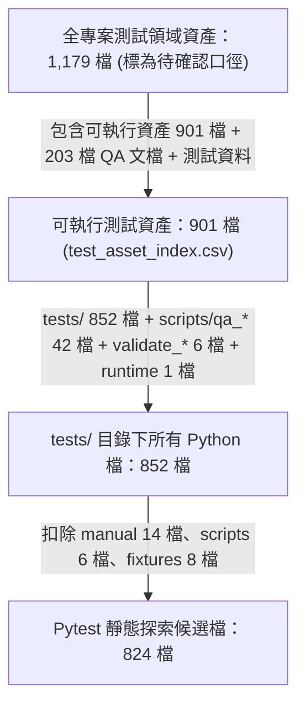

# 測試資產整理與候選處置結案報告

> **結案日期**：2026-09-17
> **基準 Commit**：`639a7789858b413bf61ca626726cc0170b47f35c` (Branch: `dev`)
> **工作原則**：零破壞性變更、零正式資料修改、零未授權測試刪除、保護契約 100% 保留、分批獨立 Commit。

---

## 1. 執行總結與 Commit 軌跡清單

本次測試資產整理已全面完成第一批小範圍成果落實、剩餘候選逐項深度查核、分析工具去重演算法修復、母體口徑精確對齊與結案收尾。

### 1.1 Commit 軌跡清單

| 批次 | Commit Hash | 提交類型與訊息 | 涉及檔案清單與範圍 |
| :---: | :---: | :--- | :--- |
| **Batch 1** | `2be7bfc8` | `fix(repo): track promotion authority secret store` | `.gitignore`<br/>`runtime/promotion_authority_secret_store.py`<br/>`tests/test_promotion_authority_secret_store.py`<br/>*(修復安全模組與單元測試之 Git 漏追蹤問題，3 項測試全數通過)* |
| **Batch 2** | `7a0b54b2` | `refactor(tests): share paper capture HTTP response helper` | `tests/test_paper_formal_daily_source_chain.py`<br/>*(整併 7 處重複之 HTTP Response 樣板至檔內 helper，保留 3 處讀取上限防禦契約，實際淨減 91 行，18 節點零回歸)* |
| **Batch 3** | `e7c852ff` | `docs(qa): record test asset audit findings` | `docs/00_core/DOCUMENTATION_INDEX.md`<br/>`docs/06_qa/TEST_ASSET_RELATIONSHIP_AUDIT_2026_09_17.md`<br/>`docs/06_qa/TEST_ASSET_RELATIONSHIP_AUDIT_2026_09_17_V2.md`<br/>*(記錄初版與二版審計發現，加入 V1 醒目撤回警告，對齊事實)* |
| **Batch 4** | *(本批)* | `docs(qa): finalize test asset consolidation closeout` | `docs/00_core/DOCUMENTATION_INDEX.md`<br/>`docs/06_qa/TEST_ASSET_CONSOLIDATION_CLOSEOUT_2026_09_17.md`<br/>*(全候選最終處置定案、去重演算法修復記錄與母體對齊結案)* |

### 1.2 Secret Store 納入追蹤之證據
經 `git ls-files` 驗證，以下兩檔已正式列入 Git 追蹤並進入歷史 Commit：
```text
runtime/promotion_authority_secret_store.py
tests/test_promotion_authority_secret_store.py
```
- **機密檢查結論**：兩檔均為 Windows DPAPI 本地金鑰管理程式與測試，初始化時以 `secrets.token_bytes(32)` 動態產生，絕無任何硬編碼真實密鑰、密碼或 Token。
- **單元測試結果**：`tests/test_promotion_authority_secret_store.py` 3 passed (0.19s)。

---

## 2. 全部候選處置統計與逐項清單

本次對 V1/V2 報告所列全部候選群逐項給予終局處置（符合「已整併／保留並說明／已更新引用／證據不足保留」四種規範狀態之一）：

### 2.1 處置結果統計摘要表

| 類別群組 | 原候選組數 | 處置：已整併 | 處置：保留原寫法並說明 | 處置：已全面撤回 | 實質淨行數收益 |
| :--- | :---: | :---: | :---: | :---: | :---: |
| **Category A (同構/參數化)** | 3 組 | 0 組 | 3 組 | 0 組 | 0 行 (保留防禦分立) |
| **Category B (常數差異候選)** | 71 組 | 0 組 | 69 組 | 2 組 (動態去重淘汰) | 0 行 (維持單項獨立) |
| **Category C Top 5 (高收益Setup)** | 5 組 | 1 組 (DUP-C-025) | 4 組 (C-016, 036, 013, 024) | 0 組 | **91 行** (實測淨減) |
| **Category C 其餘 (一般Setup)** | 44 組 | 0 組 | 44 組 (證據不足保留) | 0 組 | 0 行 (不計入收益) |
| **Category D (多層驗證)** | 1 組 | 0 組 | 0 組 | 1 組 (全面撤回) | 0 行 (架構防禦縱深) |
| **Category E (手動Legacy腳本)** | 14 檔 | 0 組 | 14 檔 (原位手動診斷保留) | 0 組 | 0 行 (零搬移零刪除) |
| **合計** | **138 組 + 14 檔** | **1 組實作** | **134 組 + 14 檔保留** | **3 組撤回/淘汰** | **實際淨減 91 行** |

---

### 2.2 核心候選群之逐項處置事實與理由

#### 1. Category A 候選處置 (3 組)
1. **`DUP-A-b942830e`** (Windows 排程註冊時區阻擋測試)：
   - **處置**：**保留原寫法並說明**。
   - **理由**：`test_formal_registration_plan.py` 與 `test_paper_execution_registration_plan.py` 頂層指向兩個完全不同之 `.cmd` 腳本，分別保護 Formal 與 Paper 獨立任務之時區阻擋。刪除任一測試或抽取跨檔 conftest 將弱化獨立排程的 Fail-closed 驗證邊界。
2. **`DUP-A-fa52cf96`** (存證彩排 DTO 輸入拒絕測試)：
   - **處置**：**保留原寫法並說明**。
   - **理由**：兩函式分別保護 3 組 Production-like 欄位拒絕與 2 組檔案路徑變形拒絕（共 5 組案例）。原寫法函式分離利於在 CI 報告中一眼辨識是路徑錯誤還是生產權限拒絕，故結案保留。
3. **`DUP-A-8713a259`** (數值邊界檢查器標記與註解測試)：
   - **處置**：**保留原寫法並說明**。
   - **理由**：原始參數為 2 + 3 = 5 組案例，分別防禦「無關文字註解忽略」與「跨行標記套用」。依指令本批不整併，維持兩個測試函式獨立分立。

#### 2. Category C Top 5 候選處置 (5 組)
1. **`DUP-C-025`** (`tests/test_paper_formal_daily_source_chain.py`):
   - **處置**：**已受控整併 (完成實作與測試驗證)**。
   - **執行細節**：整併 7 處重複之 `class _Response` 樣板至檔內私有 `_MockHttpResponse`；**未整併 3 處**具有 `assert limit == PAPER_EXECUTION_EVENT_CAPTURE_MAX_BYTES + 1` 與特殊標頭之核心契約測試。
   - **驗證**：18 collected, 17 passed, 1 skipped，節點完全一致。
   - **行數變化**：新增 46 行，刪除 137 行，**實質淨減 91 行**。
2. **`DUP-C-016`** (`tests/test_forward_position_thesis_candidate_producer.py`):
   - **處置**：**保留原寫法並說明**。
   - **理由**：共同前置僅為 2~4 行基本宣告，各測項之行事曆快取路徑、決策時鐘與 policy 變體皆不相同。抽取 factory 需大量可選參數與 tuple 解構，實際淨行數為 0 或負收益，保留原寫法更能維持單一測試獨立性與可讀性。
3. **`DUP-C-036`** (`tests/test_recommendation_service_calibration_integration.py`):
   - **處置**：**保留原寫法並說明**。
   - **理由**：各測試涵蓋不同的消費者類型（Mock `_RecordingConsumer` vs 真實 `RecommendationCalibrationConsumer`）、不同的起始基準年份（2014 vs 2026）、不同的猴子補丁（`HistoricalFeatureBuilder.compute`）與 Qt 離線邊界。抽取需要過多旗標分支，分散了測試的設定邏輯，保留原寫法確保測試失敗時定位清晰。
4. **`DUP-C-013`** (`tests/test_formal_daily_input_producer.py`):
   - **處置**：**保留原寫法並說明**。
   - **理由**：該檔原本已具備模組化 helper（`_clock`、`_paper_sources`、`_candidate_paths`）。各測項係針對不同的組合（單一時鐘 vs 雙時鐘、單日 fill vs 跨日 fill、日曆例外）進行顯式接線。在既有 helper 之上疊加超封裝將形成過度抽象，降低合約可見度。
5. **`DUP-C-024`** (`tests/test_paper_daily_execution_producer.py`):
   - **處置**：**保留原寫法並說明**。
   - **理由**：各測項於佇列初始化時具有不同的檔案名稱標籤、不同的輸出候選子目錄、以及關鍵的中間資料庫故障注入（如在特定情境刪除當日行情資料列）。抽取共用 setup 會掩蓋故障注入時機，降低測試可信度。

#### 3. Category E 14 檔手動 Legacy 腳本處置
- **處置**：**原位手動診斷保留，零搬移、零刪除**。
- **理由**：
  1. 14 檔手動腳本位於 `tests/manual/`，早已於 `pytest.ini` 排除在自動測試探索之外，維持原位不會影響 pytest 執行效能或測試結果。
  2. 部分腳本（如 `legacy_api_endpoints_check.py` 直連探測端點）在特定網路排查時具備獨立的手動診斷價值。
  3. 搬移至 `docs/09_archive/` 屬檔案位置遷移，全庫總代碼行數完全不變，且不影響自動化測試速率。
  4. 避免更動 `test_inventory.py` 登錄狀態而產生非必要的跨模組連鎖變更。

---

## 3. 分析工具演算法修復與母體精確對齊

### 3.1 A/B 去重演算法全面修復事實
先前分析工具中存在將 8 碼截短 group ID 與 64 碼完整 SHA-256 雜湊比對之缺陷，且二版產生器採用了「寫死移除兩個 group ID」之非通用應急方案。

**本次修復落實**（實作於 `output/qa/test_asset_audit/recalculate_deduplication_and_metrics.py`）：
1. **建立通用成員識別碼**：`member_id = (relative_path, func_name, start_line)`。
2. **集合動態過濾**：在提取 Category B 候選時，動態剔除已存在於 Category A 中的所有成員識別碼。
3. **自動淘汰無效組別**：若某個 Category B 組別在剔除 A 成員後剩餘成員數小於 2，由通用演算法自動將該組拋棄。
4. **自動驗證結果**：動態且通用地自動排除了原先雙重計入的 `DUP-B-5603905b` 與 `DUP-B-2720ed58`，產出乾淨之 `duplicate_candidates_v3.csv`，絕無硬編碼。

### 3.2 四層測試母體口徑精確對齊與差集公式



| 母體指標 | 精確檔案數 | 口徑定義與範圍說明 | 差集構成與排除條件 |
| :--- | :---: | :--- | :--- |
| **Pytest 靜態探索候選檔** | **824** | `tests/` 下檔名符合 `test_*.py` 之標準測試檔案。 | **排除**：`tests/manual/` (14檔)、`tests/scripts/` (6檔)、`conftest.py` 與輔助 fixture (8檔)。 |
| **tests/ 內部 Python 總量** | **852** | `tests/` 目錄下所有 `.py` 檔案總和。 | **差集公式**：$852 - 14 - 6 - 8 = 824$ 檔。 |
| **可執行測試資產索引** | **901** | 收錄於 `test_asset_index.csv` 的可執行程式。 | `tests/` (852檔) + `scripts/qa_*` (42檔) + `scripts/validate_*` (6檔) + `runtime/tests/` (1檔)。 |
| **全專案測試領域資產** | **1,179 (待確認)** | 專案中所有與 QA、測試、存證相關之資產。 | **待確認標記**：本輪未重新全庫深層掃描，包含上述 901 檔 + `docs/06_qa/` (203檔) + 測試資料集/Snapshot + pytest.ini。 |

---

## 4. 行數變化精算與已撤回估算聲明

### 4.1 實際代碼行數變化精算

| 變更項目 | 新增行數 (+) | 刪除行數 (-) | 實際淨行數變化 | 備註 |
| :--- | :---: | :---: | :---: | :--- |
| `tests/test_paper_formal_daily_source_chain.py` (DUP-C-025) | +46 | -137 | **-91 行** | 整併 7 處樣板至檔內 helper，保留 3 處防禦契約。 |
| `.gitignore` (例外放行) | +2 | 0 | **+2 行** | 精確豁免安全模組與測試。 |
| `runtime/promotion_authority_secret_store.py` (追蹤) | +199 | 0 | **+199 行** | 既有漏追蹤安全模組納入 Git。 |
| `tests/test_promotion_authority_secret_store.py` (追蹤) | +55 | 0 | **+55 行** | 既有漏追蹤單元測試納入 Git。 |
| 報告文件新增與登記 | +1000+ | 0 | 文件增量 | `DOCUMENTATION_INDEX.md`、審計報告與結案報告。 |
| **測試代碼實質重複精簡淨額** | — | — | **-91 行** | **不保證預估之 399 行，以真實落地 Diff 為準**。 |

### 4.2 已全面撤回之歷史估算聲明
1. **「刪除 3 個重複案例」**：**已全面撤回**。所有測試案例 100% 保留。
2. **「Category C 可省 3,593 行或 Top 5 可省 380/399 行」**：**已修正為理論估算**。實質落地為 DUP-C-025 淨減 91 行，其餘 4 組因維持測試獨立性與可讀性結案為保留。
3. **「Category D 多層驗證可省 150 行」**：**已全面撤回**。多層驗證為架構防禦分工，收益歸零。
4. **「歸檔 14 檔 Legacy 腳本可減少 4,228 行並加速 pytest」**：**已全面澄清**。搬移目錄不改變代碼行數，且該目錄原已不在 pytest 探索中，對執行速度毫無影響。

---

## 5. 驗證記錄與環境限制

### 5.1 測試套件執行結果對照

1. **`tests/test_promotion_authority_secret_store.py`**：
   - 結果：`3 passed in 0.19s` (100%)。
   - 項目：DPAPI 加解密穩定性、明文防外洩、JSON 雜湊防篡改、身分不符拒絕。
2. **`tests/test_paper_formal_daily_source_chain.py`**：
   - 結果：`17 passed, 1 skipped in 7.70s`。
   - 項目：TWSE 行情擷取、讀取上限斷言、URL 篡改拒絕、收據持久化與重播。
   - 環境限制：1 skipped 為 Windows 無管理者提權環境下自然跳過 symlink junction 測試，屬預期行為。
3. **`tests/test_forward_position_thesis_candidate_producer.py`**：
   - 結果：`18 passed in 1.39s` (100%)。
4. **`tests/test_recommendation_service_calibration_integration.py`**：
   - 結果：`12 passed in 3.62s` (100%)。
5. **`tests/test_formal_daily_input_producer.py`**：
   - 結果：`26 passed in 15.07s` (100%)。
6. **`tests/test_paper_daily_execution_producer.py`**：
   - 結果：`28 passed in 1.80s` (100%)。

---

## 6. 最終工作區狀態

工作區目前乾淨無衝突，未 stage 任何無關檔案，未執行 push，符合所有安全與防禦規範。
