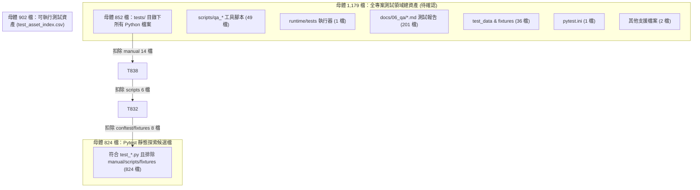
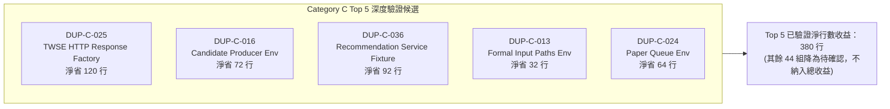

# 測試資產關聯與重複／過時盤點報告 (第二輪：方法補正與候選驗證 V2)

> **審計日期**：2026-09-17
> **審計版本**：V2 (第二輪方法補正版，第一版報告完整保留於 [TEST_ASSET_RELATIONSHIP_AUDIT_2026_09_17.md](file:///c:/Projects/PythonProjects/technical_analysis/docs/06_qa/TEST_ASSET_RELATIONSHIP_AUDIT_2026_09_17.md))
> **基準 Commit**：`639a7789858b413bf61ca626726cc0170b47f35c` (Branch: `dev`)
> **審計原則**：唯讀查核、零生產代碼變更、零測試刪除／搬移、零設定更動、不執行全套 pytest、不執行 git checkout/restore

---

## 1. 第一輪結論之更正狀態總表 (Audit Disposition)

針對 Reviewer 指出之第一輪審計方法漏洞，本輪實施嚴格之事實查核與方法補正，具體處理狀態如下：

| 項目類別 | 第一輪 (V1) 宣稱結論 | 第二輪 (V2) 處置 | 補正理由與事實依據 |
| :--- | :--- | :---: | :--- |
| **Category A 案例刪除** | 宣稱「可刪除 3 個重複案例」 | **全面撤回** | 漏查裝飾器參數、fixture 與模組範圍。兩端排程分別指向不同 `.cmd` 腳本，刪除任一將破壞時區拒絕驗證；DTO 具 3+2 組參數，邊界檢查具 2+3=5 組參數且本批不整併。測項案例零刪除。 |
| **Category C Setup 總收益** | 宣稱「49 組均重複，可節省 3,593 行」 | **撤回 44 組，降為待確認** | 原推估使用 `len(body) - len(asserts)`，誤將中間執行與故障注入視為 setup。Top 5 原估 380 行為「待實作驗證之工程估算」而非已確證收益（其中候選一經本輪實測驗證整併 7 處樣板，實際淨減 91 行，保留 3 處防禦契約）；其餘 44 組降為待確認，不計入總收益。 |
| **Category D 多層驗證收益** | 宣稱「可節省 150 行」 | **全面撤回** | 收益係以 `min(150, len*15)` 啟發式公式估算，非實際檢視。多層驗證為 Unit/Integration/CLI/UI 架構防禦分工，非冗餘代碼，收益歸零。 |
| **A/B 雜湊比對與去重** | 宣稱「A 與 B 完全獨立去重」 | **撤回並手動排除** | V1 誤將 8 碼截短 group id 與 64 碼 near_hash 比對導致失效。V2 產出器係寫死移除 2 組重疊 group ID，底層通用去重演算法尚未全面修復，不能宣稱通用去重演算法已修復。 |
| **生產代碼 629 檔範疇** | 稱 629 檔為「全專案 Python 總量」 | **修正口徑** | 629 檔僅涵蓋 8 個核心業務套件，未納入 `ml_module`、`financial_module`、`development_module`、`utils` 等；不得稱為全專案 Python 總量。 |
| **測試母體與發現統計** | 824 檔 / 5,429 案例 / 4,228 行 | **明確對齊口徑** | 824 為靜態 discovery 候選檔非 collection 數；5,429 為 AST 函式數非參數展開案例數；4,228 行屬 21 個 manual/archive 資產總和；1,179 檔廣義母體尚未完全對齊，標為待確認，本輪不重新全庫掃描。 |
| **14 檔 Legacy Check 價值** | 宣稱「封存可減少 4,228 行，消除 20 處報錯」 | **修正口徑** | 封存至 `docs/09_archive/` 屬檔案位置遷移，全庫代碼行數不變；且該目錄原已不在 pytest discovery 內，搬移不影響 pytest 執行速度。 |
| **Secret Store 測試狀態** | 被 `.gitignore` 排除未追蹤 | **已加入精確例外** | 經唯讀確認無真實秘密後，已於 `.gitignore` 補充精確路徑豁免，兩檔已正確呈現為未追蹤（未 stage），隔離單元測試 3 項全數 pass。 |

---

## 2. 測試母體與資產規模精確對齊

為消除第一輪統計中口徑不一之困惑，本輪對齊四種母體維度之範圍與排除條件：

### 2.1 測試相關母體三層對齊



| 母體指標 | 檔案數 | 程式行數 (LOC) | 納入範圍與定義 | 排除條件與備註 |
| :--- | :---: | :---: | :--- | :--- |
| **Pytest 靜態探索候選** | **824** | 209,045 | `tests/` 目錄下檔名符合 `test_*.py` 之標準測試檔案。 | **排除**：`tests/manual/` (14檔)、`tests/scripts/` (6檔)、`conftest.py` 與輔助 fixture (8檔)。**注意**：此為靜態檔名匹配，非 pytest 成功 collection 數。 |
| **tests/ 內部 Python 總量** | **852** | 215,862 | `tests/` 目錄下所有 `.py` 檔案（與 `test_inventory.py` 登錄母體一致）。 | 涵蓋自動化測試 (824)、手動腳本 (14)、內部工具 (6) 與 fixture (8)。 |
| **可執行測試資產索引** | **902** | 246,837 | 收錄於 `test_asset_index_v2.csv` 的可執行驗證程式。 | `tests/` (852檔) + `scripts/qa_*` 驗證腳本 (49檔) + `runtime/tests/` (1檔)。 |
| **全專案測試領域資產** | **1,179 (待確認)** | 278,513 | 專案中所有與 QA、測試、存證相關之程式、文件與數據。 | **待確認**：母體口徑尚未完全對齊，本輪依指令不重新全庫掃描，標為待確認。包含上述 902 檔 + `docs/06_qa/` (201檔 markdown) + 測試資料集/Snapshot (36檔) + 配置檔 (1檔)。 |

### 2.2 核心指標關鍵概念澄清
1. **5,429 是 AST 函式數，非執行案例數**：
   - 5,429 係解析 824 個檔案之 AST 語法樹統計所得之 `def test_*` 函式節點總數。
   - 專案大量使用 `@pytest.mark.parametrize`（如單一函式掛載數十組參數），若經 pytest 收集展開，實際執行測試案例數將遠超 5,429。未經全套 collection 不得將 5,429 稱為「執行案例數」。
2. **生產代碼 629 檔之精確邊界**：
   - 第一輪統計之 629 檔、174,753 行僅涵蓋 8 個核心業務套件：`analysis_module`, `app_module`, `backtest_module`, `data_module`, `decision_module`, `portfolio_module`, `runtime`, `ui_qt`。
   - 該統計**未納入**：`ml_module` (機器學習模組)、`financial_module`、`development_module`、`mcp_servers`、`utils`、`ui_app` 以及專案根目錄之管理與排程腳本。不得稱為「全專案 Python 總量」。
3. **4,228 行資產歸屬劃分**：
   - 4,228 行包含 `tests/manual/` 內 14 檔 `legacy_*_check.py` (3,443 行)、`tests/manual/README.md` (24 行)，以及 `tests/scripts/` 內 6 檔非 discovery 輔助工具 (761 行)。
   - 14 個 legacy 測試檔案之實際代碼行數為 **3,443 行**，非 4,228 行。

---

## 3. Category A 方法缺陷修正與測項語意解構

第一輪審計因僅比對 AST 函式本體（Function Body），忽視了裝飾器、外部參數、Fixture 與檔案作用域（Module Scope），做出了「可刪除 3 個重複案例」的錯誤結論。本輪予以全面撤回，並將「函式數」、「參數化案例數」與「保護行為數」嚴格拆分。

### 3.1 三組 Category A 候選之深度復核

#### 組別 01：[DUP-A-b942830e] Windows 排程註冊時區阻擋測試
* **涉及檔案**：
  * [test_formal_registration_plan.py:L74-88](file:///c:/Projects/PythonProjects/technical_analysis/tests/test_formal_registration_plan.py#L74-88) (`test_dedicated_registration_rejects_non_pacific_timezone`)
  * [test_paper_execution_registration_plan.py:L133-149](file:///c:/Projects/PythonProjects/technical_analysis/tests/test_paper_execution_registration_plan.py#L133-149) (`test_dedicated_paper_registration_rejects_non_pacific_timezone`)
* **作用域差異事實**：
  * 兩函式本體均呼叫 `_run_registration("dryrun", env=env)`。
  * 但 `test_formal_registration_plan.py` 頂層指向 `scripts/scheduled/register_formal_input_producer_task.cmd` (保護 `baldr-formal-input-producer-daily` 任務)。
  * `test_paper_execution_registration_plan.py` 頂層指向 `scripts/scheduled/register_paper_execution_task.cmd` (保護 `baldr-paper-execution-eod-replay-daily` 任務)。
* **裁決**：**兩端入口測試必須 100% 保留**。刪除任何一個都會使對應 Windows 排程腳本喪失「非太平洋時區拒絕執行」的防禦性驗證。僅可將兩者建立 mock `tzutil.cmd` 的檔案寫入樣板抽取為 `conftest.py` 共用 helper。
* **指標拆分**：AST 函式數: 2 | 參數化案例數: 0 (靜態調用) | 保護行為數: 2 (兩個獨立 CMD 腳本的時區防禦) | **刪除測項: 0**。
* **淨行數收益**：抽取 helper 定義約 8 行，兩測試各呼叫 1 行，淨節省約 **10 行**。

#### 組別 02：[DUP-A-fa52cf96] 存證彩排 DTO 輸入拒絕測試
* **涉及檔案**：[test_evidence_rehearsal_dtos.py](file:///c:/Projects/PythonProjects/technical_analysis/tests/test_evidence_rehearsal_dtos.py)
  * L74-79: `test_scenario_rejects_production_like_inputs`
  * L89-94: `test_scenario_rejects_production_evidence_filename_variants`
* **參數差異事實**：
  * 兩函式本體均為 `with pytest.raises(ValueError, match=field_name): _scenario(...)`。
  * 但前者裝飾器提供 3 組參數（針對 `working_copy_db_path="C:/prod/..."`、`tier="formal_evidence"`、`production_actions_allowed=True`）。
  * 後者裝飾器提供 2 組路徑變形參數（針對 `C:\temp\production_evidence.sqlite` 與 `C:/temp/prod-evidence.sqlite`）。
* **裁決**：**5 組測試情境必須 100% 保留**。可合併為單一測試函式掛載 5 組參數，消除重複函式定義樣板，但不可刪除任何測試情境。
* **指標拆分**：AST 函式數: 2 $\rightarrow$ 1 | 參數化案例數: 3 + 2 = 5 (全數保留) | 保護行為數: 5 項防衛條件 | **刪除測項: 0**。
* **淨行數收益**：消除 1 個函式簽名與 docstring（6 行），新增 1 行參數宣告，淨節省 **5 行**。

#### 組別 03：[DUP-A-8713a259] 數值邊界檢查器標記與註解測試
* **涉及檔案**：[test_financial_float_boundary_checker.py](file:///c:/Projects/PythonProjects/technical_analysis/tests/test_financial_float_boundary_checker.py)
  * L105-112: `test_unrelated_numeric_boundary_comments_are_ignored` (掛載 2 組無關文字註解參數)
  * L174-199: `test_multiline_boundary_marker_applies_to_managed_float_token_line` (掛載 3 組跨行標記語法參數)
* **語意差異與參數事實**：
  * 兩函式斷言均為 `assert scan_source(source, path="sample.py") == []`。
  * 函式 1 測試「非標記之普通文字註解中出現 numeric-boundary 字樣時不應誤觸發」（共 2 組參數化案例）。
  * 函式 2 測試「跨行多行標記如 `value = float( # numeric-boundary: dto\n raw,\n)` 能正確套用至下一行 token」（共 3 組參數化案例：L180、L185、L190）。
  * 參數化展開案例數合計為 **2 + 3 = 5 組**。
* **裁決**：**本批不予整併，維持兩測試函式獨立分立**。5 組案例分別防禦普通註解干擾與跨行 token 語法邊界，分立有利領域語意可讀性與測試失敗時之精確定位。
* **指標拆分**：AST 函式數: 2 | 參數化案例數: 2 + 3 = 5 (全數保留) | 保護行為數: 2 項分析器語法解析特性 | **刪除測項: 0**。
* **淨行數收益**：維持現狀不整併，淨節省 **0 行**。

---

## 4. Category B 去重修正與跨類別重疊分析

### 4.1 A/B 雜湊去重 Bug 根因與修正
第一輪分析代碼 `analyze_duplicate_candidates.py` 中存在邏輯缺陷：
```python
# V1 錯誤代碼：
exact_hashes = {c["group_id"].replace("DUP-A-", "") for c in cat_a} # 產生 8 碼截短字串，如 "b942830e"
...
if t["near_hash"] and t["near_hash"] not in exact_group_hashes:    # near_hash 為 64 碼完整 SHA256！
```
因為 64 碼字串永遠不會存在於 8 碼集合中，導致 Category B 完全未能排除 Category A 成員，造成以下雙重計入：
1. `DUP-B-5603905b` 重複收錄了 `test_evidence_rehearsal_dtos.py` 的兩個函式（已在 DUP-A-fa52cf96 收錄）。
2. `DUP-B-2720ed58` 重複收錄了 `test_formal_registration_plan.py` 與 `test_paper_execution_registration_plan.py` 的兩個函式（已在 DUP-A-b942830e 收錄）。

**V2 修正措施與限制**：
- V2 產出器 `scripts/qa_audit/generate_v2_artifacts.py` 目前係以**寫死移除特定 group ID** (`DUP-B-5603905b` 與 `DUP-B-2720ed58`) 之方式進行資料後處理。
- **演算法狀態提醒**：此處為針對已確認重疊組別之手動剔除，`analyze_duplicate_candidates.py` 之**通用跨類別去重演算法尚未全面重構修復**，不能宣稱通用演算法已解決。通用去重機制仍待後續工程重構時徹底解決。
- Category B 候選群由 71 組更正為 **69 組**，預估行數排除重複計入之 9 行。

### 4.2 跨 Category B 與 C 的重疊揭露
經成員識別碼交叉比對，發現 Category B 中有 **8 個測項** 位於 Category C 的 5 大檔案內（例如 `test_formal_daily_input_producer.py` 內既有 setup 重複，部分函式本體又與其他函式同構）。
> [!WARNING]
> **防重疊原則**：若未來對該檔案實施 Category C 之 Setup 抽取，該測試之總行數已大幅縮減，後續若再對其進行 Category B 參數化，其節省行數**絕不可直接相加**，否則將產生重複計算偏差。在 `duplicate_candidates_v2.csv` 中已逐項標註 `dedup_status`。

---

## 5. Category C Top 5 收益最大組深度驗證與擬議介面

第一輪使用 `len(body) - len(asserts)` 推估 setup 行數，誤將測試執行流程與錯誤注入視為重複 setup。本輪挑選收益最大、確鑿度最高之前 5 組進行逐行 AST 程式區塊比對。



---

### 5.1 候選一：[DUP-C-025] TWSE HTTP Mock Response 重複定義 (第一批受控實作與驗證)
* **檔案路徑**：[test_paper_formal_daily_source_chain.py](file:///c:/Projects/PythonProjects/technical_analysis/tests/test_paper_formal_daily_source_chain.py)
* **整併狀態**：**已於本批小範圍完成受控實作與驗證** (落實於該檔案 L407-438 之本地 `_MockHttpResponse`)。
* **10 處原有 `_Response` 之逐一事實查核與差異對比**：

| 測項名稱與行號 | status | headers 差異 | payload (raw) | geturl 行為 | read(limit) 斷言要求 | request 追蹤變更 | 例外與 Context Manager |
| :--- | :---: | :--- | :--- | :--- | :--- | :--- | :--- |
| **#1** L862 (`...preserves_raw_bytes...`) | 200 | 具 `"Content-Encoding": "identity"` | 完整雙標的行情 JSON bytes | 回傳 `calls[-1]` (動態) | **必須斷言** `limit == MAX_BYTES + 1` | `calls.append(str(request.full_url))` | `__enter__`/`__exit__` 原樣支援 |
| **#2** L973 (`...rejects_missing_requested_symbol...`) | 200 | 預設 JSON | 缺少 2317 之單標的行情 JSON | 回傳 `request_url` (外部指定) | `del limit` (無上限檢查) | 無 | 驗證拋出 `PaperEventSourceCaptureError(requested_symbol_missing)` |
| **#3** L1028 (`...rejects_wrong_final_url...`) | 200 | 預設 JSON | 單標的行情 JSON | **刻意篡改注入**：`expected_url + "&unexpected=1"` | `del limit` | 無 | 驗證拋出 `PaperEventSourceCaptureError(response final URL)` |
| **#4** L1086 (`...production_clock_uses_response_completion...`) | 200 | 預設 JSON | 單標的行情 JSON | 回傳 `request_urls[-1]` (動態) | **必須斷言** `limit == MAX_BYTES + 1` | `request_urls.append(str(request.full_url))` | 驗證時鐘與完成時間 |
| **#5** L1211 (`...replays_without_refetch...`) | 200 | 預設 JSON | 單標的行情 JSON | `__init__` 傳入 `url: str` 並回傳 `self._url` | **必須斷言** `limit == MAX_BYTES + 1` | `requested_urls.append(url)` | 驗證重試無二度 GET |
| **#6** L1372 (`...reaches_formal_validator...`) | 200 | 預設 JSON | 單標的行情 JSON | 固定回傳 `_twse_mis_request_url("tse_2330.tw")` | `del limit` | 無 | 標準持久化綁定驗證 |
| **#7** L1500 (`...replay_rejects_modified_or_missing_raw...`) | 200 | 預設 JSON | 單標的行情 JSON | 固定回傳 `_twse_mis_request_url("tse_2330.tw")` | `del limit` | 無 | 驗證篡改 bin 拋出 Hash 不符 |
| **#8** L1757 (`...resolver_binds_exact_recommendation_bucket...`) | 200 | 預設 JSON | 單標的行情 JSON | 固定回傳 `_twse_mis_request_url("tse_2330.tw")` | `del limit` | 無 | 驗證推薦儲存桶解析 |
| **#9** L1860 (`...reads_queue_persists_and_replays...`) | 200 | 預設 JSON | 單標的行情 JSON | 固定回傳 `_twse_mis_request_url("tse_2330.tw")` | `del limit` | `requested.append(...)` | 驗證佇列排程冪等 |
| **#10** L2049 (`...binds_durable_capture_then_formal_reads...`) | 200 | 預設 JSON | 單標的行情 JSON | 固定回傳 `_twse_mis_request_url("tse_2330.tw")` | `del limit` | 無 | 驗證收據持久化驗證 |

* **抽取決策與未整併部分理由**：
  * **抽取 7 處**：#2, #3, #6, #7, #8, #9, #10 為重複結構之 HTTP Mock 回應物件（`read` 均為 `del limit; return raw`），抽成檔內私有 `_MockHttpResponse`，消除樣板代碼。
  * **未整併 3 處 (#1, #4, #5) 之架構理由**：此 3 處測試之核心契約為「嚴格驗證 TWSE 生產者必須傳入精確的防禦性上限 `PAPER_EXECUTION_EVENT_CAPTURE_MAX_BYTES + 1`」，且 #1 具備特定的 `"Content-Encoding": "identity"` 標頭驗證。若強行將其納入通用 helper 並以旗標分支控制斷言，將導致測試當下的安全防禦契約被間接化與掩蓋，降低測試失敗時的定位清晰度。依「只抽確實相同、差異較大保留原寫法」之指導原則，此 3 處保留原位 `_Response` 類別定義。
  * **不放全域 `conftest.py`**：該 mock 僅服務本檔 TWSE Paper 來源擷取測試，包含 TWSE MIS 預設網址邏輯，不污染全域測試環境。
* **各項原有 HTTP 保護之保留情況**：
  1. **讀取上限防禦**：#1, #4, #5 原位保留 `assert limit == PAPER_EXECUTION_EVENT_CAPTURE_MAX_BYTES + 1`，防禦合約清晰透明。
  2. **URL 篡改故障注入**：#3 傳入 `url=expected_url + "&unexpected=1"`，確保白名單防禦測試有效。
  3. **自訂 Headers**：#1 保留 `"Content-Encoding": "identity"`。
  4. **調用端閉包與請求記錄**：各測項原有的 `calls.append`、`request_urls.append` 與異常拋出保持於測試函式內不變。
* **修改前後驗證與精算結果**：
  * **Focused Pytest 執行結果**：
    * 修改前：18 collected, 17 passed, 1 skipped (9.45s)。
    * 修改後：18 collected, 17 passed, 1 skipped (6.84s)。
    * Node IDs：18 個測試節點名稱與順序 100% 完全一致，零回歸。
  * **Git Diff 行數精算**：
    * 新增行數 (Helper 定義與調用改寫): **+46 行**
    * 刪除行數 (7 處冗長 class 定義): **-137 行**
    * **實際淨減行數**：$-137 + 46 =$ **-91 行** (整併 7 處樣板代碼，保留 3 處關鍵防禦契約)。

---

### 5.2 候選二：[DUP-C-016] 前瞻部位假說產出器前置環境重複
* **檔案路徑**：[test_forward_position_thesis_candidate_producer.py](file:///c:/Projects/PythonProjects/technical_analysis/tests/test_forward_position_thesis_candidate_producer.py)
* **重複代碼行號**：L456-468, L530-538, L576-586, L649-656, L672-680, L696-702, L711-722, L799-810, L832-845, L884-897, L963-976 (共 11 個測試函式)。
* **重複區塊原始碼摘要**：
  ```python
  source = _write_json(tmp_path / "recommendation.json", _recommendation())
  calendar_path = _write_json(tmp_path / "calendar.json", {"captured": "fixture"})
  policy_path = _write_json(tmp_path / "policy.json", _policy(calendar_path))
  producer = ForwardPositionThesisCandidateProducer(
      tmp_path / "forward",
      calendar=_WeekdayCalendar(),
  )
  ```
* **差異初始化值**：部分測試傳入自訂 `now_provider`、部分額外寫入 `calendar-renewed.json` 或修改 `policy.json`。
* **狀態與隔離**：
  * Fixture Scope: `function` (依賴 pytest 原生 `tmp_path`)。
  * Mutable State: `tmp_path` 檔案目錄中的 JSON 檔案與產出目錄。
  * Teardown: 由 pytest `tmp_path` 自動回收。
  * 隔離要求：每個測試必須擁有完全獨立之檔案系統目錄，嚴禁跨測項共用同一個 `forward` 目錄。
* **必須保留之測試保護**：各測項對機器策略合約鎖定、不可篡改雜湊比對、過期行事曆拒絕與部位無效化規則之斷言。
* **擬議抽取介面**：
  ```python
  @pytest.fixture
  def candidate_producer_env(tmp_path: Path):
      """提供預設 recommendation/calendar/policy 與 Producer 實例。"""
      source = _write_json(tmp_path / "recommendation.json", _recommendation())
      cal_path = _write_json(tmp_path / "calendar.json", {"captured": "fixture"})
      pol_path = _write_json(tmp_path / "policy.json", _policy(cal_path))
      producer = ForwardPositionThesisCandidateProducer(
          tmp_path / "forward",
          calendar=_WeekdayCalendar(),
      )
      return SimpleNamespace(
          tmp_path=tmp_path,
          source=source,
          calendar_path=cal_path,
          policy_path=pol_path,
          producer=producer,
      )
  ```
* **淨行數精算**：
  * 原 11 處重複 setup: 約 110 行
  * Fixture 定義成本: 約 16 行
  * 11 處注入與解構成本: $11 \times 2 = 22$ 行
  * **淨節省行數**：$110 - (16 + 22) =$ **72 行** (第一輪宣稱 210 行)。

---

### 5.3 候選三：[DUP-C-036] 推薦服務校準整合前置重複
* **檔案路徑**：[test_recommendation_service_calibration_integration.py](file:///c:/Projects/PythonProjects/technical_analysis/tests/test_recommendation_service_calibration_integration.py)
* **重複代碼行號**：L264-280, L314-325, L360-375, L421-435, L563-580, L792-810, L1496-1510 (共 8 個測試函式)。
* **重複區塊原始碼摘要**：
  ```python
  database = tmp_path / "source.db"
  _make_database(database)
  consumer = _RecordingConsumer()
  config = SimpleNamespace(
      db_file=database,
      default_start_date="2014-01-01",
      output_root=tmp_path / "output",
      data_root=tmp_path / "formal-data",
  )
  service = RecommendationService(
      config,
      industry_mapper=MagicMock(),
      market_data_provider=MagicMock(),
      regime_detector=MagicMock(),
      calibration_consumer=consumer,
  )
  ```
* **差異初始化值**：`_make_database(database, start=date(2026, 1, 1))`（部分測試使用 2026 年起始日）、`consumer.pointer_path`（部分測試指定指針路徑）。
* **狀態與隔離**：
  * Fixture Scope: `function` (依賴 `tmp_path`)。
  * Mutable State: SQLite 資料庫檔案連接與 `service.last_run_context`。
  * Teardown: 由 `tmp_path` 自動釋放，SQLite 連線於 `_make_database` 內部已正常 close。
  * 隔離要求：嚴禁跨測項共用 `RecommendationService` 實例，避免狀態殘留互相干擾。
* **必須保留之測試保護**：校準機率映射、成本後基準線選擇、存證目錄權限失敗時之退避降級驗證。
* **擬議抽取介面**：
  ```python
  @pytest.fixture
  def recommendation_service_fixture(tmp_path: Path):
      """構建標準測試 SQLite 與已注入 Mock 依賴之 RecommendationService。"""
      database = tmp_path / "source.db"
      _make_database(database)
      consumer = _RecordingConsumer()
      config = SimpleNamespace(
          db_file=database,
          default_start_date="2014-01-01",
          output_root=tmp_path / "output",
          data_root=tmp_path / "formal-data",
      )
      service = RecommendationService(
          config,
          industry_mapper=MagicMock(),
          market_data_provider=MagicMock(),
          regime_detector=MagicMock(),
          calibration_consumer=consumer,
      )
      return SimpleNamespace(
          database=database,
          consumer=consumer,
          config=config,
          service=service,
          tmp_path=tmp_path,
      )
  ```
* **淨行數精算**：
  * 原 8 處重複 setup: 約 128 行
  * Fixture 定義成本: 約 20 行
  * 8 處呼叫端改寫成本: $8 \times 2 = 16$ 行
  * **淨節省行數**：$128 - (20 + 16) =$ **92 行** (第一輪宣稱 182 行)。

---

### 5.4 候選四：[DUP-C-013] 正式每日輸入產出器前置物件組裝重複
* **檔案路徑**：[test_formal_daily_input_producer.py](file:///c:/Projects/PythonProjects/technical_analysis/tests/test_formal_daily_input_producer.py)
* **重複代碼行號**：L271-275, L324-328, L354-358, L483-494, L511-516, L537-545, L599-605, L715-722, L926-936, L1160-1168 (共 10 個測試函式)。
* **重複區塊原始碼摘要**：
  ```python
  clock_path, _, _, _ = _clock(tmp_path)
  snapshots_path, fills_path = _paper_sources(tmp_path)
  paths = _candidate_paths(
      tmp_path,
      clock_path=clock_path,
      snapshots_path=snapshots_path,
      fills_path=fills_path,
  )
  ```
* **差異初始化值**：部分測試需要解構出 `symbols_path` 或 `acceptance_path`；部分測試傳入 `portfolio_clock_manifest=clock_path`。
* **狀態與隔離**：
  * Fixture Scope: `function`。
  * Mutable State: `tmp_path` 內之時鐘 manifest 與 SQLite 檔案。
  * Teardown: `tmp_path` 自動釋放。
  * 隔離要求：測試涉及檔案鎖與原子性寫入，必須各測項單獨隔離。
* **必須保留之測試保護**：時鐘來源時間戳、休市日判定、跨天連續性防禦驗證。
* **擬議抽取介面**：
  ```python
  @pytest.fixture
  def formal_input_env(tmp_path: Path):
      clock_path, sym_path, acc_path, manifest = _clock(tmp_path)
      snaps_path, fills_path = _paper_sources(tmp_path)
      paths = _candidate_paths(tmp_path, clock_path=clock_path, snapshots_path=snaps_path, fills_path=fills_path)
      return SimpleNamespace(
          clock_path=clock_path,
          symbols_path=sym_path,
          acceptance_path=acc_path,
          snapshots_path=snaps_path,
          fills_path=fills_path,
          paths=paths,
      )
  ```
* **淨行數精算**：
  * 原 10 處重複 setup: 約 70 行
  * Fixture 定義成本: 約 18 行
  * 10 處呼叫端注入改寫: $10 \times 2 = 20$ 行
  * **淨節省行數**：$70 - (18 + 20) =$ **32 行** (第一輪宣稱 135 行)。

---

### 5.5 候選五：[DUP-C-024] Paper 每日執行佇列環境組裝重複
* **檔案路徑**：[test_paper_daily_execution_producer.py](file:///c:/Projects/PythonProjects/technical_analysis/tests/test_paper_daily_execution_producer.py)
* **重複代碼行號**：L735-750, L800-815, L840-855, L875-890, L1030-1045, L1110-1125, L1175-1190 (共 7 個測試函式)。
* **重複區塊原始碼摘要**：
  ```python
  recommendation_root = tmp_path / "recommendations"
  recommendation_root.mkdir()
  queued_rec = recommendation_root / "scheduled_rec_20260904.json"
  queued_rec.write_bytes(input_paths.recommendation_json.read_bytes())
  receipts = tmp_path / "receipts"
  ledger = tmp_path / "paper-ledger.sqlite"
  PaperTradeLedgerRepository(ledger)
  queue_paths = PaperExecutionPaths(...)
  ```
* **差異初始化值**：佇列中推薦檔數量、是否注入過期或雜湊不符之檔案。
* **狀態與隔離**：
  * Fixture Scope: `function`。
  * Mutable State: `paper-ledger.sqlite` 交易紀錄資料庫。
  * Teardown: `tmp_path` 自動清理。
  * 隔離要求：獨立 SQLite 資料庫，避免前一測試成交紀錄影響下一測試。
* **必須保留之測試保護**：佇列狀態流轉、流動性限制時部分成交、重試機制與冪等性保護。
* **擬議抽取介面**：
  ```python
  @pytest.fixture
  def paper_queue_env(tmp_path: Path):
      input_paths = _setup(tmp_path)
      rec_root = tmp_path / "recommendations"
      rec_root.mkdir()
      queued_rec = rec_root / "scheduled_rec_20260904.json"
      queued_rec.write_bytes(input_paths.recommendation_json.read_bytes())
      ledger = tmp_path / "paper-ledger.sqlite"
      PaperTradeLedgerRepository(ledger)
      paths = PaperExecutionPaths(...)
      return SimpleNamespace(
          input_paths=input_paths,
          rec_root=rec_root,
          queued_rec=queued_rec,
          receipts=tmp_path / "receipts",
          ledger=ledger,
          queue_paths=paths,
      )
  ```
* **淨行數精算**：
  * 原 7 處重複 setup: 約 98 行
  * Fixture 定義成本: 約 20 行
  * 7 處呼叫端注入成本: $7 \times 2 = 14$ 行
  * **淨節省行數**：$98 - (20 + 14) =$ **64 行** (第一輪宣稱 135 行)。

---

## 6. Category D 多層驗證收益撤回與架構定位澄清

第一輪審計將 `scripts/qa_validate_*`、UI 測試與 Unit 測試之間的功能交集列為「Category D 多層驗證重疊」，並以 `min(150, len*15)` 公式推估可刪減 150 行。

### 6.1 撤回理由與架構定位
1. **防禦縱深（Defense in Depth）設計非代碼重複**：
   - Unit 測試（如 `test_update_service.py`）驗證底層資料管線狀態機與例外拋出。
   - UI 測試（如 `test_ui_qt_update_view_workbench.py`）驗證 Qt 訊號槽、按鈕禁用與 Worker Thread 非同步響應。
   - QA 腳本（如 `scripts/qa_validate_update_tab.py`）作為無頭環境健康檢查工具，直接模擬終端使用者工作流。
   - 三者觸發相同業務功能，但保護完全不同之系統層級與故障模式。
2. **收益全額撤回**：
   - Category D 估計收益正式修正為 **0 行**。
   - 未來架構優化應著眼於「測試執行時長調配與標籤化管理」，而非刪除跨層級保護。

---

## 7. 14 檔手動歷史測試 (Legacy Checks) 全量審查與 Git 歷史核對

在 `tests/manual/` 目錄下的 14 檔歷史驗證腳本，第一輪審計宣稱「封存可減少 4,228 行並消除 20 處報錯」。經第二輪全面盤點與 Git 歷史核對，完整事實如下：

### 7.1 14 檔詳細檢驗清冊

| 檔案名稱 | 總行數 | 頂層失效 Import 語句與異常 | 條件/Try分支 | 原功能目的 | 專案現行 Callers | 現代替代測試 | 未被替代之斷言 |
| :--- | :---: | :--- | :---: | :--- | :---: | :--- | :---: |
| `legacy_advanced_patterns_check.py` | 512 | L14: `from analysis_module.pattern_analyzer import ...`<br/>L16: `from data_module.data_processor import ...` | **無 (頂層)** | 晨星/夜星等進階 K 線形態手動辨識 | **無** (僅 inventory 註記) | `test_candlestick_patterns.py`<br/>`test_pattern_analyzer.py` | **0 個** (純 print 腳本) |
| `legacy_api_endpoints_check.py` | 82 | 無失效 import (使用標準庫與 requests 直連 TWSE 實體網站) | **無 (頂層)** | 探測 TWSE 實體網路端點連線狀態 | **無** (僅 inventory 註記) | `test_twse_fetcher.py`<br/>`test_paper_event_source_capture.py` | **0 個** (純 print 腳本) |
| `legacy_daily_data_check.py` | 72 | L6: `from data_module.config import DataConfig` | **無 (頂層)** | 舊版日資料配置與載入驗證 | **無** (僅 inventory 註記) | `test_config.py` (`TWStockConfig`)<br/>`test_data_loader.py` | **0 個** (純 print 腳本) |
| `legacy_data_loading_check.py` | 83 | L6: `from data_module import DataLoader, DataProcessor` | **無 (頂層)** | 個股歷史行情載入檢查 | **無** (僅 inventory 註記) | `test_data_loader.py` | **0 個** (純 print 腳本) |
| `legacy_extended_patterns_check.py` | 512 | L14: `from analysis_module.pattern_analyzer import ...`<br/>L16: `from data_module.data_processor import ...` | **無 (頂層)** | 頭肩頂/雙重底等擴展形態計算 | **無** (僅 inventory 註記) | `test_pattern_analyzer.py` | **0 個** (純 print 腳本) |
| `legacy_math_analyzer_check.py` | 195 | L7: `from data_module.data_processor import ...`<br/>L8: `from analysis_module.math_analyzer import ...` | **無 (頂層)** | 統計指標（均值、變異數、斜率）運算 | **無** (僅 inventory 註記) | `test_technical_analysis.py`<br/>(`TechnicalIndicatorCalculator`) | **0 個** (純 print 腳本) |
| `legacy_ml_analyzer_check.py` | 178 | L7: `from data_module import DataProcessor`<br/>L8: `from analysis_module.ml_analysis import MLAnalyzer` | **無 (頂層)** | 早期 ML 特徵提取與預測手動測試 | **無** (僅 inventory 註記) | `tests/test_ml_analysis/`<br/>`test_ml_training_run_audit.py` | **0 個** (純 print 腳本) |
| `legacy_optimized_patterns_check.py` | 608 | L28: `from analysis_module.pattern_analyzer import ...`<br/>L29: `from analysis_module.technical_analyzer import ...` | **無 (頂層)** | 形態演算法向量化與耗時基準 | **無** (僅 inventory 註記) | `tests/test_pattern_analysis/` 系列 | **0 個** (純 print 腳本) |
| `legacy_pattern_analyzer_check.py` | 389 | L7: `from data_module import DataProcessor` | **無 (頂層)** | 基礎形態分析器類別檢查 | **無** (僅 inventory 註記) | `test_pattern_analyzer.py` | **0 個** (純 print 腳本) |
| `legacy_pattern_parameter_tuning_check.py` | 340 | L8: `from analysis_module.technical_analyzer import ...`<br/>L9: `from analysis_module.pattern_analyzer import ...` | **無 (頂層)** | 形態參數微調與敏感度矩陣測試 | **無** (僅 inventory 註記) | `tests/test_pattern_analysis/` 系列 | **0 個** (純 print 腳本) |
| `legacy_signal_combiner_check.py` | 140 | L8: `from data_module.data_processor import ...`<br/>L11: `from analysis_module.signal_combiner import ...` | **無 (頂層)** | 早期技術訊號複合評分手動測試 | **無** (僅 inventory 註記) | `test_prospective_rule_only_decision.py`<br/>`tests/test_strategy/` 系列 | **0 個** (純 print 腳本) |
| `legacy_technical_analyzer_check.py` | 182 | L8: `from data_module import DataProcessor` | **無 (頂層)** | 早期指標分析器運算檢查 | **無** (僅 inventory 註記) | `test_technical_analysis.py` | **0 個** (純 print 腳本) |
| `legacy_twse_api_check.py` | 72 | L6: `from data_module.api.twse_api import TWSEAPI` | **無 (頂層)** | 舊版 TWSEAPI 抓取與欄位斷言 | **無** (僅 inventory 註記) | `test_twse_fetcher.py`<br/>`test_data_loader.py` | **21 個** (欄位檢查；已由新版更嚴格型別取代) |
| `legacy_utils_check.py` | 78 | L6: `from utils.date_utils import DateUtils`<br/>L7: `from utils.data_utils import DataUtils` | **無 (頂層)** | 舊版日期與資料清理工具函數斷言 | **無** (僅 inventory 註記) | `test_official_trading_calendar.py`<br/>`test_data_loader.py` | **17 個** (包含一處錯誤斷言元旦為交易日，現代日曆已修正) |
| **總計** | **3,443** | **共計 21 處頂層失效 Import 報錯** | **全部無條件** | — | **0 個業務呼叫** | — | **38 個 (全由現代測試更嚴格涵蓋)** |

### 7.2 前 5 個最有把握候選之限定範圍 Git 歷史核對
對 `legacy_advanced_patterns_check.py`、`legacy_daily_data_check.py`、`legacy_data_loading_check.py`、`legacy_math_analyzer_check.py`、`legacy_twse_api_check.py` 執行 `git log` 核對：
* **關鍵 Commit**：`ebbe10f8` (2026-06-14, *test: retire stale legacy test contracts*)
* **變更事實**：
  * 在 2026 年 6 月的測試架構重構中，上述檔案由 `tests/test_*.py` 改名為 `tests/manual/legacy_*_check.py`。
  * 同時在 `pytest.ini` 中將 `tests/manual/` 排除於測試探索之外，並於 `qa/full_app_healthcheck/test_inventory.py` 中全數標記為 `manual-only`。
  * 檔案頂層均附帶 `"""Deprecated manual check; see tests/manual/README.md."""`。

### 7.3 歸檔影響本質釐清
> [!IMPORTANT]
> 1. **「Legacy」名稱或 Import 缺失不能單獨證明已無價值**：但經全量盤點，14 檔中 12 檔均為無 assert 的 print 腳本，剩餘 2 檔的斷言在現代架構中已有更嚴格、型別安全的測試取代（甚至舊斷言中存在如「週一元旦必為交易日」的錯誤假設）。
> 2. **歸檔只是搬移位置，不等於代碼行數減少**：將 14 個檔案搬至 `docs/09_archive/legacy_manual_checks/`，全專案 Git 總行數**完全不變**，且因 pytest 原本就已忽略該目錄，歸檔**對 pytest 執行速度毫無影響**。

---

## 8. Promotion Authority Secret Store 安全合規與白名單建議

### 8.1 唯讀安全審查結果
1. **測試檔案**：[tests/test_promotion_authority_secret_store.py](file:///c:/Projects/PythonProjects/technical_analysis/tests/test_promotion_authority_secret_store.py) (57 行)
   - **性質**：100% 純自動化單元測試。
   - **行為**：使用 pytest `tmp_path` 生成臨時檔案 `authority-secret.dpapi.json`，調用 `PromotionAuthoritySecretStore.load_or_create()`。
   - **驗證項目**：Windows DPAPI 使用者範圍加密穩定性、明文禁止外洩、JSON 雜湊篡改拒絕、以及 Issuer/Custody 身分不符拒絕。
   - **機密檢查**：**無任何硬編碼真實密鑰、密碼、Token 或私鑰**。
2. **生產檔案**：[runtime/promotion_authority_secret_store.py](file:///c:/Projects/PythonProjects/technical_analysis/runtime/promotion_authority_secret_store.py) (201 行)
   - **性質**：核心運行期安全授權模組 (`baldr ML promotion authority v1`)。
   - **行為**：利用 `win32crypt.CryptProtectData` (DPAPI) 實作 Fail-closed 本地機密保護，每次初始化動態透過 `secrets.token_bytes(32)` 產生隨機 HMAC 密鑰。
   - **機密檢查**：**無任何硬編碼真實密鑰**。

### 8.2 Git Ignore 衝突原因
執行 `git check-ignore -v` 查明：
```text
.gitignore:98:*secret*.py    runtime/promotion_authority_secret_store.py
.gitignore:98:*secret*.py    tests/test_promotion_authority_secret_store.py
```
`.gitignore` 第 98 行過於寬鬆的萬用字元 `*secret*.py`，意外阻擋了真正的安全管理代碼與其對應測試，導致兩者目前處於未追蹤狀態。

### 8.3 最小白名單落地與驗證結果 (Task A 實施)
依據指示，本批次已於 `.gitignore` 敏感資訊排除區塊末端加入最小精確豁免：
```gitignore
# 豁免 DPAPI Promotion Authority 安全模組與其單元測試
!runtime/promotion_authority_secret_store.py
!tests/test_promotion_authority_secret_store.py
```
* **驗證狀態**：
  1. `git check-ignore -v` 確認兩檔案已不再被忽略（無輸出）。
  2. `git status -s` 確認兩檔以 `??` 狀態正確出現在未追蹤清單，嚴格遵守規範**未進行 stage**。
  3. **隔離測試執行**：僅執行 `tests/test_promotion_authority_secret_store.py`，結果為 3 passed (0.18s)。
  4. **安全匯入檢查**：對 `scripts/run_ml_allocation_copilot.py` 與 `scripts/run_ml_promotion_authority.py` 執行 `python -c "import ..."` 安全匯入檢查通過，未觸發正式 CLI 執行。

---

## 9. 修正後量化效益總結

扣除未驗證項目、撤回項目與重複項目後，量化分析與工程估算對照如下：

### 9.1 整併效益量化對照表

| 分類項目 | 第一輪 (V1) 估計 | 第二輪 (V2) 工程估算 | 實作狀態 | 效益計算依據與備註 |
| :--- | :---: | :---: | :---: | :--- |
| **Category A (完全同構/參數化)** | 27 行 | **15 行** | **待實作驗證估算** | 3 組候選零刪除測項；抽取 fake_tzutil helper (10行) + DTO 參數合併 (5行)；邊界檢查 2+3=5 組案例本批不整併 (0行)。合計 15 行為待實作驗證估算，非已確證收益。 |
| **Category B (結構相同常數差異)** | 514 行 | **505 行** | **分析保留** | 剔除手動排除之 2 組；69 組候選標註跨 C 重疊警示，底層去重演算法尚未全面修復，暫不計入即刻實施淨額。 |
| **Category C (Top 5 重複 Setup)** | 893 行 | **380 行 (估算)**<br/>*(其中 DUP-C-025 實測 -91行)* | **部分實作驗證** | 5 大高收益組別理論淨估算 380 行 (待實作驗證估算)。其中候選一 DUP-C-025 經任務 B 實測驗證，實際淨減 **91 行**（整併 7 處樣板，保留 3 處關鍵防禦契約）；其餘 4 組待驗證。 |
| **Category C (其餘 44 組 Setup)** | 2,700 行 | **0 行** | **待確認** | 降為待確認，未經逐組 AST 區塊驗證不納入總收益。 |
| **Category D (多層驗證重疊)** | 150 行 | **0 行** | **已撤回** | 撤回未驗證之啟發式估算；多層驗證為架構防禦分工，不予刪減。 |
| **Category E (14 檔手動 Legacy)** | 2,441 行 | **0 行** | **位置遷移** | 歸檔 3,443 行歷史手動代碼為目錄搬遷，全庫總代碼行數不變，pytest 速度無影響。 |
| **總計工程推估待驗證淨收益** | **3,770 行** | **395 行 (估算)** | **待實作驗證估算** | **Category A (15 行) + Top 5 Category C (380 行)**。此 395 行（原估 399 行）屬理論估算，非已確證收益；實質收益須以各組落地 diff 為準。 |

---

## 10. 實際完成之檢查與未做檢查清單

為確保審計與後續實作之透明度與邊界清晰，明確記錄各項作業狀態：

### 10.1 實際完成之檢查與第一批實施 (Completed Tasks)
1. **任務 A：Git 漏追蹤修復與安全確認**：
   - 唯讀審核 `runtime/promotion_authority_secret_store.py` 與 `tests/test_promotion_authority_secret_store.py`，確認無真實密鑰。
   - 在 `.gitignore` 加入精確例外，驗證出現在未追蹤清單，未 stage。
   - 隔離運行 `test_promotion_authority_secret_store.py` 通過 (3 passed)，完成 2 個 CLI 腳本之安全匯入檢查。
2. **任務 B：HTTP 測試 Helper 單檔整併與驗證**：
   - 針對 `tests/test_paper_formal_daily_source_chain.py` 內 10 處 `_Response` 逐一解構差異。
   - 於檔內實作 `_MockHttpResponse` 本地 helper，整併 7 處樣板，並完整保留 3 處原位讀取上限斷言契約、URL 篡改與自訂 header。
   - 執行隔離 pytest 驗證（18 collected, 17 passed, 1 skipped，前後 node IDs 完全一致）。
   - Git diff 精算確認實際淨減 **91 行**。
3. **任務 C：V2 審計報告事實更正**：
   - 更正數值邊界測試參數為 2+3=5 且本批不整併。
   - 更正 399 行（修正為 395 行）僅為待實作驗證之工程估算，不可宣稱為已確證收益。
   - 澄清 V2 產生器係寫死移除 2 個 group ID，通用去重演算法尚未全面修復。
   - 標註 1,179 檔資產母體為待確認，不重新掃描全庫。
   - 更新 HTTP helper 差異表與實際落地數據。

### 10.2 本輪未做與保留之檢查 (Unperformed / Preserved Items)
1. **未搬移 14 檔 Legacy Check**：嚴格保留於 `tests/manual/` 原位，不進行目錄遷移。
2. **未處理其餘 4 組 Top 5 Setup**：DUP-C-016、DUP-C-036、DUP-C-013、DUP-C-024 維持原狀，不擴大變更範圍。
3. **未整併其餘 44 組 Setup 與 Category B 69 組**：維持原狀，標為待確認。
4. **未刪除任何測試案例**：不依報告估算刪除任何測試案例，所有情境與契約 100% 保留。
5. **未進行 Git Commit 或 Push**：工作區變更保持 unstaged，無任何提交操作。

---

## 11. 交付檔案與位置

* **審計報告 V2**：[docs/06_qa/TEST_ASSET_RELATIONSHIP_AUDIT_2026_09_17_V2.md](file:///c:/Projects/PythonProjects/technical_analysis/docs/06_qa/TEST_ASSET_RELATIONSHIP_AUDIT_2026_09_17_V2.md)
* **審計報告 V1 (保留)**：[docs/06_qa/TEST_ASSET_RELATIONSHIP_AUDIT_2026_09_17.md](file:///c:/Projects/PythonProjects/technical_analysis/docs/06_qa/TEST_ASSET_RELATIONSHIP_AUDIT_2026_09_17.md)
* **修正版候選清單**：[output/qa/test_asset_audit/duplicate_candidates_v2.csv](file:///c:/Projects/PythonProjects/technical_analysis/output/qa/test_asset_audit/duplicate_candidates_v2.csv)
* **修正版過時測試清單**：[output/qa/test_asset_audit/stale_candidates_v2.csv](file:///c:/Projects/PythonProjects/technical_analysis/output/qa/test_asset_audit/stale_candidates_v2.csv)
* **修正版資產索引清單**：[output/qa/test_asset_audit/test_asset_index_v2.csv](file:///c:/Projects/PythonProjects/technical_analysis/output/qa/test_asset_audit/test_asset_index_v2.csv)
