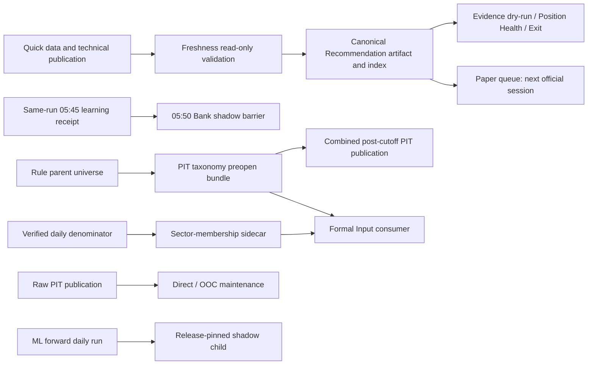

# 系統架構更新記錄（2026-06 至 2026-10）

> 原 system_architecture 的日期化歷史切片與第 16 節更新流水帳；僅作歷史追溯，含 2026-09-29 排程 operational custody 切片。2026-10-05／06 的 Personal H20、ML source custody、session proof／publisher loader、daily research snapshot／chart、private store 與 homepage 增量全文亦保留於此。現行架構契約請看 system_architecture，目前狀態請看 PROJECT_SNAPSHOT。

> 以下保留 system_architecture 於 2026-09-27 記下的決策與驗收快照；日期化 verdict 以文中 QA 收據為準，現況以 PROJECT_SNAPSHOT 為準。原 R027 strict INCONCLUSIVE 與之後的 versioned logical-time revision 是兩個獨立判定。

## 2026-09-27 邊界／資源 lifecycle 現況

### 2026-09-27 latest decision overlay

本節舊 R027 full8 段落描述的是原 strict gate，該 gate仍`INCONCLUSIVE`，原oracle與raw receipt不變。使用者接受的logical-time revision另以full8 PASS；Root其後依frozen source diff、R028 full8與獨立source/runtime review接受scoped R028 migration。Production orchestration現由`app_module.technical_indicator_job.TechnicalIndicatorJob`單一擁有，UpdateService facade lazy-delegate；R031 attempt6 current 288-path relevant regression及mandatory checks已由root接受；目前為提交前snapshot，staged review與commit結果以Git history及root最後交付為準。詳見 [R027 logical-time acceptance revision addendum](../06_qa/R027_LOGICAL_TIME_ACCEPTANCE_REVISION_20260927.md) 與 [R028 implementation report](../01_architecture/target_architecture_2026_09_22/REFACTOR_REPORTS/R028_IMPLEMENTATION_REPORT.md)。

IndustryMapper明示provider source slice已凍結，13個changed paths／4個focused route paths（14 distinct inputs）、18P/0F/0S，獨立source review未發現功能阻礙；舊264全域route已含`tests/test_decision_data_providers.py`，但缺`tests/test_industry_mapper_provider.py`與`tests/test_industry_mapper_performance_cache.py`，新全域route尚未執行。H5 app-initialization slice已bounded接受：freeze manifest `4c6b89a8f3b0817118478e8b1455a9633684017f01f3711c8e8465d03f9706db`，9 suites／105P；app CLI bootstrap與未bootstrap bare entry fail-closed保留。其CLI驗證只到`--help` bootstrap與target-free synthetic parity，不代表正式artifact loading、完整training/release或最終全域regression。

R024 root最終檢視的5-path bounded slice及9-suite route為67P/0F/0S。data-owned diagnostics/to_dict保存source facts，data→decision FactorDiagnostic imports移除；原decision FactorDiagnostic classpath、FactorService與序列化不變。新data record nominal identity不同。此處理限R024 reverse-edge，不代表R021當時已遷移IndustryMapper I/O。使用者已接受IndustryMapper follow-up：company與index均以data-owned providers明示注入、app composition建立兩者並遷移已知caller；domain缺少provider時須明確fail-closed並引導composition，不保留暗讀config／檔案／DB。遷移須保留原來源優先序、日期解析、欄位/排序及None／有效empty／error語意。Boundary目前凍結13個changed paths；4個focused route paths為14 distinct inputs，manifest SHA-256 `566c0fce31ce063b57c0f53a069e0d6a308b5cce19007fd56026e7d8ae48e602`，focused 18P/0F/0S、0.84秒。獨立source review未發現功能阻礙；attempt6 current route已包含兩個mapper tests及受影響路徑並自然通過。不得把這個follow-up回寫成R024原始驗收，也不宣稱domain-wide no-I/O。

`DBManager.execute_query` 已在獨立 bounded resource slice 增加 `finally: conn.close()`；仍使用原 `sqlite3.connect(self.db_path)` defaults、`with conn` transaction/rollback 及 `pandas.read_sql_query`。實際 TEMP API probe 在修正前 25/25 query return 後仍見 open handle，修正後 7/7 query return 後均為 0；真 connection success/error/rows/dtypes test及相鄰 regression為 92P/0F/0S。這是已 review 接受的 connection lifecycle 修正，不改 SQL、dtype、log、exception／schema 或 R027 oracle，也不被視為 R027差異的因果證明。

下列 R027 full8 段落記錄原 strict歷史receipt，而非新revision verdict：`r027_post_qt_lifecycle_root_all_20260927.json` runner exit1、projector exit0，8/8 `INCONCLUSIVE`／0 semantic／947 strict differences。原strict raw clock、mtime、WAL/SHM/reader evidence仍按原規則保存，不把947差異升為新gate結果；原oracle亦保持原bytes/hash。新revision PASS、3,303-file source scope及R028 start裁決依上述 dated addendum記錄，不取代該strict receipt。

bb68d020…ae0ae91是兩個Qt callback runtime修補前的歷史1,370-path full8；其舊taxonomy為738 raw OS、146 publication mtime、63 SQLite lifecycle。較早`ae0ddb3b…c83658`是未含TWSE暫存名修補版，`1d457f7f…e161`是REC-05前版。最新9a19 full8把current selected scope更新至1,233 paths，taxonomy為738／143／64／2；所有版本均INCONCLUSIVE，不可互相覆寫或把947差異升為PASS。

REC-02 bounded consumer/projection、canonical query與journey slice已依R029原criteria由root接受；completed business path由typed DecisionBatch產生current v1 projection，v1 event僅作wire相容／一致性核對，failed/cancelled partial snapshot只作diagnostics。R016 saved_recommendation_queries.select_latest_saved_recommendation是合法canonical readonly adapter，不是REC-02 Service list/latest。兩個in-repo業務consumer exit已達；REC-02分類ACCEPTED_WITH_RETAINED_PERMANENT_COMPATIBILITY，保留run_recommendation/list/latest public API、v1 projection、diagnostic partial output及rev1/2 decoder為必要具名compat，owner app recommendation compatibility；這不代表last_* writer全部刪除或外部support已終止。Portfolio navigation P2只驗canonical source navigation identity，不認證from_position display或Journey LINKED摘要內容。

## 9/30 排程資料流與 lane 邊界（歷史架構切片）

Quick／Freshness／Recommendation／Evidence 和 Paper 共用明確日期與來源 identity，但各自
保存 terminal receipt；Evidence 只組合當次 readback，Paper queue 只挑下一個已到期的官方
session source。Bank shadow 先綁定 05:45 Task 的同一 run、immutable receipt 與 source hash，
不能以舊 latest projection 取代 upstream barrier。PIT sector sidecar 與 taxonomy preopen 是
可分離輸出；Formal consumer 讀取相容的 sidecar不代表 combined taxonomy bundle完整，兩條
路徑仍要分別驗證 universe、clock、coverage 與 readback。Raw／Direct／OOC maintenance 和
ML forward 使用不同來源／release pins，不因同日 Task 成功互相授權。

2026-09-30 的真實排程 status、receipt hash、Task clock、目前 blocker 與驗收範圍是可變運行
事實，集中記錄於[排程修復 QA](../06_qa/SCHEDULED_OPERATIONS_REPAIR_20260930.md)；本架構
只記錄 producer／consumer 依賴與 lane 邊界，不把某次 no-op、candidate 或 blocked receipt
寫成固定系統狀態。

## 16. 更新記錄

- 2026-09-25（歷史快照，已由當日稍後 R031 closeout 更新）：同步 R026 exact NP1／NP2 bounded runtime migration 的 C2 acceptance 與 `TMP-ML-01` scoped closeout；當時保留 C3／C4 pending 與 Update SQLite teardown named baseline。請以 [R031 final closeout](../06_qa/R031_FINAL_REFACTOR_CLOSEOUT_20260925.md) 的 C3／C4 acceptance、named boundary baseline 及 retained owners 為現況。
- 2026-09-26：Wave14 candidate 在獨立 managed worktree 首次完整 union 為 2,404P／44F／5S／35W；42 個 exact-fixture byte／EOL mismatch 與 2 個既有 shadow-boundary aggregate failures 已具名，首次 480-input unchanged 不含全部實際 C1 fixture bytes，因此不能視為完整 input closure。五個 byte-pinned fixture 已還原至原 HEAD blobs，focused route 80P／1S；526-input 第二輪 union 為 2,431P／17F／5S。第三輪 526-input short-path full union 為 2,446P／2F／5S／35W；15 個 custody nodes 已在 short-path focused route 全數通過。Root 比對第三輪 CLI captured stdout JSON 與 C4 為 584 files／11 occurrences／10 distinct、`shadow_only=true` 且兩個 failing nodes 相同，裁定 `ACCEPTED_WITH_NAMED_BOUNDARY_BASELINE`；R031 engineering scope complete with retained blockers。這不是全綠或整體 refactor unqualified PASS。9/25 C4 receipts 保持獨立歷史收據；不代表產品／正式資料 gate。詳見 [R031 final closeout](../06_qa/R031_FINAL_REFACTOR_CLOSEOUT_20260925.md) 與 [Wave14 candidate manifest](../06_qa/WAVE14_CANDIDATE_CHANGE_MANIFEST_20260926.json)。

- 2026-09-14：同步 Decision Workbench 的 probability／rank provenance 詳情、unknown／shadow
  判讀、既有 Journal／Evidence／Portfolio ledger identity 重用原則，以及 daily shadow policy
  內的自動採用／回退邊界；不新增平行 decision store、不授權 formal promotion 或 broker。

- 2026-09-14 02:34:17-07:00：normal pipeline 已完成並保留 source／cohort warnings；learning child 以 `recovered_completed` 的 `time_stratified_eligible_dates` historical bootstrap 產生 255 training rows、candidate 與 1 row immutable capture。manifest 的 `initial_seen_start=2026-04-23`，bootstrap replay selected date window 為 `2024-09-16` 至 `2026-02-11`，date／row overlap 與 label boundary crossing 均為 0；decision 仍為 `retain_current`，自然 forward evidence 尚未成熟。affected focused／mature fixture 已完成，主線 QA final status 維持 pending；P1 cache-hit custody QA 其後獨立通過。

- 2026-09-14：獨立 UI／型別 QA：UI Workbench 81 passed（1 個 cache permission warning）、Update Tab 25 passed／0 failed／4 skipped；source-contract Mapping guard 修正後 mypy 606 source files no issues。real durable daily flow、主線新版 wrapper smoke 與 QA final status 仍待父任務交付；P1 cache-hit custody QA 另已獨立通過。

- 2026-09-14：主線驗收補充：affected focused suites 107 passed（11 個 test files、36.44 秒、既有 1 個 cache warning）；changed scheduled scripts 的 mypy 7 files 成功；changed scripts／modules／tests 以暫時 `PYTHONPYCACHEPREFIX` py_compile 通過，原有 `__pycache__` permission 限制保留；inventory 12 passed；新增 guards test 後登錄總量 804、recommendation 30。synthetic mature fixture 已通過 production source verifier 與 authority adopt／rollback assertions；舊 cache-hit guard 的 P1 source-audit／cross-root lookup／隔日 DB 變更缺口其後已由 verified receipt reuse 修復，獨立 cache QA 已通過；主線新版 wrapper smoke 與修後 source tests／型別／compile／inventory 最終 handoff 仍待交付。

- 2026-09-14：P1 cache-hit custody 修復後獨立 QA 已通過：`tests/test_recommendation_learning_cache_hit_custody.py` 為 `1 passed, 1 warning in 1.25s`、exit 0；三日正式 output receipt → Shadow verified reuse、原 timestamp、production source audit hash／value／lineage 與正式 ADX producer 輸出均驗證。此為 bounded fixture custody proof；主線新版 wrapper smoke 與修後 source tests／型別／compile／inventory 最終 handoff 仍待交付。

- 2026-09-14：主線修後 focused handoff：source-contract／capture／official-custody／guards `17 passed`；update-service／process-pool／technical-analysis `10 passed`；targeted mypy `5 files` clean；inventory `12 passed`，登錄總量 `805`／recommendation `31`；cache custody `1 passed`。scheduler 修正 test fixture 後的最終重跑與新版 wrapper smoke 尚待交付，整體收尾維持 pending。

- 2026-09-14 04:22:11-07:00：正式 default wrapper true-success：pipeline `passed_with_warnings`、`blockers=[]`；quick publication 於 `2026-09-14T04:21:27.181165-07:00` 為 `published`；learning child `completed`，symbol source=`scheduled_recommendation_snapshot:scheduled_rec_20260914_042140.json:eligible`、symbols=`1528`、candidate=`rec-cal-29c1b6129396a3885a89d080`、natural sample=`0`、decision=`retain_current`。新 immutable capture hash=`sha256:8c974b82de0cb6f4a5dc01ab08183e8cd02049f97bd56d6ce74908360072b2c0`；04:10 microsecond／nested capture false-success 不列為 pass，主 Luna 回報 QA 7.1 為 33 passed；僅主 Luna git commit 尚待完成。

- 2026-09-14：同步 V4.2 每日推薦學習的 wrapper → pipeline → source custody → normal snapshot → learning 資料流；補上 `--skip-broker-branch`、warning／degraded 傳遞、child／pipeline timeout、normal cohort 與 explicit capture 的 identity 隔離，以及 technical／official event／corporate sidecar 的 prospective 邊界。2026-09-14 durable readback 仍為 partial／degraded 與待自然成熟，維持 shadow-only、不可宣稱 V4／alpha／收益提升；QA handoff 待當日最終測試與正常 cohort status。

- 2026-09-13：新增 V4.2 每日推薦自動學習與受控校準閉環架構同步；05:40 forward outcome 後的 05:45 bounded replay／training／capture／自然成熟／active recheck／authority rollback 皆維持 shadow-only。補上 source contract 實際 digest／coverage／available-at／corporate-action conservative gate、after-cost 獨立 baseline 與 adopted active rows 的 cutoff 隔離；同步 dedicated `FA_Data_Shadow` root resolver 與 scheduler／runner／consumer／Workbench 共用路徑契約；不寫正式 recommendation／evidence DB、不啟用正式 promotion 或 broker。

- 2026-09-06：同步八卡日期／品質 DTO、推薦 context、T+1 版本、顯式 Registry 恢復、Evidence 提案、候選帳本／候選池及 Runtime 生命週期；保留正式來源與外部 Gate。

- 2026-09-04：Data Update 增加月營收／Phase 3C 候選更新 service wrapper 與子分頁操作入口；所有候選寫入仍隔離於正式 SQLite，來源狀態查詢在 production 根目錄唯讀時採 fail-soft manifest warning。全部資料頁操作列與狀態卡採 status-first responsive layout。
- 2026-08-29：將 `release_v4` 明確定位為 engineering／storage namespace，不再稱 `V4.0 Operational Production`；補入 immutable PIT／Direct／OOC pointer、dependency closure、人工 retention、resume abandonment、tombstone 與 stale status 邊界。Runtime environment／clone proof 與 production transaction proof 維持分層；Formal 0/3、alpha 0、scheduler／broker disabled 不因容量清理改變。
- 2026-08-26：補強 Data Update trust UX；UpdateView 狀態卡改為明確 status token／freshness 判定並清除部分 payload 的舊卡片，quick/safe 與各寫入型 worker 增加互斥、子流程進度區間映射與 final-status 100% gate。SQLite Inspector 與 UpdateService 狀態讀取共用 `mode=ro`／`query_only` adapter，缺 DB 時以 unavailable fail-soft，不建立空資料庫；TWSE 明確失敗時每日來源流程在 TPEX／SQLite／技術指標前停止；同步補上 UI、每日更新與 SQLite 操作手冊及回歸測試邊界。

- 2026-07-15：同步 corporate-action availability history staging-only CLI 邊界；JSON root deterministic fail-closed、既有 target 拒絕覆寫、staging publish／cleanup 與環境 `DATA_ROOT` forbidden-root guard 均不接正式資料或 Formal lifecycle。
- 2026-07-13：新增 Terra Development Dataset V0 獨立 development-only generation 邊界；四個 core source 唯讀、T-1／252 日 observed universe、2025 development／2026 evaluation-only、append-only artifact 與 zero-formal-write safety flags 不接正式 Rule-only path。
- 2026-07-12：新增 Gate 1 Advice Current Architecture 邊界；Advice policy / composer 在 application layer，Workbench UI 僅渲染 DTO，所有輸入維持 as-of / fail-closed / no-write contract。
- 2026-07-11：新增 Target Architecture 與 Post-Refactor Product Roadmap companion 連結；修正目前主 UI 為 8 個左側主工作區，Daily Decision 已內嵌於「決策工作台 > 決策來源」；本文件仍只描述 Current Architecture。
- 2026-07-11：新增 Safe Refactoring Master Report 為行為不變重構執行 companion；該 program 於 2026-07-12 closeout 後已歸檔為 `docs/09_archive/SAFE_REFACTORING_MASTER_REPORT_2026_07_12.md`，目前架構、產品 Roadmap 與使用流程權威邊界不變。
- 2026-07-07：更新 Phase 2 Workbench MVP shell 架構同步；`ui_qt/views/workbench_view.py` 與 `ui_qt/models/workbench_table_models.py` 只呈現 `WorkbenchDashboardDTO`，主 UI 透過 `WorkbenchSourceService` 注入，新增中文顯示、預設 replay JSON summary 分析與舊 Daily Decision / Evidence Review / Portfolio read-only drill-down，不直接讀 SQLite / replay DB、不寫 DB、不啟用 scheduler、不重算 scoring / portfolio / backtest / lifecycle。
- 2026-07-08：補充 Pre-V2 readiness source-gap closeout fallback；同日 scheduled dry-run `latest_status.json` 可作為修正後歷史觀察日的唯讀證據，仍不回補 DB、不觸發 confirm、不解除 production scheduler gate。
- 2026-07-07：補充 Workbench background evidence feed / read-only Action Items MVP 架構；`WorkbenchDashboardDTO` 新增背景證據流與只讀人工待處理列，來源只限既有 snapshot/readiness/agent/replay summary payload，Action Items 保留 source trace / degraded reason / drill-down target 且 `write_intent=false`。
- 2026-07-07：補充 Workbench Action Items 人工佇列 follow-up 架構；Action Item DTO 增加 queue group / source label / sort rank，composer 只排序既有 payload，Qt view 補空 / 降級狀態文案與 drill-down target contract，仍不接 DB / replay / scheduler / lifecycle。
- 2026-07-07：補充 Workbench Phase 2C / 2D closeout 架構；`WorkbenchOperatingLoopStep` / `WorkbenchOperatingLoopTableModel` 只從 `WorkbenchDashboardDTO` 串接 daily first-look、manual queue、weekly history、multi-day dry-run、manual review note 與 scheduler gate，所有 step `write_intent=false`，Phase 0 時間 gate 與 production scheduler gate 不因 UI closeout 被補完。
- 2026-07-06：文件架構補上 `VERSION_ROADMAP_V2_1_TO_V4_0.md`，定位為 V2.0 之後長期版號 companion；本文件仍只維護目前架構、模組邊界與資料流。
- 2026-07-06：新增 V2.0 Phase 1 read-only Workbench prototype 架構同步，確認 DTO / composer / replay summary adapter / CLI 只組合唯讀樣本與 replay JSON summary，不寫 DB、不掛主 UI、不重算策略、不啟用 scheduler。
- 2026-07-06：新增 Workbench formal read-only source adapter 架構同步，確認 `WorkbenchSourceService` 只用 SQLite `mode=ro` / `query_only` 讀受控 DB path 的 DDD snapshot，並組合 Pre-V2 readiness、Agent summary 與可選 replay JSON；missing DB / table 只回 diagnostics，不建立 schema、不寫 DB、不解除 Phase 0 / scheduler gate。
- 2026-08-27：Decision Desk／Pre-V2／Evidence source coverage 的 current snapshot 查詢統一以台灣市場今日為上限；future row 保留 raw 稽核、輸出 blocker／diagnostic，不進入 current evidence。`EvidenceSourceCoverageService` 與 `inspect_decision_desk_snapshots.py` 改用 query-only 讀取，避免唯讀正式 DB 被 writer repository 初始化 schema。
- 2026-08-27：Data Update UI 的日期控件統一由台灣市場日期服務提供「今日」；localized `不可用` 會落到異常狀態；全域狀態檢查失敗會將六個核心與三個候選來源 inline 摘要同步清除並保留共同錯誤原因，避免狀態卡與來源頁殘留不同步；候選來源分頁也會投影自己的檢查結果。此為 presentation／diagnostic 邊界，不改資料更新與 SQLite 寫入契約。
- 2026-08-27：每日資料合併的 cancellation callback 延伸至單一 CSV 的讀取批次邊界；完整檔案讀取完才加入待提交集合，取消仍不會截斷或替換正式整合檔。這改善長檔等待期間的可觀測性，但不等於逐列中斷或解除 single-writer 安全邊界。
- 2026-08-27：ScoringEngine 的 rolling PatternScore 同步保存已確認型態的唯讀 evidence（名稱、方向、確認日與衰減日數），並投影 `PatternNames`／`Pattern_Signal`／`PatternAgeDays` 給 ReasonEngine。Explain 不在單列資料上重新呼叫 PatternAnalyzer；缺少具體名稱時只顯示 generic 方向訊號，避免把 end_idx 或分數臆測成已成立型態。
- 2026-08-27：Recommendation 與四個策略 executor 移除未使用的全歷史 `identify_patterns()` 預掃描，統一由 ScoringEngine rolling path 產出分數與 evidence；不改策略訊號，只避免重複計算與未確認型態的誤解釋。
- 2026-08-27：UpdateService 的 SQLite 輸入正規化修正為先辨識受治理的日期／股票代號／股票名稱別名，再在寫入副本上統一 canonical 欄位、日期與四碼代號；修正重複條件造成的英文欄位被提前丟棄問題。raw CSV 與呼叫端 DataFrame 不被原地改寫，必要欄位缺失仍 fail-closed。
- 2026-09-12：新增 V4.1 A 線第二輪 historical method pack 架構同步，確認 manifest 的 row-level time／lineage／gap contract、20／5 walk-forward reuse、PIT theme fail-closed 與 create-only frozen shadow artifact；不改 Recommendation／Scoring、不寫 formal DB、不授予 natural forward evidence credit。
- 2026-07-06：新增 Historical Evidence Replay 架構同步，確認 replay service 只做 working-copy / replay DB orchestration，recommendation result 受 `created_at <= decision_date` 限制，forward outcome 受 `data_as_of_date` 限制，不改 scheduled dry-run、不寫 formal DB、不啟用 production scheduler。
- 2026-07-06：補充 Phase 0A reference return fix 架構契約，確認 missing benchmark fallback 到 TAIEX、market index `收盤價` fallback 與保守 industry sector mapping 只影響 evidence outcome reference lookup，不改 scoring、portfolio 或 scheduler。
- 2026-07-06：新增 Pre-V2 readiness inspector 架構同步，確認 `PreV2ReadinessService` 只做 weekly history / multi-day record / source gaps / Agent report sample 唯讀檢查，不建立 schema、不寫 evidence、不啟用 scheduler。
- 2026-07-06：補充 Pre-V2 非時間型 closeout 與 Recommendation liquidity payload follow-up，確認 working-copy source gaps / UI smoke / Agent sample 已收斂，但 formal DB write、weekly / multi-day 時間 gate 與 production scheduler approval 仍未完成。
- 2026-07-05：完成 V1.6 Cross-sectional Factor Pipeline v1 架構同步，新增 snapshot DTO / repository / migration、FactorGate-backed pipeline、concept basket available-date gate、rank / quantile persistence 與 read-only attribution summary CLI；保持 application governance layer，不改 scoring、不啟用 scheduler。
- 2026-07-05：完成 V1.7 Screening Matrix & Negative Evidence v1 架構同步，新增 Recommendation result screening matrix、negative evidence payload capture、screening matrix events 與 source coverage warning；只消費已保存 payload，不回補、不重算、不改 scoring、不啟用 scheduler。
- 2026-07-04：文件架構補上 `EXTERNAL_REFERENCE_VERSION_BLUEPRINT.md`，作為外部開源專案參考、資料源補強優先序與 V1.5-V2.0 版本形狀 companion；本文件仍只維護目前模組邊界與資料流。
- 2026-07-04：完成 V1.5 Data Credibility & Corporate Action Gate v1 架構同步，新增 read-only source capability registry、corporate action policy、microstructure governed metadata 與 shared evidence source coverage service；不寫正式資料、不改 scoring、不啟用 scheduler。
- 2026-07-02：完成 V1.2 Research Credibility & Execution Model v1 架構同步，確認 Profile replay 訓練 / 驗證分離、推薦回放 rolling risk、microstructure preflight 與 relative attribution 都位於 application diagnostics boundary，不改交易、PnL、cash ledger 或策略生命週期。
- 2026-07-03：完成 V1.3 Evidence Operations & Manual Lifecycle v1 架構同步，新增 weekly evidence operations service / CLI；manual approval package 與 action item planning 只供人工覆盤，不啟用 scheduler、不自動套用 lifecycle action。
- 2026-07-03：完成 V1.4 Evidence Review History v1 架構同步，新增 weekly review history repository、dashboard service 與 Research Lab `Evidence Review -> 覆盤歷史` 唯讀子頁；history 只保存人工覆盤快照，不啟用 scheduler、不自動 lifecycle action。
- 2026-07-02：完成 V1.1 workflow bridge v1 架構同步，新增 `ProfileReplayComparisonService` / DTO application boundary；Profile replay 比較只讀注入 runner 結果並輸出人工 lifecycle candidate，不寫 DB、不重算推薦、不自動升降級。
- 2026-06-23：完成 Healthcheck Batch 2 架構同步，新增 `DecisionDeskDashboardComposer` 與 `SmartMoneySemanticService` 邊界；Daily Decision Desk answer-first dashboard 與 Smart Money 5 / 20 / 60 日語意診斷皆由 app service / DTO 提供，Qt UI 不重算籌碼或市場邏輯。
- 2026-07-01：新增 Post-V1 evidence layer 架構邊界，確認 Evidence Event Store / Forward Outcome Calculator 只保存事件與 close-to-close research outcomes，不改 scoring、推薦權重、portfolio 或 UI。
- 2026-07-01：新增 Evidence Review Dashboards read-only UI pack 架構邊界，Research Lab `Evidence Review` 只透過 dashboard service 讀取 Forward Evidence、Live vs Research Gap、Signal Decay 與 Decision Quality；UI 不直接讀 SQLite / repository，不改 scoring、portfolio、Research Run 或 Strategy Lifecycle，也不建立 scheduler。
- 2026-06-23：完成 Healthcheck Batch 3 架構同步，新增 `RecommendationProfileService` 作為推薦分析 Profile lifecycle 邊界，支援內建 / 自訂 / gate-passed 策略版本 Profile，並明確規範 Profile-Regime mismatch 只作解釋與分數揭露。
- 2026-06-23：完成 Healthcheck Batch 4 架構同步，新增 `research_result_presentation.py` 作為 Research Lab 結果頁呈現邊界；推薦回放段落、Train-Test / Walk-forward 樣本可靠度提示與 Registry 比較中文判讀只讀既有結果，不重跑回測、不抓新資料、不產生交易建議。
- 2026-06-17：完成 Month 5 Fundamental Layer v1 closeout 架構同步，確認 fundamental tables / provider / adapters / diagnostics 為保守接入邊界；P/B、P/S 已補 guarded presentation policy，官方歷史 PIT 公告日保留為後續治理 residual；Month 6 Strategy Lifecycle 不得直接污染 ScoringEngine。
- 2026-06-17：補上 P/B / P/S valuation policy 架構同步，確認 P/B / P/S 僅接受 governed external observations 或 future backfill records，不在系統內推導估值分子 / 分母。
- 2026-06-17：完成 Month 6 Strategy Lifecycle / Portfolio Feedback v1 架構同步，新增 lifecycle rule engine、drift detector、portfolio feedback attribution、Portfolio Review snapshot 與 Registry-based Promote lifecycle gate；持倉管理 UI 只讀 service attribution，不重算策略或改寫持倉。
- 2026-06-17：補上 lifecycle evidence 架構同步，新增 append-only `strategy_lifecycle_repository.py`、latest state projection 與 demote / retire proposed evidence 保存邊界；Promotion 成功後可記錄 applied evidence。
- 2026-06-15：完成 Daily Decision Desk Portfolio Alert Attribution v1，將持倉警示拆為來源標籤、condition status、chip risk level、reason tokens 與 data quality flags，並整合至主 UI 與風險提示，明確定義由 PortfolioAlertService 進行歸因產生的架構職責。
- 2026-06-15：完成 Daily Decision Desk Why Not / 風險提示 v1 對接，由既有 section DTO 欄位與警告推導，輸出對應之低流動性、相對弱勢、Watchlist 觸發與持倉警示提示，不重複計算。
- 2026-06-15：補入 baldr 願景與架構權威邊界，更新 Daily Decision Desk v1 已接上主 UI；Market Breadth v1已接 SQLite `daily_prices` provider，Sector Rotation v1 已接 SQLite `industry_indices` provider，Relative Strength / Liquidity Ranking v1 已接 SQLite `daily_prices` provider，Watchlist Trigger v1 已接 `WatchlistService` 與 SQLite `technical_indicators`，Portfolio Alert v1 已接 `PortfolioService`、`PortfolioConditionMonitor` 與 `PortfolioChipService`，其餘 Strategy Drift 與 Post-trade Attribution 仍屬後續工作；同步 Month 3 Portfolio Replay 可信度、固定組合 per-stock factor metadata保存與後續資料因子接入防線。
- 2026-06-16：完成 Month 4 Daily Decision Desk 收尾架構註記，確認 v1 以 service snapshot 聚合並新增 UI boundary contract test；Month 5 可從 Fundamental Layer preflight 開始，Strategy Drift 與 Post-trade Attribution 仍屬後續工作。
- 2026-06-16：啟動 Month 5 Fundamental Layer preflight 架構落點，新增公告日 / available_date 初版政策、raw 月營收正規化契約、候選 SQLite schema dry-run / report API 與 fundamental adapter contract，確認 raw fundamental CSV 缺 `available_date` 時不得產生 normalized record / factor record，未來資料仍須經 FactorGate 驗證。
- 2026-06-16：新增月營收 availability mapping dry-run 驗證入口與 CLI 架構邊界，確認它們只讀 mapping、輸出 diagnostics，不建立或改寫正式 mapping、raw CSV 或 SQLite。
- 2026-06-16：新增月營收 availability historical dry-run builder 架構邊界，確認 TWSE/TPEX 最新月 OpenAPI 或人工官方 JSON 只能產生候選 mapping / diagnostics，正式 mapping 寫入與 monthly revenue backfill 仍需人工 gate。
- 2026-06-16：補上 MOPS 官方 HTML source-dir 架構邊界；`--mops-html-dir` 只讀人工保存且含 `出表日期` 的官方 HTML，缺欄位時 fail-closed，不由 raw CSV 補日期。
- 2026-06-17：補上 MOPS `--mops-static` 架構邊界與 45 天合理揭露窗口；historical static report 的重新出表日會被視為過晚 available_date，不得形成 candidate row。
- 2026-06-16：補上授權 PIT 月營收公告日 CSV 架構邊界；`--pit-csv` 只接受具 source_version 的 point-in-time 匯出檔並產生候選 mapping，不寫正式 mapping、不回填 SQLite、不接 ScoringEngine。
- 2026-06-16：補上 GitHub public archive source audit 架構邊界；commit first-seen 可作未來 PIT 候選方法，但目前已檢查 public repos 皆未提供可追溯 daily snapshot，因此不新增 `github.*` allowed source。
- 2026-06-16：新增 MOPS snapshot / FinMind create_time 候選抓取器架構邊界；兩者只輸出 candidate/raw evidence 到 output 目錄，不推定正式 available_date，不寫 `monthly_revenue_availability.csv` 或 SQLite。
- 2026-06-16：新增估值呈現政策 / adapter 架構邊界，確認只輸出相對估值區間與 diagnostics，不接 ScoringEngine，不產生目標價、合理價、上漲空間或買賣建議。
- 2026-06-16：新增 valuation data layer 架構邊界，確認資料層只建立受治理 observation 與同產業分位，估值輸出仍由 presentation policy 控制。
- 2026-06-16：新增 valuation metrics backfill 架構邊界，確認 `daily_prices.本益比` 需經 dry-run / confirm / backup workflow 才能寫入 `fundamental_valuation_metrics`，且不接 ScoringEngine。
- 2026-06-16：新增 Abnormal Fundamental diagnostics 架構邊界，確認異常基本面只進 Research metadata 與 Daily Decision Desk risk prompts，不改財報、不改 score。
- 2026-06-16：新增 TPEX daily price backfill 架構邊界，確認官方 TPEX daily close quotes 只能經 dry-run / confirm / backup workflow 補寫 `daily_prices`，不修改 `companies.csv`、fundamental tables 或 scoring。
- 2026-06-18：更新 TPEX daily price 架構邊界，確認日常 / 手動 / 背景流程以官方 afterTrading historical endpoint 補缺少日期，SQLite sync 同時讀取 TWSE `daily_price/` 與 TPEX `daily_price_tpex/`，並 upsert `daily_prices`；背景補齊狀態寫入 `DATA_ROOT/meta_data/tpex_full_refresh_status.json`。
- 2026-06-16：更新 SQLite / broker flow 邊界，確認 `broker_flows` 唯一鍵需包含 `trade_type`，且 SQLite Inspector 顯示 alias 不得影響表格 model 取值。

2026-10-03後續驗證：見 `docs/06_qa/FINAL_DATA_CLOSEOUT_AND_COMMIT_20261003.md`。current fundamentals 為weekly成功後的獨立writer；current revision與正式PIT分離，decision date使用Asia/Taipei、market cutoff保留獨立日期；Evidence依child stdout/summary/report與來源品質驗收。個股研究提供明確保存來源／指定股票分析及獨立技術觀察，仍守正式ML來源修訂隔離。

## 2026-10-06 個人 H20 原模型讀取增量

`H20GrossModelContract` 與 `PersonalH20GrossInference` 沿原 artifact loader 的 captured-manifest／same-bytes decode。受控 composition 注入原 `read_recommendation_training_lineage`，模型 final-fold training_as_of 與 merged-lineage cutoff 分域；candidate.training_cutoff 精確綁後者，兩者不得晚於決策日。原中文 lineage canonical bytes 語義保持。中央 preflight 只讀可信 fit receipt 的 raw pin→原 sidecars→原 verifier→typed contract，不重造 lineage、不載 artifact或啟 Task。

真 artifact 原保存請求重播已驗，尚未把 current-restated inference source 與 frozen training source 完成 daily composition。config personal_model_policy_path 只選 policy 位置，explicit MainWindow override 優先，不自動啟用；私人 policy／預測紀錄仍與 FA_Data／marketdb 分離。證據與剩餘見[中央整合 QA](../06_qa/BALDR_PERSONAL_MODEL_ACTIVATION_INTEGRATION_20261006.md)。

## 2026-10-06 ML source custody依賴方向閉合

M01 `47873e1d→5cc54631`、二次source補正 `ff7adffe→a5304f1c` 已採。原saved artifact／index／stdout reader AST除pure cohort validation保留在ML wrapper外相同。缺port／非callable／returned verified flag拒絕，scheduled script注入原App reader；capture、fit receipt、outcome builder、receipt readback與二次source binding傳遞同port。v1、金融公式、時序、custody及false資格不變。

中央M01 53 passed／1 Windows symlink skip／1 真fit deselected（7.13s）；相鄰原v2 batch15 passed（0.76s）；CLI＋原dependency boundary55 passed（13.95s）。6 source mypy、9 files compile通過。各subset不累加成完整App數量。guard678/0 exit0；原global零違例assert未改，只有 `a0abe901` 將過時CLI六歷史違例期望收緊為main0／zero，原負例保留。raw／blobs見 `output/qa/m01_central_acceptance_20261006.json`。

9 Stage仍1 done／8 partial／0 pending，24 UX仍2 done／22 partial／0 pending；七項有限closed UX03/04/05/06/09/15/17保留。partial混合後續增量、規格、外部資格與真人接受，不能全部稱為未修工程。歷史raw／失敗與唯一plan前綴保留；無push/mainmerge、真DBwrite、migration、Task、ACL、Native、fit或清理。

`docs/06_qa/BALDR_ENGINEERING_DECISION_DELTA_20261006.md`

## 2026-10-06 session proof 與 publisher loader 邊界

原 natural maturity session proof verifier 經 data_module/recommendation_natural_maturity_proof.py → 原 NaturalMaturitySessionResolver；App personalization 不再直接 import ML evidence wrapper，20 session／cutoff／calendar／market custody 不變。完整 personalization 仍有其他既有 allowed training imports，不宣稱全面冷載入隔離。

CurrentRestatedMLRunRegistry readonly 查詢無 loader；publish_current_restated_stock_research_run 新 keyword-only model_loader，缺件前置拒絕。原 scheduled current_stock_research_cycle 在 script composition 明示注入原 ML loader；不在 App 偷移 dynamic import。原 bundle／manifest／sidecar hash checks 與 source/account/PIT 資格不變。中央20 focused 通過，guard677/3仍 FAIL，剩 M01 H1–H3；原重型 union 不冒稱涵蓋新 head。

## 2026-10-06 UX21 明示基準的有限資料流

原exact parent／children＋明示runtime v2 benchmark settings→source同calendar decision/H5/H10/H20/asof→query-only市場adapter＋target revision pin→原Decimal core→saved.v2 immutable envelope（設定／basis／availability／期間／source／cost version核驗）→舊receipt reader→readonly Qt。unconfigured沿v1/null；可選CLI設定檔raw pin連同原／effective runtime保存，不自動接受observed hash。新leaf只管設定／保存驗證，不引入政策選擇或ML訓練。

caller-declared target basis與benchmark qualified research只在同期間相容時計算excess；原source availability／calendar資格及自然權威保持unknown/false。revision另存；讀回不依live DB。benchmark工程完成不代表完整期間labels或PIT。[收據](../06_qa/UX21_BENCHMARK_SOURCE_STORE_UI_20261006.md)。

## 2026-10-06 保存圖表資料流限定追加

SQLiteDailyMarketSnapshotSource.load_input（既有唯讀transaction／source pin）→DailyMarketSnapshotProducer（nested saved_technical_chart v1；外層feature v2 optional欄位）→DailyMarketSnapshotRepository exact manifest/hash/cutoff核驗→StockResearchReportReadService frozen保存價格與MA20／60→純StockChartPayload→既有QPainter與精確表。codec只序列化／驗證Decimal字串／整數，不查SQL或計算指標。各120列、raw256KiB／envelope48KiB，外層容量／atomic publication不放寬。

方法／原排名revision核驗仍獨立，圖表可重現不授予排名、PIT、ML或交易資格。舊無chart保存來源留空，可明示另開最新研究；只新日研究parent producer接線，推薦writer及舊結果補建尚無。[收據](../06_qa/UX08_SAVED_CHART_READBACK_20261006.md)。

## 2026-10-05 UX13 具名研究母體共用投影

`DailyMarketResearchScreenerService` 唯讀讀回原 verified v2 快照；`daily_market_cohort_projection.py` 將完整發布 rows 與相同 manifest 投影為 immutable 母體 DTO，核對 scope／日期／hash／方法／實際條件結果，保留 declared／published／missing 分母。既有 Decimal 值排序不改發布資料或原方法；原強弱排名不存在時明示 unknown。

`DailyMarketResearchView` 發出 snapshotAccepted／snapshotCleared；Main 的 `DailyMarketCohortView` 直接收相同物件，盤勢重載委派名單既有 worker，沒有第二份資料庫讀取或跨日期計算。市場探索 → 同來源名單 → 原 pinned 個股研究路由沿用既有 DTO，篩選不改市場方法統計分母。這是具名≤16檔研究入口；其他原大盤／強弱 consumer 不在此共用契約內，完整市場融合仍待工程。

## 2026-10-05 UX18 固定研究方法與發布契約

兩條既有 close／MA20／MA60 觀察的方法 metadata 由 application 層單一契約 owner 提供；feature snapshot 在投影時捕獲方法規格與 canonical hash，納入 input fingerprint／cache identity，而非序列化時重讀可變規格。producer 將同一規格綁入 immutable manifest，repository 同時驗證現行契約、manifest、逐股 payload 與條件身分；screener 和 StockReport 的 pinned readback 保留同一方法結果，不另創公式或分數。

舊研究 schema、錯方法／版本／參數／日期／hash 停止唯讀；只有明確 producer 更新才能重新發布，候選驗證後原子切換 latest，保留舊 immutable。固定參數只有20／60窗口，資格只指本觀察的輸入足夠，不授歷史 PIT、正式推薦或模型權限。原排名／市場共用 consumer 為下一工程切片，非本次 metadata 自動達成；見 [限定 QA](../06_qa/UX16_CURRENT_OBSERVED_SOURCE_CONTRACT_20261005.md)。

## 2026-10-05 日常研究名單與pinned個股

Main共用DailyMarketResearchScreenerService，Recommendation研究來源頁只讀snapshot並組合既有條件，明確更新命令才呼叫現有有界source／producer。列表row→ResearchStockContextDTO→session event/store/reducer→StockReport的pinned reader，固定manifest/root/cohort/date及條件；當前有限source input核驗失敗不fallback live。返回需原manifest，與原保存推薦／Advice資格分離。參數與研究區路徑見[Manual日常研究flow](../07_guides/APPLICATION_MANUAL.md#2026-10-05-ux0405-每日研究條件與同源個股)；本包不另建正式writer／scheduler。

## 2026-10-05 隔離日研究快照資料流

`SQLiteDailyMarketSnapshotSource` 在同一 query-only transaction 重用 StockReport 既有有限價格／technical DTO 查詢；`DailyMarketSnapshotProducer` 重用既有 close／MA 特徵投影和容量政策，核驗候選後才原子替換 latest。`DailyMarketSnapshotRepository` 每次驗證 manifest／artifact／版本／身分與來源 pins；StockReport 明示 root／cohort 才讀已發布版本，live 預設維持。CLI 僅允許 repo output 的隔離子目錄，不是正式 Rule／Evidence writer 或排程。

來源 main／WAL 變動拒發布；只重算失效股票，明示 cohort 缺件即停止。reader 可辨識 partial research，current-observed／PIT=false 與 unknown available-at／calendar 限制沿用。完整參數、發布與失敗邊界見 [Manual UX19](../07_guides/APPLICATION_MANUAL.md#2026-10-05-ux19-隔離研究快照生產與讀回)；限定驗證見 [QA 新章](../06_qa/UX16_CURRENT_OBSERVED_SOURCE_CONTRACT_20261005.md)。

## 2026-10-05 共用日特徵的研究 consumer

**最新個人資料分離約束**：可單獨分享的市場／抓取來源資料與個人收藏、研究紀錄、筆記、記帳／持倉狀態必須分 root／專用 DB，不能只分表或放市場包的 output 子目錄。既有 Watchlist `OUTPUT_ROOT/watchlist` 與 Portfolio JSONL `OUTPUT_ROOT/portfolio` 尚在市場 output 邊界；本批不宣稱已搬離。候選 `%LOCALAPPDATA%/baldr/personal`（本機 `C:/Users/archi/AppData/Local/baldr/personal`），個人 watchlist DB 為 `watchlists/watchlists.v3.sqlite`；配置、marker／receipt／audit／backups 與 SQLite sidecar 一併留私有 root。路徑選定、writer/discovery 及市場匯出 allowlist／排除驗證是正式套用前的工程，位置待使用者確認，不改其他 owner 帳本。詳細邊界見 [本批 QA](../06_qa/UX08_NATIVE_CHART_CONTRACT_20261005.md)。

UX08 個股價格圖在既有 StockResearchReportDTO 與原生 Qt consumer 之間增加純 application 投影：同一份核對後 points 供圖與精確表，來源上下文 pin 與逐列價格指紋分別按原語義核對，不新增 SQL／producer／金融公式。cutoff 與已知 available_at 在投影前過濾；未知可得時間不升格 PIT。Qt 不重新讀最新行情、不自行重算來源 hash；原生 renderer 初始化／填值失敗保留已核對表格。單日 technical snapshot 不變成歷史線，無完整身份的 event 不轉已驗證交易 marker。詳細工程範圍與未完成項見 [UX08 QA](../06_qa/UX08_NATIVE_CHART_CONTRACT_20261005.md)。

UX08 後續歷史技術切片：read service 有界讀既存 technical_indicators 的 MA20／MA60，報告追加 frozen 歷史列；純投影核對 stock／source／date／row hash／cutoff，再按價格日期對齊給原生覆蓋線與精確表。缺值保 None 並斷線，不推導指標、不延伸單日快照、不把 live 歷史補入缺件的保存來源；可得時間與暖機資格仍明示未知。此新增 readonly query 不改 producer、儲存 schema 或金融公式。

`StockResearchReportReadService` 在既有價格／技術唯讀查詢後，交由 `DailyMarketFeatureSnapshotService` 投影close／MA20／MA60；不加SQL或producer。每service有RLock與最多4筆LRU，契約版本／scope／日期／全DTO內容及來源fingerprint綁identity。DTO的 `shared_daily_features` 交給研究理由與Qt首屏同一三態，失敗／不足暖機保留unknown。必要暖機沿既有SMA的末段有效OHLC20／60窗口；不授calendar／available-at／PIT或完整producer等價資格。舊DTO空mapping相容，既有RSI／Advice／原排名與canonical writer不變。此為UX18有限consumer；UX19 manifest／bounded writer／atomic publish仍待，詳見[QA新章](../06_qa/UX16_CURRENT_OBSERVED_SOURCE_CONTRACT_20261005.md)。

> **最後更新：2026-10-04｜目前程式結構；不代替運行狀態。**
> `release_v4` 是 storage／engineering namespace，不等同正式 V4.0。配置 ML、Rule／ML bp 混合、風險投影、Decision／Evidence 與 Paper ledger 的責任邊界如下。Formal input 計數、ledger 是否已產生、scheduler 是否啟用、D 剩餘容量均是可變運行事實，須讀 Snapshot 與當次具 hash／時間的驗收產物；不再以本架構檔的舊值作現況。Live broker execution 不在此系統範圍。

## 2026-10-06 第二波來源與私人審查邊界

Watchlist 沿原 repository revisions，以 immutable item digest 排除私人 notes／review extension 後核來源；個人 service writer guard＋CAS 僅更新理由與查看狀態。UI 成功前讀回 exact identity/revision，兩個明示同源 revision 比較不借 live。Portfolio 三帳摘要只投影既有 DTO／同列 cache，root/mode 任一已配置即要求中央注入同帳服務；Paper pair 核 portfolio／benchmark 與 state/benchmark/cost DB 全同，不能缺件 fallback。

圖表 marker reader 接原 Portfolio／Journal readonly adapters，以 caller 先核保存原列 custody SHA pins，分別驗來源、帳戶、aware clock、cutoff 與 report context，再投影至 chart；推薦確認與實際買賣分域，缺 account_kind 不推定 actual。主程式注入尚未完成，不從 report.events 造來源。Update／Runtime 只翻譯原 DTO，成功日／行情日期與觀測時間分離，明細收合不解除原 blocker。

generic personal selection → exact Review route → DecisionQuality 私人 review reader／writer＋原 notes selector；Evidence/Gap/Decay 仍 query-only 市場 source。EvidenceOperationsService 的 readiness 用 config 副本，週報 lineage 保存原 ID/hash/路徑但 snapshot qualification unknown；HistoryRepository 沿相同私人 Review DB，每 connection 核 DB/sidecars custody，readonly list 不 mkdir/schema。CLI source --db-path 的 production-like guard 保留，私人輸出不 retarget 市場來源。B09 custody 完成尚未確認，使用者已批准仍適用修正合併並由原 lane 重試；backend／main 最終 composition 仍是獨立剩餘，不以這些葉節點代替。[接線與限定驗證](../06_qa/BALDR_B10_PRIVATE_REVIEW_20261006.md)。

B12 typed calendar／terminal 來源 pins → strict request codec → subprocess preflight／execute → 原 owner acceptance／saved status；明示零 process exit，缺 clock／coverage／terminal 及 hash mismatch 拒絕，default 不 execute。共享 coordination lock 約束多 segment，timeout／cancel 保留 partial。producer/repository 使用共用 OS renderer，source identity 與所有外部 receipt 仍 canonical；既有 capture200GiB 下限不由較低 override 降級。此鏈只完成隔離工程，正式 Task／account／ACL／來源 qualification 未授。[B12 收據](../06_qa/BALDR_B12_DAILY_RUNTIME_20261006.md)。

## 2026-10-06 首頁接線與personal IO邊界

`personal_store_routes.select_personal_store_route` 純選擇 trades／聲明／Paper trade ledger／Portfolio ledger／Review／Evidence 的 read source 與 write target，不開 store、不 mkdir。PERSONAL 固定同 store；legacy readonly 無 writer；Evidence 強制市場 readonly；Review 保留市場 Evidence refs 不搬整庫。Portfolio ledger 路徑與身份由 caller 明示，不猜 schema。B09／B10 接線仍是下一步，現有 Journal 主 UI selector 不重做。B02 六檔 COW／activation／repository 已沿同版 helper 完成 canonical DB >260 與 suffix 的隔離全鏈驗證；公開身份不變。

首頁四用途沿既有callbacks到原工作區，股號搜尋建立明示當下`ResearchStockContextDTO`，原保存候選保留原exact context；沒有新dashboard／domain計算／全域狀態平台。大盤只翻譯原DTO分類與明示布林條件，缺件保持unknown，刷新不重置收合。個股focus summary沿原change／section status，與ML限制併列，不升模型資格。

`personal_data_paths`保留canonical path給containment／equality／hash／receipt，只在Windows OS IO使用UTF16門檻extended renderer；SQLite URI只ro/rw，不授writer／migration。links/hardlinks與device namespace守衛保留。registry exact symbols僅DTO／transition policy，reader仍sidecar-free一致snapshot；舊8ML boundary未解，不稱架構全通過。[範圍與驗證](../06_qa/BALDR_FIRST_WAVE_INTEGRATION_20261006.md)。

## 排程來源與 operational custody（2026-09-29）

Windows query 與 registration inspector 共用同一受測 21 項 inventory，包含 legacy learning
及 BankTaiwan；readiness 不等於業務成功。Scheduled Evidence 從同日 snapshot status
取得精確 result ID，經 canonical query/hash/clock 重驗後交給 importer 與 coverage，不
混用 formal／shadow latest；缺件在 pipeline 啟動前拒絕，child 受 600 秒 timeout 約束。
Learning orchestration 已驗證的同日 formal technical receipt 直接重用，不重啟 updater
覆寫主排程 latest；其餘 learning source-time／custody gate 不變。

PIT 盤前 CMD 接到版本化官方 taxonomy source config，archive／denominator 完成後重讀
clock，taxonomy 失敗傳遞非零。盤後 history 限明確 coverage scope，舊檔保留但不消費，
日曆只用既有 hash-bound cache；範圍內 source readback、cutoff、license 與 formal
publication gate 仍完整保留。官方現在取得的來源不反向提供歷史 availability。
ML forward 等候階段另保存 per-run heartbeat/state；與 business status 分離、無 forward
credit。這些接線／觀測修正不包含新模型、thesis、Paper 舊成交、formal approval 或 broker。
