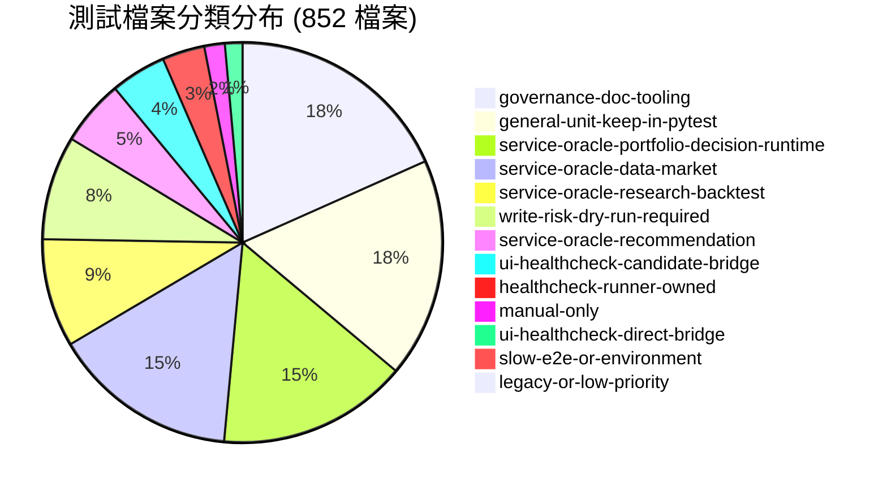
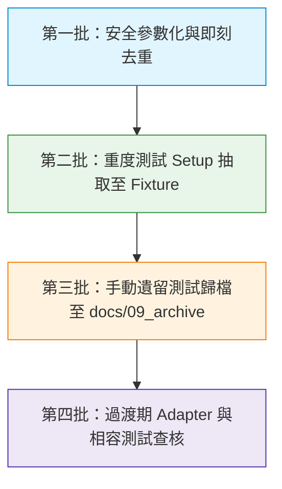

# 測試資產關聯與重複／過時盤點報告 (V1 初版，已撤回部分結論)

> [!CAUTION]
> **重要撤回與更新聲明 (Audit Deprecation Notice)**：
> 本文為第一輪 (V1) 初步盤點報告，其中部分推估（包括「可刪除 3 個重複案例」、「Category C 49 組 setup 均重複可省 3,593 行」、「Category D 可省 150 行」等）**已全面撤回或修正**。
> 1. **嚴禁依本報告之重複數、可刪除案例數或理論行數收益直接刪除或更動任何測試案例**。
> 2. 最新方法補正與候選驗證請參閱第二輪報告：[TEST_ASSET_RELATIONSHIP_AUDIT_2026_09_17_V2.md](TEST_ASSET_RELATIONSHIP_AUDIT_2026_09_17_V2.md) 以及後續結案文件。

> **審計基準日**：2026-09-17
> **Git HEAD**：`639a7789858b413bf61ca626726cc0170b47f35c`（分支 `dev`，乾淨工作區）
> **執行原則**：唯讀盤點，不修改既有代碼、測試或資料庫；不執行全套 pytest，不啟動 UI、排程器或網路連線。
> **資料來源權威**：資料根目錄由 `TWStockConfig`（預設 `D:/Min/Python/Project/FA_Data`）決定，本盤點不假設 repo 內存在正式資料。

---

## 1. 執行摘要與真實規模驗證

### 1.1 「50 萬行測試」事實查核
專案歷史上曾流傳「專案有超過 50 萬行測試程式」之說法。經本次全量靜態 AST 與檔案分類實測：

* **核心結論**：**測試代碼並非 50 萬行**。
  * **純自動化測試案例**（`tests/` 下由 pytest 收集之測試檔）：**824 個檔案，209,045 行**（非空行 182,480 行），共定義 **5,429 個 AST 測試函式**。
  * **整體測試領域資產**（含 QA Runner、健康檢查框架、測試資料、快照、手動腳本與 QA 文檔）：**1,179 個檔案，278,513 行**。
  * **正式生產代碼**（`analysis_module`、`app_module`、`backtest_module`、`data_module`、`decision_module`、`portfolio_module`、`runtime`、`ui_qt`）：**629 個檔案，327,289 行**。
  * **全專案 Python 總代碼量**：約 **53.6 萬行**（生產代碼 32.7 萬行 + 測試案例 20.9 萬行）。若計入全部 QA 腳本與文檔，總規模約 60.5 萬行。
  * **推論**：先前「50 萬行」之印象應為「全專案整體規模」或「本機 `output/` 歷史備份未排除」所致，測試本身真實規模為 20.9 萬行測試案例（5,429 測項）。

### 1.2 資產分類度量清單

| 資產類別 | 檔案數 | 總行數 | 非空行數 | 代碼行 | 註解行 | 空白行 | AST 測試函式 | AST 測試類別 | 總位元組 |
|---|---:|---:|---:|---:|---:|---:|---:|---:|---:|
| **自動化測試案例** (`automated_test_cases`) | 824 | 209,045 | 182,480 | 181,180 | 1,300 | 26,565 | 5,429 | 9 | 7,751,111 |
| **QA 執行器與工具** (`qa_runners_and_tooling`) | 86 | 30,975 | 27,414 | 26,727 | 687 | 3,561 | 52 | 0 | 1,283,043 |
| **QA 文檔與矩陣** (`qa_documentation`) | 201 | 31,631 | 24,167 | 21,952 | 2,215 | 7,464 | 0 | 0 | 3,082,045 |
| **手動／封存遺留資產** (`archived_or_manual_assets`) | 21 | 4,228 | 3,479 | 2,910 | 569 | 749 | 31 | 3 | 176,860 |
| **Fixtures 與共用 Helper** (`fixtures_and_helpers`) | 8 | 1,317 | 1,181 | 1,179 | 2 | 136 | 1 | 0 | 49,512 |
| **測試資料與快照** (`test_data_and_snapshots`) | 36 | 1,297 | 1,297 | 1,297 | 0 | 0 | 0 | 0 | 52,534 |
| **測試設定檔** (`test_configuration`) | 1 | 20 | 20 | 20 | 0 | 0 | 0 | 0 | 447 |
| **其他支援項目** (`other_test_related`) | 2 | 0 | 0 | 0 | 0 | 0 | 0 | 0 | 0 |
| **合計** | **1,179** | **278,513** | **240,038** | **235,265** | **4,773** | **38,475** | **5,513** | **12** | **12,395,552** |

---

## 2. 測試規模與前 30 大測試檔案

以下為測試代碼中行數最多的 30 個測試檔案（包含自動化案例與專用 QA Runner）：

| 排名 | 測試檔案路徑 | 資產類別 | 總行數 | 非空行數 | 測項數 | 檔案大小 (Bytes) | 主要保護範疇 |
|---:|---|---|---:|---:|---:|---:|---|
| 1 | [test_ui_qt_update_view_workbench.py](../../tests/test_ui_qt_update_view_workbench.py) | automated_test_cases | 2,387 | 1,925 | 83 | 90,676 | 數據更新工作台 UI 互動、狀態機與非阻塞更新流程 |
| 2 | [test_paper_formal_daily_source_chain.py](../../tests/test_paper_formal_daily_source_chain.py) | automated_test_cases | 2,196 | 2,003 | 18 | 81,439 | Paper／Formal 每日官方資料鏈相依與狀態鎖定 |
| 3 | [test_daily_recommendation_learning_loop.py](../../tests/test_daily_recommendation_learning_loop.py) | automated_test_cases | 2,172 | 2,007 | 24 | 91,893 | 每日推薦學習回圈、成熟度比對與模型回退機制 |
| 4 | [test_ml_allocation_shadow_evidence.py](../../tests/test_ml_allocation_shadow_evidence.py) | automated_test_cases | 2,093 | 1,944 | 31 | 72,159 | ML 資產配置 Shadow 證據保存與驗證 |
| 5 | [qa_validate_epic2_mvp1.py](../../scripts/qa_validate_epic2_mvp1.py) | qa_runners_and_tooling | 2,017 | 1,595 | 30 | 77,283 | Epic 2 MVP1 驗證 Runner（早期驗收工具） |
| 6 | [test_update_service_status.py](../../tests/test_update_service_status.py) | automated_test_cases | 1,994 | 1,643 | 62 | 72,983 | 資料更新服務內部狀態流轉與錯誤復原 |
| 7 | [qa_validate_research_journey_qt.py](../../scripts/qa_validate_research_journey_qt.py) | qa_runners_and_tooling | 1,760 | 1,598 | 0 | 72,945 | 研究旅程跨頁 Qt 流程驗證腳本 |
| 8 | [test_daily_banktaiwan_learning_cost.py](../../tests/test_daily_banktaiwan_learning_cost.py) | automated_test_cases | 1,705 | 1,619 | 19 | 69,519 | 臺銀成本情境學習隔離、50bp 邊界與 Root 衝突防護 |
| 9 | [test_pit_taxonomy_daily_source.py](../../tests/test_pit_taxonomy_daily_source.py) | automated_test_cases | 1,688 | 1,581 | 31 | 72,438 | 官方 PIT 產業分類來源、版本演進與 Fail-closed 驗證 |
| 10 | [test_daily_ml_allocation_orchestration.py](../../tests/test_daily_ml_allocation_orchestration.py) | automated_test_cases | 1,687 | 1,482 | 31 | 59,493 | 每日 ML 配置排程編排與前置條件檢查 |
| 11 | [test_build_mops_statement_pit_candidate.py](../../tests/test_build_mops_statement_pit_candidate.py) | automated_test_cases | 1,683 | 1,530 | 54 | 67,228 | 公開資訊觀測站財報 PIT 候選集建置與別名映射 |
| 12 | [test_portfolio_ml_dataset_assembler.py](../../tests/test_portfolio_ml_dataset_assembler.py) | automated_test_cases | 1,624 | 1,497 | 29 | 54,009 | 持倉 ML 訓練資料組裝與時序窗口切割 |
| 13 | [test_forward_position_thesis_candidate_producer.py](../../tests/test_forward_position_thesis_candidate_producer.py) | automated_test_cases | 1,582 | 1,462 | 22 | 59,963 | 前瞻持倉論點候選生成器契約 |
| 14 | [test_formal_rule_source_producer.py](../../tests/test_formal_rule_source_producer.py) | automated_test_cases | 1,529 | 1,411 | 24 | 57,758 | 正式規則資料源生成器、Cutoff 與 Universe Hash 保障 |
| 15 | [test_paper_daily_execution_producer.py](../../tests/test_paper_daily_execution_producer.py) | automated_test_cases | 1,515 | 1,353 | 20 | 54,952 | Paper 每日模擬下單產生器與資產負債平衡對帳 |
| 16 | [test_formal_daily_input_producer.py](../../tests/test_formal_daily_input_producer.py) | automated_test_cases | 1,494 | 1,349 | 24 | 52,652 | 正式每日輸入資料產出與 SHA256 溯源存證 |
| 17 | [test_recommendation_service_calibration_integration.py](../../tests/test_recommendation_service_calibration_integration.py) | automated_test_cases | 1,438 | 1,299 | 13 | 53,747 | 推薦服務校準與分數整合測試 |
| 18 | [test_portfolio_ml_out_of_core_pipeline.py](../../tests/test_portfolio_ml_out_of_core_pipeline.py) | automated_test_cases | 1,359 | 1,257 | 19 | 46,242 | 持倉 ML Out-of-Core 記憶體安全訓練管道 |
| 19 | [test_scheduled_evidence_pipeline_dry_run_wrapper.py](../../tests/test_scheduled_evidence_pipeline_dry_run_wrapper.py) | automated_test_cases | 1,348 | 1,250 | 18 | 51,911 | 排程證據管道 Dry-run 安全封裝 |
| 20 | [qa_ml_direct_ooc_shared_reuse.py](../../scripts/qa_ml_direct_ooc_shared_reuse.py) | qa_runners_and_tooling | 1,319 | 1,239 | 0 | 66,567 | ML OOC 數值重用機制驗證腳本 |
| 21 | [test_ml_allocation_copilot.py](../../tests/test_ml_allocation_copilot.py) | automated_test_cases | 1,273 | 1,180 | 14 | 44,986 | ML 配置副駕駛合規審查與權限控制 |
| 22 | `test_ml_teacher_shadow_pipeline.py` | automated_test_cases | 1,256 | 1,173 | 18 | 44,611 | ML 教師模型 Shadow 模式管道隔離 |
| 23 | `test_portfolio_ml_ooc_release_gate.py` | automated_test_cases | 1,250 | 1,147 | 25 | 43,473 | ML OOC 發布閥門與回歸指標驗收 |
| 24 | `test_official_events_pipeline.py` | automated_test_cases | 1,213 | 1,114 | 22 | 44,528 | 官方重大訊息與市場事件抓取清洗管線 |
| 25 | [test_corporate_action_availability_history.py](../../tests/test_corporate_action_availability_history.py) | automated_test_cases | 1,202 | 1,130 | 18 | 46,281 | 除權息歷史可用日與復權因子防未來函數 |
| 26 | `test_market_data_service.py` | automated_test_cases | 1,198 | 1,067 | 37 | 45,984 | 市場資料服務查詢、快取與 Fallback |
| 27 | [test_fubon_shadow_decision_service.py](../../tests/test_fubon_shadow_decision_service.py) | automated_test_cases | 1,184 | 1,091 | 28 | 42,951 | 富邦 Shadow 決策服務與唯讀授權防護 |
| 28 | [test_ui_qt_workbench_view.py](../../tests/test_ui_qt_workbench_view.py) | automated_test_cases | 1,183 | 1,048 | 29 | 44,821 | 決策工作台視圖 UI 渲染與事件流 |
| 29 | [test_scheduled_decision_evidence_capture.py](../../tests/test_scheduled_decision_evidence_capture.py) | automated_test_cases | 1,173 | 1,080 | 15 | 42,504 | 定時排程決策存證抓取契約 |
| 30 | [test_evidence_rehearsal_service.py](../../tests/test_evidence_rehearsal_service.py) | automated_test_cases | 1,167 | 1,082 | 23 | 41,833 | 證據彩排服務之唯讀演練與日誌驗證 |

---

## 3. 功能領域分布與執行架構

### 3.1 測試在各架構分類之分布（依 `qa/full_app_healthcheck/test_inventory.py`）

本專案具備精密的測試清冊邊界控制機制。所有 852 個檔案均經過註冊與分類保護，嚴禁非破壞式 Runner 隨意調用具寫入風險之測試：



1. **治理、防禦與文檔工具** (`governance-doc-tooling`: 155 檔)：
   - 保護範圍：量化裸 float 防禦（`test_financial_float_boundary_checker.py`）、儲存容量防護、PIT 溯源、CLI 編碼安全（CP1252/UTF-8）、清冊審計工具。
2. **通用單元測試** (`general-unit-keep-in-pytest`: 150 檔)：
   - 保護範圍：純計算邏輯、技術指標公式、數學模型、日期轉換與契約驗證。
3. **持倉、決策與 Runtime Oracle** (`service-oracle-portfolio-decision-runtime`: 130 檔)：
   - 保護範圍：持倉對帳（Decimal 無誤差）、決策連續性日誌（Journal）、Position Health 轉變評估、Runtime 事件總線。
4. **數據與市場 Oracle** (`service-oracle-data-market`: 127 檔)：
   - 保護範圍：日價抓取清洗、官方行事曆交易日判定、重大訊息歸檔、TDCC 集保股權、MOPS 財報 PIT。
5. **回測與研究 Oracle** (`service-oracle-research-backtest`: 74 檔)：
   - 保護範圍：回測撮合模擬、滑價／手續費計算模型、過擬合風險控制、Walk-forward 滾動回測。
6. **寫入風險與 Dry-run 隔離** (`write-risk-dry-run-required`: 71 檔)：
   - 保護範圍：資料庫遷移腳本、正式寫入前置驗證、資料庫檔案 Lock 機制。
7. **推薦系統 Oracle** (`service-oracle-recommendation`: 45 檔)：
   - 保護範圍：推薦排序算法、Calibration 每日校準回圈、個人化（Personalization）V6 存證與 Projection。
8. **UI Healthcheck 橋接** (`direct-bridge`: 12 檔，`candidate-bridge`: 38 檔)：
   - 保護範圍：PySide6 UI 頁面生命週期、無記憶體外洩與關閉保護（`_drain_qt_deferred_deletes`）、跨頁瀏覽流程。

### 3.2 執行與 Discovery 邊界狀態
* **pytest discovery 範圍**：
  * 由 `pytest.ini` 指定 `testpaths = tests`，`python_files = test_*.py`。
  * 明確排除：`tests/manual/`（14 檔）、`tests/scripts/`（6 檔）。
  * 實質可被預設 pytest 收集的檔案為 **824 個**。
* **CI 整合狀態**：
  * 專案內未發現 `.github/workflows` 或其他遠端 CI 設定；目前以本地 Pre-commit / 本機腳本執行。
* **QA Runner 引用狀態**：
  * 核心驗證入口為 `scripts/run_full_app_healthcheck.py` 與 `scripts/audit_test_inventory.py`。
  * UI 修改強制驗證：`tests/test_ui_qt_update_view_workbench.py` 與 `scripts/qa_validate_update_tab.py`。

---

## 4. 重複候選深入剖析（五大類別）

本次審計使用 AST 語法樹標準化雜湊與結構指紋，比對全量 5,512 個測試函式，共識別出 **141 組候選群**。

### 4.1 總體重複與精簡潛力統計

| 重複類別 | 候選組數 | 涉及案例數 | 潛在行數減少 | 計算方法與說明 | 影響案例數 |
|---|---:|---:|---:|---|---|
| **A. 完全相同程式或 AST** | 3 組 | 6 | **27 行** | 保留 1 份，刪除其餘完全重複的測試函式 | -3 案例 |
| **B. 結構相同僅常數/命名差異** | 71 組 | 184 | **514 行** | 改寫為 `@pytest.mark.parametrize`，保留 100% 邊界案例 | 0 案例（案例數維持，函式定義減少） |
| **C. 重複 Setup 與 Fixture 複製** | 49 組 | 382 | **3,593 行** | 抽取為模組級／共用 Fixture，消除重複的前置資料初始化 | 0 案例（完全保留所有斷言） |
| **D. 同功能多層驗證重疊** | 4 組 | 87 | **150 行** | 評估 Unit / Service / CLI / UI，絕大多數屬於健康防禦，僅精簡 UI 中重複的純計算重測 | 0 案例 |
| **E. 歷史版本相容與遺留測試重疊** | 14 組 | 31 | **2,441 行** | 針對 `tests/manual/` 中因 import 失敗已無法執行的舊腳本進行封存 | 0 自動化案例（原即不在 pytest 範圍） |
| **合計** | **141 組** | **690** | **約 6,725 行** | **在完全不犧牲任何業務契約與邊界防禦的前提下** | **僅清理 3 個完全重複函式** |

> [!IMPORTANT]
> **重要原則**：減少行數、減少案例數與縮短執行時間是三種截然不同的收益。
> * **類別 B 與 C 的整併是「減少行數但保留 100% 測試案例與邊界覆蓋」**，不可因為結構相同就刪除測試案例！
> * **未經過真實 benchmark 測時，嚴禁宣稱整併會使測試加速多少百分比**。

---

## 5. 最值得處理的前 20 組候選群詳情

以下精選前 20 組具有最高證據確鑿性、最高行數收益或最高維護風險的候選群：

### 【第一優先：完全相同或即刻可參數化】

#### 候選 01：[DUP-A-b942830e] Windows 排程註冊時區阻擋測試完全重複
* **涉及位置**：
  * [test_formal_registration_plan.py:L74-88](../../tests/test_formal_registration_plan.py#L74-88) (`test_dedicated_registration_rejects_non_pacific_timezone`)
  * [test_paper_execution_registration_plan.py:L133-149](../../tests/test_paper_execution_registration_plan.py#L133-149) (`test_dedicated_paper_registration_rejects_non_pacific_timezone`)
* **觸發路徑與斷言**：兩者均建立 mock `tzutil.cmd` 回傳 `UTC`，執行對應命令並斷言 `result.returncode == 2` 與 `"timezone must be Pacific Standard Time"`。
* **共同與獨有**：完全相同的 Windows 時區檢查防衛邏輯。
* **建議處置**：將 mock `tzutil` 抽取至共用 helper，兩測試檔共用同一個時區斷言邏輯。
* **承接位置**：`tests/test_formal_registration_plan.py` 或抽取至 `tests/conftest.py`。
* **預期收益**：減少 17 行重複代碼。

#### 候選 02：[DUP-A-fa52cf96] 存證彩排 DTO 輸入拒絕測試重複
* **涉及位置**：
  * [test_evidence_rehearsal_dtos.py:L74-79](../../tests/test_evidence_rehearsal_dtos.py#L74-79) (`test_scenario_rejects_production_like_inputs`)
  * [test_evidence_rehearsal_dtos.py:L89-94](../../tests/test_evidence_rehearsal_dtos.py#L89-94) (`test_scenario_rejects_production_evidence_filename_variants`)
* **觸發路徑與斷言**：兩函式內部代碼 100% 相同（均為 `with pytest.raises(ValueError, match=field_name): _scenario(...)`），僅裝飾器參數列表被拆為兩個函式。
* **建議處置**：合併為單一測試函式，將兩組參數整合至同一個 `@pytest.mark.parametrize`。
* **承接位置**：`tests/test_evidence_rehearsal_dtos.py`。
* **預期收益**：減少 6 行重複函式樣板。

#### 候選 03：[DUP-A-8713a259] 數值邊界檢查器忽略非標記註解測試重複
* **涉及位置**：
  * [test_financial_float_boundary_checker.py:L111-112](../../tests/test_financial_float_boundary_checker.py#L111-112) (`test_unrelated_numeric_boundary_comments_are_ignored`)
  * [test_financial_float_boundary_checker.py:L196-199](../../tests/test_financial_float_boundary_checker.py#L196-199) (`test_multiline_boundary_marker_applies_to_managed_float_token_line`)
* **觸發路徑與斷言**：兩者斷言完全相同（`assert scan_source(source, path="sample.py") == []`）。
* **建議處置**：保留兩者的測試輸入樣本，將其合流為參數化案例。
* **承接位置**：`tests/test_financial_float_boundary_checker.py`。
* **預期收益**：減少 4 行重複函式定義。

#### 候選 04：[DUP-B-4cfe7515 / 7fda9aff] 跨 10 檔 CLI CP1252 編碼安全樣板重複
* **涉及位置**：
  * [test_append_portfolio_stress_history_cli.py:L96-110](../../tests/test_append_portfolio_stress_history_cli.py#L96-110)
  * [test_inspect_ml_storage_retention.py:L115-129](../../tests/test_inspect_ml_storage_retention.py#L115-129)
  * [test_monthly_revenue_availability_merge.py:L232-246](../../tests/test_monthly_revenue_availability_merge.py#L232-246)
  * [test_append_paper_trade_csv_cli.py:L110-125](../../tests/test_append_paper_trade_csv_cli.py#L110-125)
  * [test_run_p0_source_evidence_audit.py:L739-754](../../tests/test_run_p0_source_evidence_audit.py#L739-754)
* **觸發路徑與斷言**：以 Windows CP1252 編碼執行 CLI `--help`，驗證繁體中文字元不會引發 `UnicodeEncodeError`。代碼在 10 個 CLI 測試檔中逐字複製。
* **建議處置**：在 `tests/conftest.py` 建立共用輔助函式 `assert_cli_help_utf8_safe(cli_module)`。
* **預期收益**：消除約 120-150 行重複樣板。

#### 候選 05：[DUP-B-c21b84ac / d8e16f36 / 767b13af] MOPS 財報科目代碼別名解析重複
* **涉及位置**：
  * [test_build_mops_statement_pit_candidate.py:L267-463](../../tests/test_build_mops_statement_pit_candidate.py#L267-463)（7 個函式）
  * [test_mops_statement_3064_alias.py:L4-294](../../tests/test_mops_statement_3064_alias.py#L4-294)（5 個函式）
* **觸發路徑與斷言**：呼叫 `resolve_official_item_code` 驗證不同財報科目（營業外損益、營收、成本等）在不同官方命名下的解析與縮排判定。
* **建議處置**：以單一參數化矩陣 `(alias_name, expected_code, expected_indent)` 表達所有科目映射。
* **承接位置**：`tests/test_build_mops_statement_pit_candidate.py`，完成後可評估封存 `test_mops_statement_3064_alias.py`。
* **預期收益**：減少約 119 行代碼。

#### 候選 06：[DUP-B-a314f99d] 因子契約邊界值拒絕測試重複
* **涉及位置**：
  * [test_factor_contract.py:L43-85](../../tests/test_factor_contract.py#L43-85) (`test_factor_record_rejects_out_of_range_score_bp`, `test_factor_record_rejects_empty_factor_name`, `test_factor_record_rejects_empty_stock_code`)
* **觸發路徑與斷言**：三個函式各自 13 行，均測試 `FactorRecord` 在非法欄位下的 `ValueError`。
* **建議處置**：改寫為 `@pytest.mark.parametrize("invalid_kwarg", [...])`。
* **預期收益**：減少 15 行代碼。

#### 候選 07：[DUP-B-add9c5f0] TWSE 資料載入器下載狀態判定重複
* **涉及位置**：
  * [test_data_loader.py:L224-300](../../tests/test_core/test_data_loader.py#L224-300)
* **觸發路徑與斷言**：模擬 TWSE 查無資料、未來日期、暫態連線錯誤的三次回應與狀態轉換。
* **建議處置**：參數化 `(twse_raw_response, expected_status)`。
* **預期收益**：減少 16 行代碼。

#### 候選 08：[DUP-B-bf1f0571] 前瞻績效服務缺漏降級測試重複
* **涉及位置**：
  * [test_forward_performance_service.py:L290-324](../../tests/test_forward_performance_service.py#L290-324)
* **觸發路徑與斷言**：除權息缺口與交易限制缺口觸發時之 outcome degradation 斷言完全同構。
* **建議處置**：參數化 `(gap_type, expected_degrade_reason)`。
* **預期收益**：減少 14 行代碼。

---

### 【第二優先：重度重複 Setup／Fixture 抽取（最高行數收益）】

#### 候選 09：[DUP-C-025] Paper 每日來源鏈檔案 12 測項重複 Setup
* **涉及位置**：[test_paper_formal_daily_source_chain.py:L1-2196](../../tests/test_paper_formal_daily_source_chain.py)
* **重複現象**：全檔 12 個主要測試函式，每個函式前段均耗費 20-35 行手動構建假目錄樹、寫入 mock 行事曆與生成假的 source receipt。
* **建議處置**：抽取模組層級 fixture `mock_daily_source_environment(tmp_path)`。
* **預期收益**：**減少約 231 行** 重複初始化代碼，測項 100% 保留。

#### 候選 10：[DUP-C-016] 前瞻持倉論點候選生成器 11 測項重複 Setup
* **涉及位置**：[test_forward_position_thesis_candidate_producer.py:L1-1582](../../tests/test_forward_position_thesis_candidate_producer.py)
* **重複現象**：11 個測項各自手動宣告近 25 行相同的 thesis payload 結構與 mock candidate。
* **建議處置**：抽取 `base_thesis_candidate_payload` fixture。
* **預期收益**：**減少約 210 行** 重複代碼。

#### 候選 11：[DUP-C-036] 推薦服務校準整合測試 8 測項重複 Setup
* **涉及位置**：[test_recommendation_service_calibration_integration.py:L1-1438](../../tests/test_recommendation_service_calibration_integration.py)
* **重複現象**：8 個測項重複建立假的歷史推薦記錄與評估器設定檔。
* **建議處置**：抽取 `mock_calibration_context` fixture。
* **預期收益**：**減少約 182 行** 重複代碼。

#### 候選 12：[DUP-C-013] 正式每日輸入生成器 10 測項重複 Setup
* **涉及位置**：[test_formal_daily_input_producer.py:L1-1494](../../tests/test_formal_daily_input_producer.py)
* **重複現象**：10 個測項各自初始化相同的 input manifest 與 hash checker。
* **建議處置**：抽取 `base_formal_input_manifest` fixture。
* **預期收益**：**減少約 135 行** 重複代碼。

#### 候選 13：[DUP-C-024] Paper 每日模擬執行生成器 10 測項重複 Setup
* **涉及位置**：[test_paper_daily_execution_producer.py:L1-1515](../../tests/test_paper_daily_execution_producer.py)
* **重複現象**：重複手動初始化模擬持倉簿與撮合交易環境。
* **建議處置**：抽取 `mock_paper_execution_state` fixture。
* **預期收益**：**減少約 135 行** 重複代碼。

#### 候選 14：[DUP-C-010] 每日推薦學習回圈 7 測項重複 Setup
* **涉及位置**：[test_daily_recommendation_learning_loop.py:L1-2172](../../tests/test_daily_recommendation_learning_loop.py)
* **重複現象**：7 個長測試各自配置一套完整的 Shadow directory 結構與模型 registry。
* **建議處置**：抽取 `shadow_learning_env` fixture。
* **預期收益**：**減少約 132 行** 重複代碼。

#### 候選 15：[DUP-C-014] 正式規則資料源生成器 12 測項重複 Setup
* **涉及位置**：[test_formal_rule_source_producer.py:L1-1529](../../tests/test_formal_rule_source_producer.py)
* **重複現象**：12 個測項重複構建 stock universe 與預設權重分佈。
* **建議處置**：抽取 `mock_rule_universe` fixture。
* **預期收益**：**減少約 121 行** 重複代碼。

#### 候選 16：[DUP-C-007] 臺銀成本情境學習 7 測項重複 Setup
* **涉及位置**：[test_daily_banktaiwan_learning_cost.py:L1-1705](../../tests/test_daily_banktaiwan_learning_cost.py)
* **重複現象**：重複構建 50bp 與電子下單手續費折讓情境。
* **建議處置**：抽取 `banktaiwan_cost_scenario_fixture`。
* **預期收益**：**減少約 114 行** 重複代碼。

#### 候選 17：[DUP-C-047] 更新工作台 UI 測試 10 測項重複 Setup
* **涉及位置**：[test_ui_qt_update_view_workbench.py:L1-2387](../../tests/test_ui_qt_update_view_workbench.py)
* **重複現象**：10 個 UI 測試重複手動構造 `UpdateService` 的模擬進度信號與 worker 回調。
* **建議處置**：抽取 `mock_update_workbench_context` fixture。
* **預期收益**：**減少約 90 行** 重複代碼。

---

### 【第三優先：歷史遺留與過時關聯整理】

#### 候選 18：[DUP-E-001 ~ 014] `tests/manual/` 14 個歷史遺留測試檔
* **涉及位置**：`tests/manual/legacy_*_check.py`（共 14 檔，4,228 行）
* **問題證據**：
  1. 這些檔案位於 `tests/manual/`，已在 `pytest.ini` 中以 `norecursedirs` 排除，**常態自動化測試本就不執行**。
  2. 經靜態 import 檢查，**所有 14 個檔案均包含已不存在的 production 模組或符號**（例如 `analysis_module.pattern_analyzer`、`data_module.api.twse_api`、`DataProcessor`、`math_analyzer` 等）。若手動執行會立即遭遇 `ModuleNotFoundError`。
  3. 現代架構中已有完整的對應測試（例如 `test_pattern_analysis`、`test_technical_analysis`）。
* **建議處置**：保留歷史完整性，整批移入 `docs/09_archive/legacy_manual_checks/`，並在 `docs/00_core/DOCUMENTATION_INDEX.md` 更新索引。
* **預期收益**：自測試專案中清理 4,228 行不可執行的死碼，大幅降低新進開發者或 AI 的探索干擾。

#### 候選 19：[STALE-042] `tests/test_research_run_legacy_adapter.py`
* **涉及位置**：[test_research_run_legacy_adapter.py:L1-118](../../tests/test_research_run_legacy_adapter.py)
* **問題證據**：專門保護舊版回測資料轉至新版 `ResearchRunRepository` 的轉接層。
* **建議處置**：**暫時保留（待確認）**。需由 Data Audit 查核目前正式資料根目錄中是否仍殘留舊格式的回測結果；若無舊檔案，此 Adapter 與測試方可同步退役。

#### 候選 20：[CONFIG-BUG] `tests/test_promotion_authority_secret_store.py` 被 `.gitignore` 誤排除
* **涉及位置**：[test_promotion_authority_secret_store.py:L1-57](../../tests/test_promotion_authority_secret_store.py)
* **問題證據**：該測試是保護 Windows DPAPI 加密存儲的有效測試，且已在 `test_inventory.py` 登錄。但因 `.gitignore` 第 98 行設有通用規則 `*secret*.py`，導致該測試檔被 Git 忽略，無法被正常版本控制。
* **建議處置**：在 `.gitignore` 中加入例外白名單：`!tests/test_promotion_authority_secret_store.py`。
* **預期收益**：修復潛在的代碼丟失與版本不同步風險。

---

## 6. 應嚴格保留之跨層與邊界測試（禁止誤刪）

在重複清理過程中，部分看似「功能重疊」的測試實際上保護著截然不同的系統契約，**嚴禁刪除**：

### 6.1 個人化機制 (Personalization) 跨層測試
* **層級分布**：
  * Unit：`test_personalization_contract.py`（保護 Payload 雜湊不變性與型別）
  * Service：`test_personalization_action_recorder.py`、`test_personalization_read_service.py`（保護 CAS 修訂、Append-only 存證）
  * CLI：`test_personalization_fit_cli.py`（保護獨立進程執行、參數解析與 Exit code）
  * UI：`scripts/qa_personalization_mainwindow_save_readback.py`（保護真實 PySide6 介面儲存與交付 ACK 讀回）
* **保留理由**：各層驗證之防禦邊界完全不同。刪除任一層都會破壞 V6 個人化機制的嚴格存證鏈。

### 6.2 跨頁決策旅程與 Qt 關閉保護
* **涉及檔案**：
  * `test_cross_page_decision_journey_mainwindow.py`
  * `scripts/qa_cross_page_mainwindow_busy_close.py`
* **保留理由**：保護視窗關閉時的 native teardown 協調器（`_drain_qt_deferred_deletes`）。若僅在 Service 層測試，無法捕捉 PySide6 在背景執行緒忙碌時強制關閉產生的 Windows 記憶體寫入異常彈窗。

### 6.3 失敗、篡改與邊界情境測試
* 包含 `tamper`、`corrupt`、`reject`、`boundary`、`cutoff`、`retry`、`rollback` 等關鍵字的測項。
* **保留理由**：許多業務邏輯在「正常情境」下雖然路徑相似，但在「資料缺失、哈希遭篡改、時區偏離、資料庫鎖定」等異常情境下具有獨特之 Fail-closed 行為，絕不可視為重複。

---

## 7. 安全分批整併計畫 (Phased Consolidation Plan)

本計畫以「風險最小化、步驟可回滾、驗證可量化」為原則，分為四個階段推進：



### 第一批：單檔內參數化與即刻去重 (Low Risk, High Precision)
* **執行範圍**：候選 01 ~ 08（包含 3 組 Category A 完全重複、CLI CP1252 樣板、MOPS 科目參數化、Factor 契約邊界）。
* **預期收益**：減少約 **750 行** 代碼；消除 3 個重複測項，其餘測項 100% 保留。
* **風險評估**：極低。變更完全局限於測試檔案本身，不涉及生產代碼與跨模組呼叫。
* **驗證方式**：
  ```powershell
  .\.venv\Scripts\python.exe -m pytest tests/test_evidence_rehearsal_dtos.py tests/test_financial_float_boundary_checker.py tests/test_factor_contract.py tests/test_core/test_data_loader.py -v
  ```

### 第二批：長測試檔案之重複 Setup 抽取 (Medium Risk, High Line Reduction)
* **執行範圍**：候選 09 ~ 17（包含 `test_paper_formal_daily_source_chain.py`、`test_forward_position_thesis_candidate_producer.py`、`test_recommendation_service_calibration_integration.py` 等）。
* **預期收益**：減少約 **1,500 ~ 2,000 行** 冗餘前置代碼；代碼可讀性大幅提升。
* **風險評估**：低至中。需確保抽取之 fixture 具備良好的隔離性（使用 `tmp_path`，不污染全域環境）。
* **驗證方式**：
  ```powershell
  .\.venv\Scripts\python.exe -m pytest tests/test_paper_formal_daily_source_chain.py tests/test_forward_position_thesis_candidate_producer.py -v
  ```

### 第三批：不可執行之手動遺留測試歸檔 (Zero Operational Risk)
* **執行範圍**：候選 18（`tests/manual/legacy_*_check.py` 共 14 個檔案）。
* **預期收益**：減少 **4,228 行** 遺留死碼；消除靜態分析中的 20 處 import 報錯。
* **風險評估**：零。這些檔案原即不在 pytest discovery 範圍，且因相依模組已刪除而無法單獨運行。
* **執行步驟**：
  1. 建立 `docs/09_archive/legacy_manual_checks/`。
  2. 搬移 14 個檔案，並附帶 `README.md` 說明其歷史背景與對應之現代測試。
  3. 更新 `qa/full_app_healthcheck/test_inventory.py`（將分類註記為 archive 或移除）。
* **驗證方式**：
  ```powershell
  .\.venv\Scripts\python.exe scripts/audit_test_inventory.py
  ```

### 第四批：過渡期相容測試與 Adapter 覆盤 (Requires Confirmation)
* **執行範圍**：候選 19（`tests/test_research_run_legacy_adapter.py` 等）。
* **預期收益**：約 120 行代碼。
* **風險評估**：中。需與 Data Audit Agent 協同確認舊格式回測資料之歷史相容需求。
* **驗證方式**：查核正式資料庫與輸出目錄，確認無殘留舊版資料格式後方可實施。

---

## 8. 未分析與無法靜態判定之項目 (Limitations & Unknowns)

1. **動態測試執行時間未直接測量**：
   - 本次依安全規範未執行全套 pytest，故報告中未包含單項測試之真實執行秒數。
   - 後續若需「縮短測試時間」之優化，應在受控環境以 `pytest --durations=50` 進行基線度量。
2. **動態載入與字串反射之呼叫**：
   - 部分測試使用 `importlib.import_module` 或反射呼叫（例如動態加載 Qt view）。這類動態呼叫可能未完整反映在靜態 AST 頂層 symbol 列表中，已在 CSV 中標記「中」信心。
3. **正式資料庫相容性依賴**：
   - 涉及正式 D 槽歷史成果之測試（如舊版 Research Run 是否仍被使用者開啟），無法單純由程式碼靜態判定，必須由人類決策者或 Data Audit 進行實體檔案確認。

---

## 9. 交付物清單與重跑指引

本次盤點產出之完整清冊、候選集與分析腳本如下：

1. **主審計報告**（本文件）：
   `docs/06_qa/TEST_ASSET_RELATIONSHIP_AUDIT_2026_09_17.md`
2. **測試資產全量關聯清冊**（902 筆測試資產之生產相依、防禦契約與引用狀態）：
   test_asset_index.csv（Git-ignored 本機輸出，未入庫；原位置：output/qa/test_asset_audit/test_asset_index.csv）
3. **重複候選群清冊**（141 組候選，含 A~E 類別、位置、差異、建議與行數粗估）：
   duplicate_candidates.csv（Git-ignored 本機輸出，未入庫；原位置：output/qa/test_asset_audit/duplicate_candidates.csv）
4. **過時與失效候選清冊**（41 筆失效項目，含缺失模組、跳過測試、歷史遺留標記）：
   stale_candidates.csv（Git-ignored 本機輸出，未入庫；原位置：output/qa/test_asset_audit/stale_candidates.csv）
5. **規模度量統計 JSON**：
   test_scale_summary.json（Git-ignored 本機輸出，未入庫；原位置：output/qa/test_asset_audit/test_scale_summary.json）
6. **可重跑分析工具集**：
   * 規模度量：`output/qa/test_asset_audit/measure_test_scale.py`
   * 資產關聯生成：`output/qa/test_asset_audit/build_test_asset_index.py`
   * 重複分析：`output/qa/test_asset_audit/analyze_duplicate_candidates.py`
   * 過時與失效分析：`output/qa/test_asset_audit/analyze_stale_and_broken_candidates.py`

**重跑命令**：
```powershell
.\.venv\Scripts\python.exe output/qa/test_asset_audit/measure_test_scale.py
.\.venv\Scripts\python.exe output/qa/test_asset_audit/build_test_asset_index.py
.\.venv\Scripts\python.exe output/qa/test_asset_audit/analyze_duplicate_candidates.py
.\.venv\Scripts\python.exe output/qa/test_asset_audit/analyze_stale_and_broken_candidates.py
```
