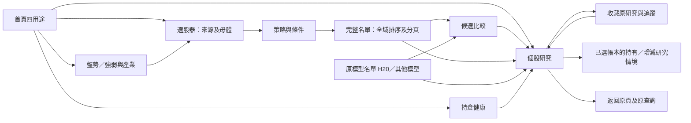

# Baldr 產品補完接續計畫

> 調查基準：2026-10-06，實際 Git 複核時間 22:36 UTC（台北 10/07 06:36）。
> 現行狀態：**依 §0.4 推進兩階段交付；最新本機候選是固定來源 `5de18635cc60` 的[日常研究97](../../../output/trial/Baldr-Daily-Research-97/TRIAL_GUIDE.md)。** 它沿95的當期1,949檔價格研究及四股一般個股／回測資料，新增中等視窗結果頁直接保存單股回測。正常 Windows EXE 保存兩個原策略 run、返回／新程序讀回與啟動器核對已限定通過；97真人、不同DPI仍待。第二列財報完整來源、第三列真帳研究、第四列完整雙策略績效與第五列自然成熟各自未完成。95及更早候選保留；完整P00–P14／G0–G4不因固定候選或局部QA通過。正式資料、私人持倉、Task、模型訓練／啟用、交易、push與發布仍不在授權範圍。
> 唯一原始需求：[Danny Quant 原產品計畫](../../../output/plans/baldr_product_experience_plan_20261004.md)。本文件是它的差距對照、分工與驗收補件，不另建產品 Roadmap，不覆寫原文或原驗收收據。
> **2026-10-14 資料政策決議**：使用者已採納每日固定抓取、不可覆寫的版本快照及台北小時可用性政策，並將 Scrapling 納入 P03 的限縮取得工具。時間／用途契約依 §4.1–4.2，阻礙分流依 §9.5，目前施工順序見 §0.4；早期施工紀錄與原 FAIL 保留。這是原計畫的增量，不另立總計畫；正式資料寫入、全量回補、正式 Task 變更、push、發布與交易仍須各自的精確授權。
> **兩階段交付決議（2026-10-15 UTC／使用者時區10/14）**：依使用者要求改為兩階段；立即先交可實際試用V1，凍結範圍與出口見§0.3。本節優先於較早把完整P00–P14能力列作當前交付前置的順序；完整計畫與原FAIL不刪除，移至第二階段接續。

<a id="0-一頁接續摘要開發已開始"></a>
## 0. 現在能用什麼、接下來交什麼

快速閱讀：[接續順序與交付出口](#接續順序與交付出口) · [日常研究候選的四項修正](#日常研究候選的四項明確工作) · [執行方法](#用較少切換完成工作)。

**交付節奏：每輪先解除一個實際操作或金融判讀阻礙，再固定候選、驗受影響旅程與同版出口；來源缺件則隔離用途並轉下一個可交付流程。** 第一列97已另交，真人可自行試用；P01當期多股與V1-04結果保存均到固定EXE。第二階段的 TPEx 法人單日原件可在同版95 EXE 的診斷頁父／新程序唯讀回訪，但未接受正式用途；財報前期與真私人 Paper 帳缺來源時維持隔離，並轉第四／第五列可獨立核驗的出口。不把視覺細節或同一合成案例反覆加入前置。§0.3四條V1、§5金融定義、§8完整需求及§11原驗收門檻不變。

| 目前位置 | 可查的成果 | 尚未交付的差距 |
|---|---|---|
| 已交試用 | [日常研究97](../../../output/trial/Baldr-Daily-Research-97/TRIAL_GUIDE.md)固定 `5de18635cc60`；沿95的1,949檔當期價格研究與四股一般個股／回測資料，結果頁現可直接保存原 Registry run。95與更早候選保留。 | 真人手勢、不同DPI與真私人帳待回報；`1528`不在四股一般價庫，原期限與績效資格不變。舊名冊不是當日全市場真N。 |
| 已整合程式碼 | 價格研究多股來源、兩個原 `1.0.0` 策略保存／對照、舊推薦回訪與一般視窗回測版面在固定97；EXE父／新程序已走結果頁保存與讀回。TPEx法人沿固定95同版EXE唯讀核原單日兩股。 | TPEx此路只顯示診斷候選，不授正式用途或歷史PIT；其他策略家族、完整績效與來源／成本權威另驗。 |
| 接續交付 | 使用者有空試97，問題只按實際中斷或錯誤金融結果修；工程轉第二列已保存季度原件的單位／issuer／前期／官方鏈。第三列缺真同帳本現金／Health／價格時，轉第四列完整雙策略結果及第五列可獨立驗證旅程。 | 2330／一期／三欄的單位推論不授整個資料集資格；issuer PDF 單次取得403、舊月營收／MOPS缺EOF不盲重抓；正式財報聚合資格仍0。P06預設根未見策略Paper帳，不以手動成本造NAV。 |
| 全範圍 | P00–P14／M1–M3／F01–F23／UX01–UX24／G0–G4 繼續保留 | 真 N、財報／前期、來源權威、歷史 PIT、雙策略完整績效、Native／真人及自然成熟各按原證據接受。 |

目前狀態的權威仍為 [Snapshot](../../00_core/PROJECT_SNAPSHOT.md)；本頁只列使用流程的交付順序、當前候選入口與驗收出口。Snapshot 正由其他 owner 編輯，本 task 不覆寫；97 的固定身份與限制以包內[交付收據](../../../output/trial/Baldr-Daily-Research-97/DELIVERY_RECEIPT.json)為準。逐輪命令、SHA、FAIL 和收據回[具名 QA](../../06_qa/BALDR_DATA_POLICY_IMPLEMENTATION_20261014.md)，不以 Increment 或案例數表示產品完成度。

<details>
<summary>2026-10-06 首波接續摘要（歷史，保留原文）</summary>

九個選股檔案已先保存於 `bf9207fb`，三位 Luna Max 葉片均已交回並逐包提交：啟動／版本 `92ed944e`（43案例）、H20投影 `cefef608`（12案例）、P01底層 `9330f7fb`（6案例）。中央整合與建置修正保存至 `4b40788b`；固定來源 M1 candidate 已通過 Python／exe 同版隔離比較。全母體 UI 與其餘工作包仍未完成。

**首波 M1 已交候選**：H20接首屏摘要／狀態／下一步，Python三入口共用設定，版本與commit可辨識；固定 `4b40788b`／195項依賴建置獨立candidate，與同commit來源快照的Python做四用途／模型／收藏／日期／錯誤／取消／子程序比較通過。[QA收據](../../06_qa/BALDR_COMPLETION_FIRST_WAVE_20261006.md)明列synthetic與canonical限制。下一驗收點先做小規模Native真人試用；M1不代表完整選股器、每策略績效或原模型品質完成。

**選股第一版 M2**：P01真正完整母體閉環加P02/P04首批既有MA交叉、KD、MACD、量能規則。有完整分母、全域篩選排序、比較／個股／收藏返回、新程序與candidate驗收，才稱可用選股第一版。其餘23條條件的B/C缺件明列，不把首波寫成14包完成。

**後續 M3**：復用原金融引擎，做持倉情境與每策略獨立帳本／歷史比較。Paper先沿原500000研究本金、8檔最大持倉的有版本政策；8是帳本持倉政策，不是研究母體上限。需提高時由中央另提有版本政策、金融驗證與接受收據，這輪不自行放寬。

目前無需額外決策才能完成M1。真正政策選擇仍只有§12的H20研究排序如何接配置情境；推薦沿使用者等權／明示目標情境，不能直接把毛報酬轉權重。正式資料、私人帳本、模型／Task、交易、push與發布保持原授權邊界。
</details>

### 0.1 M2 施工與真人回報（2026-10-07，未完成）

本輪[工程 QA](../../06_qa/BALDR_COMPLETION_M2_20261007.md)保存新增受控研究根、Windows 長路徑失敗與修正及 H20 真讀取器旅程。受控根實際17股兩批產製／全域查詢／新程序唯讀重開已通過；中央受影響 capture／parent／scope／長路徑回歸80 passed、2 skipped。H20三日期不同的保存來源UI旅程2案例通過，模型contract仍為明示合成邊界，不授真fit或Native資格。來源未知日期保留、盤中cutoff拒絕、aware時區正規化及kernel／frozen metadata契約最終重驗61案例通過，尚未接正常UI／保存新版本；固定e5026b3a的實際exe／Python同版技術來源probe已通過，僅證engine合成來源；完整query收藏／比較與全流程新candidate仍未完成。共享readonly session中央69例通過，17股跨批共用一個交易快照且只有finish可交付；v4快照語義紅測已修正，中央來源／session／方法／快照65例通過，封存原kernel SHA、套件版本與固定參數；v4正常保存鏈及UI仍在施工，不能沿局部綠燈標M2完成。

使用者已授權繼續 Luna Max 分工、由中央審核。新增排他範圍：P01 producer 葉片為 `app_module/daily_market_universe_producer.py`／同名測試；query 葉片為既有 `daily_market_universe_run.py`／新 `test_daily_market_universe_run_query.py`；P02 葉片為 `decision_module/factors/selection_technical_rules.py`／`test_baldr_completion_p02_methods.py`。中央擁有新增 `app_module/daily_market_universe_selection.py`、`ui_qt/views/daily_market_universe_view.py`、其 UI 測試及既有每日研究頁接線。使用者回報的個人推薦歷史版本窄欄排版另釋出 `recommendation_view.py`／新版面測試給啟動契約 Luna；不與中央同檔並寫。

- 多條件全域 AND／OR 與缺欄三態已由257碼、兩段真 parent writer 產物驗證；P02五項純 Decimal 規則20案例通過，但來源／保存新版本與 UI 尚未接線。中央完整母體頁到原 child 下鑽隔離案例通過；producer 正常外部根已有具名工程閉環，但仍缺 UI 產製、比較／收藏／重開完整 query、真 N 及候選版驗收。
- 全排除／零納入母體原 manifest 遺漏條件零計數，導致 reader 拒絕；writer／reader 現共用固定 source-clock 契約的條件 keys。v2／v3各300筆排除、兩段全域查詢與fresh reopen通過，中央連同原writer／reader重驗8 passed，排除300／未知0，未授真市場來源資格。producer的真納入17／257／1000與取消續跑另在驗證，不能由零納入案例宣稱完成。
- 原 parent capture writer 的預設 guard 僅允 QA／Temp，不能以此限制當正常 OUTPUT_ROOT 產品完成；後續需明示受控研究根契約，保留原預設防護、來源隔離、資源上限與 immutable 保存。
- 真人驗收先精確分來源：H20名單選2382→「研究選取股票」→個股「摘要」上方「第一眼先看五個問題」→「返回來源清單」。H20目前沒有已驗收藏入口，不能要求使用者找原排名或每日規則的收藏按鈕替代。現成M1呈現fixture不能從正常reader開H20，Native啟動／布局與canonical來源旅程分列。
- 使用者回報三個預設策略同時被官方日曆阻擋，及個人推薦歷史版本欄在窄視窗擠壓。固定來源 `2b6fda42` 已修外部日曆接線、失敗說明與窄欄布局；候選 `2026.10.06+2b6fda426b6f` 同版隔離比較通過，原exe保留。實際reader及推薦交易日邊界在相同外部synthetic cache下逐值一致，既有原官方cache唯讀核驗通過；未放寬hash／expiry／available-at，未執行真人三策略。H20缺摘要仍待版號／來源核對與保存旅程驗證，報告讀取失敗會阻止H20啟動的限制仍保留。詳見[真人回饋QA](../../06_qa/BALDR_RECOMMENDATION_HUMAN_FEEDBACK_20261007.md)。
- 其他排程／Paper／Snapshot／Manual未提交變更由別的工作保留，不順手納入本包；原exe、main、原計畫、失敗QA及正式Task均保持原邊界。

### 0.2 每日快照與資料補完決議（2026-10-14，已採納、實作及隔離驗證進行中）

恢復前核對 HEAD `10eb154af9c553354c73e57fcb2fafa724b82b8a`、乾淨工作樹及 raw Git index `67b1525cdf38b92baee3511d169425b9b6b84e1a0f7f06d4c58229d2cd556df9`；[最新 checkpoint](../../06_qa/BALDR_COMPLETION_CHECKPOINT_20261014.md)、原候選與收據原件均保留。P08 同版組合實際為 **10 PASS／4 FAIL／0 SKIP**，來源預檢及收據讀回不折抵該 FAIL；被動觀測只定位兩個 catalogue worker 在原 10 秒等待後仍執行，不授予 P08／Gate。P01 p95 原 FAIL 與使用者同意暫緩前置的決議不變。

資料工作以 P00 時間／用途契約、P03 限縮真來源鏈及每日版本快照為當前可交付增量；P02 同母體跨方法保存、P08 接線修正及其他可推進包並行。Scrapling 全面完成不是任何其他工作包的新前置。Root 為唯一 Python／QA 執行者，一次一個 8 GiB／12 程序受控 Job，啟動前至少 8 GiB 可用 RAM，前組自然 PID0、handles 關閉及 mutex 釋放；最多同時 3 個 Luna Max、本任務新建最多 10 個，worker 只做靜態工作且不得再產生子代理。

新政策已決定，不再把小時精度當成待使用者選項。以下實作與 Gate 仍須真實證據；工期未知不給虛構估算，未執行的隔離抓取、consumer、正常 UI／新程序及同版 EXE 不寫成通過。

### 0.3 兩階段交付與V1範圍凍結

當前版本與執行順序見 §0、§0.4。下列四條流程是已凍結的第一階段範圍；後續修正與第二階段交付沿它們接續，未增加第五條 V1 前置。

**第一階段：可實際試用V1。** 凍結時以固定來源`675bea262f8d25a1d5a8ade2762b7285fd11451b`候選為起點，只為下列四條主要流程修復阻礙。啟動、資料隔離、保存／重開與錯誤金融結果是阻擋項；視覺細節、非必要重構、擴充功能、不阻斷流程的效能及新增需求均進第二階段。範圍自本次凍結，不能以新增Increment持續增加V1前置。

| 凍結流程 | 使用目的與原入口 | V1驗收出口 |
|---|---|---|
| **V1-01 市場／個股技術研究** | 從市場探索選股或在個股研究輸入股號，讀既有行情、資料日、價格圖與可計算技術指標，再回原入口 | 正常候選EXE可啟動；至少一份明示來源／日期的既有真實行情隔離副本完成選股→個股→返回。缺指標顯示不可用，來源過期明示；不抓取、補資料或啟用ML。 |
| **V1-02 技術條件研究與版本收藏** | 沿原MA／KD／MACD／量能等已有價格技術條件，套用條件→選股／比較→保存研究收藏 | 使用隔離副本與可用條件完成正常入口、條件結果、保存、關閉後同來源版本重開及返回。此版只承諾明示試用資料範圍的完整分母，不冒充全市場真N；依賴未接受法人／營收／財報／TPEx資料的條件停用或明示不可用。 |
| **V1-03 觀察清單與回訪** | 新增一檔有效股票至本次試用清單，開個股研究並返回，重啟後仍可回訪；研究收藏沿原版本讀回 | 正常GUI新增→保存→個股→返回→新程序讀回，股票與來源身份一致。只寫試用清單／研究根，既有私人清單和真實帳本不搬移、不覆寫；不把一般最新研究代替exact收藏。 |
| **V1-04 單股策略回測與歷史讀回** | 使用原單股回測入口與已存在普通股價格，明示期間、策略、成本／滑價假設，保存結果並從歷史重開 | 正常GUI執行→保存→歷史開啟→返回→新程序同run重開；基本成交、成本與損益算例及無交易情況正確，缺件不補0。只提供研究假設結果，未證歷史PIT或金融權威者不授績效排名、Paper／Forward或交易資格。 |

V1共通交付為**固定候選目錄／EXE SHA、可直接使用的啟動方式與隔離設定、四條使用步驟、試用資料來源／日期／範圍、已知問題與停用功能清單**。優先沿原ports與已驗旅程，不另造一套產品。既有正式資料可唯讀取用，試用所需有限行情副本、清單與結果只建立在新owner的隔離試用根；不以合成fixture充當真行情。試用檔案不入Git、不發布。資料來源用途未涵蓋的部分不帶入試用；缺少的時間、幣別、成本或指標不能靠設定字串／hash授資格。

候選已完成的原同版probe、Registry合成Main／fresh與未變來源檢查直接沿用；本次QA只驗V1四旅程及其變更／修復，沒有受影響的檢查不重跑。Native初次座標命中FAIL保留；本輪已在Qt windows平台以原曝光／命中／裁切守衛完成限定旅程，1440px個股命中診斷已定位其他程序遮蔽，保留原FAIL與未全尺寸真人界線，不拿offscreen替代真啟動。V1候選的修補Increment須記明解除哪個V1阻礙、實際變更、聚焦驗證及剩餘已知問題；第二階段Increment另明示推進原P00–P14的哪個產品出口，不追加為V1試用前置。

**最初 V1 本機候選（歷史交付；目前回報修正版見 §0）**：固定來源`9fa4518c2aca87beaddef75a2b29165722da6a6c`，EXE SHA`3b0c93147979b72bd4560b4bd1262e23e86b68d8ae8e8df4357d7d213f6e06fe`，沿`output/trial/Baldr-V1/Launch-Baldr.cmd`啟動。Increment36既有金融修復保留；Increment37只解除V1-04零完成配對誤稱無交易及缺門檻摘要中斷，依§7.2顯示尚無已完成交易，分開明示成交／期末持股，未知不補零。QA158共103 PASS與必要UI防線；QA161父30640→fresh48700正常買入／保存／歷史返回／同版讀回，1筆買入5000股、0完成配對，419日曲線、成本／現金／權益與42b原結果一致。其他三旅程與Startup沿未受影響具名收據；不重跑或擴張前置。QA162先封存42b九原件再更新同入口、7093檔清冊與--check；交付SHA `0cc49abbf81d24981ba06841948f9ee7352699d22eb165a0f85a51d56feb804e`。四流程、第二階段及原FAIL／舊run保留；未平倉估值不是已實現損益，PIT／來源權威及完整Gate仍未接受。第一版主要驗收為正常固定門檻流程，互相矛盾的分位數診斷未全面驗證。

**第二階段：原完整補完與試用回饋。** P00–P14／M1–M3／F01–F23／UX01–UX24／G0–G4未完成項全部保留：TPEx指定取得授權、官方完整文件／單位版本、來源權威、歷史PIT、真N、完整雙策略績效、自然成熟、其他主機與完整Native真人驗收等各自處理。TPEx日曆雙市比較、未接受基本面與ML／Paper資格缺件只隔離受影響用途，不能阻擋前述可用流程。V1交付不等於原完整Gate接受；新增需求及非阻斷優化先記入第二階段，依實際試用問題再排定。

**2026-10-15執行澄清**：使用者可自行安排第一版試用，試用回饋與後續補完並行。固定候選持續可用，Root依原計畫推進第二階段尚未完成的正常使用流程、資料與金融結果；來源權威、TPEx及自然成熟只隔離受影響用途。不得把尚未開始試用當成整個產品停止工作的前置，也不得反覆執著單一細節。影響操作的後續變更同步指南；已驗且未變的檢查沿用原收據，新增需求保留後續版本。

<details>
<summary>兩階段決議後的逐輪紀錄（歷史；當前順序以 §0.4 為準）</summary>

Increment64將§5.3的W底核心接回原正常單股／當次訊號保存與歷史／返回／fresh，研究不可晉升、原Broker與資料守衛不改。原11個保存輸入／日期／取消FAIL保留並修正，最終Main39460→45296限定通過，固定0f644faa預覽不替換；只接受具名研究旅程，不接受完整家族／PIT／績效／Native或EXE。下一葉回原P03必要財報／前期比較的既有capture與reader缺件，不在策略變體增加競爭前置，詳[Increment64 QA](../../06_qa/BALDR_DATA_POLICY_IMPLEMENTATION_20261014.md#increment64p07w底正常回測與當次訊號保存)。

Increment62回原P07策略家族，按§5.2自有研究假說接完整布林基礎executor與原selector／規則／正常執行／訊號保存／歷史／返回／fresh；不以舊上軌filter或unknown卡片代替策略。原四條V1與0f644faa預覽保持，研究資格、進階家族及原完整範圍各自保留，詳[Increment62 QA](../../06_qa/BALDR_DATA_POLICY_IMPLEMENTATION_20261014.md#increment62p07布林基礎研究策略正常執行與訊號保存)。

Increment61沿原P07/P08解除新建策略版本可能覆寫／補償刪掉前版的保存阻礙，已完成新ID、create-only發布與失敗斷鏈修復的隔離及Main／fresh驗證。此為後續source增量，固定預覽與四條V1範圍保持；原FAIL、金融／來源與完整策略家族接受不由此授予，詳[Increment61 QA](../../06_qa/BALDR_DATA_POLICY_IMPLEMENTATION_20261014.md#increment61p07p08版本新建保留前版與失敗補償)。

Increment60回原P07：保存StrategyVersion正常明選、原run規則／結果、返回與fresh已在source候選限定驗證；生命週期版號不冒充來源執行版，原件／時間保持。此補可操作出口，仍不接受完整策略家族或績效；沒有改固定0f644faa／4b530或新增V1第五旅程，詳[Increment60 QA](../../06_qa/BALDR_DATA_POLICY_IMPLEMENTATION_20261014.md#increment60p07保存策略版本明選與來源研究)。

Increment59解除試用回報的實際篩選中斷及57／58尚無同版包的阻礙：固定`0f644faa0d48`另交`output/trial/Baldr-Feedback-Preview-59/Launch-Baldr.cmd`，不替換4b530窄版。價格研究任意順序代碼在UI正規化，核心守衛不變；兩策略v2所需三份原始來源加入包及metadata，舊四來源契約保留。Native來源／EXE各保存→歷史／規則→返回→fresh及金融投影一致已限定驗證，詳[Increment59 QA](../../06_qa/BALDR_DATA_POLICY_IMPLEMENTATION_20261014.md#increment59試用回報固定候選與同版出口)。此為後續開發預覽，持倉排版不新增第五旅程；四條V1範圍與完整第二階段維持，下一步回原產品包，不反覆重跑未受影響流程。

Increment58處理使用者9fa試用回報：價格研究補原指南漏掉的「查詢版本」與單一來源批次→股票篩選→結果三步，Root已完成source候選；當前持倉表按明確新要求前移至四卡後，手動帳持倉重點保留原位，屬後續產品改良，不新增V1第五流程。四股原保存價差缺方向及0／6交易說法分流核對，不能為填滿畫面補數或改SOP；相關UI／必要防線已限定驗證，Native／EXE未新增。大tab「選資料→設條件→看結果」及研究入口分開列後續版本；原其餘包繼續，不停在單一UI點，見[Increment58 QA](../../06_qa/BALDR_DATA_POLICY_IMPLEMENTATION_20261014.md#increment58試用回報與持倉表前移)。

Increment57沿原P07/P08補兩個既有1.0.0策略fixed next_open新實驗的當次規則封存及正常歷史卡，不換金融引擎或新增策略；正常Main38512→fresh36480同run保存／規則／原結果／返回通過。舊baseline v1與舊run不補章，來源一致仍不授PIT／績效或完整Gate，詳[Increment57 QA](../../06_qa/BALDR_DATA_POLICY_IMPLEMENTATION_20261014.md#increment57p07p08原兩策略的當次規則封存)。此解除第二階段的保存後無完整規則來源阻礙；固定V1不新增前置。使用者9fa試用回報已由一名重用Luna並行定位漲跌缺值、價格研究選取與持倉排版，Root續原計畫／金融複核／QA，不等試用才推進其他包。

Increment56推進原P12的決策擷取終態讀回：共用有界reader核同run收據／CLI原件／時鐘，接回原Runtime與Workbench；正常Main48720→fresh30816已驗明選診斷／切頁返回／同run重開，9原件內容與時間不變。這解除使用者無法辨認「孤立成功字串、逾時保存未知、缺收據」的操作阻礙，指南同步[手冊§11](../../07_guides/APPLICATION_MANUAL.md#11-系統狀態與決策擷取終態)。僅隔離終態及模擬逾時事件，原120秒實跑／自然Task／重試方案及完整P12仍待；不觸發maintainer、不改固定V1或50ddb開發包。原完整計畫與試用並行，下一葉仍按原包推進，不新增V1前置。

Increment55沿原P13/P14補兩個後續開發旅程的固定同版Native出口：50ddb640 candidate的真TPEx法人同pin／用途／返回／fresh，以及原合成P06保存情境明確登錄→Registry→個股實按返回→fresh，來源版與EXE均通過；共同啟動／完整archive／依賴鎖／原同版probe亦通過。候選、具名PID／收據與原限制見[Increment55 QA](../../06_qa/BALDR_DATA_POLICY_IMPLEMENTATION_20261014.md#increment55p13p14固定候選native與同版出口)。只解除這兩旅程缺Native／EXE證據的交付阻礙，不擴V1、來源或完整Gate；無新HTTP／正式資料／Task。接續原P12受控terminal／status reader正常UI出口，禁止重觸發正式maintainer。

**Increment54：原P00/P03一次性來源用途已接正常法人讀回**。重用DailySourceUseAcceptance，固定四份真官方文件／schema／TPEx／shares／diagnostics，create-only＋外部SHA另存，逐批原件與可用小時獨立驗，不改generic P0 v1或其13來源分母。真CLI接受07:18:53，正常Main36096→fresh47452三證券／九原值／接受身份與顯名／返回一致，12檔不變、無HTTP或重寫；受改writer19PASS、原173PASS含Workbench85與原反例定向、mypy1032／validator25/0/4，FAIL保留。固定4b530不增前置；歷史PIT／完整F09／P0整桶不升格。下一葉補已完成流程的Native／打包驗收，見[同輪QA](../../06_qa/BALDR_DATA_POLICY_IMPLEMENTATION_20261014.md#increment54p00p03法人精確來源用途與每日驗證分離)。

**Increment53：原P03明選TPEx法人OpenAPI已補候選接線**。沿資料集11856／既存Swagger與新單次完整898原列，不借T86 discovery或其他TPEx未授來源；新20欄／ROC日／三類aggregate整數及合計守衛接原capture／rebuild／daily／正常法人頁，舊TWSE ports仍限T86。199受改回歸含Workbench85＋原FAIL修正後定向1PASS、mypy1031／validator25/0/4；真成功保存台北06:45、07:00可用，提前拒讀，QA288真07:00後Main32628→fresh37900三證券原值／返回與重開一致，24來源／批次檔不變、socket0；另補CLI必填報告日5PASS，非Native／EXE。此第二階段不增4b530固定V1前置，P0來源用途／歷史PIT／完整F09不升格，詳[Increment53 QA](../../06_qa/BALDR_DATA_POLICY_IMPLEMENTATION_20261014.md#increment53p03明選tpex法人openapi與每日版本)。

**Increment52：原P06的正常找回出口已補入開發候選**。既有情境明確登錄至同一Registry的typed reference，正常Main5648→fresh44328沿Registry明選回P06／個股／返回，原artifact／帳戶投影與兩DB hash相同，不重算／不改原件。218定向及受改回歸含Workbench85、mypy1030與validator25/0/4通過；原FAIL保留。此為第二階段，未增第一版前置或改4b530a7e固定EXE；手動／聲明完整現金與同源Health／行情仍缺，完整P06及其餘原範圍不升格。操作指南已更新，見[Increment52 QA](../../06_qa/BALDR_DATA_POLICY_IMPLEMENTATION_20261014.md#increment52p06配置研究登錄與正常registry重開)。

**Increment51：V1-04金融阻擋已交窄版候選**。固定 `4b530a7e929f31dc0f7d7edfba790d011aeb1bfc` 以9fa為基底，只回移PF nullable／語意及必要消費端／測試／指南，不帶49新歷史卡或其他第二階段功能。新啟動 `output/trial/Baldr-V1-PF/Launch-Baldr.cmd`、EXE SHA `68e92c92adf30e479a798052e812f0d965d0f40c2e2e841610ab628191330f37`；舊包／20輸入保留，新寫入隔離。QA264固定來源162PASS及必要防線、265 portable docs及固定建置，267原生GUI／保存對話框／歷史返回／fresh同run、419日原成本／現金／權益及PF不可用原因通過。其他三未改流程沿原收據，不當本EXE全部重跑或真人接受；四流程凍結與完整第二階段範圍不變。原輸出連結與harness binding的FAIL保留，見[Increment51 QA](../../06_qa/BALDR_DATA_POLICY_IMPLEMENTATION_20261014.md#increment51v1獲利因子窄版候選)。

</details>

### 0.4 依使用流程重排交付（2026-10-15）

#### 為什麼改

已完成的安全修正與研究能力有價值，但工程 checkpoint、可試用 EXE 與真人回饋沒有形成足夠短的循環。Increment60–64 停在程式碼候選，推薦頁整體易讀性仍待做；此前「一個 Increment 解一個點」的安排，未保證使用者能連續完成一件事。大量歷史狀態又擠在 Snapshot 與計畫開頭，使已完成、未打包、資料缺件與真正待修混在一起。這是本次要修正的交付方式，不以測試多寡否定必要的金融與保存防線。

#### 接續順序與交付出口

兩階段維持：第一階段四條流程已交有限候選；第二階段按下表逐個完整流程交付，包含第一階段的試用修正。下表是原 P 包的交付視圖，不另建總計畫。P00 整合、P13 驗收文件、P14 同版交付伴隨每一列，不再排到所有功能寫完之後。

| 順序／原範圍 | 使用者的完整任務 | 進場依據與最低交付出口 |
|---|---|---|
| **1 日常研究修正版**：P00/P01/P02/P04/P05/P09/P10，納入已完成 P07/P08 保存修補 | 從市場或每日研究頁，選明示資料版本、設已有條件、選股／比較、看個股、保存後回訪；看懂回測與持倉 | 固定97沿95的1,984宣告／1,949處理／35排除當期來源及兩股比較，補中等視窗結果頁的單股保存，正常EXE兩策略保存／返回／fresh同run讀回已限定驗證；交[本機97試用](../../../output/trial/Baldr-Daily-Research-97/TRIAL_GUIDE.md)。一般個股／回測仍只含四股，舊8/11名冊、來源用途、真人回報與完整真N各自待驗；不以此新增V1前置。 |
| **2 有來源的基本面研究**：P03/P00/P02/P05 | 在正常個股頁看當期財報與可證明的前期比較，返回原研究；可用資料能保存重開 | 先核既有原件、attempt 帳本、issuer／單位／期間／可得時間，再接既有 capture → parser → 保存版本 → public reader → 正常 UI。第一份合格來源先完成這條鏈，再擴其他必要資料；無前期不顯成長率。來源用途、每日 validator、歷史 PIT 各自接受。 |
| **3 持倉與研究情境**：P06/P05/P09/P10 | 從目前持倉看到缺件與風險，明確選同帳本建立研究情境，再保存／比較／返回 | 沿已有情境 Registry 與 Health 讀回；先補同帳本現金、行情、日期與原政策輸入。隔離帳本能完成一個實際研究情境及反例；正式私人帳本不自動改寫。排版通過不等於 Portfolio Advice 成立。 |
| **4 可比較的策略研究**：P07/P08/P02/P09 | 選兩個具名策略，以可比較的期間與成本跑實驗，保存各自結果、重開比較、查明細並返回 | 先用已完成的基本策略關閉完整雙策略結果缺口；保留獨立本金／帳本／成本／來源，缺項拒比。完整保存與比較出口交付後，才逐家族補進階布林、形態、VCP、族群及共振；每個家族仍須原規則、因果及用途驗收。 |
| **5 結果追蹤與其餘原範圍**：P11/P12，補齊其餘 F／UX／M 出口 | 看得懂研究結果是否到期、哪個資料或執行失敗，以及可採取的下一步 | 工程缺件依可重現行為修復；既有排程與自然結果只按授權核讀。未成熟／授權待補不靠手動觸發冒充完成；P01 真 N、剩餘 F01–F23、跨流程及非技術使用者驗收按原 §8／§11 關閉。 |

先後次序以可交付證據調整：目前正在做的一列若只剩外部授權／歷史原件／自然時間，寫出精確解除條件後轉下一個無依賴流程；不讓該阻礙成為所有列的新前置。可獨立解除啟動、資料破壞或錯誤金融結果的缺陷優先插入；其他新需求排在現行交付範圍之外。

**第五列 P12 判讀修正（Increment91，開發來源）**：10/15 正式自然 run 的同收據讀回證明 snapshot／Evidence 已保存，但 05:25 起等同一 `release_v4` 鎖約70分鐘，06:35 才以 `eod_research` 完成；內嵌 current-stock research cycle 佔用共用鎖，Raw/PIT 父 run 隨後仍被 2014 年起的歷史來源版本守衛阻擋。原正常「系統狀態」現在投影已驗收據的研究用途與等待時間，解除 `passed／已保存` 被誤讀為開盤前或自然資格的阻礙。這只到受影響 UI 測試與正式原件唯讀 reader；固定90包不變，正常 Main／EXE、正式排程時序或共用鎖修改、真正自然資格與完整 P12 仍待。排程改動須另有精確授權，時間調整本身也不提升現行時間政策；下一葉轉可獨立交付的 P03／P06／P08 缺口，證據見[Increment91 QA](../../06_qa/BALDR_DATA_POLICY_IMPLEMENTATION_20261014.md)。

**第二列 P03 文件鏈接續（Increment98）**：台積電官方 2026 Q2 四頁英文財報已在獨立有界取得中保存完整 PDF 原件與 SHA；PDF 明列合併、未經查核、新臺幣百萬元，且**Q2 單季與上半年累計分頁**。已存 TWSE OpenAPI 2330 三個原值只與上半年營收／淨利及6/30資產在假設千元後按顯示精度相符，不能因此替 OpenAPI 通用欄位核定單位或把上半年誤當單季。來源／用途與2330身分鏈、逐欄 parser、保存版本、public reader、正常個股頁及新程序仍未完成；本輪不改固定97、原 PIT／Gate。精確原件與失敗收據見[Increment98 QA](../../06_qa/BALDR_DATA_POLICY_IMPLEMENTATION_20261014.md#increment98p03-單一發行人完整財報原件與期間分流)。

**第二列 P03 期間與重開接續（Increment99）**：具名2330／2026-Q2 原 PDF 現有嚴格 parser、原 PDF＋成功 HTTP 收據雙固定 pin、13 個單季／半年／資產及前期欄、不可覆寫隔離版本與外部 SHA public reader；回讀早於台北2026-10-16 22:00或原件／收據／期間勾稽不符即拒絕。官方股價頁明示此發行人 TWSE 代碼2330，但此窄鏈不替 OpenAPI 兩市場單位或歷史 PIT 授資格。`source_use_accepted=false`，正常個股數值頁、同版候選及第2列使用者旅程仍未交；接續時先處理精確來源用途接受與正常「個股→前期→保存→重開」，若只剩外部權威缺件即按本表轉第三／四列。真 PDF QA及未解條件見[Increment99 QA](../../06_qa/BALDR_DATA_POLICY_IMPLEMENTATION_20261014.md#increment99-p03-issuer-pdf)。第一版97不加新前置，完整Gate不升格。

**第五列 P12 正常接線核對（Increment92）**：沿原 writer helpers 產生隔離合成研究用途終態，開發來源正常 Main 明選詳情、切頁返回，關閉後 fresh PID 重讀同 run；兩邊都顯示「收盤後研究」與 70 分 03 秒，原件不變。這解除 Increment91 的 Main／fresh 接線未知，但正式原件只在先前獨立 reader 唯讀核對，沒有把兩筆證據拼成正式 Main／自然資格。QA581–583 的測試腳本 FAIL 保留，QA584 限定通過；固定90 EXE、正式時序、真來源與完整 P12 仍待。後續轉 §0.4 可獨立交付的 P03／P06／P08，不反覆做同一畫面案例；見[Increment92 QA](../../06_qa/BALDR_DATA_POLICY_IMPLEMENTATION_20261014.md#increment92p12-研究用途終態沿正常-main-與新程序讀回)。

**目前第三列限定進度（Increment77–78）**：正常 Main 已可從既有已核 Paper 帳清單明選策略／版本／namespace，接同日 Health，完成隔離合成來源的比較、保存、個股返回及新程序同原件重開。這解除手抄內部 ID 的操作阻礙；真私人帳、未持有候選的同源 Health／行情與固定 EXE 仍各自待證，不把此子集當第三列完整交付。下一步依上表轉第四列可比較策略研究；第二列財報／前期缺 MOPS 完整 EOF 與單位權威時維持不可用，不重抓已耗舊 scope。

**第三列續進（Increment85，開發來源）**：已選 exact 策略帳與同日 Health 後，可勾選原帳本全部持股，省去手抄股號；父 Main 比較／保存／個股返回與新程序同 artifact 重開已在隔離合成帳本限定通過。它解除初次研究的輸入斷點，沒有增加 V1 前置，也沒有替真私人帳、未持有候選或固定 EXE 授資格。下一個第三列實質出口是有同來源完整現金、Health 與行情的實際帳本／候選；缺該證據時按本表轉第四／第五列可獨立完成的使用流程，不擴張前置工程。具名證據見[Increment85 QA](../../06_qa/BALDR_DATA_POLICY_IMPLEMENTATION_20261014.md#increment85p06-已選策略帳全部持股的初次配置研究)。

**第五列的獨立安全修正（Increment79）**：既有 P11 個股「決策 → 結果」adapter 已強制唯讀，期限原因改為中文顯示；正式根既存推薦與 Evidence DB 的同次讀取／畫面、原件不變及受影響 QA 已限定驗證。它解除可寫 repository 誤接唯讀頁面的風險，不把 `ready`、局部 UI PASS 或既存結果當自然成熟／完整 P11；正常 Main／新程序、Native／EXE 仍待。第四列兩個基本策略的合成保存與比較已有局部證據，來源／幣別／成本權威、歷史 PIT 與完整雙策略績效缺件繼續精確隔離，不因這筆安全修正移除該列。

**第五列固定 EXE 正常回訪（Increment83，限定證據）**：沿既有 `f67d59654655` 固定 EXE，不改產品程式，把既存推薦結果精確複製到隔離 output，並在啟動後將原 Evidence DB 接到明確唯讀 adapter；正常 Main 以原 `1528／scheduled_rec_20260914_051003` context 開「個股研究 → 決策 → 結果」、返回再重開，新程序重讀同一原件。兩程序各見兩筆 Evidence、相同 journey 指紋，畫面仍是「尚待結果成熟」，不當成已實現損益；正式推薦檔與 DB 的大小／時間戳前後不變。這解除原 Increment79 尚無固定 EXE Main／fresh 證據的窄缺口。來源接線與 context 是受控注入，尚未驗從推薦清單由真人滑鼠進入、正式根預設配置、自然成熟或完整 P11／G0–G4；四股試用包82本身沒有這筆 `1528` 推薦結果，不把此 QA 當試用功能。詳[Increment83 QA](../../06_qa/BALDR_DATA_POLICY_IMPLEMENTATION_20261014.md#increment83p11-固定-exe-唯讀決策結果回訪)。

**第五列逐期狀態判讀（Increment86，開發來源）**：當同一推薦的短期限由來源標示 `ready`、長期限仍待未來資料時，個股「決策 → 結果」頁首現在分別列出期限；連結衝突的期限不列為來源 `ready`。它解除「整筆只寫尚待成熟，使用者看不出哪些期限已有來源結果」的判讀阻礙，但 `ready` 仍不是已核准績效或實際成交。QA546 的受改頁面 13 PASS／1 SKIP、Workbench 85 PASS；更新頁 validator 在 sandbox 暫存根兩次因 WinError 5 失敗，保留 QA546／547，正常 Windows 權限 QA548 為 25 PASS／0 FAIL／4 SKIP，mypy 1043 files success。固定82 EXE 未納入此顯示；推薦清單真人入口、完整來源／成熟驗收及 P11 全出口仍待。詳[Increment86 QA](../../06_qa/BALDR_DATA_POLICY_IMPLEMENTATION_20261014.md#increment86p11-逐期來源狀態與待成熟並列)。

**第五列舊格式推薦入口（Increment87，開發來源）**：原 `RecommendationExecutionQueries` 已能唯讀核對既存舊格式推薦與原件 SHA，但推薦頁的來源清單只容許 canonical，故真人無法由原保存清單走到 P11 個股結果。現在沿同一 exact query 將舊格式列為明示唯讀選項，保留讀取前後原件身份比對、原保存決策日聲明與「獨立可信雜湊／僅當次雜湊」區分；選股可下鑽及返回原 result ID。canonical 保存、觀察清單、持倉交易與個人採用資格不借舊格式提升。QA554 的隔離 reader／Qt 受影響 35 PASS、Workbench85、validator25／0／4、mypy1043 成功；首次 sandbox WinError 5 的 QA551／552 保留。這解除第五列正常推薦頁的一個入口阻礙，但只到開發來源的 view 與信號；正常 Main／新程序、正式預設根、真人、固定 EXE、歷史 PIT、來源用途與自然成熟仍待。固定82候選不變，詳[Increment87 QA](../../06_qa/BALDR_DATA_POLICY_IMPLEMENTATION_20261014.md#increment87p11-舊格式已保存推薦的唯讀入口)。

**第五列正常主視窗返回（Increment88，開發來源）**：沿 Increment87 原 reader／UI，合成舊保存結果已由正常 MainWindow 的預設 composition 走「讀取來源 → 明選 → 個股研究 → 返回同一 result ID」，關閉後另一 Python 程序亦重讀原列並返回；原 JSON／SQLite SHA 不變。QA556 的測試根目錄錯置 FAIL 保留，QA557／558 的當次定向分別 1 PASS，未修改產品程式或重跑未受影響共同防線。這只解除第五列「view 信號是否真的接上 Main」的窄工程未知；正式預設根、真來源的清單操作、同版固定 EXE、真人、來源／歷史 PIT 及自然成熟仍待，不能與 Increment83 的固定 EXE 手工 context 注入合稱完整旅程。下一出口須在可核的真來源副本上驗同版清單下鑽；固定82候選不變，詳[Increment88 QA](../../06_qa/BALDR_DATA_POLICY_IMPLEMENTATION_20261014.md#increment88p11-舊格式推薦的正常-main-與新程序返回)。

**第五列真來源副本清單下鑽（Increment89，開發來源）**：沿 Increment88 同一 Main／reader，將既存 `scheduled_rec_20260914_051003` 原件按 SHA 唯讀複製到隔離輸出，僅在隔離根建立清單索引；正常 Main 明選該筆舊格式來源、選 `1528` 進個股、返回同一 result ID，fresh 程序重做，QA563 通過且正式原件與隔離原件／索引前後不變。它解除「真舊結果能否走來源清單」的第五列阻礙；沒有修改產品程式，固定82仍是第一版候選。這筆尚未以正式根預設配置、同版固定 EXE、完整 Evidence／行情頁或真人驗證，也不授歷史 PIT／成熟資格。下一個有意義出口是把清單→個股→結果→返回接成**同一固定 EXE 與同版真來源副本**的連續旅程，而非再增加合成接線案例；詳[Increment89 QA](../../06_qa/BALDR_DATA_POLICY_IMPLEMENTATION_20261014.md#increment89p11-既存真推薦副本的正常-main-與新程序回訪)。

**第五列獨立試用候選（Increment90）**：承接上段精確出口，不改產品程式，把既存 `scheduled_rec_20260914_051003` 原 bytes 與同日 `1528` 的兩筆 Evidence／四筆 outcome 精確複製到新隔離試用狀態；原正式推薦與 4 GiB Evidence DB 只讀，新增的清單索引只在試用包內。從固定 `a14f59f3e4ed` 來源封存建同版 EXE，正常 Windows Main 由「推薦分析」來源清單明選舊格式結果，進個股「決策→結果」、返回原 ID，關閉後另一 PID 再沿同一路重開；啟動檔 `--check` 亦通過。這解除第五列「手工 context／注入 adapter 才能在 EXE 看結果」的試用阻礙；[候選90](../../../output/trial/Baldr-Daily-Research-90/TRIAL_GUIDE.md)含指南、已知問題與固定 SHA 收據，原候選82與四條 V1 範圍不變。`1528` 不在四股價庫、原 5／10／20 日 `ready` 尚未核成熟，60 日仍待成熟；正式預設根、來源權威、歷史 PIT、完整 P11／G0–G4、真人與移機均未接受。下一個第五列出口改為使用者在90的真操作回報或來源／成熟可證新原件；未取得前按 §0.4 轉其他有精確輸入的列，不再新增相同 P11 接線案例。詳[Increment90 QA](../../06_qa/BALDR_DATA_POLICY_IMPLEMENTATION_20261014.md#increment90p11-固定-exe-從真舊來源到決策結果的獨立試用)。

**第二階段 F16 獨立讀回與啟動修復（Increment84）**：已保存真 TWSE 單日公告在固定82 EXE 的正常個股研究完成 2308／053040／2330、返回與新程序精確讀回；解除「僅有 Native、未驗固定包」的窄缺口，來源用途／歷史 PIT、TPEx、其他日期與試用入口仍分開。驗證同時揭出無關的選用 Paper 合約根在 Windows `resolve` 拒絕時會中止 Main；開發來源已把它降為 Paper 查找停用，受改正常根與拒絕根、共同 UI 防線各有具名證據。此修補尚未打入固定82 EXE；不再對同一公告反覆驗證，接續原第二列必要財報／前期完整來源與第四列可比較策略的實際缺件。詳[Increment84 QA](../../06_qa/BALDR_DATA_POLICY_IMPLEMENTATION_20261014.md#increment84真注意公告固定-exe-讀回與選用-paper-根啟動降級)。

**第四列的可試用子集（Increment80）**：原 `stable_conservative_v1` 與 `momentum_aggressive_v1` 各自正常執行並保存 `1.0.0` run、精確成對核對、開原明細／返回與新程序重開，已在 Windows Native 與固定 `37231290e3bf` EXE 對四股原來源副本限定通過；獨立[試用版 80](../../../output/trial/Baldr-Daily-Research-80/TRIAL_GUIDE.md)可操作此路，原試用71和預覽73不替換。這解除「只能看局部 source／offscreen，沒有可供真人試的固定 EXE」阻礙，不是第四列完整出口：來源／幣別／成本權威、可比較的完整期間績效、獨立帳本、歷史 PIT 與真人回報仍逐項待證。QA509 的同版模型 probe PID 暫存名稱碰撞原 FAIL 保留，改以形態＋PID 命名後重建並取得同版／EXE 旅程成功；詳[Increment80 QA](../../06_qa/BALDR_DATA_POLICY_IMPLEMENTATION_20261014.md)。不新增第一階段第五條流程，也不降低 G0–G4。

**第四列的保存條件防線（Increment81，開發來源）**：兩筆原 run 即使彼此記錄相同本金／費率與撮合設定，若每筆原提交、保存整數單位或原撮合設定內部不一致，現在於基本策略對照前阻擋，不能顯示「保存條件相同」。只核原保存值，不取目前預設、重算績效或更動試用版80；QA518 的定向25例與 scoped mypy 通過。這解除錯誤金融比較的一個具體阻礙，不提供來源／幣別／成本權威、完整期間獨立績效、歷史 PIT 或第四列完整出口；詳[Increment81 QA](../../06_qa/BALDR_DATA_POLICY_IMPLEMENTATION_20261014.md#increment81p08-兩策略原保存輸入與撮合設定交叉核對)。

#### 日常研究候選的四項明確工作

| 使用者回報 | 具體修正方案 | 可判定的出口與目前狀態 |
|---|---|---|
| 推薦分析艱澀、找不到可選股票 | 原頁分成「1 選資料」「2 設條件」「3 看結果」；來源日期／範圍留首屏，版本 hash／parser 等移至可展開詳情。常用條件使用既有方法；缺資料的條件顯示一個具體原因。結果表緊接條件區，列符合數／未知數／已選數，固定提供個股、比較、保存研究入口；資料取得與進階研究工具另收合，不混入日常步驟。 | ec5 已把價格選股置於預設子頁，來源日期／母體／處理數在首屏且詳情可展開；四股查詢、兩股比較、收藏及新程序精確重開已驗。整頁結果區與所有進階工具尚未完成原提案的全部重排，真人易讀性待回報。 |
| 個股漲跌多數「未提供」 | 先沿同股同日 public reader 查來源數值、方向欄、單位及前期證據，區分缺原件與讀取／呈現遺漏。有證據卻漏接才修接線；缺件說明具體欄位與日期，詳情可查原值。不得猜正負或以另一日期補同一欄。 | 新隔離價庫以同股同日同收盤與同價差精確核正式唯讀方向欄；四股末日漲跌均已讀回，977 列缺方向維持未知。正式庫及舊包未改，歷史 PIT 不因此成立。 |
| 回測看似 0 交易、文字卻有 6 組 | 同一 run 並列成交筆數、完成進出場配對數、期末未平倉部位；摘要、交易表、保存與重開必須取同一結果。先用既有可重現案例定位顯示／選取問題；原使用者 run 未取得時保留該案未確認。 | ec5 新候選同 run 摘要／歷史來源已驗兩原策略保存、新程序重開；缺欄維持未提供。使用者六配對原 run 未取得，SOP 樣本不足、Baseline FAIL、未做 Walk-forward 原文保留。 |
| 持倉細節藏在最下方 | 保留已完成的四張狀態卡 → 當前持倉表 → 其他操作安排，手動登錄入口依原決議；檢查有資料時表格與捲動。 | ec5 以兩筆隔離測試持倉在 Native Main／EXE 可見，仍待使用者真帳試用；不搬入私人資料。 |

這份候選必含已證實的保存安全修正。布林／W 底等已完成程式碼能力只有通過本候選適用的 Native／EXE 路徑才列入可用功能；若僅該能力受阻，明示尚未交付，避免拖住其餘日常流程。候選清單在開始實作前於本 task 固定，新增需求留後續；不可默默修改仍在試用中的 EXE 或私人狀態。

**Increment66交付狀態**：`ec5c9573360891595bb395fa7bbb934077c6d4c0` 已固定為本機候選；價格選股為預設子頁，來源摘要與可展開核驗詳情接原 catalog，回測同 run 數量分列，四股漲跌僅在隔離價庫對正式唯讀明確方向精確補接。QA394 的受改 77、Workbench85、validator25/0/4、mypy1042 及 QA400／402 的來源／同版 EXE Native Main／fresh、兩筆隔離持倉與正常保存重開已限定通過；QA403 核啟動與輸入身份。固定入口與交付界線見 `output/trial/Baldr-Daily-Research-66/TRIAL_GUIDE.md`、`KNOWN_ISSUES.md`，`DELIVERY_RECEIPT.json` SHA-256 `1f8df5505c892af87a1a0dc288e79d8bd2f21a4744dd58783eb28b8ce5d989a2`。舊試用包不變；真人與原完整 V1／G0–G4 Gate 不由此成立。

**第二階段 P08 金融判讀修正（Increment67）**：一般 Registry 比較只看 metadata，先前可把來源／日曆／幣別／成本未核的推薦回放顯為「可直接比較」並列標準化權益。現在只要選取含推薦回放的 run，就停用一般比較並指向兩筆原 run 的完整期間診斷；服務層同樣拒絕通用比較。QA405 原19 PASS／1提示斷言FAIL保留，QA406 只修復提示計數並完成適用共同防線。這解除錯誤金融結果的呈現風險，不是完整雙策略績效的交付；來源、成本、PIT與真人流程仍依本列出口驗收。

**第二階段 P06 同帳本情境接續（Increment68）**：第二列基本面因 MOPS 完整件／可得時間缺件停在來源端，沿上表分流第三列。策略 Paper 初次來源清單現在只列 Health 收據在評估日台北當天已保存的成對來源，跨日才保存者明示排除數；比較以原收據 `available_at` 作研究 cutoff 並重新 exact 核帳本／Health，保存仍重核同時鐘。正常 Main→新程序已限定驗證同帳本 2330 比較、保存、個股返回與精確重開；這沒有補齊真私人帳、未持有候選同源 Health／行情或完整 P06。具名 FAIL、受改回歸、UI 防線與父／新程序收據見[Increment68 QA](../../06_qa/BALDR_DATA_POLICY_IMPLEMENTATION_20261014.md#increment68p06-同日-health-收據的初次情境旅程)。固定 `ec5c95733608` 試用包不變。

**第二階段 P07／P08 兩基本策略原保存對照（Increment69）**：沿第四列既有兩個 `1.0.0` 單股策略、Registry 及歷史 reader，增加恰選兩筆同股、同要求與實際期間、同成本／執行及同來源指紋的只讀對照。只並列原保存版本化指標，可開各自原 run 明細並返回同一對選取；缺任一條件或來源完整性即不顯示並列數值。這解除「兩筆都能保存卻無法連續重開、對照、看明細」的工程阻礙，**尚未完成**第四列的來源／成本權威、歷史 PIT、可評估績效、獨立帳本與完整雙策略交付出口。正常 Main→新程序僅在隔離合成來源限定驗證；固定 `ec5c95733608` 試用包不變。證據與未解項見[Increment69 QA](../../06_qa/BALDR_DATA_POLICY_IMPLEMENTATION_20261014.md#increment69p07p08-兩基本策略原保存對照與明細往返)。下一步按本表回第二列財報完整來源鏈，同時保留第四列具名缺件，不為此子旅程擴張新前置工程。

**第一列試用回報的後續可見性修正（Increment70）**：第二列 MOPS 財報與月營收既有 attempt 仍缺完整 EOF／用途接受，不為沒有可用來源的空 reader 加前置。依已凍結第一列「設條件、看結果」阻礙，價格選股成功載入後收合長表單並移到結果區，符合數、選股／比較／收藏和修改條件入口可見；詳細分母與來源仍可展開。錯誤、取消、翻頁、返回及收藏重開不改動原查詢／捲動政策。這只解除工程上的結果可發現性，不代表真人已認為易讀，固定 `ec5c95733608` 不替換；正常 Main／新程序與同版 EXE 另依具名 QA 判定。後續新需求仍列後續版本，第二至五列出口與原完整範圍不縮減。

**真人試用回報的可用性修正（Increment71）**：使用者在固定 `ec5c95733608` 確認市場、一般個股、觀察清單及回測可啟動，卻在價格條件頁只見一檔、無法比較／收藏；雙擊進原價格視窗與指南敘述不符，手動持倉下鑽後一般行情空白，回測視窗把設定區堆到結果上方並遮住長摘要。本輪只解除第一列已凍結流程的這些中斷：同源「顯示全部股票」清除條件、結果區說明來源處理數／符合數、單檔可收藏、修正雙擊指南；未連結的手動持倉改走當下個股 reader，手動交易名稱／代號在本機名冊唯一時互補；回測 1366px 左右排列、選用查找預設收起且互斥、摘要可捲動。若來源實際仍只有一檔，不能為了比較補造第二檔；原來源／日期、金融與保存守衛不變。受改測試和既有共同防線通過不等於候選交付，新的固定候選須另驗正常 Main／新程序與同版 Native／EXE，並給更新指南和已知問題；舊 `ec5c95733608` 包及收據保留。這輪不新增第五條 V1 流程，財報來源、真 N、完整雙策略績效及 G0–G4 各按原出口接續。

**Increment71 第一版候選出口**：固定 `f9b4e7d1214967f86d9ae90b1e462bde11b73f3f`，本機入口 `output/trial/Baldr-Daily-Research-71/Launch-Baldr.cmd`，同目錄有新版 `TRIAL_GUIDE.md`、`KNOWN_ISSUES.md` 與 `DELIVERY_RECEIPT.json`（SHA-256 `524eaa0038d5c15f9241bfb7e66d8094c777601b0fa4207b1b2278aac7e85dca`）。QA444 確認原保存批次四股，QA445 正常 Main／新程序、QA448 同版封存／EXE、QA456 原生 EXE 父／新程序的四股篩選恢復、比較收藏、持倉訊號下鑽價量重載、兩原策略保存與精確讀回、QA458 試用 launcher 與五份複本 hash 已限定通過；詳[Increment71 QA](../../06_qa/BALDR_DATA_POLICY_IMPLEMENTATION_20261014.md#increment71真人試用回報的四流程可用性修正)。QA447 建成 EXE 後因另一 owner 文件 post-pin 變動失敗、QA449–455 受執行沙箱及測試雙擊驅動所限的原 FAIL 保留。真人滑鼠雙擊、真私人帳與先前六配對原 run 尚未接受，價格／財報來源權威、完整績效及 G0–G4 仍沿第二階段逐列完成；固定候選的交付不是整個補完計畫完成。

**第一列一般視窗回測可讀性接續（Increment82，固定試用候選）**：使用者再次回報固定66在視窗模式把設定放到結果上方，使實驗摘要難讀；固定80雖有選用查找與摘要捲動，內容寬度小於1150px仍上下排列。本輪只把一般900／1024／1280px視窗的設定與結果保持左右並排，極窄內容仍上下排列；右側摘要可捲動，左設定可收合，較窄設定欄須水平捲動。QA522 定向4例、QA523 Workbench85、QA524 validator25/0/4與mypy1043限定通過，QA520 QtWebEngine離屏例外及 QA521 初次幾何斷言失敗、QA523 隔離暫存權限失敗均原樣保留。固定 `f67d59654655` 經 QA529 建置、QA530 同版、QA531 Windows EXE 900／1024px 正常 Main 與兩策略保存／對照／返回／新程序讀回、QA532 試用入口與五份副本 SHA 通過；新獨立[試用版82](../../../output/trial/Baldr-Daily-Research-82/TRIAL_GUIDE.md)已提供，真人仍待。66 雙擊獨立原價格視窗屬原行為；82 沿用四股清篩、單股收藏、持倉名稱互補與個股價量重載，不重新造流程或擴第一版範圍。詳[Increment82 QA](../../06_qa/BALDR_DATA_POLICY_IMPLEMENTATION_20261014.md#increment82第一列一般視窗回測結果可讀性)。

**第一列回測判讀補洞（Increment72，開發來源）**：舊歷史比較與雙擊原結果遇保存績效缺欄時原會補零或中斷，六組完成配對若交易明細檔遺失只剩空表。現在缺件顯示未知／未提供、真零保留；缺本金／費率不以目前預設值代入，摘要明示完成配對與明細列數及無法讀取原因；不重算原 run。這解除第一版回測流程的錯誤金融呈現阻礙；補正後 QA463 定向23PASS、Workbench85、validator25/0/4、mypy1043及四份文件結構檢查限定通過，前輪 QA460–462 保留，詳[Increment72 QA](../../06_qa/BALDR_DATA_POLICY_IMPLEMENTATION_20261014.md#increment72舊回測歷史缺件與空交易表的金融判讀)。固定 `f9b4e7d12149` EXE 未納入此開發增量，原使用者六配對 run 尚未取得；來源、PIT、完整雙策略績效及第二至五列出口不因本項升格。下一次候選整合時再做受影響 Native／EXE 與指南版本標註，不為此單點反覆重包第一版。

**第四列 P07 原生研究出口（Increment73，第二階段獨立預覽）**：來源版已能執行、保存及重開布林／W底，QA464 卻重現固定 EXE 缺 `baldr_bollinger_executor.py` 原檔，按執行即中斷。此次只補兩策略及共用計算依賴的八份原始來源進封裝與建置 SHA manifest；不改訊號、成交、成本或第一版範圍。定向31測試、固定來源建置、同版比較、Windows EXE 正常 Main 兩策略執行／保存／歷史／返回／fresh 和獨立啟動器 `--check` 已依 QA465–468 限定通過，原 QA464 FAIL 保留。新預覽為 `output/trial/Baldr-P07-Research-73/Launch-Baldr.cmd`，固定 `90e9a4f7adcb`，有獨立 `state/`、步驟、已知問題及交付收據；原日常研究71不替換。這解除 P07 研究策略在原生程式不能運行的阻礙，仍未完成第四列完整雙策略來源／成本權威、歷史 PIT、OOS／Walk-forward、完整績效、Paper／Forward 或 G0–G4；下一葉回第二列基本面原件或第三列真帳同源缺件，只在有精確來源時實作，不為 P07 再擴前置。詳[Increment73 QA](../../06_qa/BALDR_DATA_POLICY_IMPLEMENTATION_20261014.md#increment73p07-原生-exe-來源封存與獨立研究預覽)。

**第五列 P12 終態的固定 EXE 讀回（Increment74）**：Increment56 已在來源版正常 Main／fresh 顯示決策擷取終態，尚缺固定程式證據；沿現成 `90e9a4f7adcb` EXE，QA470 以原 producer helpers 生成隔離合成成功／timeout 終態，再用固定 EXE 父程序與 fresh 程序沿正常「系統狀態 → 日常排程 → 決策證據擷取 → 詳細」讀回同一 run／收據、保存未知及階段原因。這解除第五列「開發來源可讀、EXE 是否同樣可讀未知」的窄工程阻礙；原件保存後未被兩程序改動，也未啟動正式 Task。原 120 秒真超時、慢依賴、完整快照、自然排程與真人判讀仍待，**不**以合成終態或局部 EXE PASS 接受完整 P12／G0–G4。固定 66／71 試用包與 P07 預覽73 均未替換；詳[Increment74 QA](../../06_qa/BALDR_DATA_POLICY_IMPLEMENTATION_20261014.md#increment74p12-決策擷取終態的固定-exe-讀回)。

**第三列 P06 首次情境入口（Increment77，開發來源）**：初次研究原已能精確比較與另存成對策略帳／Health，卻要求使用者預先找到策略 ID、版本 ID 與 Paper namespace。現在沿既有 `StrategyPaperAccountService.list_accounts()` 唯讀列出最多 25 筆已核帳戶，明選後只帶入三個識別碼；使用者仍須選同日 Health 來源、比較並保存。這解除第三列「有來源卻無法從畫面找到同帳本起點」的操作阻礙，不改帳本、Health、金融公式、可得時間或 Registry。定向 QA 與原沙箱權限失敗均記於[Increment77 QA](../../06_qa/BALDR_DATA_POLICY_IMPLEMENTATION_20261014.md#increment77p06-初次配置研究的已核策略帳明選入口)。此為開發來源候選，尚缺正常 Main／fresh 與固定 EXE、真私人帳、未持有候選同源 Health／行情及完整 P06；固定日常研究71與 P07預覽73不變。

#### 用較少切換完成工作

1. **同時只施工一個主要流程。** Root 負責共享契約、金融判斷、整合、QA、文件與交付；最多重用一名無待寫、無檔案衝突的 Luna，處理該流程的獨立 UI 葉片或下一項有限靜態盤點。新建額度已 10/10，不再新建；worker 仍禁止 Python／QA／網路／子代理。
2. **每次開工只定一張工作卡。** 在既有 task 記「使用者要完成的事、起點／終點、現在失敗、最小修改檔、依賴／阻礙、驗收案例、交付候選、延後項目」；不另立計畫或為相同欄位新造框架。既有程式可接通就接通，只有具體阻礙需要才改共用設計。
3. **把相依修改整合後再驗收。** 先保存缺陷重現，再驗修改與直接 consumer；同一候選完成一組必要 UI／型別／來源防線和完整旅程。新失敗或新變更才重驗受影響範圍，未變且來源／環境仍適用的收據沿用。所有共用強制 QA、8 GiB／12 程序、期限、資源閉鎖及 G0–G4 要求維持；不得把合成／offscreen 沿用成 Native。
4. **交付是流程的最後一步。** 完成的使用流程要附固定候選、啟動入口、可用範圍與已知問題；正常保存／重開／返回、新程序與適用 EXE 驗證在這一批收尾。已有待交的完整流程時，優先完成交付，不再連續增加新策略與未打包能力。使用者有空再試用，不成為其他工程工作的等待條件。
5. **同一阻礙反覆失敗就重新判斷範圍。** 連續兩次修正仍未解除時，Root 先寫出重現條件、根因假說與最小可交付路徑，再決定直接修復或隔離受影響能力；不盲重跑、加長期限、重置抓取額度或削弱斷言。這是避免空轉的檢視點，不是兩次後可以宣告完成。
6. **進度只報四件事。** 本次使用者多能做什麼、在哪個候選能用、尚有哪個阻礙、下一次交什麼。狀態使用「已交付／程式碼已驗未交付／施工中／具名阻礙／待排／自然等待」，每項附原 QA；不報沒有定義分母的完成百分比，不以 commit／測試數代替成果。

#### 易讀性、連貫性與完整計畫的關閉方式

- 日常頁第一屏回答「現在看什麼、資料到哪一天、能做什麼、下一步在哪裡」；工程細節按需展開。沿原 §11.4，保留非技術使用者 30 秒說出結論／日期／限制及 2 分鐘進個股並收藏的驗收，Root 不自稱已代替真人通過。
- 相同來源、股票、條件、日期、run 與帳本身份沿名單 → 比較 → 個股 → 保存 → 返回／重開連續傳遞；同名欄位在各頁語意一致。頁面可開啟但路徑中斷不能記成已交付。
- 第一階段修正只改四條凍結流程的可用性。第二階段保留 §5 全 F 清單、§8 全 UX 清單、§9.2／§14 的 P00–P14，以及 M1–M3、G0–G4；每個交付包回填自己覆蓋的原項與未完成出口，不把五列流程當成五個完整 Gate。
- A 取得工具、B 可用時間、C 重複驗證、D 品質，另加歷史缺件、執行缺件、自然成熟，按 §9.5 既有分流記錄。來源用途一次接受與每日 validator 分開；已驗新快照的日常用途不等待永久補齊歷史 PIT。unknown 能隔離缺件，但不能關閉原功能待辦。
- 下一項只排到有可判定出口的深度；不虛構完成日期。每次交付後依實際回報調整下一張工作卡，若修改範圍／承諾則明示原因；本次不改金融公式、正式 Gate 或六個月 Roadmap 的依賴。

## 1. 先回答：現在能做什麼，真正還缺什麼

Baldr 已有可用的研究零件及數條有限閉環，但尚未形成完整的「看盤勢 → 選股 → 比較 → 個股 → 持倉情境 → 收藏追蹤」產品。優先補完使用者每天會走的路，再擴充條件與策略績效。自然結果等待成熟，與介面、接線、完整母體等可立即施工事項分開管理。

| 類型 | 現在的具體情況 | 接續處置 |
|---|---|---|
| 已有可用流程，但驗證有範圍 | 九個工作區、四用途捷徑；原保存推薦讀回；有限 MA／BB 規則快照；原研究收藏、同源圖表與返回；H20 十股名單排序、個股讀取與返回；手動持倉與日誌 | 保留既有入口、來源身分與驗收。新功能必須通過相同實際旅程，不能因重排畫面而破壞它們。 |
| 已有底層，尚非完整產品 | 多種技術計算、籌碼／營收／產業因子；Advice、配置與再平衡政策；Paper 成交與帳本；Backtest／Registry；八家族 catalog | 接成可選條件、具名策略、獨立研究帳本與可比較結果。catalog、API、DTO、單元測試各自都不算產品完成。 |
| 接線與體驗缺口 | 個股首屏工程資訊過多；H20 不參與五問摘要／下一步；來源切換與 root 注入不完整；daily view 仍以 child 為單位；比較／返回／重新開啟尚未覆蓋完整母體與擴充查詢 | P00–P06、P09–P10 優先處理，不等待自然樣本成熟。 |
| 資料或規則缺口 | 權證標的關係、完整注意／處置歷史、可驗證處置預警；完整 KDJ、VCP、形態確認、族群核心／新資金定義；部分基本面前期／可得日；H20→權重政策 | 每項有資料／規則交付包及失敗狀態，不偽造結果；詳見第 5 節與 P03／P07。 |
| 需要自然時間 | 已合法保存預測的未來交易日結果、真正下一次自動 Task、前瞻 Paper 績效及效果驗證 | 保留 pending／waiting／unknown；由既有 producer 與 reader 累積，不以 replay 或手動測試頂替。P11／P12 補的是可讀狀態及證據接線。 |
| 仍需人工實測 | 3–5 位非技術使用者能否理解與操作；全流程 Native／新 exe 是否等同來源版 | P13 真正驗收；本輪沒有冒稱完成真人或 exe 實測。 |

推薦開發順序是：**先讓 2382 看得懂、來源選得到、返回不丟失；再把全母體與既有公式接通；最後完成策略帳本與歷史比較。** 各階段可驗收交付，但不可把第一階段三條件版本標成完整 Danny 式選股器。

### 1.1 2382 核實結果

- `current_roster` 是官方當下上市名冊的證據種類，不是 H20 預測。日常畫面應寫「官方上市名冊」，原 token 留在來源詳情。
- 直接唯讀原 H20 reference、manifest 與十份 capture，manifest 及十份 capture 的 bytes hash 均相符。2382 的 `predicted_gross_return_bp=684`，即 **20 個交易日、未扣成本的報酬估計 +6.84%**。同份十股排序為第 **9／10**，不能顯示「全市場第九」。
- 日期分別是判讀／預測適用日 **2026-10-07**、來源交易日 **10/06**、模型特徵截至日 **10/05**。capture 另有 observed_at；feature available date 也不是 feature as-of。畫面不得用一個「資料日期」覆蓋它們。
- H5 的 **−100 bp** 是另一模型的成本後相對基準超額估計，表示落後基準 1.00 個百分點；不表示股價必跌 1%。H5 原成本情境 **80 bp＝買 25＋賣 55**，不是使用者實際成本，也不是 H20 的成本設定。H5 數值與成本依近期保存核對及現有 DTO／測試契約解讀，本輪未重新跑 H5 模型。
- 調查時 H20 已有名單、整數排序、同股 evidence、來源下鑽與返回，但 `set_personal_h20_evidence` 只更新獨立 label，缺 Advice 的下一步也擋住 H20 比較。首波已把合法 H20 接到五問摘要／狀態／下一步；原來源與 cutoff guards 保留，尚未通過 candidate 同版驗收前不算發布。
- H20 capture 原狀態是 `pending_exact_entry_capture_and_twenty_sessions`。若未取得精確 entry、日曆或合法結果 producer，屬工程／來源缺件；取得後仍未滿交易期，才屬純時間等待。不能籠統說「只等二十天」。
- H20 原 evidence 沒有逐特徵貢獻說明。可以並列價格、規則事實與反證，但不能編造「模型因為這三項理由估計 +6.84%」。canonical 機率 head 的 Brier 比較與此 gross head 的效果分開，不挪用結論。

### 1.2 五種狀態各自回答一個問題

| 使用者問題 | 顯示內容 | 不得替代的意義 |
|---|---|---|
| 這份資料讀得到嗎？ | 已核讀／缺檔／損壞／讀取中／已取消，附重試 | 讀得到不代表新鮮或完整。 |
| 日期是否適合現在用途？ | 各域資料日、可得時間、時效已核／未核／過期 | 一域未核不把其他域全標成無法使用。 |
| 模型有沒有有效的原估計？ | 已驗原估計、模型與目標／期間、適用名單；不可驗證時具名原因 | research-only 不等於沒有預測；也不等於投資有效。 |
| 實際結果已經出來嗎？ | 尚待 entry／日曆／結果來源、未到期、已成熟、評估失敗 | 未成熟不能補零，也不能拿 historical replay 代替。 |
| 我現在能拿它做什麼？ | 可研究排序／可比較／可檢視情境／仍缺哪一項輸入 | 研究用途不是正式 Advice、ML 配置或交易權限。 |

已核官方狀態原件包含 15 個 captured／parsed source、2382 listed；共同 freshness receipt 沒有 `official.current_market_status`，程式 alias 也沒有對應。這能解釋一部分降級，不能推論全份報告的每一個 partial 原因。`company.master_data` 讀的是 companies.csv，不能直接 alias 成同一份官方狀態快照；沒有 cadence／expected-period 契約就保留「時效未核」，不改成綠燈。

## 2. 調查基線、來源與保護範圍

### 2.1 Git、檔案與實際設定（歷史調查與開發更新分列）

| 項目 | 本輪實際讀回 |
|---|---|
| 工作分支／dev | 調查起點 `4f052beb`；開工checkpoint `bf9207fb`；葉片 `92ed944e`／`cefef608`／`9330f7fb`，整合與候選固定來源 `4b40788b`。其後為驗收文件增量，當前HEAD以git讀回為準；同版驗收使用4b固定archive，不使用當前dev冒充它。 |
| main | `305635642ecdf5f1331a24a0c81566d07f36cb0d` |
| 本機分支／worktree | 僅 dev、main；唯一 worktree 為本 repository。無須再做分支清理。 |
| 保留工作 | 第10節九檔已於`bf9207fb`提交；首波整合與三個葉片也已分包提交。候選及所有失敗輸出保留；文件收據另提交，不與原九檔未提交狀態混淆。 |
| 唯一原計畫 | 2,002 行，SHA256 `4f90d28051e91a2754466fd0ac4677eeb49a7c28e1de3cc419f78965716b9a55`；已完整讀取正文與追加收據。 |
| 可用 exe | `dist/baldr/baldr.exe`；SHA256 `ab0c72ef1c98f906e3d7ef14d440490ea4bf238aa53f959597636ddc2b1b263e`。整個資料夾保留；它未包含九檔未提交修改。 |
| source 的 root | 本工具程序無 DATA_ROOT／OUTPUT_ROOT 覆寫；依 `TWStockConfig` 預設為 `D:/Min/Python/Project/FA_Data` 與其 `output`。不實例化會建立目錄的 config 來做唯讀核對。 |
| exe 的 root | 唯讀 `%LOCALAPPDATA%/baldr/config.json`，DATA_ROOT／OUTPUT_ROOT 同為上述 FA_Data 與 output。實際啟動程序若有環境覆寫，仍以該程序解析值為準；本輪未啟動 exe。 |
| 私人 H20 | 已選 `FA_Data/personal/recommendation_h20`；reference revision 1，manifest 十股。不能因新 selector 再要求啟用、搬家或重選已授權私人根。 |

重要差別：`DailyMarketResearchScreenerService` 預設規則根仍是 **套件根/output/research_snapshots/daily_market**，不是 `TWStockConfig.output_root`。一般 `MainWindow()` 未明示注入規則 root／cohort；新 selector 雖能額外查 OUTPUT_ROOT 的固定位置，仍不是完整主入口／parent／重開接線。根沒有 MA/BB 快照，不等於沒有保存推薦或 H20。

上一輪調查只讀設定、程式、文件及必要的既有 JSON 證據，沒有開正式 DB、GUI 或 Task。當前授權開發的驗證改用隔離 fixture／GUI／未訓練 shadow artifact；仍不讀私人持倉明細，不修改原計畫、既有 exe、正式資料、排程或 main。

### 2.2 證據權重與來源登記

| 來源 | 本計畫如何使用／校正 |
|---|---|
| [原計畫](../../../output/plans/baldr_product_experience_plan_20261004.md) §§2–13、UX01–24 及全部追加收據 | 原產品意圖與既有有限接受的唯一需求依據；不重開已接受的單項修復，也不把有限接受擴成整項完成。 |
| [ML REPORT](../../../output/qa/ml_product_purpose_audit_20261006/REPORT.md)、[DISPATCH](../../../output/qa/ml_product_purpose_audit_20261006/DISPATCH_CONTRACT.md) | 回查 main、report view/service、Advice／Health caller，另核原 H20 bytes；提議 API 仍標提議。 |
| [Danny report](../../../output/qa/danny_selection_gap_audit_20261006/report.md)、[ownership](../../../output/qa/danny_selection_gap_audit_20261006/ownership_scope.md) | root／三種來源判斷仍成立；「強弱頁固定兩 MA AND」已被九檔部分修改，不能照抄為現況。 |
| [多因子精確盤點](../../../output/qa/multifactor_selection_inventory_20261006/INVENTORY_EXACT_SCOPE.md) | 回查 MA／KD／MACD／量能與分點公式；其 DB 日期／覆蓋數是該輪觀測，不冒充本輪重新查庫或完整合格母體。 |
| [全功能 GUIDE](../../../output/qa/baldr_full_function_audit_20261006/GUIDE.md)、[inventory.json](../../../output/qa/baldr_full_function_audit_20261006/inventory.json) | 85 筆功能索引，基線 `07da90c1…`；狀態只適用各 receipt。當前 D01／打包日期等後續修復不重列舊缺陷；未驗部分照留。 |
| [exe 最終收據](../../../output/packaging/DATE_HOVER_SPLASH_FINAL.md) | 保留背景圖、14 個真初始化階段、app_icon、日期／hover 修復和整包。offscreen／guarded startup 不等於真人完整旅程。 |
| [排程操作指南](../../07_guides/SCHEDULE_OPERATIONS_AND_MIGRATION.md) | 區分 Windows source Python、exe、Codex 任務及時區；本輪沒有重新查 live Task、修改或觸發任務。 |
| [Snapshot](../../00_core/PROJECT_SNAPSHOT.md)、[Roadmap Hub](../../00_core/DEVELOPMENT_ROADMAP.md)、[產品方向](../../00_core/PRODUCT_ROADMAP_POST_REFACTOR.md)、[6M](../../00_core/ROADMAP_6M_ENGINEERING.md) | 沿用 scoped authority；本計畫不把 proposal 寫成已完成，也不提升 maturity。 |
| [外部藍圖](../../00_core/EXTERNAL_REFERENCE_VERSION_BLUEPRINT.md)、[長期 maturity](../../00_core/VERSION_ROADMAP_V2_1_TO_V4_0.md)、[Carryover](../../00_core/LEGACY_ROADMAP_CARRYOVER.md) | 沿用外部參考／data acceptance 邊界及既有移交；不用第三方命名推造公式或報酬。 |
| [目前架構](../../01_architecture/system_architecture.md)、[FINAL 目標架構](../../01_architecture/target_architecture_2026_09_22/FINAL_TARGET_ARCHITECTURE.md)、[Manual](../../07_guides/APPLICATION_MANUAL.md) | UI→application→既有領域計算；資料 adapter 給標準事實，因子語意歸 domain。typed 契約／版本 decoder 先於擴充，不新建平行金融引擎。 |

使用 Graphify 既有圖定位 caller 後逐檔回查；圖不作當前實作真相。UI/UX 技能僅取漸進揭露、鍵盤焦點、可讀錯誤與長表格原則；保留 PySide6 現有主題與中文字型，不套網頁 landing-page 設計、不重做 splash。

## 3. 建議頁面與日常旅程

### 3.1 工作區職責

維持九個 workspace 的穩定 ID；側欄可用「日常／研究／工具」分組，不另外複製一套頁面或 producer。

| 頁面 | 第一屏回答 | 主要操作與邊界 |
|---|---|---|
| 首頁／決策工作台 | 今天盤勢如何？哪些持倉需檢視？從哪裡找候選？ | 四張用途卡＋全域股號／名稱搜尋；顯示各卡自己的資料日。無來源是「尚未載入／缺來源」，不是零風險。 |
| 市場探索：市場總覽／大盤／產業 | 市場強弱、廣度、產業變化及資料限制 | 保留既有 DecisionDesk 與市場 reader；可把已選母體送選股器。 |
| 市場探索：強／弱勢個股 | 原本日／本週價量排名是什麼？ | 預設保留原 StockScreener 方法與 eligible 分母。「套用我的研究條件」是另一明示模式，顯示同份查詢，不能把符合數冒充原排名。強／弱的差異是原排名方向，不是缺資料多少。 |
| 推薦分析：每日研究／選股器 | 選定策略與完整母體後，哪些符合、為什麼、風險何在？ | 來源／母體 → 策略及條件 → 名單 → 比較／研究／收藏；一份共享 query，不在強弱頁重算另一份。 |
| 推薦分析：模型名單 | 此模型對這份候選的研究估計與次序是什麼？ | H20、H5、保存推薦分清目標／名單／日期。H20 可直接進比較和個股，不要求先造一份 Advice。 |
| 觀察清單 | 我為何收藏？與收藏當時相比變了什麼？ | 「查看原研究」與「另開最新研究」分開；確認／稍後／理由沿既有 review 保存。收藏不是持倉。 |
| 個股研究 | 結論、可核理由、主要風險、與我的持倉關係、下一步 | 摘要先行；技術／基本面／籌碼產業／持倉／歷史按需展開。回原名單保留來源、頁碼、條件、排序與選股。 |
| 持倉／Portfolio | 哪筆持倉因何需要檢視？ | 手動交易帳、聲明研究帳、Paper 帳三者明示；Health 依論點、行情、限制及既有政策；未知不當續抱或賣出。 |
| Research Lab／回測 | 某個版本策略在相同假設下表現如何？ | 五種既有模式、Registry 原 run、近期策略追蹤與獨立歷史比較；不可混成一張總績效。 |
| 數據更新／系統狀態（工具） | 缺哪個來源？影響哪個功能？下一步可做什麼？ | 來源域、最近成功／最近嘗試／warning／failure 分列；長路徑、SHA、Task 詳細參數放進階。 |

### 3.2 首屏草圖（文字線框，待實作）

```text
2382 廣達                              [回原模型名單]
個人 H20 研究估計：20 交易日未扣成本 +6.84%
同份 10 檔名單第 9；這是一份研究估計，實際結果尚待成熟。

值得研究的已知事實          主要風險／限制
最多 3 項原規則／價格事實    最多 3 項反證或缺件與影響
（無模型歸因資料時直說）    （不重複堆滿每一區）

與我的持倉：依已選帳本顯示；未選／無持倉／健康未知分開
[比較同份候選] [核對持倉情境] [收藏此研究] [查看結果追蹤]

行情截至…｜特徵 10/05｜來源 10/06｜預測適用 10/07
▸ 另一份 H5 研究：成本後基準超額 −1.00 個百分點
▸ 全部研究資料與來源（模型、期別、保存時間、資格、SHA）
```

這是呈現順序，不硬塞四個同等醒目按鈕：依來源與持倉選一個主操作，其餘為次操作。錯源、檔案壞損及必要限制仍在操作旁可見；不能把會阻擋操作的錯誤只藏 tooltip。H20 晚到時摘要、狀態及下一步一起刷新；切股時立即清除舊 H20，不能只換股號。

### 3.3 四條必須打通的旅程



1. **看盤勢**：首頁→市場資料日期→市場／產業摘要→原強弱排名→選一組母體送選股→返回仍是原排名期間與模式。
2. **看持倉**：首頁持倉提醒→明示帳本與資料日→同股 Health／論點／成本→比較既有 target/current/gap 或人選情境→保存研究理由→回原帳本與股票。不寫真交易。
3. **選股**：策略／母體→加入分類條件→完整分母、符合／不符／未知→2–5 檔比較→個股→收藏→返回原頁碼與排序→結束程序→由收藏重開同份原研究。換最新必須另開。
4. **模型個股研究**：H20 原十股→2382→讀懂估計與限制→比較同 cohort／檢視持倉→收藏與回名單→新程序仍能核同 manifest。沒有 Advice 也可完成這條路。

## 4. 來源、日期與查詢的共用契約

以下是**待定版的契約要求**，不是已新增 API。

- 來源 descriptor 必須區別 `daily_market_research_snapshot`、完整 parent 規則來源、保存 Recommendation、`personal_h20_saved_cohort` 與明示最新個股。保存推薦不能冒充 MA/BB manifest，H20 不能偽裝 canonical result_id。
- 日常選單用「名稱／策略版本／母體／資料日／保存時間／完整或缺件」；hash、result_id、內部路徑只在詳情。選原檔是進階救援，不是正常流程前置。
- 首次來源目錄從已選root、既有收藏／來源descriptor及已知producer收據建立，不掃整顆磁碟或私人資料夾猜latest。若確實尚無daily規則產物，顯示「規則名單尚未保存」，提供明示母體的「建立研究名單」入口；只讀來源切換本身不產資料，也不把保存推薦轉造規則快照。
- 一次來源選擇傳到所有 consumer：實際 root、kind、manifest／內容 hash、parent／child 關係、母體版本、方法版本、clock、read mode。不得各頁猜 latest，或在包內建另一份資料。
- query 保存分類 AND、分類內明示 AND／OR、方法及參數版本、三態篩選、全域排序、股票搜尋、比較集合、選取股票、origin workspace/tab/mode、page anchor。清除条件代表無額外條件的母體瀏覽，不偽造一個「全符合」策略。
- 使用現有研究 session／watchlist extension 保存查詢；增加版本 decoder。v2/v3 舊收藏保持原語意；不自動遷移或用新公式重寫它們。來源失聯給「找回原來源」與「另開新研究」，不 silently fallback。
- `restore` 先核全部 enum／方法／pins，再原子套用 controls；目前九檔的逐欄套用若中途找不到 combo 項目，需有回復／拒絕測試，避免半套 query。
- 明確區別「查看已封存原研究」和「核對目前資料是否仍一致」。目前 daily strict reader 會重驗當前 DB；原研究重開應沿既有 sealed capture／parent readback 能力讀原保存 bytes，不把 mutable DB 的改動拿來重算舊結果，也不削弱現行 current-source 核驗。
- 所有 worker 結果攜帶 generation、query revision、來源 identity、股票／帳本身分；cancel、切股、切來源、close 後的晚到結果一律丟棄。查詢取消不刪原快照。

| 日期名稱 | 來源與用途 |
|---|---|
| 市場資料截至日 | 行情／技術等各來源自己的 as-of，不用模型日覆蓋。 |
| 模型特徵截至日 | 模型實際吃到的特徵截止日；另保留 available_at。 |
| 判讀／預測適用日 | 原 decision_date；可晚於資料日，須有原 clock 契約。 |
| 保存／觀測時間 | timezone-aware timestamp；完整時間可展開，不當成行情日期。 |
| 台北交易日期 | 由 Asia/Taipei 及已核官方交易日曆判定；不以美西系統日期當交易日。 |

首頁以卡片資料日為主，個股以該研究來源日期列為主；台北今天僅作頁面環境資訊。跨域日期不同時說明影響，不能把股票價格日期貼給營收或法人。

### 4.1 每日固定批次與小時可用性契約（使用者已採納）

策略時間精度到小時，統一 `Asia/Taipei`；原始時間仍完整保存。先取對應**該版本**的官方發布／更新 timestamp，不用會計期末、資料基準日、最新頁面時間或其他版本替代。官方時間有完整日期與小時才作發布依據；只有資料基準日期時使用成功抓取批次的時間，明示 `successful_batch_hour_no_official_hour` 等具名 basis，不能永久停在 unknown，也不能倒填成歷史發布時間。

小時界線一律不提前：`ceil_hour(14:45)=15:00`，整點維持原整點。版本的 `available_hour` 採 `max(ceil_hour(official_version_timestamp), ceil_hour(successful_batch_completed_at))`；缺官方小時時只取後者。批次未成功完成或版本未保存、品質未通過時不可供決策使用；consumer 不得把 decision cutoff 向上取整以偷用下一小時資料。每日實際決策釘同一固定批次成功保存的快照，跨頁、比較、返回及新程序不換成 latest。

每個版本保存 source／資料集／股票與市場身分、官方時間原文與解析時區、資料基準期、batch id／開始與成功完成時間、原件 hash、解析／schema 版本、snapshot id／hash、可用小時與時間 basis。更正資料是新版本及新可用時間，不覆寫舊原件／快照，不重算舊研究。來源只給日期、晚取得、更正、UTC／台北跨日、整點與 14:45、批次失敗、錯身分／版本／單位、缺前期／缺值及半批均須具名反例。

從首次成功保存日起建立前瞻可用性。已通過指定來源／用途與該批驗證的新快照可供日常研究；缺完整歷史 PIT 不再作其永久前置。歷史回測仍只用當時可證明的版本與時間；首次取得日前無版本證據的期間明示缺件，不把本次抓到的舊財報日期偽造成舊日可用。Forward label、Paper 成交／估值、交易日與自然成熟沿各自原契約，不由此政策提前。

### 4.2 來源與用途接受一次，批次自動驗證每日執行

P00／P03 建立可追溯的來源與用途接受紀錄：官方 domain／endpoint 或文件鏈、資料集、市場、schema／parser 版本、單位、時間 basis 政策、授權／使用限制、指定用途及首次接受證據。日常研究、歷史回測及績效資格分開；接受其中一個用途不授其他用途。來源或 parser／schema／用途契約改變才重做受影響的一次性接受，沒有變更的成功批次不反覆走同一套人工審查。

每日批次自動核 source／版本／snapshot 身分及 hash、批次完整性／成功終態、可用小時因果、股票／市場／期間、單位／有限值／缺值、需要的前期與連續性、授權 scope。通過者沿已接受 scope 提供 reader／consumer；失敗者保存原件及具體原因，隔離於失敗批次，不能發布部分成功為完整母體、默認為安全或補 0。舊 FAIL、人工接受收據及歷史未驗範圍不刪除。

重複的相同 immutable raw／snapshot 核驗可合併成一次帶版本的 batch validation receipt，由 public reader、UI 與新程序核同一份身分和接受 scope；仍保留各邊界的錯來源、錯版本、未來資料與內容完整性拒絕，不加入任意 skip_verify。G2 操作旅程、G3 Native、G4 同版交付與自然成熟仍分別履行。

## 5. 選股條件與策略的完整盤點

分類：**A＝已有可驗證規則可接；B＝有原料但缺規則／確認時點／產品接線；C＝必要資料尚未找到完整可用契約。** A 仍需保存必要欄位與接到 UI，不代表目前選單已有。B/C 也有指定交付與驗收，不以「以後可以做」結案。

| ID／需求 | 分類與已存在內容 | 本輪建議的實作定義／不可冒充 | 包／關鍵驗收 |
|---|---|---|---|
| F01 均線黃金交叉 | A；`scoring_engine.py:650` 有前後日 MA5／MA20 交叉 | 今日 MA5>MA20 且昨日 MA5≤MA20；嚴格取 5、20，不沿模糊欄位 fallback | P02；昨日也在上方→不符合；缺昨日／暖機→未知。 |
| F02 均線轉強 | A 多頭排列；B MA20 上彎 | 先接精確 MA5>MA10>MA20>MA60；四項缺一不可縮成兩條。scorer 的「MA20 上彎」只有註解，若提供坡度版須另定期數／公式 | P02／P07；排列與坡度分方法、分版本。 |
| F03 KD／KDJ 黃金交叉 | A KD；B KDJ | KD 今日 K>D、昨 K≤D；低檔 K<30、中檔 30≤K<70 是現有版本；來源 STOCH 5/3/3 SMA。KDJ 的 J、平滑及交叉定義另立自有版本 | P02／P07；KD 不改名 KDJ；兩日同股、有限值、暖機。 |
| F04 MACD 黃金交叉 | A；`signal_combiner_support.py:117` | MACD>signal 且昨 MACD≤signal；核 12/26/9 與欄名。`reason_engine` 單日大於的金叉標籤不可沿用為真交叉 | P02；連續在上方不重複金叉；不讀會被其他指標覆寫的合成 Technical_Signal。 |
| F05 量能放大／排序 | A，存在三種不同口徑 | 優先接 20 日含當日均量比>1.5；另列 5 日含當日>2。原 StockScreener 前20日不含當日／短史 fallback／≥1.5 保留原名，不能混用 | P02；完整窗口、正分母；舊 min_periods=1 不當完整20日。log1p 顯示值不叫普通放量百分比。 |
| F06 波動收斂 | B；有 ATR／BB／OHLCV | 明定觀測窗口、比較基準、連續性、閾值來源及突破確認；先保存 bandwidth／ATR 原料，規則由 P07 定版 | P02／P07；低 ATR 一點不等於收斂，短史未知。 |
| F07 高／中／低價與價格排序 | A 價格排序；B 命名分段 | 現 dirty query 已允 close 排序，不能再說完全沒有。補 min/max 數值條件；高中低預設须顯示實際區間，沒定義前不用名稱冒造門檻 | P02／P04；Decimal、邊界含不含、未知置尾、穩定 tie-break。 |
| F08 籌碼偏多／排序 | A 有界分點語意 | `PortfolioChipService`：淨吸籌連續≥3日，或累計≥500000股且不抵觸連續出貨≤−3日；沿原期間及 coverage。這是主力分點，非三大法人 | P03；排序按具名原淨額／狀態，榜外／估算／缺日揭露。 |
| F09 法人連買 | B／C 當期完整性 | 原 institutional_flows 有外資／投信／自營資料；補法人範圍、連續官方交易日、日數參數及可得日。不得用分點替代 | P03／P07；缺一開市日不算連買；舊表不能當今天。 |
| F10 有掛牌權證 | C 關係資料 | taxonomy 能認 warrant，仍缺標的股→權證→掛牌／到期／終止日及可得時間的關係契約 | P03；as-of 查詢與終止／到期案例，無資料→未知而非無權證。 |
| F11 基本面成長 | B／C 前期、PIT | 定義是營收／EPS／營業利益哪個成長；保留同比基期、會計期間、修訂與 available_at；先接已有完整指標 | P03／P07；單季正 EPS 不等於成長；前期不足未知。 |
| F12 營收動能／排序 | A 年增門檻；B 複合動能 | 沿既有 `monthly_revenue_yoy_min`，先提供年增率數值排序；MoM、連續3月、新高分開版本，不新增任意預設門檻 | P03；ratio／百分比換算明確；現3m flag缺曆月連續核對、新高flag缺前史仍回1，不能直接作訊號。 |
| F13 族群強度／排序 | A 產業；B 自訂題材 | 沿 IndustryStrength 同層級5／20日相對TAIEX超額bp與穩定同值排序；固定分類及成分時點 | P03／P07；aggregate與leaf不可混排，現在分類不回填歷史。 |
| F14 族群核心 | B | 用既有同群成分、相對強度／流動性資料提出透明候選定義、主次排序與版本；工程提交規則卡，不引用私有稱號代公式 | P07；成分與排名可重建，缺群或資料不硬選核心。 |
| F15 新資金 | B | 先做明示「成交金額放大」或「已核淨流入」代理，兩者分開；沒有帳戶流量證據不稱真新增資金 | P03／P07；窗口、分母、單位、來源固定；爆量不自動解釋為資金流入。 |
| F16 注意股票 | C 歷史／完整 coverage；有當下官方狀態框架 | 重用 CurrentMarketStatusReader 的已驗當下註記；補官方注意公告資料與有效／可得時間。產品 attention_reasons 不是官方注意名單 | P03；當下與歷史限制分開；未覆蓋市場→未知。 |
| F17 處置股票 | B parser／當下 reader；C 完整事件史 | 既有 TPEx disposal parser與官方狀態框架可沿用，補跨市場有效起迄及可得日。舊盤點未見事件表不代表全 repo 沒有當下狀態資料 | P03；公告前／生效中／到期後；缺事件來源不能當安全。 |
| F18 處置預警 | C 規則史料 | 另列「依公開規則的預警估計」；資料 owner 取得可核版本、累積注意史料和觸發條件後才實作，與已公告處置分開 | P03／P07；缺任何必要史料即不可判，不能靠一般風險分數冒充。 |
| F19 資料日期／風險篩選 | A 框架；B 分域接線 | 每個條件有 as-of／available／freshness／原因；使用者可排除已知限制，未知另外顯示並明示是否納入瀏覽 | P03／P04／P05；未知不視作安全或不符合，不合併各域日期。 |
| F20 多欄排序 | A 部分欄；B 新欄 | 量能比、分點淨額、營收YoY、價格、族群強度分具名欄位；全域穩定排序後分頁，未知雙向均置尾；用股票代碼最後 tie-break | P01／P04；跨批極端值在正確位置，不能只排序可見頁。 |
| F21 完整母體／符合數／缺件／清除恢復 | A 三態基礎；B 完整流程 | 顯示已選母體、處理進度、排除、可評估／未知與已套用條件；清除和復原 query 都可保存 | P01／P04／P09；分母不隨篩選縮小，恢復含來源版本。 |
| F22 多策略共振 | B 聚合／真正策略不足 | 同股同一比較時點命中多套**已定義且有版本的策略**；列每套規則、match/no_match/unknown。MA20與MA60是兩方法同一趨勢家族 | P07／P04；方法數、家族數、策略數分開，不換算勝率。 |
| F23 三面向共振 | B／C 部分來源 | 技術／盤面、籌碼、基本面各有合格且在decision cutoff可得的 match；三面向齊全才顯示成立 | P03／P07；一域未知就不能標三面向成立；不同來源日照列，不假裝同日同義。 |

### 5.1 策略家族不等於三個條件，也不等於可交易策略

| 自有策略系列 | 可復用基礎 | 補完定義與版本成果 |
|---|---|---|
| 布林基礎／進階 | BBANDS30 上軌v3、價格／量能原料 | 現有版精確叫「收盤高於上軌」。真正突破須前後日；進階壓縮／量能／失效另立規則卡與參數版本，不改寫舊v3。 |
| 形態基礎／進階 | pattern_analyzer 的形態辨識 | 定義 pattern、觀測確認日、失效與先後順序。find_peaks 可能用右側資料；逐日 prefix 得到訊號後才記 confirmation_at，不能回標舊 end_idx 當當天已知。 |
| VCP 自有版本 | ATR、帶寬、OHLCV | 明定多段收縮、轉折／pivot、量乾、突破、失效、最短歷史；參數來源與敏感度試驗先封存。未定版顯示「規則待完成」。 |
| 族群連動基礎／進階 | 產業成分、相對強度、廣度／流動性 | 基礎先同群強度；進階再核心／跟隨／資金代理，清楚列出成分版本和市場基準。 |
| 其餘原八家族 | 原價量排名、趨勢、布林、量縮、形態、籌碼、營收、產業 | 每族具能力狀態，不把 catalog 八列叫八套完成策略；每套策略都必須有保存輸入、選股 predicate、版本、失效和研究用途。 |

P07 必須交付可執行 StrategySpec／版本卡／因果測試及 selector 接點；不足的條件明列 source blocker。SBA、Elite、VCP 2.1、族群 2.2 只保留為外部畫面參考，不沿用為我們公式名稱或績效。

沿用既有predicate但收緊暖機、固定alias或補因果確認時，必須有新的研究方法revision及差異測試；不能偷偷改舊scorer或把結果變化說成純UI接線。新技術方法由分析邊界提供已核指標值，再以Decimal／具名整數單位比較。

策略若要進 Paper／Backtest，還必須補齊進場時點、出場／失效、持有期、同時持倉、資金、成本、再平衡及缺件政策。單純篩選 preset 可以收藏研究，但不能憑空顯示 CAGR。

### 5.2 布林基礎研究策略 1.0.0（Increment62 限定實作與驗證）

本葉交付可執行的 `baldr_bollinger_basic_v1@1.0.0`，名稱「布林基礎突破（研究）」；不是既有「收盤高於上軌」v3 filter 的改版，也不是壓縮／VCP／三面向共振。以下為Root定版的研究假說，不是已驗有效或官方推薦策略。官方[布林規則](https://www.bollingerbands.com/bollinger-band-rules)指出觸帶本身不足以決定買賣、帶外收盤可呈趨勢延續；本案採既有30期／2倍SMA原料以保持可核實驗基準，不冒稱其為官方20期預設或最優參數，中軌出場是本案自有假說。

| 契約 | 凍結定義 |
|---|---|
| 輸入與暖機 | 單股依日遞增、日期唯一、有效正OHLC；沿既有`calculate_causal_indicators`分段重算BBANDS30/2/SMA，不信任預存同名band欄、不填補缺行情。至少30連續有效列才有上／中軌；判突破另需前一列有效軌值。正常入口同次只讀前180曆日，最多保留測試窗前31列供指標／前日比較，來源不足繼續暖機／不可用，不冒稱完整官方日曆。不帶訓練持倉或確認狀態進測試窗；原requested期間不算入暖機成交／績效。 |
| 進場意圖 | 前列close<=前列upper，當列close>當列upper，為首次向上突破。`entry_confirm_sessions`只允1/2/3，預設1；2/3須從該突破連續收盤高於各自當日上軌至指定列才發一次意圖，跌回或缺件即失效，不回標突破日。 |
| 出場／持有 | 當列有效close<當列middle發出賣出意圖；等於中軌保持。無固定持有天數，直到出場／原Broker風控；期末未平倉只估值，不虛構平倉。executor不自認成交或維護假持倉，原Broker只對實際部位執行。 |
| 交易與資金 | 限`next_open`，沿原next-session-open.v2、當次明示本金／費率／滑價、lot／稅費、部位方式、停損停利與原成交限制；單股、不加碼、不新增槓桿／再平衡。close／ATR風控等未核路由先拒絕，不能默默忽略設定。這些是輸入假設，不自授成本權威。 |
| 缺件與取消 | 缺OHLC／未暖機不發新進出場訊號，清除未完成確認；撮合仍按原缺開盤／停牌／零量政策，不補收盤。來源／日期／版本錯誤拒絕；取消不發布完整規則收據。缺正式日曆／availability保持歷史PIT未合格，不假裝每個交易列間無缺日。 |
| 版本與出口 | 新參數契約`baldr-bollinger-basic.v1`，原Registry登記→selector／原規則卡→正常回測→原Registry保存→原歷史卡／結果→返回／新程序。保存同次spec／effective rules、指標與executor等來源SHA、訊號列與日期；fresh不借目前Registry／executor。 |
| 診斷與驗收 | 只顯示已暖機／不可用列、進場意圖與中軌出場條件列數，不造綜合得分；成交／完成配對沿原報告。逐日prefix、未來append、等於軌／已在軌外／缺件／測試窗重設／取消及保存錯配反例；1/2/3確認的訊號數敏感度原樣保存，不挑最高績效宣稱有效。原SOP、OOS／Walk-forward、Paper／自然成熟與完整P07接受仍獨立。 |

原完整家族範圍保留；先完成此基礎版的執行與保存出口，進階收斂、量能、失效、族群與三域共振仍依各自版本和來源證據，不因一套可跑而合計成P07完成。

正常單股入口已完成本節因果／反例、原next_open撮合與Main／fresh保存訊號出口的限定驗證；研究版即使SOP滿足也不能正式晉升。原固定候選與正式資料不改，批次／參數研究／Walk-forward、同版Native／EXE及完整P07仍待。下一葉依原形態家族核rolling確認日與完整入出場規格，不將舊find_peaks的end_idx回標成當天可知訊號。

### 5.3 W底基礎研究策略 1.0.0（Increment63 因果執行核心）

Root在原形態家族內凍結自有研究假說`baldr_w_bottom_basic_v1@1.0.0`／`baldr-w-bottom-basic.v1`，名稱「W底頸線突破（研究）」。它是新的收盤價三點轉折版本；不沿用舊全段`find_peaks`、整段price range／平均ATR或`bfill`，不改寫原W底／雙底圖形辨識，也不宣稱是已驗有效的交易方法。先完成可執行核心與因果／原撮合反例，後續接原selector、當次規則／訊號保存與正常返回／fresh；未接完前不登記成可供使用者選取的完整功能。

| 契約 | 凍結定義 |
|---|---|
| 輸入／精度 | 唯一、遞增、無時區的日OHLCV；價格須正且OHLC一致。原價轉Decimal後比較，最多28有效數字／小數12位，運算隔離60位context；不做全段正規化、平滑或價值補造。成交量只供原Broker判斷撮合，不拿零量當可成交。觀測列不證明官方日曆完整或歷史可得性。 |
| 谷與確認日 | 第i列close嚴格低於i-1及i+1列，於i+1列收盤才確認谷；平台不視為谷。只比較相鄰已確認的兩谷，谷距3–20個觀測列。第一谷前必須有5個連續有效列，前三列總和×2須大於後兩列總和×3，作自有前置跌勢；不足為暖機，不略過條件。 |
| 幾何與頸線 | 兩谷價差×10000 <= 第一谷close×500（5%，基準是第一谷，不是全段range）。頸線取兩谷之間最高close，同價取最早日；頸線×10000須嚴格大於兩谷各自close×10100。第二谷確認日固定保存`confirmed_at`，谷日只作幾何來源，不能回標進場。 |
| 候選／進場 | 第一組合格相鄰雙谷先保留，不被後續形態替換。僅當前列close<=凍結頸線、當列close>頸線時發一次進場意圖；最早可在第二谷確認列，永不早於它。`max_wait_sessions`只允5／10／20，預設20，從第二谷確認列後計觀測列，等於期限仍可突破、超過期限失效。 |
| 失效與先後 | 未進場前close<兩谷較低close或超過期限即清候選，當列不重建／不進場，從當列重新累積幾何。相等低點不失效。缺OHLC清暖機／谷與未進場候選，不從後日回填；原始非正價／OHLC矛盾拒絕。 |
| 出場／持有 | 進場意圖發出後凍結原頸線，抑制其他進場；往後有效close<該頸線發一次失敗突破出場意圖，相等保持。這是意圖episode，不自認成交／真持倉；即使原Broker拒絕進場也遵守相同訊號序列。若Broker已先風控出場，仍等episode結束及新形態才可再進場。缺OHLC期間不造出場、保留原頸線，下一有效列才能比較。無固定持有期、無強制期末平倉，原Broker可依提交風控提前出場。出場列不再進場，重新累積完整形態。 |
| 測試窗／交易 | 測試開始前不帶入谷、候選或意圖episode，測試窗內重新暖機；不借訓練訊號。限定單股、next_open、不加碼與原百分比風控／本金／成本／交易單位，沿原Broker未成交／漲跌停／零量／停牌／缺開盤政策，意圖不是成交。後續正常入口整合前不開放其他模式或直接晉升。 |
| 保存／資格 | 每列須保留有效性、狀態、原因、谷日／谷價、頸線日／價、第二谷確認日、實際訊號日；來源／規則／參數與輸入指紋仍須沿原Registry當次捕獲。來源權威、歷史PIT、績效有效性、OOS／Paper／自然成熟及完整P07各自未合格。 |
| 驗收反例 | 每個prefix及未來追加不變；第二谷未確認／只有幾何而未突破／同價平台不進場；5%及1%邊界；同日失效優先、候選不替換、期限邊界、缺件前後、測試窗清狀態、Decimal caller context不改訊號；原Broker下一有效開盤／未成交守衛及原輸入不變。等待5／10／20只保存訊號敏感度，不以最高報酬選參數。 |

Increment63完成核心與原Broker的76項限定合成反例；Increment64再沿原ports接正常selector、當次W schema訊號／規則、原歷史／保存版本、返回及fresh，service與reconciliation皆拒研究晉升。metadata存實際窗、原請求保留，逐項核當次輸入，收尾取消不回填完整來源；peer原11FAIL保留後修至228PASS／UI102含85／mypy1042／validator25/0/4。最終Main39460→45296核保存前改目前參數仍讀原20、419日／10意圖／10完成配對，樣本數不授有效性或SOP以外資格。只接受正常單股source旅程，其他模式、進階家族、PIT／完整績效、Native／EXE與完整P07仍待，不另造儲存或撮合。

## 6. 完整母體：移除產品上限，保留資源邊界

### 6.1 現有上限核實

- `daily_market_research_screener.py` 的 produce／read／filter 都檢查 child 最多 16 檔；daily view 消費 child，不能靠多選頁面解除。
- `rule_research_parent_capture.py` 有同一唯讀 transaction、child pins、部分／取消收據及新程序 readback，值得沿用。但 `MAX_BATCHES=16`、每批最多16個納入代碼，總納入最多256；另有64MiB保存預算。它是有界 parent，還不是全市場服務。
- 新 `list_daily_research_sources` 每根最多列舉256個項目，逐份核整包；超量拋錯要求選 manifest。這是另一個歷史來源列表上限，不能忽略。
- 新 shared frame 在原排名 descending 時反轉「已排名＋排除」整串，靜態上會把排除／未知排到前面；要加排序反例驗收，不能只看 BB unknown 案例。

### 6.2 建議架構

1. **凍結完整母體。** 從明示母體設定／官方當下名冊／既有 universe service 得到全數代碼與來源版本，先去重並保留重複清冊，固定 decision cutoff、instrument／market 範圍及排除理由。現在名冊只能支持 current-observed 母體，不能冒充歷史存續成分。
2. **小批次可擴展協調。** 保留 child 的16檔限制作計算單位。新增有版本的完整母體 manifest／分段索引，可引用任意數量經核驗的既有有界 parent 段；256變成內部分段大小，而非使用者名單上限。舊 parent v1 與 child v2/v3 decoder 不變。
3. **一致來源。** 同次發布所有批次綁同一來源快照或受控一致讀取。已有 parent 的單一唯讀 transaction 可作一段基礎；跨段不能開獨立交易讀到不同 DB 版本卻聲稱同源。優先沿既有不可變 market capture；若只能用 live DB，須共同讀取交易／revision 核對，變動即失敗重建新 generation，不能拼湊。
4. **單一發布者。** worker 只產生有界結果，由協調者保存 child、段索引及最終母體收據。全部預定成員都有終態、hash／方法／clock相符後才原子發布 complete 指標；中途失敗保留 incomplete／cancelled 與可續跑資訊，原已完成版本仍可讀。
5. **全域查詢。** 建來源綁定、可重建的派生查詢索引，沿既有 SQLite／repository 模式保存必要欄位，UI 用 QAbstractTableModel 分頁。先全域篩選／排序再分頁；多欄穩定排序、空值雙向置尾、頁游標綁 query與generation。這是快取，不是第二套真相或金融帳本。
6. **取消／重試。** UI 持續顯示已處理／待處理／失敗。取消停止新批次、合作式收尾、保存準確狀態；只重試同 pins 的未完成批。來源變動另開 generation，不能把昨天缺件用今天值補到原名單。程序崩潰與正常取消分開驗。
7. **歷史列表。** 用已發布來源索引及游標呈現日期／名稱；先列 metadata，選中後 strict 核完整內容。壞檔具名隔離顯示，不能把局部列表說成全部，也不能只因一筆損壞令所有已核來源無法選。
8. **資源限制可理解。** 設 worker／in-flight／bytes／磁碟 reserve／快取條目／單次時間預算；超預算顯示具體原因和續跑入口。不得降低既有磁碟保留、刪原始資料或把 batch 數直接調極大。背景化不代表 CPU／RAM 下降。

完整性有兩軸：**母體處理完整**與**所需資料完整**。處理完所有股票但某些欄位缺件，可以是處理完整、資料部分；尚有未處理批次則不可顯示全母體結果或全域排名。

### 6.3 分母與三態

在每個保存版本固定以下不重複計數：

```text
去重後宣告母體 N = 納入研究 E + 明確排除 X
已完整處理後，E = 符合 M + 不符合 F + 無法判斷 U
處理中，E = 已核完成 T + 待完成 P；P包含未開始、失敗待重試及取消未完
缺件原因可多標籤，但缺件股票數以唯一代碼計，不把原因數當檔數
```

某股部分條件未知時，依有版本的三值 AND／OR 判斷整體；保留「部分證據缺件」計數，不硬把所有有缺欄股票都當 combined unknown。AND 已有明確 false 可判不符合；OR 已有 true 可判符合，但仍顯示未核項。三面向共振只在三域各自有合格 match 時成立。

至少測 17、257、1,000 檔及實際選定完整 N；其中17／257驗跨舊邊界，1,000驗多段和資源，真 N 驗真母體。另驗單股、完整清冊全部被排除而納入0檔，以及母體尚未讀取；後兩者不能顯示同一個「0檔」。需跨批重複股、跨批最大排序值、缺欄、未知、正式排除、不同資料日／方法版、最後一批失敗、取消重開、原來源後來變動。合成資料只能證明工程，實際母體覆蓋另有唯讀或受控快照收據。

## 7. ML、持倉情境與每策略績效

### 7.1 Advice／Portfolio／Health 復用邊界

Increment44 接續修補原封存個股鑽取缺帳戶參照：沿既有 workspace 精確讀回原帳種／portfolio／artifact，報告投影原現金、NAV、股數、估值、Health 及 targets；未保存預覽先另存，來源失配拒絕且不查當前手動帳。正常 Main 保存→個股→返回→新程序同版讀回通過，僅增加此交付出口，未造初次帳戶／行情來源。這是第二階段原 P06 的可操作增量；固定 V1、原 FAIL 及完整出口繼續保留。

Increment39 接續原 P06 的正常使用出口：復用已存在的 scenario service／精確 valuation／v3 artifact 與 private v1 store，補 Portfolio 明選封存、改 target、比較、另存與新程序重開。每次重研究僅改 explicit target，保留完整原 account/context/cutoff/source，政策 hash 不同拒絕重算；不另建金融引擎或另一個 Registry。它解除「完整封存只有後端無正常頁面」的阻礙，不新增 V1 前置；初次 account／Health／行情 source 組合與原 Registry 交叉入口仍依本節及 P06 出口繼續，不將空庫／unknown 卡視為完整功能。試用與第二階段工作並行，固定候選不因這個增量重打包。

| 既有入口 | 可以復用 | 還必須補的接線 |
|---|---|---|
| `AdvicePolicy.decide` | mode、promoted/candidate、品質、可執行性、risk budget、持倉數、cash、target、locked／disclosure | 它不讀 H20 gross。維持原資格；PROFESSIONAL candidate仍是RESEARCH，不因顯示模型而升權。 |
| `AdviceComposer.compose` | 既有配置結果和 current weights→target/current/gap，V2 executable／diagnostics | 個股 report 目前傳 `portfolio_result=None` 且沒有帳戶 current weights；改由明示來源的研究情境提供，缺 current 保持None。 |
| `PortfolioConstructionService.construct` | equal_weight、score_weight、inverse_volatility，Decimal資金、部位上限、lot sizing | 人選 cohort 的等權情境可接；gross不是score，不能偷偷套score_weight。 |
| `PaperPortfolioPolicy.evaluate` | cash／sector、band、minimum trade、turnover、cooldown與成本 | 先有合法明示target，才計差異；沿選定policy版本，不能拿 H5 80bp當帳戶或H20費率。 |
| `PortfolioAllocationService.project` | 現金、集中度、流動性／成交量、Health、lot、成本、rebalance，以及promotion guard | H20不是MLAllocationProposal；不可把模型權重放進rule_requested_weights繞過nonzero alpha驗證。 |
| `PositionHealthService`＋transition／Exit readers | 既有 condition、feedback、thesis、source trace 與不可執行狀態 | report簡化分支為WATCH／EXIT_CANDIDATE／HEALTHY，缺行情／論點可能覆為UNKNOWN；完整transition規則需沿原state machine，不聲稱H20已可決定增減。 |

先交付兩層：**(a) 並列同股模型看法與已選帳本的 current／既有 target／Health；(b) 使用者選候選與既有 policy 後，比較維持原樣、等權候選研究、明示調整 target 的假設。** H20改變研究檢視次序；情境差異來自人選假設及既有政策，不宣稱是模型配置。

情境讀回須綁帳本種類／portfolio_id／as-of、現金與總資產、持倉、quote與成本版本、候選名單及policy。沒有持倉與未載入持倉不同；未知資產不補0。輸出展示被現金、集中度、流動性、交易單位或cooldown擋下的原因、target/current/gap與估算成本，保存成原 Registry 可追溯研究記錄，不寫使用者交易帳。真正讓H20改變target須先完成第12節用途決策與獨立政策定義。

### 7.2 每策略兩張卡，兩種來源

| 項目 | 近期持續追蹤 | 獨立歷史回測 |
|---|---|---|
| 意義 | 從某日開始、按當時可得資料持續運作的研究帳 | 對選定歷史期間重播一個已定版策略 |
| 唯一身分 | strategy_id/version、研究portfolio_id、policy、起始資金、來源與日期 | Registry run_id、strategy/version、資料fingerprint、期間、母體、execution／cost／sizing |
| 首屏指標 | 期間報酬、起訖淨值／現金、實際持有與追蹤數、候選數、成本、最大回撤或風險狀態 | 股票／訊號／已完成交易樣本數分列、平均單筆、勝率、CAGR、最大回撤 |
| 細節 | 每日候選／未納入原因、目標與fill差異、獨立現金、成本、交易與估值；自然資料缺口 | 進出場、成交假設、持有期、成本明細、trades/equity、排除及取消、benchmark與樣本期間 |
| 不可混入 | 尚未成熟H20/H5 labels、未成交target、手動真交易、其他策略資金 | 第三方績效、事後補成的自然evidence、未完成run、現在成分回填歷史 |

復用路徑與需要的工程：

1. **Paper 已有 producer。** `data_module/paper_daily_execution_producer.py`／`scripts/run_paper_execution_daily.py` 已支持T+1官方session行情、Decimal fill、成本、queue及append-only ledger；不是重新造撮合器。但producer部分讀入與snapshot路徑仍拒絕非 `paper-main`。P08先引入明示且受驗的策略帳戶路由，保留原預設向後相容；不得全域替換字串而串帳。
2. **獨立本金與帳本。** 每個策略版本＋policy＋起始日有獨立portfolio_id、ledger／snapshot route、現金與benchmark。相同初始資金可公平比較，不共用現金、不把同股同日的不同策略事件當重複刪掉。沿 `portfolio_id:source_event_id` 冪等範圍。策略改版建立新比較線，不能重寫舊績效。
3. **研究本金不是帳戶資金。** 既有 `PaperPortfolioPolicyConfig` 預設500000、max_positions8等只是程式預設；原計畫100萬是研究比較例。UI須明示選定研究policy及initial capital，保存後固定；不要暗稱這是使用者資產或拿8當篩選母體上限。
4. **績效服務不再造一套。** 沿 PaperSnapshotRepository、PaperTradeLedger、PaperPortfolioWeeklyEvidenceService／WeeklyReportService與既有Decimal回報；沿 Backtest／PerformanceAnalyzer／PerformanceMetrics及 ResearchRunService 保存歷史。呈現 adapter要核metric validity；legacy empty metrics 的0不能在新卡冒充真零報酬／零回撤。
5. **口徑必須可比較。** 期間報酬取完整資金曲線，成本按原ledger與估值語意只扣一次；資金流入流出、未成交／部分成交／未平倉各按既有契約揭露。單筆報酬與平均交易不得代替組合CAGR；勝率分母為已完成交易，損益兩平另列。CAGR只有正起始值、合法期間與可比較資金曲線才可顯示；樣本不足說明，不外推收益保證。
6. **Registry 沿原讀回。** `ResearchRunComparisonService` 已檢查fingerprint、execution、sizing及期間／母體／成本差異；incompatible不排名，caution先顯示差異。不同期間的正規化圖只供視覺比較，不改原報酬。各策略百分比不相加；要合成組合必須另跑共享現金的portfolio實驗。
7. **完整策略才啟動帳本。** P07的研究filter尚缺出場等規格時，卡片顯示候選追蹤／待策略定版，績效空缺有原因；不能複製原 Recommendation 的分數假造策略Recommendation。先用typed adapter把策略決策送既有Paper邊界，所有來源與policy可驗。

既有歷史指標映射先凍結：`PerformanceMetrics.total_trades`是完成交易配對數、`expectancy`是配對報酬平均、`win_rate`以獲利配對數除全部配對、`annual_return`是原引擎CAGR、`max_drawdown`來自equity。各run若使用另一metrics schema，adapter要按schema明示轉譯；不得只看同名欄位。平均單筆需顯示原return_pct單位與成本口徑，已完成交易為0時顯示「尚無已完成交易」。股票數／候選數／訊號數另外計，不借total_trades當全部樣本數。

Increment40 沿原 P07／P08 解除「1.0.0 策略的新回測／規則卡／Walk-forward／參數掃描被寫成1.0」的版本識別阻礙。共用 public Registry metadata 接點，掃描讀行情前凍結本輪版本，缺件拒絕；正常Main保存→歷史返回→fresh已驗兩策略真版本與完整保存內容，舊run不改寫。此為第二階段實作，不增加凍結V1前置或改動9fa試用包；完整策略定版、雙策略權威與績效、來源PIT及各原出口仍須各自驗收。P06初次來源缺件另處理，不因版本小修停止其他產品線，見[Increment40 QA](../../06_qa/BALDR_DATA_POLICY_IMPLEMENTATION_20261014.md#increment40p07p08新實驗綁定真策略版本)。

### 7.3 自然結果與模型改善

沿原 capture／forward store／outcome reader／label readiness／fair comparison／personalization reader，將「已保存預測、符合／不符／未知或控制組、待entry、待市場資料、到期未核、已成熟」分開。訓練資料凍結 feature／label／universe／source／clock；保留未入選與排除理由，避免只觀察贏家。Temporal split、purge／embargo、標準化只fit於訓練段；benchmark、停損／停利及成交只用當時可得資料。

目前可先展示研究估計與人選情境。模型有效性由後續公平比較回答，不以這次UI工作提升natural／formal credit、ML alpha或promoted狀態。本輪不訓練；後续也不把新增全市場條件自動接成線上重訓。

## 8. 原計畫與本次要求的完整需求對照

以下逐項保留原UX編号。狀態是可交付差距，不重新計算模糊完成百分比；歷史有限closed收據繼續有效。

| 原計畫 | 已有基礎／目前邊界 | 補完落點 | 必須看到的驗收成果 |
|---|---|---|---|
| UX01 基線與現況 | 原baseline、真資料／fixture區分與QA存在；新九檔不在exe | P00／P13 | 精確HEAD／dirty SHA／exe版本、四用途基準旅程、來源及資源基線；不覆寫舊失敗。 |
| UX02 白話與狀態 | 有部分readability修正，仍混大量工程詞／partial | P05／P10 | 五種狀態分開；2382五問可答；限制一次說清且可下鑽。 |
| UX03 導覽與共享來源 | 九workspace、搜尋、部分exactroute／bookmark已驗 | P00／P01／P04／P09 | 一個選定來源貫穿名單、比較、個股、收藏、返回與重開。 |
| UX04 每日候選呈現 | 有固定MA預設、摘要、原排名有限發布 | P04／P07 | 名單卡含策略版本、理由、反證、完整分母及全域排序，不混TopN與母體。 |
| UX05 互動條件 | 三條件及dirty跨頁query；非完整選股器 | P02／P03／P04／P07 | F01–F23每項有可選方法或具名資料／定義阻擋，清除／復原／保存全部狀態。 |
| UX06 個股工作區 | 六類研究內容、原來源路由與H20 label存在 | P05／P06／P09 | 首屏結論→理由→風險→持倉→操作；按需研究內容及exactreturn。 |
| UX07 圖表選型 | 已有原生同源圖表，外部圖為候選 | P09 | 先延續原生；同源、Decimal顯示邊界、授權／隱私與marker能力驗證；更換套件非本輪前置。 |
| UX08 價格／指標／事件圖 | 保存價格／MA與推薦writer有限閉環 | P02／P09 | 新方法同源圖、缺暖機／事件未確認提示、view range／CSV與原值一致；不拉最新覆蓋舊圖。 |
| UX09 名單生命週期 | 已有first/continuous/reentry/exit/unknown工程 | P01／P09 | 完整可比母體及官方session下比較；缺一期不宣稱退出，返回原事件／原股。 |
| UX10 多策略共振 | 方法／家族數及catalog有基礎 | P07／P04 | 真策略交集與三面向分欄，列來源、版本與unknown；不從兩MA推三獨立證據。 |
| UX11 規則及績效卡 | 規則、Paper、Registry分散存在 | P07／P08 | 每策略獨立本金／帳本追蹤＋獨立歷史卡，細節可查，缺績效不填0。 |
| UX12 回測與歷史 | 五模式、保存run、比較、legacy reader | P08 | 問題導向入口→固定版本實驗→真保存→Registry重開／比較→明細→返回。 |
| UX13 市場與觀察清單 | 市場多頁、COW收藏原研究與review已部分接通 | P04／P09／P10 | 原強弱／共享條件／收藏職責清楚；多股比較與跨程序回訪仍保同源。 |
| UX14 持倉與工具 | 三帳本、Health、更新／Runtime存在；範圍各異 | P06／P10／P12 | 明示帳本、健康原因、資料缺件處置、日期與最近成功，無假持倉／假安全。 |
| UX15 Manual／使用者接受 | 大量有限文件／Native收據存在 | P13 | Manual寫實際可達入口，3–5位非技術者完成四用途；未測與失敗保留。 |
| UX16 資料／方法矩陣 | 有exact inventory、availability與PIT邊界 | P02／P03／P11 | 每方法欄位、單位、暖機、as-of/available、coverage、consumer與source blocker可查。 |
| UX17 效能 | F1與Journey有已接受例外，非全面pass | P01／P04／P13 | 全母體程序樹CPU/RAM/I/O、取消／重開、頁面延遲；不改寫18.6219658%與8.109s原結果。 |
| UX18 共用features／方法 | v2 close/MA20/MA60、v3 BBupper；其他指標未全保存 | P02／P03／P07 | 一份核驗特徵供各頁與策略；公式版本、兩日證據、EMA／暖機一致，不多份重算。 |
| UX19 保存／發布 | immutable child／bounded parent與history具備 | P00／P01／P02／P09 | 完整母體原子發布、版本decoder、crash/retry、舊版保存回看與query持久化。 |
| UX20 全母體自然擷取 | 有界parent／capture已存在；仍非全市場 | P01／P11 | 全納入／控制／排除清冊與來源時計；處理未完整不可稱全母體，不能事後補歷史自然樣本。 |
| UX21 結果與labels | forward/outcome管線存在；自然成熟分域 | P11 | 真entry與官方session、horizon、benchmark、成本、缺件／到期狀態正確，保存再讀回。 |
| UX22 公平比較／ML研究 | readiness與fair comparison已有限驗證 | P07／P08／P11 | 同期間／母體／成本對照rule baseline；train-only標準化、purge/embargo；未fit可交可讀readiness。 |
| UX23 shadow／採用 | 原personal H20已接受並啟用；不等於formal promotion | P06／P11 | 不重開既有U2核准；用途、shadow結果、採用／rollback、權限分開，不為UI升alpha。 |
| UX24 全鏈與資源 | 多次有限union，曾有首紅精確重驗 | P13 | 每包端到端＋跨包四用途＋資源＋source/exe＋真人；原失敗、豁免及未驗不消失。 |

| 本次要求 | 對應章節／包 |
|---|---|
| 保護九檔、原計畫、exe；僅dev/main一worktree | §2、§9–10、§13；P00／P13 |
| 2382與H20/H5真正有用；分離可讀、時效、成熟與用途 | §1、§3–4、§7；P05／P06／P11／P12 |
| 完整Danny式條件、家族、排序與兩種共振 | §5 F01–F23；P02／P03／P04／P07 |
| 解除16／256限制、完整母體、全域查詢、取消重試 | §6；P01／P02／P04／P09 |
| 每策略獨立資金追蹤與歷史回測 | §7.2；P07／P08 |
| 頁面分工、日期一致、排程120秒問題保留 | §3–4、P10／P12、§11 |
| 原計畫UX01–24完整承接、精確ownership與Luna Max分派 | §8–9、§14；使用者後續已授權首波開發 |
| 要求十：exe／Python 共用入口、版本、根路徑、固定來源及同版驗收 | §14；P14跨P00／P13，唯一writer為中央；M1候選及每次後續交付都需同版比較 |
| 每包真保存→讀回→UI→操作→返回／新程序，異常分支 | §9每包出口、§11共用驗收矩陣 |
| 少量決策、單一接續文件與索引 | §12–13 |

## 9. 可執行工作包、依賴及排他 ownership

### 9.1 分派方法

使用者已授權，由 **中央root** 擔任唯一整合／產品與金融邊界 owner；**Luna Max** 實作已凍結契約葉片。原Sol Medium Fast是規劃的角色建議，不覆寫目前chat模型。三個Luna已啟動；未開新chat、branch或worktree。§9.3與§14.2均以當前實體檔名與writer為準。

- 保持dev/main、一個worktree。檔案是排他鎖的最小單位，不用「不同函式」當可共編理由。shared檔由中央收接口與測試後順序整合，不把各leaf整份覆蓋回來。
- 中央先保存當時HEAD與九檔新hash，再發每包：可寫檔、只讀依賴、輸入輸出契約、fixture根、禁止事項、驗收node、需接哪個consumer。下表是初始白名單；額外檔案由中央更新此表才分派，不給leaf整個目錄寫權。
- 同時最多三個互不共檔的Luna葉片，加一個Sol中央。共用Qt主入口、金融producer、型別契約、文件、打包與正式路徑驗證由中央排隊。單一worktree的測試輸出各有隔離根；不並跑會共用預設root／Qt全域狀態的測試。
- Sol審查數字語意、因果性、保存完整性及使用者旅程；Luna交代changed files、真讀回證據、未驗與阻擋。leaf測試成功只叫葉片可整合；主程式未接、缺新程序、缺Native時不叫產品完成。
- 每包都依第11節G0–G4驗收。無UI檔的backend包必須由中央接上consumer後才關閉。中央整合是P00持續職責，不能以「等別人接」讓底層包獨立done。

### 9.2 工作包內容與出口

| 包／主責 | 依賴 | 可交付結果 | 必須走完的保存與使用旅程 |
|---|---|---|---|
| **P00 契約、主入口與中央整合／Sol** | 起點 | 凍結source/query/date/account/version contracts、向後decoder、single-writer表；source與exe解析同root；主入口、導航與各leaf信號接通 | 真保存三類研究→各自reader→正常MainWindow選單→進個股／返回→新程序恢復；錯kind／root／identity拒絕，未選來源／取消／晚到不借最新。 |
| **P01 來源目錄與全母體／Luna** | P00；新feature接P02 | 完整母體manifest／分段、可續跑協調、唯讀全域查詢及來源索引；保留舊child／parent讀法，移除使用者16／256門檻 | 17／257／1000／真N保存→reader→名單全域排序分頁→跨批選股→返回／重開；缺尾批、重複、混日期／方法、cancel/crash/retry及超預算全部可見。 |
| **P02 技術方法與保存／Luna** | P00；P01可先以舊v3開發 | F01–F07、F20所需欄位、前後日及暖機；標準化單位／alias；新版本features和方法結果可讀，舊版不改 | 含交叉／持續在上方／等號／短史的真fixture保存→篩選→理由／圖表→返回／新程序仍相同；取消、錯source及舊版缺新欄保持未知。 |
| **P03 籌碼、基本面、族群與官方事件／Luna** | P00；method contract接P02 | F08–F19標準事實adapter、可得日、coverage、domain predicate；必要資料取得與更新接點的版本契約；不可取得者具名blocked | 多來源不同日期fixture保存→來源reader→條件／風險列→股頁→返回／重開；公告晚於cutoff、缺前期、缺交易日、缺權證關係、錯市場與晚到結果驗收。來源缺口不能用UIunknown永久結案。 |
| **P04 完整選股、比較與強弱共享query／Luna** | P00/P01/P02；擴充接P03/P07 | 策略／母體→分類條件→理由與風險→2–5股比較→研究／收藏；全域排序、count、清除／恢復、原排名模式；修dirty排序／選取風險 | 從正常入口讀完整母體→切條件／分頁→比較→個股→返回→同query收藏重開；取消、舊回呼、雙向未知置尾及source錯配；每一步不偷偷producer。 |
| **P05 個股摘要、H20與分域狀態／Luna** | P00；不等P01或自然成熟 | 新純presentation projection＋現有view/service接線；五問摘要、source-aware下一步、H20/H5分域、可展開原證據 | 原十股／2382保存來源→public reader→摘要+9/10→比較／持倉入口→原名單／新程序；缺capture、錯股／clock、H5未成熟、freshness缺mapping、切股晚到均正確。 |
| **P06 持倉與研究情境／Sol領域主導、Luna葉片** | P00/P05；用途決策不阻並列功能 | 已選帳本＋原Health／target/current/gap並列；人選等權／明示target情境沿既有policy、cost、cash、liquidity；保存研究結果 | 隔離帳本來源→情境真保存→讀回→個股／Portfolio比較→原帳本→新程序；不同帳本同股拒混、unknown不補0、現金不足／集中／成交量／cooldown擋下可見；cancel不寫真交易。 |
| **P07 自有策略定版及共振／Luna，Sol裁決規則** | P02/P03；可分家族逐版交付 | 布林基礎／進階、形態基礎／進階、VCP、族群系列與三面向組合的具名StrategySpec；新門檻需版本化提案、理由及敏感度檢驗，不向使用者丟一串參數問題 | 每個已定版策略逐日prefix→訊號真保存→selector／規則卡→命中股與反證→返回／新程序；加未來資料不改當時訊號，取消／錯版本／缺資料仍可核。完整策略可送Paper，filter-only明示差距。 |
| **P08 策略帳本、績效與歷史比較／Sol金融owner，Luna封裝與畫面** | P07；帳本契約P00/P06 | 明示多策略portfolio路由；保留原paper-main；每策略獨立capital／ledger／snapshot／benchmark；兩種績效卡、Registry比較與明細 | 至少兩策略同股同日各自保存fill／成本／估值及historical run→public readers→兩張卡→trade/run詳情→返回／新程序；一帳本損失、另一獲利仍獨立；缺成本／未成熟／cancelled run不填0。 |
| **P09 收藏、歷程、圖表與恢復／Luna** | P00/P04/P05；新features接P02 | 原query／比較集合／頁碼／origin持久化於既有session/watchlist；生命周期拓展完整母體；原圖range／CSV／event來源一致 | 收藏真保存→新程序從觀察清單重開原parent／query／股票→圖表／比較→返回；另開最新不污染原件，來源移失、版本不符、半批、取消、晚到與同股多書籤驗收。 |
| **P10 首頁、市場與日期呈現／Luna** | P00/P05；完整母體摘要接P01 | 四用途第一屏、共享日期語彙、原強弱／每日研究／模型／收藏清晰入口；工具錯誤導向具體資料域 | 讀保存市場／持倉／模型→首頁與市場畫面→跳正確workspace/stock→返回／重開；台北跨日／美西前日、週末、不同資料域日期、缺來源、取消與stale callback測試。 |
| **P11 自然追蹤與研究可用性／Luna** | P00；完整母體接P01、策略版本接P07 | prediction→entry→outcome→readiness／fair comparison狀態讀模型，完整納入／控制／排除及樣本漏失；效果／用途與promotion分開 | 隔離capture與outcome真保存→現有reader→模型／策略追蹤→原prediction／run→返回／新程序；自然真件另做唯讀核對。future label、缺entry／日曆、重試、取消、錯cycle及未成熟案例齊全。 |
| **P12 來源時效與DecisionDesk排程未完成項／Sol維運owner、Luna診斷葉片** | P00；狀態consumer接P05/P10 | 官方status自身freshness契約；DecisionDesk原120秒超時分段trace、重複讀取／deadline／retry方案與terminal狀態讀回 | 受控fixture跑原job保存terminal→原status reader→系統狀態／首頁→診斷→返回／新程序；missing dependency、timeout、取消、錯source與晚到terminal分列。真自動Task驗收另等自然執行，不能用fixture關閉。 |
| **P13 整合QA、文件與可攜包／Sol** | 每包階段性＋最終P00–P12 | 四用途完整旅程、金融／來源權限回歸、程序樹資源、Native／真人、Manual、candidate exe與source等價；保留現有exe | 同一版code和測試資料真保存→source及candidate exe讀回→四用途操作→返回→重開；本節及第11節反例全驗；現有整包不替換，除非另有交付授權與安全關窗條件。 |

### 9.3 精確檔案白名單

以下路徑均相對repo；`新`代表**本輪未建立、未實作**。現有金融引擎除P08指定的帳戶路由外先唯讀復用；若發現核心bug，中央另定有證據的窄修復範圍，不讓葉片順手重構。測試資料僅用各包隔離根。

| 包 | 排他可寫production／UI檔 | 排他測試檔（未註新者為既有） |
|---|---|---|
| P00 | 中央唯寫：`ui_qt/main.py`、`baldr_launcher.py`、`data_module/config.py`、`app_module/research_session/session_dtos.py`、`app_module/stock_research_report_dtos.py`、`decision_module/strategies/contracts.py`、基線已提交 `app_module/daily_research_source_selection.py`。入口由P00/P14共同驗收，只有root一個writer | `tests/test_baldr_launcher.py`、`tests/test_ui_qt_daily_market_research_main_routing.py`、`tests/test_ui_qt_personal_h20_cohort_integration.py`、`tests/test_baldr_common_entry.py`；未釋出部分維持待辦 |
| P01 | Luna首波唯寫新 `app_module/daily_market_universe_run.py`（run／catalog／全域index合併於此；驗收前審查模組大小）。中央後續接點：`app_module/rule_research_parent_capture.py`、`ui_qt/widgets/daily_research_source_selector.py`、`app_module/daily_research_source_selection.py`；未釋出前Luna不可修改 | 新 `tests/test_daily_market_universe_run.py`；既有 `tests/test_rule_research_parent_capture.py`、`tests/test_daily_research_source_selection.py`、`tests/test_ui_qt_daily_research_source_selector.py`由中央接線後驗收。底層、UI與新程序分列，不冒稱全市場產品完成 |
| P02 | `app_module/daily_market_feature_snapshot.py`；`app_module/daily_market_method_contract.py`；`app_module/daily_market_snapshot_source.py`；`app_module/daily_market_snapshot_producer.py`；`app_module/daily_market_snapshot_repository.py`；`app_module/daily_market_research_screener.py`；`app_module/daily_market_cohort_projection.py`；新 `decision_module/factors/selection_technical_rules.py` | `tests/test_daily_market_feature_snapshot.py`；`tests/test_daily_market_method_contract.py`；`tests/test_daily_market_research_screener.py`；新 `tests/test_baldr_completion_p02_methods.py` |
| P03 | 新 `data_module/selection_fact_readers.py`、`data_module/selection_official_events.py`、`data_module/selection_warrant_relations.py`；新 `decision_module/factors/selection_fundamental_chip_rules.py`、`app_module/selection_data_update_service.py`、`scripts/update_selection_research_sources.py`；`decision_module/factors/fundamental_adapters.py`（只修連月／前史旗標之具名邊界）。資料取得沿既有data ports；新增受控更新service／CLI，正常UI更新按鈕由P00主入口接入，不改正式Task | 新 `tests/test_baldr_completion_p03_sources.py`、`tests/test_baldr_completion_p03_clock.py` |
| P04 | dirty `ui_qt/shared_market_research_consumer.py`、`ui_qt/views/daily_market_research_view.py`、`ui_qt/views/strong_stocks_view.py`、`ui_qt/views/weak_stocks_view.py`；`app_module/daily_market_research_presets.py`；新 `ui_qt/widgets/research_candidate_compare.py`、`ui_qt/models/research_candidate_table_model.py` | dirty `tests/test_ui_qt_shared_market_method_query.py`；`tests/test_shared_market_research_consumers.py`；`tests/test_ux04_05_daily_market_research_view.py`；新 `tests/test_baldr_completion_p04_selection.py` |
| P05 | Luna純投影唯寫新 `app_module/stock_research_product_summary.py`（五問與分域availability合併）。UI/service中央唯寫：`ui_qt/views/stock_research_report_view.py`、`ui_qt/views/stock_research_workspace.py`、`ui_qt/widgets/personal_h20_research_widget.py`、`app_module/stock_research_report_service.py`；P06/P09/P12接點由root順序整合 | 新 `tests/test_stock_research_product_summary.py`與中央 `tests/test_ui_qt_stock_research_product_summary.py`；既有readability、ml_scope_context、model_cost_presentation與stock_research_report回歸。Luna不可共編UI |
| P06 | `ui_qt/views/portfolio_view.py`；新 `app_module/recommendation/personal_h20_portfolio_research_projection.py`、`app_module/portfolio_research_scenario_service.py`、`ui_qt/widgets/portfolio_research_scenario_widget.py`。AdvicePolicy／Composer／Allocation／Construction／Health各核心先唯讀；不讓Luna直接改權限 | 新 `tests/test_baldr_completion_p06_scenarios.py`、`tests/test_baldr_completion_p06_account_identity.py`；既有Advice／allocation／Health回歸唯讀執行 |
| P07 | `app_module/rule_research_family_catalog.py`；`app_module/daily_market_research_capabilities.py`；`decision_module/strategies/registry.py`；新 `decision_module/strategies/baldr_bollinger_executor.py`、`decision_module/strategies/baldr_pattern_executor.py`、`decision_module/strategies/baldr_vcp_executor.py`、`decision_module/strategies/baldr_group_executor.py`、`decision_module/strategies/baldr_multifactor_executor.py`。共享strategy contract由P00單寫，先發revision再接executor | 新 `tests/test_baldr_completion_p07_strategy_specs.py`、`tests/test_baldr_completion_p07_prefix_invariance.py` |
| P08 | Sol單寫：`data_module/paper_daily_execution_producer.py`、`app_module/paper_portfolio_daily_runner.py`、`app_module/paper_portfolio_snapshot_repository.py`、`app_module/paper_portfolio_weekly_evidence_service.py`、`app_module/paper_trade_ledger.py`、`scripts/run_paper_execution_daily.py`；Luna單寫：新 `app_module/strategy_performance_read_service.py`、`app_module/strategy_paper_account_service.py`、`ui_qt/widgets/strategy_performance_widget.py`，及 `ui_qt/views/backtest_view.py`、`ui_qt/views/backtest/result_panel.py`。原metrics／broker simulator／ResearchRunService／ComparisonService只讀 | 新 `tests/test_baldr_completion_p08_accounts.py`、`tests/test_baldr_completion_p08_performance.py`、`tests/test_baldr_completion_p08_saved_runs.py`；上述Sol／Luna子scope各自一writer，按契約先後整合 |
| P09 | `app_module/daily_market_research_bookmark.py`；`app_module/watchlist_service.py`；`app_module/research_session/session_store.py`；`app_module/research_membership_lifecycle_read_model.py`；`app_module/stock_research_chart_payload.py`；`ui_qt/views/watchlist_view.py`；新 `ui_qt/widgets/research_saved_chart_controls.py`。既有COW stores／migration唯讀 | `tests/test_daily_market_research_bookmark.py`；`tests/test_stock_research_chart_payload.py`；新 `tests/test_baldr_completion_p09_reopen.py`、`tests/test_baldr_completion_p09_history.py` |
| P10 | `ui_qt/views/workbench_view.py`；`ui_qt/views/workbench_presenter.py`；`ui_qt/views/decision_desk_view.py`；`ui_qt/views/market_regime_view.py`；新 `ui_qt/research_date_presentation.py`。strong/weak檔屬P04，不能同時改 | 新 `tests/test_baldr_completion_p10_dates.py`、`tests/test_baldr_completion_p10_home.py` |
| P11 | `app_module/recommendation_learning_evidence_projection_service.py`；新 `app_module/research_evidence_progress_projection.py`、`ui_qt/widgets/research_evidence_progress_widget.py`。原H20 hook、activation、forward writer／label／training／adoption只讀，缺caller以中央review小接點處理 | 新 `tests/test_baldr_completion_p11_evidence.py`、`tests/test_baldr_completion_p11_roundtrip.py` |
| P12 | `app_module/decision_desk_service.py`；`app_module/decision_desk_snapshot_support.py`；`app_module/runtime_services/scheduled_operations_service.py`；`scripts/capture_decision_desk_snapshot.py`；`scripts/scheduled/data_freshness_probe.py`。不改Windows/Codex註冊或正式status；必要clock policy先具名定版 | 新 `tests/test_baldr_completion_p12_job_status.py`、`tests/test_baldr_completion_p12_freshness.py` |
| P13 | 中央文件／QA唯一writer：本計畫、`docs/00_core/DOCUMENTATION_INDEX.md`、`docs/00_core/PROJECT_SNAPSHOT.md`、`docs/00_core/DEVELOPMENT_ROADMAP.md`、`docs/00_core/ROADMAP_6M_ENGINEERING.md`、`docs/01_architecture/system_architecture.md`、`docs/07_guides/APPLICATION_MANUAL.md`、`docs/07_guides/PORTABLE_WINDOWS.md`、`docs/07_guides/SCHEDULE_OPERATIONS_AND_MIGRATION.md`、`docs/02_features/UI_FEATURES_DOCUMENTATION.md`、`docs/02_features/BACKTEST_LAB_FEATURES.md`、`docs/02_features/USER_GUIDE.md`、`PROJECT_NAVIGATION.md`、`PROJECT_INVENTORY.md`；`packaging/portable_journey_probe.py`、`packaging/portable_configured_probe.py`由P14中央管理，P13負責整體QA驗收 | 新 `tests/test_baldr_completion_end_to_end.py`、`scripts/qa_baldr_product_completion.py`。既有Workbench／validator／mypy不為通過而刪檢查；新QA正式摘要一份，raw沿單一任務output根。 |
| P14 | 中央唯寫 `baldr_launcher.py`、`ui_qt/main.py`、`app_module/packaging_provenance.py`、`analysis_module/technical_analysis/technical_indicators.py`（僅共用日誌位置）、`packaging/build_windows.py`、`packaging/baldr.spec`、`packaging/windows-dependencies.lock.json`、`packaging/portable_probe.py`、`packaging/portable_journey_probe.py`、`packaging/same_version_product_probe.py`、`packaging/verify_same_version.py`；Luna已提交啟動／版本葉片，整合修正由root接收 | `tests/test_application_bootstrap.py`、`tests/test_build_identity.py`、`tests/test_baldr_launcher.py`、`tests/test_baldr_common_entry.py`、`tests/test_packaging_provenance.py`；P13整體QA共用，不開另一writer |

這張表不要求為無行為變更的檔案製造diff；它限制誰可以修改。現有測試檔若需修fixture且不在表內，先由Sol登記唯一owner。任何Financial核心新計算必須用Decimal／整數bp、股數或分；指標分析／圖表的浮點邊界維持明確隔離。

### 9.4 依賴波次與可平行範圍

P14是跨波次中央共用入口／建置驗收包，與P00／P13共享邏輯驗收但只有root一個writer。P01/P05的合併模組是明示實作調整，不保留不存在的新檔名；未釋出的後續檔案只可唯讀。中央每驗收一葉片即在dev本機commit，候選打包只取固定commit，不取其他lane的dirty內容。

| 波次 | 可同時進行 | 中央關卡／可交付增量 |
|---|---|---|
| A 契約與最短可用流程 | P00先凍結；P14與P05首波整合。Luna分開啟動契約、H20純投影、P01有界run；P02尚未釋出 | M1先交共同入口／版本與2382可讀摘要的candidate及同版比較，安排小規模Native真人試用；P01未驗收時不列全市場完成 |
| B 條件與入口 | P01 root接線及P02/P03/P04/P10；P07先依已齊全方法定版 | M2選股第一版：完整母體加第一批MA5/20、KD、MACD、量能，保持公式與版本。Native回饋納入P04，B/C缺件具名保留 |
| C 研究到持倉與追蹤 | P06與P09不同檔；P11的純projection可平行。P08金融路由由Sol順序審核，Luna先做read model／UI | 原研究收藏跨程序閉環、情境保存、每策略獨立ledger。P08a多帳戶先於P08b績效卡，不並改producer。 |
| D 全產品與維運 | P12診斷可提前；P13每次整合收旅程，P14每個候選版本做固定commit同版比較 | 四用途全鏈／每策略保存返回。Native真人在M1先試、M2再試，最後回歸；自然Task與成熟樣本保持獨立未驗狀態 |

沒有給固定日曆工期：P03資料取得與P07新規則需要先完成來源／規格實驗才能估工。Sol在A完成後，以每包實際檔案diff與測試成本給短週期排程；不得用未知工期把已可做的P05、P01、P02卡住。

### 9.5 資料阻塞分流與下一批交付（2026-10-14 調整）

> 2026-10-15：本節保留 A/B/C/D 分流與原取得／時間／品質限制。較早的「下一葉」是當時施工紀錄；目前先完成 §0.4 日常研究修正版，再依可交付性接財報／前期與其他原包。不能把資料補完或策略變體重新加成所有流程的前置。

Increment60已接原版本服務→exact來源metadata／完整性reader→正常選單／規則／結果→fresh；Increment61再以原失敗反例修復create_version同秒／explicit碰撞覆寫、未發布暫存誤列及已回填版本被失敗補償刪除。兩者只解除保存／重開阻礙，正式版本不遷移、不重新promote，不改金融或升級條件。下一葉回原P07策略家族的具名規格／訊號出口，先核現有原料與缺的出場／風控／時間／精度定義，不再把保存小修當完整策略。原P03完整文件／單位版本、來源用途／歷史PIT、真N、完整雙策略與自然成熟等仍按A/B/C/D分流，完整範圍不縮成selector或保存器。

Increment59已交57／58同版預覽出口，原生來源與EXE均能依使用者四碼輸入查詢並完成兩策略保存／規則／歷史返回／fresh；修掉的是UI集合順序與EXE來源檔缺件，沒有更動金融公式或把6配對SOPFAIL改PASS。漲跌方向缺件仍屬D品質，歷史PIT／權威資料／真N／完整雙策略及自然成熟分流保留；推薦長頁重排列後續，現有固定候選供試用，Root續原P00–P14工作，新增Increment須再指出解除的具體交付阻礙。

Increment58真人回報解除操作阻礙而不擴資料前置：缺方向屬D品質／原件缺值，保持不可用並記明確欄位；查詢版本缺步驟屬UI引導，直接修指南與source文字；6pairs／SOPFAIL與未WF按原結果保留，0位置未證不推論。持倉新排版沿原服務，完整tab分流列後續。source修補的Native／同版包出口仍須各自處理，原P00–P14與自然成熟未完成項目繼續，未受影響QA不重跑。

Increment57只補既有穩健／暴衝執行後的不可變規則來源，沿原執行→保存→public reader→歷史／返回→fresh；實際門檻取原policy，風控核精確原比例與舊整數投影，不改交易。原prefix有限完整行情測試不消除executor缺值bfill與歷史PIT限制；完整家族規則、雙策略權威／績效、來源缺件及自然成熟各自保留。最新試用缺陷另按第一版阻礙修復，不擴成新的資料或架構前置；下一葉以原產品包的可操作出口繼續。

Increment56沿P12既有producer／stage診斷補共用終態reader及原正常系統狀態出口，原件身分與保存未知不再由通用passed字串覆蓋。正常Main／新程序同run讀回已限定驗證；受改反例、UI必跑與型別結果及原FAIL逐項見[Increment56 QA](../../06_qa/BALDR_DATA_POLICY_IMPLEMENTATION_20261014.md#increment56p12決策擷取終態與正常系統狀態)。實際120秒執行／依賴與效能原因、自然排程與重試尚未關閉；本輪不修改或重觸發正式Task。P03來源缺件、P07規則／P08完整績效與其餘正常旅程繼續各自推進，不能以此讀回增量冒充全產品或新V1前置。

2026-10-16 依原 A/B/C/D 分流補核 P12：10/15 同 run snapshot／Evidence 成功，但 70 分鐘的共用鎖等待與 `eod_research` 限定了其用途；Raw/PIT 並行的 current-stock cycle 完成後，父 run 仍是 `blocked_source_revision`。Increment91 只修已保存結果的用途判讀，不把排程 exit 0、被擋 raw、局部 QA 或研究快照當完整 Gate；原 120 秒執行／正式時序與自然成熟仍待。可獨立交付的產品流程照 §0.4 推進，不為此重觸發 maintainer、重抓已耗 scope 或改正式 Task。

Increment55沿原P13/P14補兩個後續開發旅程的固定同版Native出口：50ddb640 candidate的真TPEx法人同pin／用途／返回／fresh，以及原合成P06保存情境明確登錄→Registry→個股實按返回→fresh，來源版與EXE均通過；共同啟動／完整archive／依賴鎖／原同版probe亦通過。候選、具名PID／收據與原限制見[Increment55 QA](../../06_qa/BALDR_DATA_POLICY_IMPLEMENTATION_20261014.md#increment55p13p14固定候選native與同版出口)。只解除這兩旅程缺Native／EXE證據的交付阻礙，不擴V1、來源或完整Gate；無新HTTP／正式資料／Task。接續原P12受控terminal／status reader正常UI出口，禁止重觸發正式maintainer。

Increment54已把指定TPEx diagnostics來源用途與每日品質小時分開，真文件／正常CLI／Main36096→fresh47452已限定驗；不修改formal P0／Task或增加V1前置。下一葉推原P13/P14的Native／打包驗收，保留來源歷史／真N／自然成熟各自缺件，不再加深此小點。

Increment53沿同一P03補上已有官方開放資料鏈的TPEx法人明確單日，不借其他來源授權，candidate／P0用途與歷史資格仍分開。首次成功daily台北06:45、07:00可用，QA288在真07:00後已驗Main32628→fresh37900同批次三證券／返回，無HTTP／seal／未來clock。來源用途精確綁定為下一葉，財報缺官方完整件維持D，P12正常畫面已明示產物不代表Task啟用，未另造框架。

Increment52已把原P06完整封存登錄、正常Registry／P06／個股返回及fresh重開接通；限定證據與缺件見上方同輪QA。第一版四流程固定4b530a7e不擴張，回原P03功能必要資料／原用途鏈推進，手動帳缺現金聲明等D項保留，不以unknown卡片算完成、不等待試用回饋才工作。沒有新HTTP或正式寫入授權。

Increment51已解除下段V1-04待backport阻擋，固定4b530a7e窄版EXE及新啟動入口完成；QA267正常Native／保存對話框／歷史／返回／fresh37704→32700，QA269核7093檔、20輸入、舊包與同入口--check、五份正文，完整範圍仍未接受。新三步：保留此四流程凍結候選供試用，回原P06首次來源／Registry交叉入口及P03必要資料缺件，來源用途／歷史PIT／真N／完整雙策略及自然成熟各自推進，不以未回報試用暫停。未改的流程沿原具名證據，未因PF修正帶入49新增歷史卡。

Increment50 解除P08 PF把無虧損獲利金額當比率、零分母假零與None中斷：原FIFO／分量化、Decimal60隔離context，nullable及語意接單股／batch／optimizer／新保存NULL／舊比較及升級隔離；QA260原177PASS／1顯示FAIL保留、261定向修正及validator、262正常Main17676→fresh48528兩run保存讀回。**V1-04固定9fa仍有同錯，下一交付須做窄版backport／EXE候選與受影響旅程**；不得整批帶回49等新功能或擴四流程凍結範圍。PF原欄未修前不可當有效比率。完整計畫與原FAIL保留，詳[Increment50 QA](../../06_qa/BALDR_DATA_POLICY_IMPLEMENTATION_20261014.md#increment50p08獲利因子語意與金融錯誤修正)。

Increment48真可用小時後的正常Main已由QA259補驗：父44872→fresh33944同pin三代碼／返回、13檔不變，無HTTP／seal／未來時鐘。僅解除該工程步驟，來源用途／TPEx／歷史PIT／完整F16／Native／EXE與Gate仍各自保留。

Increment49 解除 P08 新單股保存結果在正常歷史卡仍一律未知的接線阻礙：沿原 analyzer 公式加有效性與版本 node，新 Registry 保留／核驗原實際日期及原表，歷史卡只投影已保存值；無完成配對、無期間與 fallback 不顯假0，舊 run 不補版本。正常Main38288→fresh44116兩run相同，原檔與時間不變、fresh禁重算保存，合成I/O與其餘原鏈各自明示；不授來源／精度／完整雙策略績效或Native。原P06手動／聲明帳缺完整現金來源，屬D具名缺件；不以default0或成本反推NAV，不混Paper。此葉仍第二階段，固定V1不變，完整範圍與原FAIL保留。下一葉核原profit_factor在無虧損配對時回金額的語意／消費者，先修錯誤金融結果，不擴前置工程；注意公告真可用小時後續驗正常Main。詳[同一QA](../../06_qa/BALDR_DATA_POLICY_IMPLEMENTATION_20261014.md#increment49p08新單股歷史指標版本與正常讀回)。

Increment48 接續 P03／F16 注意名單的功能缺口，沿原時間政策另存單日 TWSE 原件、固定雙 SHA reader及個股報告獨立欄位，不把 `attention_reasons` 或處置 reader 當注意資料。真18筆有價證券完整 EOF 已保存，真可用小時台北10/16 06:00之前保持阻擋；23新解析／UI及受改213回歸／必要UI防線已限定驗，reader與正常Main／fresh續驗。此葉屬第二階段，沒有增加第一版前置或更動固定9fa。用途／授權、歷史、TPEx與完整F16各自保留；接續原P06手動／聲明初次帳戶的同源Health／行情與正常保存，不重造scenario engine。詳同一[政策QA](../../06_qa/BALDR_DATA_POLICY_IMPLEMENTATION_20261014.md#increment48p03單日官方注意公告與固定版本)。

Increment47 解除原 P06「只有已保存情境可讀、初次策略帳缺 Health namespace／同源價格證據與正常保存入口」的阻礙。沿原 exact account／ledger query-only prefix、Health baseline/evaluator、scenario service/store 加 additive v2，提供明選命令及正常頁面；缺件不補 HEALTHY／0，原等權比較固定獨立精度。Main5668→fresh34132 同 artifact／帳戶與情境、21來源不變、fresh禁止重算／append；命令、來源反例及必要UI防線另驗，原FAIL保留。這是策略帳完整來源的限定出口，不縮小P06：手動／聲明初次來源、未持有候選、原Registry交叉入口與真來源／Native／EXE仍待。固定9fa不變、不增加V1前置。接續原P03 F16注意名單的真來源與原capture/public reader接線；Swagger不是注意名單資料，通用attention_reasons也不算完成。

Increment46 解除 P03 真 TWSE 處置英文原件 reader 不相容，並修正相鄰市場 reader 將 `listing_termination` 誤比 `terminated` 而拒絕 8183 的真公文；未放寬日期／hash／來源核驗。新 pin／parser v3、原 v2 身份與 258 列舊保存來源相容、真 12 列及正常Main39920→fresh34548已限定驗證，18來源檔不變；行情仍明示四股合成，原完整Gate不變。此葉使原真來源可沿既有保存／重開／返回路徑使用，不新增框架或 V1 前置。接續初次P06可核驗帳戶／Health／行情與P03功能必要來源；HTTP完整鏈／用途授權、F16注意名單、歷史PIT、真N與Native／EXE各自保留，未驗處不由unknown代替。固定9fa與原完整範圍不變，不等真人試用。

Increment45沿Increment43原真T86同pin，在實際台北04:00後完成正常Main5752→fresh43792的四代碼原整數／原時鐘／切頁返回及重開；無新HTTP、重seal或來源寫入，未受影響QA不重跑。此為第二階段P03真來源正常使用出口，來源用途接受、連買／真N／歷史PIT各自未完成。P07窄靜態核對確認原歷史規則卡public reader與入口已接，不另造實作；P12已有trace/terminal接點，不以本次靜態閱讀宣告真排程解決。初次P06來源及其餘原包繼續，不等真人試用，也不擴V1前置。

Increment44 已解除 P06 已存完整情境進個股無法保留原帳戶內容的實作阻礙；服務／UI／正常 Main10288→fresh18608 同原 Decimal、targets、hash，fresh 禁止重算與 append，沒有當前手動帳查詢。QA201 context 名稱及 QA202 runtime 匯入失敗保留，只定向復驗失敗與受影響路徑。下一步仍按各包真缺口推進；初次 account／Health／行情原件與獨立可得時間、Registry 交叉入口不由這次讀回冒充完成，也不等待真人試用或將它升格為新 V1 前置。
#### Increment 18 最新進度與下一步（2026-10-14）

P03 已新增月營收 Archived V2／Index V2 精確封存重開、self-contained 兩檔 Artifact V4 及 F17 archived Recipe V3：V4 envelope 保留原 Artifact V3 descriptor、SourceReference V3 與 RawArchiveReference V2 的原始 canonical bytes；Recipe V3 綁定原 V2 recipe、原 V3 descriptor／reference 外部 SHA、V4 descriptor SHA 與 archive reference SHA。翻頁只更新原 V2 page request／頁碼／大小並重算 recipe identities，不換原來源參照。Source V3 以新 operation 從封存重新發行 Reference V3 SHA，維持相同 full cohort、stable source identity、原 recipe 三個外部錨點與雙 ledger；DB、raw、原 snapshot、Artifact V3 漂移後的第一個 Source V3 exact-reopen 案例已通過。

獨立結果分列：Monthly V2 8 PASS、Artifact V4 8 PASS、Archived Recipe V3 5 PASS、Source V3 8 PASS、mypy 1001 sources PASS；Source V3 的三種錯 SHA、竄改、跨 thread 與提交後兩種 cancel 反例亦通過。Source V3 另經 native 新程序父 PID 55252→fresh PID 9188：full 258 母體、頁 1、Decimal `22.006875`、雙 ledger、full pin、stable source identity 與 origin Recipe V3 維持，fresh Reference V3 SHA 重新發行；14 份封存來源、V4 pair、每日固定來源檔案的 bytes／SHA／mtime／inode 未變，原 320 份 F17 資產保留。actual PID／named Job 與 phase terminal 已核，outer `e374c5f50182443ca75050b6c29b4e23`、SHA `9b5c822c03b1eecad1ca45079bf96ba974d9a1f7057d26cfb1c7056df037f578` 完整閉鎖。這是受限 backend／archive-lane 證據；來源未獲官方用途接受或 PIT 資格。

正常 F17 頁面已接明示 Source V3／Recipe V3／Bookmark V3，沿原 owner-thread actor、Main typed saver 與 Watchlist「個股分析」路由。四個外部 SHA 固定原 Reference V3、原 Artifact V3 descriptor、ArchiveReference V2 及 Artifact V4 descriptor；完整來源根與正式／operation 根先檢核，再建立三個獨立 sibling 保存目錄。Binding metadata 提供完整 roots，不讀 mutable pointer，也不以 Unverified DTO 授來源資格。V1／V2 舊收藏維持原 strict-live 行為。

新增獨立證據：Bookmark V3 9 PASS、storage 27 PASS／1 protected-reparse SKIP、Watchlist V3 5 PASS、archived UI 漂移重開 1 PASS（44.49 秒）。正常 Main 父54640→fresh32420 通過保存1128／頁1、typed Watchlist 重開；父關閉後改私有 DB／raw、移開原 snapshot／Artifact V3、改壞 mutable series pointer，fresh 仍保留 full258、origin Recipe V3、四錨點與頁面 codes。26固定來源的 bytes／SHA／mtime 在父／fresh 一致，原320 F17資產不變；outer `523ae360503c4b538f7eec39f3f87279`／SHA `a9fd1398409b0c14f8510c4ed6e7e0ba3f20a3417f24dbc859b8a5c7d2fc063d` 已完整閉鎖。八roots mypy1003 PASS，但既有 `ui_qt.* ignore_errors=True` 不證 UI 強型別；實際 UI 與舊路由回歸另驗。這解除本段正常封存保存／重開工程缺口，不接受官方來源用途、完整 Recommendation、PIT、EXE或完整Gate。

下一批推進 P08 expected sessions／官方日曆 provenance、同股完整期間雙策略 pair reader、正常歷史保存／重開，先依[Increment 17 P08 靜態缺口](../../../output/tasks/baldr-completion-policy-20261014-01a1390b/p08_full_period_next_static_increment17.md)定位原 ports。MOPS 財報清單→該版文件→官方時間、TWSE exact 單位／版本品質與正式 publisher 授權、歷史 PIT、真 N、Native／EXE、自然成熟仍各自阻塞；既有 FAIL／timeout／權限 SKIP 保留，不重跑已耗來源取得 scope。工期未知。

#### Increment19交接：P08靜態候選，未執行QA

沿本節下一步新增日曆raw evidence／create-only artifact、明示雙Registry run的full-period reader及測試，Root增量綁public reader外部metadata SHA／byte budget、策略身分與原capture。現V2來源／幣別／日曆／成本仍unknown，日期完整亦不授績效。三個worker均凍結，RAM低於8GiB所以compile／mypy／pytest全未啟動。使用者要求本地commit並由新對話接手；首次先重核source pins及資源，再按原30／180／120／120／180秒case期限串行驗證，之後補受影響Reader回歸與正常UI。完整缺口、私有證據與分工見[最新交接](../../06_qa/BALDR_COMPLETION_HANDOFF_20261014_INCREMENT19.md)，不另立總計畫。

Increment20沿checkpoint `789f82565ce4c95d1ee7fe8b585382b2d2e60811`接手，新owner保留舊task、七來源／52保護原件及原FAIL。資源達標後已驗原候選、受影響Reader與取消／雙metadata pins；正常Main父30060→fresh38780以合成資料驗保存按鈕／Registry重開／雙run診斷／返回，9固定來源不變。Decimal JSON finalize窄修保留CAS，來源／幣別／成本與候選日曆不授績效；原計畫完整範圍及A/B/C/D阻塞維持。累計新建Luna8／10、同時最多3，不因重開或換對話重置；見[Increment20 QA](../../06_qa/BALDR_DATA_POLICY_IMPLEMENTATION_20261014.md#increment20恢復後reader與正常registry旅程)。

Increment21沿同一§9.5補完整JSON transport、create-only日曆批次／雙外部SHA與用途錨點exact reader。19案及父6316→fresh13156原版／更正8來源不變已限定驗證；pending讀回取消空窗窄修後2反例／mypy1010通過。新批次尚未接正常UI或真來源接受，不授PIT／績效；長期分段與source／currency／cost authority仍待。累計Luna9/10，優先重用；完整範圍、原FAIL與正式授權維持，詳[Increment21 QA](../../06_qa/BALDR_DATA_POLICY_IMPLEMENTATION_20261014.md#increment21日曆完整傳輸與每日批次)。

Increment22沿原producer保真捕獲執行輸入，以additive V3接同一Registry／正常保存與public reader；舊V1／V2不改、不補舊run。新codec17／Registry11、必要UI與受影響Reader回歸各自PASS；Main保存後焦點FAIL保留，父24812→fresh28756重用同兩run完成重開／雙run診斷／返回，9來源不變。超限反例先FAIL，V3沿原V2讀前16MiB上限修正後PASS。下一葉接明示exact daily calendar batch與獨立接受錨點到原Registry頁，不掃latest；source／currency／execution／cost權威、長期分段、完整雙策略績效與Native／EXE仍各自待。9/10 Luna與完整範圍不重置，詳[Increment22 QA](../../06_qa/BALDR_DATA_POLICY_IMPLEMENTATION_20261014.md#increment22原producer執行輸入捕獲進行中)。

Increment23已把明示daily pin／雙外部SHA／獨立兩市場接受與actual cutoff接入原pair reader與Registry頁；原artifact路由不變。新backend12PASS／1個Root atime測試FAIL保留，該案修正後PASS；原pair／新舊controller與必要UI各自通過。Main父33268→fresh17672重用17來源，無producer或calendar重產，原版本／非clock診斷及bytes／stat一致。只有QA注入合成接受，正式Main缺真接受紀錄仍阻擋，尚未取得真日常成功版或自動配置；下一葉核官方用途鏈與配置，再沿原producer權威／長期分段／完整績效推進。原完整範圍、9/10代理與A–D／歷史缺件／自然成熟、正式授權限制不變，見[Increment23 QA](../../06_qa/BALDR_DATA_POLICY_IMPLEMENTATION_20261014.md#increment23每日日曆版本接原registry診斷)。

Increment24重用已保存TPEx年度原件，補有界HTML結構與原calendar模組的股票語義；債券不關閉股票、合法optional cell結尾保留說明，異日重複節日與93日邊界已有反例。新41案、受影響舊116PASS／1平台連結SKIP、mypy1013與精度守衛各自通過；下一葉沿原transport／daily增具名年度版本，來源用途／明示配置仍待，不把annual HTML cast舊monthly schema。原完整範圍、A–D與各獨立資格維持，見[Increment24 QA](../../06_qa/BALDR_DATA_POLICY_IMPLEMENTATION_20261014.md#increment24tpex年度原件的股票日曆解析)。

Increment25具名年度POST transport與獨立codec已補，原完整body validator共用，舊monthly V1 wire／getter不變。新39案、Root超長test ID原ERROR保留，縮短ID後該案／尚未跑舊53案、mypy1014及精度守衛通過。下一葉接年度期間evidence與原daily生命周期，再核真用途接受及明示配置；完整Gate仍未接受，見[Increment25 QA](../../06_qa/BALDR_DATA_POLICY_IMPLEMENTATION_20261014.md#increment25具名年度post完整原件transport)。

Increment26年度雙市場evidence／Root逐年股票衍生已補，新23／舊74案各自PASS；mypy兩處混合tuple FAIL保留，明確型別修正後兩讀回／mypy1015／精度守衛通過。年度wire尚未接原daily生命周期／pair ports，真用途接受與完整跨年成功原件仍待；下一葉沿原pipeline整合，不另建publisher或放寬Gate，見[Increment26 QA](../../06_qa/BALDR_DATA_POLICY_IMPLEMENTATION_20261014.md#increment26年度雙市場期間證據)。

Increment27年度具名daily沿原核心接回writer／reader及Registry pair，舊月別契約保持。新20案、真控制器1、舊80與daily controller16、Workbench85／validator25-0-4／mypy1015／精度守衛各自通過；等待FAIL與測試命令ERROR原樣保留。下一葉核真取得收據→typed transport的保守完成觀測basis，再核真用途接受／明示配置及年度正常Main／fresh；正向完整跨年、任意長期間與完整績效仍待。完整範圍、9/10 Luna、各資格及正式授權限制不變，見[Increment27 QA](../../06_qa/BALDR_DATA_POLICY_IMPLEMENTATION_20261014.md#increment27年度日曆沿原daily與registry接線)。

Increment28已沿13份外部pins重用QA27／49真原件，兩程序20552→32736重算保守完成觀測年度候選一致；原worker-result缺receipt SHA不事後補造，採原controller完成上界，原輸出不動。沒有再抓取或發布daily／授用途。下一葉核既有官方文件鏈的一次性用途接受精確範圍及正常Main接點，沿同一daily lifecycle推進；PIT、長期分段、完整雙策略績效、Native／EXE及自然成熟仍獨立，詳[Increment28 QA](../../06_qa/BALDR_DATA_POLICY_IMPLEMENTATION_20261014.md#increment28真取得原件的保守完成觀測與custody)。

Increment29正常Main的明示外部接受binding接點已補，沿原Reader守衛／原Registry表單；錯SHA只隔離日曆用途，Main持有caller設定副本。新30／UI8、舊145及必要回歸各自PASS，平台連結SKIP保留；Main2440→fresh36248從正常配置讀年度合成接受、重用原兩run及13來源完成重開／比較／返回。真用途接受與正式配置仍未成立，下一葉核官方完整用途鏈及受限接受，再沿真原件成功保存／public reader／正常UI／新程序，不另造publisher或借合成時鐘倒填歷史。原完整範圍、9/10 Luna與所有Gate維持，見[Increment29 QA](../../06_qa/BALDR_DATA_POLICY_IMPLEMENTATION_20261014.md#increment29明示接受binding接正常main)。

Increment30沿§4.2核既存Swagger及官方資料集11761／條款／授權鏈，僅發TWSE年度股票日曆前瞻研究用途接受（SHA `7f120b20e261d6173f2536ab206ddb4576b258954fc7839259ceb5adf84bf697`）；不授任意歷史年度query。TPEx年度POST尚缺指定資料及取得方式的授權證據，歸D具名缺件，不重抓或以瀏覽器取得代用途接受。未發雙市場binding／日批／正式配置。接續既有雙策略source／currency／execution／cost authority接點，金融判斷仍由Root，不重造實作；完整範圍與各Gate不變，見[Increment30複核](../../06_qa/BALDR_DATA_POLICY_IMPLEMENTATION_20261014.md#increment30年度日曆用途複核與具名缺件)。

Increment31依原P14從本機checkpoint `675bea262f8d25a1d5a8ade2762b7285fd11451b`建唯一候選，未替換現有包。原同版probe已通過；新增固定來源Main14068→11644及EXE38052→17332重用原兩run／13來源完成年度接受binding→正常Registry重開／雙run比較／返回，683產品模組origin與完整archive核驗，7089候選檔案不變。QA78靜態未啟、QA79 Root helper漏匯入FAIL各自保留，QA80只補QA匯入後通過；不將EXE合成offscreen等同Native真人、完整P14或來源／績效資格。後續沿原各包缺件繼續，不能用此候選重觸發maintainer、發布或關閉整體Gate，見[Increment31 QA](../../06_qa/BALDR_DATA_POLICY_IMPLEMENTATION_20261014.md#increment31固定來源候選exe與registry同版旅程)。

#### 本批 consumer 與每日設定接線（同日後續，沿原計畫）

P00／P03 已增加獨立 YoY FactV2／IndexV2，保留原 method、28 位 Decimal 算式與門檻，改依完整 daily cohort 小時證據驗可用時間。來源與投影各有 ledger／分母，來源 observed 也可因期間、derived version 或可得時間不一致而投影 unknown。SourceReferenceV3 精確重開須由 caller 提供外部原件 SHA；沒有降格為 V1。Daily V2 snapshot 接受既有 harvester 的一次 UTF-8 BOM 封裝時，另核原件 bytes／stat／SHA、剝除 BOM 後 SHA 等於完整 cohort 的市場 raw SHA；V1 的原嚴格拒絕保留。

每日配置沿原 bootstrap／composition／Main：`MONTHLY_REVENUE_SERIES_BINDING_PATH` 與 `MONTHLY_REVENUE_SERIES_BINDING_SHA256` 成對指定穩定外部設定，和固定 cohort pair 互斥。每次自然決策首次使用才讀 pointer→raw-SHA catalog→最多64個 exact pins，按未取整 cutoff 選版；同 session 固定 reader／pin，失敗具名隔離且不退回 legacy，後續 invocation 可讀新 catalog。一次來源／用途接受仍在固定 trust；每日檢查仍逐項驗原件、版本、全部市場、單位、完整性及時間。正式 daily publisher／Task 沒有在本批啟用。

| 類別／工作包 | 本批解除或簡化 | 保留阻塞與下一份成果 |
|---|---|---|
| B／P00、P03、P07 | 小時版本可進 public YoY 投影，不再被舊 V1 時間語意永久判 unknown；原公式不改。 | 來源品質與用途一次性接受、錯版本／原件／單位／缺值／future guards 仍獨立；合成資料不授真來源資格。 |
| C／P03、P12 | 穩定 trust／binding 與每日 bounded catalog 分開；同決策只選一次，失敗版本隔離。 | 正式 publisher／來源保存排程與 UI 批次終態仍依精確授權接線，不每批重做人工接受。 |
| P13 | 首輪152PASS／1FAIL／1SKIP後只重受影響36案；BOM相關50PASS／1FAIL後只重該V1無發行案。989來源型別、金融精度、Workbench85及validator25/0/4通過。正常Main37740→fresh45128、30來源／full pin／V3清冊相等。 | 所有原FAIL／權限SKIP保留；此為推薦input/context與public Index精確重開，不是完整Recommendation執行或F17原頁面全流程。 |
| B/C／P00、P03、P07、P12、P13 | 獨立F17／月營收QueryV2、SourceV2、ReferenceV3 create-only artifact與固定pin重開已限定驗證；完整258母體、雙外部SHA及小時pin保留。重用已釘定320來源省去重複producer，原180秒timeout保留。 | source/use一次性接受及每日validator仍分開。正常選版只在取得exact F17 cutoff後呼factory；保存recipe重開必須沿外部trust的原pin及外層descriptor/ref SHA，不讀mutable catalog、不換latest。失敗隔離，不提升官方coverage或歷史PIT。 |
| D／P03、P07、P13、P14 | Increment17 backend archive lane 原證據保留；Increment18 正常F17／Bookmark3／Main／Watchlist封存收藏與新PID54640→32420已限定驗證。四錨點／full258／頁1／1128／origin Recipe3、26固定來源及320 F17資產核對；父關閉後原DB/raw更正、舊snapshot/reference移開、pointer改壞仍精確重開。Bookmark9、storage27／1protected SKIP、Watchlist5與UI1各自PASS，沒有把總和冒充合併suite。 | 官方來源／用途一次性接受、正式publisher／Task、歷史PIT、完整Recommendation、真N與Native／EXE未授。下一批P08需official expected sessions／日曆provenance、同股雙策略全期間pair reader、正常歷史保存／重開；A/D真來源完整鏈、TWSE單位版本／品質及自然成熟仍獨立。mypy1003 PASS的UI legacy ignore限制明示，工期未知。 |
| A／P03 | 已驗取得工具仍是限縮選項，既有官方API優先。 | MOPS財報PDF完整鏈、官方TWSE本期單位／版本及其他功能必要來源按既有A/D缺口推進；已耗GET不重抓，不新增全市場歷史回補。 |

收據與新候選來源SHA見本輪QA及task.latest_source_readback。完整P00–P14／M1–M3／F01–F23／UX01–UX24／G0–G4仍未接受；工期未知，不編造估算。P08、P02等其餘已授權增量繼續按原順序並行安排，Python／QA仍只由Root串行。

本批續交 P00/P03 的完整 V2 保存／exact 重開：`FundamentalReadSnapshotSessionV2` 沿原 SQLite copy owner 保存 full cohort pin、外部 reference SHA、實際 complete manifest 原件 SHA 與全股票結果清冊；發布前重驗全部必要市場，發布後原操作取消不撤回已完成 token，但來源漂移仍拒收。Root 原首輪 99PASS／9FAIL／1SKIP 保留；8 個 Windows 過長隔離路徑及 1 個 clock 反例輸入修正後只重驗原 9 項，9PASS、983mypy 與精度守衛通過，原斷言／期限不變。父24716→真新PID9700已從固定外部 binding/reference hash 重建 reader 並 exact 重開，15個來源 bytes／SHA／stat 相同，native同Job及前phase真正退出已核。這解除 B/C 的完整 pin 保存／新程序工程缺口，仍不授來源接受、歷史PIT、正常月營收 UI、Native／EXE或完整Gate。

本批再交 P03 月營收 public consumer V2／SourceReferenceV3及有界每日選版：前者真走V2 copy／reader，保持 missing／unavailable 全分母、原 Decimal／比較基期、完整 upstream pin及外部SHA；舊 archive ReferenceV2不挪用。後者用固定source/use錨點與明示月別、最多64個exact候選及cutoff或完整batch IDs，選一次並凍結同reader，不掃latest、不讓舊session改版。全missing也須批次available_hour不晚於cutoff；只有空逐列capture可保留，原DB／全市場raw與接受pin仍強制。首輪100PASS／7FAIL保留；原7項精確7PASS後3typing窄修、986mypy與精度守衛通過，未重跑100項。新PID51228重用先前已保存parent並讀回同15來源／全ledger，不重產製來源。這解除B/C工程缺口，不接受真來源、正常月營收UI、每日配置已運作、PIT／Native／EXE或完整Gate。

下一批沿同一計畫接V2月營收投影／正常UI及每日固定配置→本次選版→同reader注入Main，再驗保存／返回與新程序；Source/use一次性接受與daily validator分開，失敗保留具名隔離，不重走同一人工接受。三位既有Luna仍只靜態，Root串行QA。P07/P12接已接受範圍成功快照及具名隔離原因，P13只重驗影響範圍，P14待同版固定候選。A/D的MOPS完整文件、TWSE exact單位、品質／歷史缺件、規則與自然成熟仍獨立；已耗GET不盲重跑，Scrapling不成為其他補完包前置。工期未知，原P00–P14／M1–M3出口維持。

本批續交 P03 正常Main的固定版本配置：binding v1把明示pin roots/hash與既有typed acceptance錨點交給外部設定path/SHA，64KiB有界loader拒錯來源scope／版本／缺市場／別名／包內root，正常decision composition注入同一reader。合成實際Main父29512→新PID33656已從config重建雙市input/context，18來源原件／DB／pin／配置bytes/SHA/mtime一致、真junction拒絕；native actual PID建立時間／named Job及退出順序核對，原phase120秒不延長。原10套件118PASS及兩新fixture錯DTO欄位FAIL保留，兩案分別精確PASS；新增bounded stat-growth後46PASS／1原生symlink權限SKIP，979mypy／Workbench85／validator25/0/4／精度守衛通過。這解除設定→實際Main→新程序的限定工程缺口，不授完整推薦執行／結果保存、真來源、Native／EXE或完整Gate。

本批續交 P00/P08：原 producer frozen capture 含原本金、requested/observed日期、completion、execution及明示cost identity；V2附件包原V1 canonical document與capture／可選precision，綁Registry／parent／真Parquet SHA，沿同一create-only staging／CAS／reconcile精確讀回。Main父56200→新PID40264已由正常Registry opener復原同capture／來源五檔不變；UI保存按鈕、雙策略盈虧／全期間／貨幣與來源日曆資格仍待。原超大整手迴圈120秒timeout促成C/D執行缺口修正：整數有界搜尋仍呼原費率／最低費用／日期／Decimal成本，保留原相鄰[200,199,50]斷言。P03 opt-in Selection V2已完成全pin身份與open/finish雙市重驗、batch/first-persist hash及缺件／取消守衛；V1 wrapper拒V2防降格，後續接平行V2 snapshot manifest／finished reference／decoder，再接每日批次新版本自動配置。策略或具名成本缺件不建立precision，來源／currency／calendar unknown與current-only/PITfalse保留。P07/P12只消費已受信範圍的成功版本／隔離原因，P13只重驗受影響來源，P14仍待固定來源版與Native／EXE；A/D官方單位、財報完整文件鏈、歷史缺件與自然成熟獨立推進，不把Scrapling設全計畫前置，工期未知。以下段落保留前批增量，當前已完成範圍與下一步以本段及最新QA為準。

本批再完成 P03 保存雙市場 pin 的新程序輸入鏈：合成父程序41848保存 hash-addressed pin、原件及正常 input context，新程序48188以外部預期hash及各市場明示 trusted acceptance 重建 reader；兩市金額、共同13:00台北可用時間、批次／原件身分與context一致，11個來源檔案bytes／SHA／mtime未改。Root獨立actual native Job讀回通過；原QA01錯誤狀態預期及QA02 venv launcher PID比較的整組FAIL均保留，沒有重跑成功的保存／讀取。這只解除已保存合成cohort的跨程序工程缺口，尚未接受正常Main、完整推薦執行、官方來源或Gate；見本輪QA。

下一批先在原application composition加入明示cohort reader，串至正常Main推薦preparer與provider，保存／重開沿固定外部hash及接受錨點；未設定時保留舊路徑，缺半市場／錯hash或錨點時拒絕，不掃latest。Selection的V1 source clock、snapshot wrapper與finished decoder精確型別不能攜帶新pin，須以additive V2保留全鏈identity及finish全市場重驗，原V1 unknown與bytes不改。P08下一批可在原Decimal loop轉float前保真捕獲cash／position value／equity；每日實現／未實現損益、行情currency authority、raw／clock、正式calendar與成本內容hash仍缺，不補猜金額或時間，不授money_comparable。Main接線、Selection V2與P08保真capture是可推進的工程範圍；A/D真來源／單位、歷史缺件與自然成熟仍獨立，Scrapling不增加全計畫前置。工期未知。

本批追加 P03 hash-bound雙市場cohort pin／外部hash讀回、固定root與接受錨點、共同較晚小時、完整必要市場重驗；current provider與正常推薦session／context已接explicit composition port。首次整合97PASS／4FAIL後只修fixture/API參數（原斷言保留），原四案另4PASS；P08獨立Decimal精度契約的6typing錯誤窄修後22原案PASS、八roots mypy978與精度守衛PASS。Workbench85及validator25／0／4protected skips依同source先前QA重用，原兩份FAIL保留，沒有加總為包級Gate。

P08精度V2目前是pure typed contract，保存producer原Decimal text及可精確表示的minor units，不從V1 float猜金額、不重算損益；幣別語法／authority與來源metadata尚不代表實際ISO成員／官方資料證明，qualification一律False。下一個P08交付沿原next-session-open.v2 Decimal loop接typed observation／currency-source-clock-completion authority，再codec/Registry exact reader與同股雙策略／UI；Paper帳戶觀察鏈保持獨立。

P03 cohort保存→新PID→正常input source context已有上方合成限定讀回；下一批續正常Main明示選批次及SelectionFundamentalReadSession的cohort identity／finish重驗新版契約，v1 unknown不改為綠燈。取得／官方單位的A/D缺件仍獨立推進，不重耗既有GET，已完成的cohort工程不等待Scrapling全面完成。真來源／正常UI／Native／EXE及完整P00–P14／M1–M3範圍保持；工期未知。

本批依原順序交付 P03 MOPS saved-capture／UpdateService 明確 scope、root、接受錨點及 batch port：76受影響案例通過，父15480→新PID20956精確讀回保存原件、同manifest／receipt及pinned provider；只屬合成隔離鏈，沒有新來源接受或正式寫入。失敗quarantine保存HTTP原件，pending barrier拒絕發布後時鐘／隔離失敗，晚materialization不倒退可用時間。TWSE仍需exact官方單位／版本證據，再接其獨立snapshot分支；MOPS ports不以TWSE強錨點為前置。

並行 P08 已修一般单股／批次Registry保存時丟棄日期index的缺口，保留實際producer日期，不补造舊保存曲線。相關與provider83PASS、必要Workbench85、validator25／0／4protected skips、八roots mypy976檔與精度守衛通過。這解除D類「新run保存失去日期」工程阻塞；舊run歷史缺日、versioned金額／幣別／成本／completion、兩策略同股全期間／真樣本及績效資格仍為D，不能由日期修正折抵。

下一批沿本計畫接 P03雙市場明確cohort pin／正常更新與推薦session，具備完整原件的已接受範圍再驗正常UI／新程序；缺完整MOPS或TWSE單位的資料隔離、原已耗GET不重抓。P08先定版可追溯期間／貨幣及成本契約，再接既有Registry／Paper producer，資料工作與其餘補完包並行。P12只呈現實際批次成功或具名拒絕，P13只重驗受影響部分，P14待固定來源版與Native證據；無工期估算，完整Gate仍未接受。

本節 A–D 是**資料阻塞處置分類**，不同於 §5 的功能 A／B／C 與 §9.4 的波次名稱。

A＝缺來源／原件／文件鏈，可由限縮取得工具處理；B＝缺發布小時或晚取得，以新成功批次小時及前瞻用途契約處理；C＝同一不可變版本的重複原件／schema／人工審查，可合併成帶版本的自動批次收據；D＝品質／前期／歷史版本缺件、規則未定、執行故障或自然成熟，保留獨立阻塞。B／C／D 本身不觸發擴大抓取或回補。

| 資料／功能 | 包與具體缺口 | 取得方式與分流 |
|---|---|---|
| 三大法人；F09、F19／F20 | P03→P07／P04；市場／法人範圍、逐官方交易日連續性與可用時間 | 優先既有 TWSE／TPEx 官方 API／ports。A：缺來源鏈才補取得；B：日期資料使用新成功批次小時；D：缺開市日與法人分類仍不可假連買。 |
| 月營收；F11／F12、F19／F20 | P03→P07；當月、同比基期、連月與單位；修訂版本 | 沿既有官方 API；MOPS 必要頁／文件以限縮 Scrapling 補鏈。A：原件與前期取得；B：缺發布小時依批次；D：缺同比／完整三個曆月／前史仍具名缺件，不造動能門檻。 |
| 財報／EPS／營業利益及前期比較；F11 | P03→P07／P08；MOPS 清單、該期文件、官方時間、會計期間與修訂、單位及前期 | 先驗 **清單→對應文件→對應官方 timestamp**。可用官方 API 繼續用；需要 browser／session／動態載入時才用 [Scrapling](https://github.com/d4vinci/Scrapling)。A＋B 可解除取得／缺小時阻塞；D：缺前期或歷史版本不靠本次抓取補假 PIT。 |
| 重大訊息與注意／處置；F16／F17／F19 | P03→P07／P05；公司公告與交易所事件分來源，發布／生效／到期及市場 coverage | MOPS 公告清單／文件／時間與 TWSE／TPEx 注意／處置官方來源分別取得，沿現有 current status／event ports。A＋B 補當下版本；D：完整事件史、F18 規則史料與未知市場仍獨立阻塞。 |
| 分點、權證關係、族群／資金代理；F08／F10／F13–F15／F18 | P03／P07；各自來源、關係／成分時點、定義與授權 | 先重用現有 reader／ports，按明確策略功能逐項取得；Scrapling 不自動解決授權、關係缺件或規則未定。D 項由資料／規則 owner 處理。 |
| 信用交易、TDCC 或其他補充資料 | 只在已定版功能／StrategySpec 確有依賴時列 P03 | 本批不擴成全市場全歷史回補，不用補充資料代替法人／分點或掩蓋缺件。 |

Increment41 沿原法人capture增加明選TWSE T86範圍，解除舊入口強制把TPEx及信用當同批前置的阻礙；重播保留同範圍且拒篡改／缺分區，未要求信用不造零。只離線驗證候選鏈，不新抓取或正式apply，不新增V1前置。下一出口仍是單一TWSE原件版本→品質／成功批次保存小時→固定public reader→正常UI與fresh；現行capture的逐response available_at、不同revision版本及正式表欄位不直接冒充此鏈，不把這個選項算完整F09或unknown卡結案。

Increment42 已解除上述成功批次時鐘／固定public reader／正常數值出口缺口：沿原capture／parser核EOF、全批原件、整數品質及時間，旁存不可覆寫版本，正常法人頁以目錄與雙SHA唯讀開啟；合成Main／fresh同pin及最終取消／跨小時定向反例通過，原FAIL保留。屬第二階段，不改固定V1或新增其前置；此為候選事實檢視，無真HTTP／用途接受／歷史PIT或連買資格，報表列數不當股票真N。下一P03出口先核T86既有attempt、官方用途／欄位單位證據與精確取得scope；已耗TWSE Swagger／t187ap05_L及月營收GET不重抓。P06原snapshot雖有cash／marks，來源時間與估值一致性尚缺，沿原repository補核而不混帳或補值；P07／P08正常實驗與其餘原包持續推進，不等真人試用、不以unknown卡結案。

Increment43解除本葉只有合成原件的阻礙：核T86自身舊attempt後只取2026/10/15一次，保存真body／EOF並沿原capture／parser／seal，21,000報表列／0quarantine、股單位與全部分類／官方合計／candidate一致。並修原parser漏核宣告合計，daily reader不再只信metadata單位；缺原證據拒絕，不回填舊artifact。8新反例及受影響路徑共50PASS，原合成fixture錯69修70且原斷言保留。真成功批次最早台北10/16 04:00可用，之前不以未來cutoff或改clock取巧；到時沿同一pin做正常讀回／Main／fresh，不再抓取或重跑未影響QA。用途／授權仍獨立補齊，前瞻用途不要求虛構完整歷史PIT；不新增V1前置，原完整包與P06等其餘缺口繼續。

Scrapling 是 P03 的**工具選項**，不全面改寫抓取系統，也不假定能突破 MOPS WAF。Root 在 task-owned 隔離環境釘套件版本，限制股票／期別／請求數、總期限及程序樹；只保存隔離原件與版本快照。取得鏈成功後才沿既有 data ports／更新服務接上「抓取→原件／版本快照→解析與品質檢查→保存→public reader→正常 UI→新程序重開」。HTTP／WAF／解析／時間／文件連結任一失敗均留原件與原因，未驗 browser/session 不宣稱可用。

下一批順序：P00 小時與用途契約／因果反例 → P03 小範圍官方 API 對照及 MOPS 真取得鏈 → immutable 快照、一次性接受與批次驗證 → public reader／更新服務與正常 UI／新程序。P07 只接已齊資料及已定版規則；P12 接 batch 成功／失敗／隔離／重試狀態，正式 Task 不變；P13 收受影響回歸／真來源／Native；P14 在固定來源版上收同版 EXE。P02／P05／P08／P09 等其他增量可平行，Python／QA 仍由 Root 串行。

能簡化的 C 項是同版本重複原件／schema／snapshot 核验與反覆人工來源審查，依 §4.2 自動化及共用具名收據；不能合併掉跨程序、正常 UI／返回、Native、錯來源／版本／未來資料／單位／缺值／完整性反例。D 項保留品質／歷史缺件、規則未定、執行故障（含 P08 原 4 FAIL）、同版交付、真人及 forward／paper 自然成熟；不由新政策改成 PASS。

本輪 MOPS 隔離白名單限既有 `mopsov.twse.com.tw/mops/web/ezsearch_query` 財報清單、`doc.twse.com.tw/server-java/t57sb01` 文件清單，以及由精確列實際導出的同官方 host 附件。先以 2330／2026Q1、最多六個請求驗證，禁止猜附件 URL、無界 crawling、重試 WAF 或將文件名視為已下載原件；需要的 browser 模式若無法保證請求／程序預算就記未驗。其它股票／期別或來源須依功能缺口再界定。

月營收獨立隔離 scope 限 TWSE／2026-09 一份報表、2330 為 consumer 目標，沿既有官方 API 的 POST redirect→返回 popup GET→頁內明示 static GET，最多三個請求、20秒接受限制／全鏈120秒，無重試／browser／猜 URL。財報六次預算仍按原收據管理；資料只存本 task。保留各步 HTTP 原件／headers／EOF或長度／完成時鐘，再以 manifest v2 的傳輸 SHA 與既有 canonical SHA 橋接；quality、用途一次性接受、單股隔離 DB、public reader及正常 UI 分別判定。實際redirect／popup成功，最後static僅262144／448751bytes、24.547秒超限制而FAIL；阻塞read不能即時按20秒中斷的執行缺口另列D，不擅自加長或重試。

目前小時／原件橋同組 QA09為82 PASS／0 SKIP，三來源 mypy及新 PID 的 Big5→parser→Decimal normalizer→隔離 DB→pinned consumer旅程通過，單位及前期比較 gate 在實際旅程核對；其後巢狀來源表反例的preparation套件單獨12PASS。原 QA06篡改診斷、QA07 WinError5及QA08比較 gate失敗均保留；WinError5另作零retry handle觀測成功，原瞬間拒絕來源仍未知，不將診斷PASS抹去失敗。財報完整PDF鏈仍FAIL。P02正常bundle V3 opener已通過保存257股／雙parent的三個原consumer函式直接重播，正向、poison及取消均核對；V2 composite把F07 Decimal範圍作既有四組AND／OR後的共通AND gate，11個原consumer案例及四個重算digest的issuer-anchor反例通過。Presenter三案／bookmark十案另通過，bookmark受影響十案重驗及八roots mypy972檔PASS；價格JSON四反例通過。這些不替代原producer suite：原300秒／60秒FAIL保留，不缩256分段契約或257股母體，也不授正常Main／watchlist／新程序／完整P02資格。

TWSE JSON獨立preparation契約已完成44案例、真partial拒絕及保存完整原件的2330／11509父→新PID解析一致。只重用10/13既有原件，不新增GET、不改owner舊時間政策；新驗證批次另記台北20:00可用小時候選，沒有倒填舊PIT。出表日缺小時的B阻塞已能用具名批次basis處理，官方金額單位仍是D品質缺件；不轉換金額、不發行daily snapshot、不提高shadow用途。當輪Swagger／API兩GET預算已用完，API未EOF的A／D FAIL保持。

P02後續已接入正常Main的「官方條件與價格研究」、V2 typed Watchlist與指定合成來源新程序重開；父54060→fresh34696同envelope/pins/page/row/basket/價格條件及scroll1962一致。首次view的range恢復缺口已用有界guard窄修，當版974mypy、受影響UI案例及必要Workbench／validator／精度守衛通過；Parent按原SHA重用，原各FAIL保留。這不授真N、原producer、來源/PIT、Native／EXE或完整P02。下一個可交付段並行安排：P02先完成當版治理與來源綁定，再收真N／Native及固定來源版交付證據；P03補同版本官方單位強證據，通過後才沿既有ports／更新服務接immutable snapshot及public reader；P08繼續原完整期間／雙策略同股／qualification缺件。P12只承接實際成功或隔離狀態，P13重驗改動影響的正常UI／跨程序與必要回歸，P14待固定來源版同版EXE；不把Scrapling全功能或每批人工審查列為上述三路共同前置。工期仍未知。

本輪可追溯增量見[每日快照契約](../../03_data/DAILY_SOURCE_SNAPSHOT_CONTRACT.md)及[實作與隔離 QA](../../06_qa/BALDR_DATA_POLICY_IMPLEMENTATION_20261014.md)。恢復時52份保存資產／收據SHA核對完成；Scrapling0.4.15已在私有venv釘版安裝，原沙箱DNS FAIL保留。EZSearch原一次探針因20.781秒超原20秒而FAIL，保存1000列原件的coverage未知；另一次t57 session通過2330／2026Q1清單匹配。已依明確 `readfile2`／fm2 的step9 POST取得官方href，但PDF GET在原20秒僅收925696／5271067bytes、完整鏈FAIL且沒有完整PDF。這些觀測不授來源／用途、P00／P03或完整Gate；consumer／測試與真來源結果逐項更新同一QA，不盲重跑或提高期限。

P02目前另以原300秒失敗留下的完整保存來源重開公開reader，原257股／兩parent／Decimal／digest、錯身分poison及取消清空三個原consumer test function逐一通過，來源bytes前後不變；未重產fixture，也不冒稱原producer suite或完整P02已PASS。已修內部byte counter誤觸immutable守衛與V3錯誤原因傳遞，原producer逾時與所有早期FAIL保留。P08已精確forward-port到正式工作樹，原14整合測試與六套canonical回歸共同驗證，修Qt test pump飢餓（原10秒不變）及帳戶／ledger操作hash域誤比；QA04同七套件102PASS、Workbench85PASS、update validator25PASS／0FAIL／4protected skips、八roots mypy968檔PASS。這是正式樹限定接線證據，正常Main／fresh與同版EXE、兩策略完整期間績效及產品Gate仍待，不能由此接受。

資料A／D取得阻塞的下一個窄範圍為 `monthly_single_http_hard_deadline_01`：有界getter的loopback10案例已通過後，以前次popup原件中保存的同一官方明示static href，**只執行一個GET、20秒worker絕對期限包含啟動、16MiB上限、零retry／redirect／browser**，create-only保存完整或partial原件與實際Job／PID／handles證據。此為針對原阻塞read無法即時停止的新實作診斷；原月營收三請求scope已消耗且FAIL不重寫，財報六次預算及四次結果也保持。失敗立即隔離、不再自動重抓；只有真正HTTP200／EOF／實長／限額完整，才進入layout、數值／千元單位、2330前期與版本品質審查，不自動簽發正式來源用途接受。Getter在Windows改用具hash的實際base interpreter及明示隔離venv，避免只kill venv launcher；整组PID0仍由Root收據驗，20秒不包含後續hash／收據IO。

本批P08正常Main共享版本→兩個合成帳戶真writer→正常Paper查找／public exact card→新PID重開A的限定旅程已通過（父26532／fresh43032、11來源bytes與stat相同），不含真行情、同股盈虧／完整期間、Native／EXE或绩效资格。P03上述單GET已消耗：HTTP200／294912bytes／未EOF，20秒截止後真正worker17132回收閉鎖（含kill／reap20.015秒），取得仍FAIL；原件隔離、不追加retry，不將其接consumer。

下一批依序為P02正常query／bookmark接線與producer執行成本；P03已存在的官方TWSE API先核單位強錨點與獨立JSON source／schema／parser／version（只TWSE本期／2330與必要前期），保留research-shadow／diagnostics範圍，不借MOPS契約或升格為正式推薦。MOPS／財報傳輸限制仍為D執行阻塞，其他來源功能缺口依§4.2逐項處理；有完整合格原件後才接daily producer／更新服務／P12狀態與正常UI。資料與其餘補完包維持並行，Scrapling不成為共同前置；partial不得接consumer或接受scope。原QA失敗、P08原四FAIL與P01 p95原FAIL全數保留，Paper／Forward不提前成熟；工期未知，不編造估算。其他owner於HEAD `5cedd657`保存Direct自然失敗後精確停用的授權狀態，P12不自行重新啟用或觸發昂貴重跑，見[排程運維指南](../../07_guides/SCHEDULE_OPERATIONS_AND_MIGRATION.md)。

官方 API 下一個隔離 scope 為 `twse_t187ap05_L_2330_11509_schema_metadata_01`：既有 TWSE endpoint 與官方 Swagger metadata 各一次 GET，最多兩請求，每次20秒含 worker 啟動、API 8MiB／metadata 2MiB、零 retry／redirect／browser。完整原件只做來源與 schema 診斷，目標限2330／11509；不以返回全表宣稱全市場接受。出表日期不當發布小時，成功批次小時的前瞻政策保持；單位未核時不乘1000、原件隔離、不發行用途接受。此為既有官方 API 的獨立新 scope，不重抓任何已消耗 MOPS scope。

## 10. 九個保留檔案的逐檔接續方案（已於 checkpoint 提交）

九檔已完整提交於 `bf9207fb`，下表是功能接續判定及原調查hash，不再表示未提交狀態。其後修改由中央按實際ownership與驗收逐包提交，不能reset回更早HEAD覆蓋成果。

已逐檔讀新檔、三份tests及四檔diff，沒有改寫。使用者提供的19原回歸、5新案例與局部mypy為**交接證據**；本輪不重新宣稱全套通過。

| 檔案／owner | 可以直接接續的成果 | 必須修改／補齊的內容與驗收 |
|---|---|---|
| `app_module/daily_research_source_selection.py`／P00 | frozen query、manifest雙pin、檔名hash／schema／link核驗、讀原repository、不猜latest | 目前query硬限三條件與child；sort/filter狀態未含母體、page、compare、origin及重開版；新source目錄查詢交P01，保留原facade相容。移除256列表產品限制、來源schema明示分流，與query版本codec一起驗。 |
| `ui_qt/widgets/daily_research_source_selector.py`／P01 | TaskWorker、generation、合作式取消、原來源失敗保留 | label目前露cohort／feature版本／root，browse主流程仍叫選manifest；換白話來源卡、parent來源、分頁目錄及正常入口自動列已知來源。worker完成後sourceLoaded必須真的被consumer接受才報成功；failed／busy／cancel重試要驗。 |
| `ui_qt/views/daily_market_research_view.py`／P04 | 接selector、更換service、current/restore query、_return_query與shutdown協作 | 仍以VerifiedDailyMarketSnapshot／child為中心；service換root後report／bookmark／主入口須一起收新descriptor。restore原子性、空條件瀏覽、完整parent、分頁／比較／新程序恢復；不能只改16常數。 |
| `ui_qt/shared_market_research_consumer.py`／P04 | query信號、generation／來源核驗、BB與三態列、控制項同步、共享下鑽 | 原排名反轉不能把排除列排前；QTable排序後選取必須映射正確代碼與query。避免逐次本地filter都重讀整份DB／全母體；保留完整分母、全域索引、origin模式。 |
| `ui_qt/views/strong_stocks_view.py`／P04 | 新doubleClicked轉共享研究方法 | 驗共享模式可下鑽且回強勢頁；原排名模式維持既有雙擊／排序行為、不出現重複handler。共享按鈕enable須對應當前row和已核read。 |
| `ui_qt/views/weak_stocks_view.py`／P04 | 同上，弱勢頁共享入口 | 另驗弱勢方向／原期間與來源；不能因共用daily opener只回推薦tab。無有效row與晚到read不可開錯股。 |
| `tests/test_daily_research_source_selection.py`／P01 | 2案例涵蓋真fixture保存／strict讀回、query pin、原件不變、錯schema | 擴parent／>256來源／壞來源／source與exe root／多版本／新程序；避免僅assert回傳型別。需取消後可重試。 |
| `tests/test_ui_qt_daily_research_source_selector.py`／P01 | 2案例涵蓋selector真service讀回與取消舊回呼 | 加真MainWindow caller、來源切換／busy拒絕／錯root、關閉後worker0、列表分頁、重開restore；offscreen不替代Native。 |
| `tests/test_ui_qt_shared_market_method_query.py`／P04 | 1案例涵蓋BB unknown、query及memory exactreturn | 補MA/KD等多方法、完整母體、強弱兩頁、全域排序選股、未知置尾、比較／收藏／獨立程序、wrong origin／source、query restore失敗不半更新。 |

保護基線SHA256如下。結束本輪規劃時逐一比對；後續真正實作從這些bytes接續，不能用HEAD版本覆蓋dirty成果。

| 檔案（簡名，完整路徑見上表） | 本輪起始SHA256 |
|---|---|
| daily_research_source_selection.py | `0b2347d6654f1eaf4e6f4eda8c9008e1efcbb4f8848034c443dac0b772867c47` |
| daily_research_source_selector.py | `2529e4d4ee86ec62b45e49ddfa52845f3f275cb896a448ed76f956bbfa641a08` |
| daily_market_research_view.py | `f63625f867960acc72ce7223acf91f5c1ee49c7b7f2bea80977f39370ae0603c` |
| shared_market_research_consumer.py | `d1a3816b247d7562b76e218fc4465cbf42e2790bd5fd32ae801d24b27ba5446a` |
| strong_stocks_view.py | `9369dfd57fb67b1372f0a1d1c07deb0360368e1ffb3dd4f6dc49674687257803` |
| weak_stocks_view.py | `b1178d0bef966594f2d22924c692b2d16fdd945de6d986c4fb86107bf3356041` |
| test_daily_research_source_selection.py | `7efde4cac5b2616acbb2aae8b5f688e0395041bdb5ec2c37d461942133aad647` |
| test_ui_qt_daily_research_source_selector.py | `0576a906dd7cf8d1c936cffcad931bb084a4bce8308b7faa6fd804f5e25140ea` |
| test_ui_qt_shared_market_method_query.py | `38b0b5c7a3944e534ca860972ad70116c0d95dc602ea3830264a8526a9a3ebb6` |

## 11. 驗收規格：功能必須被使用，不能只被測到

### 11.1 每包共同Gate

| Gate | 證據與判定 |
|---|---|
| G0 契約與因果自查 | 記明method／strategy／source／query／account版本與owner；逐項核訊號、篩選、feature、標準化、停損／停利、benchmark、entry、label的決策當時可得性。新財務計算不得裸float。 |
| G1 有效的定向測試 | 執行包內真正行為測試與受影響回歸；不能只assert dataclass欄位／mock返回值；錯股、錯來源、缺件及邊界有反例。失敗原紀錄保留，修正後以精確node重驗，不累加重複案例當更多證據。 |
| G2 保存→讀回→UI→操作→返回→獨立程序 | 隔離資料根用**真正writer**寫artifact／ledger／run，關閉writer；正常public reader重讀並核內容identity；完整MainWindow或實際composition的consumer呈現，操作、返回，再退出並用另一程序／PID重開。backend沒有自己的UI也必須走接收它的頁面。 |
| G3 真來源核對與Native | 來源與指定用途依 §4.2 一次接受，成功批次自動核身分／品質／小時可用性；從首次成功保存日起可供已接受的日常研究用途，完整歷史 PIT 不作其永久前置。歷史用途仍須該期間版本證據。記來源與 clock、coverage、原件穩定及同版 Native 實際點擊；合成 fixture 不算真來源或自然成熟。未取得來源、缺品質／歷史證據或 Native 未驗各自列 blocker，不由 G2 或新政策代為通過。 |
| G4 交付整合 | Manual實際入口、參數、結果、限制與排錯同步；source與candidate exe相同root與來源讀回；預設空root／缺件可理解；真人操作、資源、worker收尾均有證據。未做的項目保留「未驗」，不因package build成功而勾掉。 |

每份包收據保存：code SHA＋dirty hashes、fixture／真來源分類、source/manifest/query/account pins、writer與reader PID、操作序列、畫面／事件證據、預期與實際、異常分支、worker／子程序退出、資料前後變化及未驗事項。使用單一任務output根與一份正式QA摘要，不另生成互相競爭的總計畫。

### 11.2 跨包異常矩陣

| 情境 | 必須看到的行為 | 適用包 |
|---|---|---|
| 保存檔缺失／損壞、部分欄位缺件 | 原因具名；其他可讀域仍可用；未知不補0，不借latest；可找回／重試 | 全部；P02/P03另驗不足暖機與缺前期 |
| 取消後晚到、切股／切來源／切query | generation＋identity拒絕舊結果；新選擇不被覆蓋，重試正常；close後worker0 | 全部含UI／reader；P12另驗晚到terminal |
| query／source／account錯配 | 同股不同來源、不同帳本、不同日期／方法版均拒絕；不能只核stock_code | P00–P11 |
| 跨批完整性 | duplicates有紀錄、跨批一致clock／features；缺最後一批不稱complete；cancelled母體不當全市場 | P01/P02/P04/P09/P11 |
| 排序與選取 | 原排名、研究條件、價格／比率不同語意；未知雙向置尾，全域排序後分頁；點擊排序後正確股票 | P01/P04/P07/P08/P09 |
| 保存與最新來源分離 | 原研究重新開啟值不變；來源版本升級／DB變更不自動重算原快照；另開最新有新身分 | P00/P01/P02/P05/P09/P11 |
| Paper中途取消／部分成交 | 已合法append的fill仍在ledger；取消不抹掉已成交記錄，未成交部分按原狀態；重跑冪等，不借另一策略現金 | P06/P08 |
| 財務缺件／虧損 | 缺cost／quote／capital與真0有區別；真虧損照列；重複成本不二次扣；策略帳之間不相加 | P06/P08/P13 |
| 列表／reader超資源預算 | 明示處理未完與續跑，原結果保留；不顯示假全母體分母、不偷偷截斷 | P01/P04/P08/P09/P13 |
| 預測尚未成熟 | 估計可讀、actual pending；entry／日曆工程缺件另外列；沒有到期值不給accuracy／0報酬 | P05/P08/P11 |
| 時區／自然Task | 10/06美西與10/07台北可合理共存；scheduled、running、warning成功、failed、timeout分清 | P10/P11/P12/P13 |

### 11.3 強制命令與現有回歸

以下為**後續實作驗收要求，本輪規劃沒有執行或宣稱通過**。UI每次整合後按repo順序執行：

```powershell
.\.venv\Scripts\python.exe -m pytest tests/test_ui_qt_update_view_workbench.py -q -o addopts=
.\.venv\Scripts\python.exe scripts\qa_validate_update_tab.py
.\.venv\Scripts\python.exe -m mypy ui_qt app_module data_module analysis_module backtest_module decision_module portfolio_module runtime
.\.venv\Scripts\python.exe -m py_compile <本包變更的Python檔案>
```

`py_compile`最後一行是命令模板，由中央填入精確changed files，不能原樣貼上。測試依Testing/QA路由，所有會寫入的fixture須明示隔離root；不得用正式DATA_ROOT跑writer或為求綠燈提高權限。除各包列出的tests外，保持下列既有語意回歸：

- Advice未知current weight不捏造部位，V2 allocation preserving executable weight；非零ML alpha不能自行授權／經原promotion核驗。
- H20 public reader／cohort／widget的同股同日期與排序；H5模型成本呈現、wrong-db／future-clock／freshness unknown。
- Paper policy／execution／ledger／weekly cost、ResearchRun hash／replay／comparability、next-session-open、取消與部分成交；不改broker／cash政策來配合畫面。
- child／parent v2/v3、BB lineage／短史、原排名四模式、immutable收藏、COW、新程序、source mismatch、worker close。
- 依既有guard腳本檢查quant數字與ML邊界。新增失敗與既有具名baseline分列，不能把舊fail抹掉或把新fail塞進舊豁免。

### 11.4 易用性與資源

- 3–5位非技術者，不提供hash或內部路徑，**30秒**能說出結論、資料日期及主要限制，**2分鐘**內從候選進個股並收藏，能找到支持／反證及下一步。研究使用者可再鑽到規則、來源與交易明細。觀察「需人提醒的次數、開錯來源、返回丟失、誤讀預測」而非只問滿不滿意。
- 延續原計畫1366×768、1400×800、1920×1080及100／125／150／200%縮放驗證；沿既有1000×835外框／125%有限驗收，不另把1000×800當新硬Gate。鍵盤Tab／Enter／Esc、可見焦點、長文字、數字欄單位、非單靠紅綠、hover以外的日期入口均可用。
- 沿原計畫基線方法：5次冷啟動、30次代表性互動，記p50/p95、程序樹CPU／peak RAM／I/O／快取／磁碟成長。已載入本地查詢p95<300ms是原設計目標，完整N的首次建索引與頁面查詢分開量測；不拿小fixture成績代替全市場。
- 開工先鎖硬體、資料N、冷暖快取、worker/in-flight、保留容量及比較方法。歷史F1 **18.6219658%／20%**、Journey **8.109s／8s**的已接受例外照留，不重跑洗掉或改名成達標。若新流程觸同路徑造成回歸，另記新結果與處置。

### 11.5 DecisionDesk自然排程的關閉條件

目前只可說日期呈現、分段診斷與部分重複讀取效率已有修正；**原正式快照Task曾120秒逾時，整體是否解決尚未驗證。** P12先核原job argv／root／timeout與各階段耗時，處理真正熱點、deadline傳遞和單一terminal狀態；不能單純延長timeout或用GUI手動成功當結案。

受控測试必须含原120秒邊界、讀取慢／dependency missing、取消、重試、status讀回。自然關閉證據必須來自既有排程在預定時間自行執行的原 run：正式來源、完整快照、expected stages、terminal狀態、deadline及下游可讀均吻合。曾記載下一H20 calibration為2026-10-07 12:45UTC／05:45PDT／20:45台北；那不是本輪已核最新Task註冊或成功收據，也不是DecisionDesk修復證據。這輪不建立提醒、不改Task、不手動觸發。

## 12. 真正需要使用者決定的事項

只保留**一個政策方向問題**，供看完計畫後安排開發時決定；它不阻擋P05首屏、P01完整母體及已有情境的並列呈現。

| 問題 | 推薦選項與理由 | 另一選項與影響 |
|---|---|---|
| H20第一階段是否直接改變目標倉位？ | **先作研究排序＋候選比較＋人選等權／明示target情境**。可以立即把模型與持倉、成本、風險放在一起研究，沿既有政策，不需要發明gross→權重公式。 | 若要「H20直接影響target」，由Sol另提有限的轉換政策與驗證：負值／unknown、現金、風險上限、成本、benchmark及權限。先有可審查規格再實作；不能直接按gross比例配重或繞ML alpha。 |

其他由工程直接採以下建議，不再逐項追問：

- 技術第一批沿既有精確MA5/20、KD、MACD、具名量能版本；新策略規則由P07提出透明自有版本和反例，不借第三方私有名稱。
- 策略比較預設採同一**明示的研究policy／初始本金**。建立研究帳時讓使用者確認金額與帳本，既有真帳本不變；不把原100萬示例或程式50萬預設當本人資產。
- 價格先提供明確min/max與排序；高中低、VCP參數、族群核心等由工程做具名規則卡與敏感度證據，再作版本審查，不要求使用者先設計金融公式。
- 保留原生圖表、九workspace穩定ID、既有私人root和COW／append-only語意。全母體使用受限批次＋完整聚合，不新增使用者母體上限。
- 首期成果可以在自然結果未成熟時交付，但模型品質與正式action仍依原Gate；不再要求重答已接受的U1有限BB與U2 H20啟用。

## 13. 文件覆蓋、交接與本輪驗證

### 13.1 Coverage Pass

| 文件 | 本輪處理 | 理由／後續更新責任 |
|---|---|---|
| 本接續計畫 | Must：新增唯一一份 | 完整需求、差距、work packages、ownership、驗收及待決策，原計畫保持原bytes。 |
| `docs/00_core/DOCUMENTATION_INDEX.md` | Must：登記連結與規劃狀態 | 日常可找到本文件，同時連回唯一原計畫；不宣稱功能已完成。 |
| `docs/agents/shared_state/handoff_log.md` | Must：只追加短交接 | 依team中大型任務規範留入口與baseline；ignored本地協作紀錄不是第二計畫。既有active_task內容保留，不覆蓋其他任務owner。 |
| Snapshot／Roadmap Hub／6M／Product／maturity／Legacy | 本輪不改完成狀態／順序權威 | 本輪無產品行為變更，使用者尚未安排開發；P13於具體實作被接受後同步真實current與優先序，不回改歷史Gate。 |
| Architecture／Navigation／Inventory | 本輪唯讀對照 | 契約仍是提案，沒有新package／資料流已落地；P13在實作後記真caller與邊界。 |
| Manual／UI features／Backtest guide／可攜與排程指南 | 本輪不寫成可操作的新功能 | P13逐包更新實際入口、操作、參數、結果、限制、排錯及版本；修文案不能冒充Task／producer驗收。 |
| 原計畫、全部舊QA raw／失敗／打包receipt | 保留原檔 | 單項已接受、不足、首紅／重驗及來源時點均不得重寫。 |

一致性結論：本計畫採目前架構的既有service／repository、FINAL的typed contract與領域owner分層，沿產品／6M方向補四用途與evidence loop；未提升V4 maturity、未建立另一資料／金融真相來源。Snapshot仍是目前狀態權威；本文件負責「這次要求如何補完」，日後不得把整張提案表複製到Snapshot當Done。

### 13.2 本輪可宣稱的驗證

本輪只做文件／來源調查驗證：原計畫完整閱讀、九檔逐一對照、近期報告與現碼交叉核實、實際root唯讀讀回、原H20 manifest／十capture hash及684bp排序核對；文件連結、UX01–24／F01–F23／P00–P13覆蓋與保護hash在交付前再檢查。未跑UI／全repo測試、未啟動Native／exe、未讀私人持倉、未重驗模型推論、未執行自然Task。

交付核對：計畫與索引共67個本機連結均存在；UX01–24、F01–F23、P00–P13齊全，索引無重複登記。原計畫、九個保留檔案、現有exe共11個SHA256均與開工基線相同；Git仍僅dev/main、一worktree、原HEAD不變。新增計畫、索引登記與ignored交接紀錄以外，沒有本輪修改；沒有stage／commit／push。

上一輪於調查交付停止；後續接手先讀本文件§2、§9、§10、§14及原計畫，重核當時git與檔案hash。使用者後續已明確授權開發，依§14啟動首波；歷史驗證與當前實作分開記錄。

## 14. 新增要求十：exe／Python 同版、同設定與同結果

使用者要求同一發布版本、固定依賴、相同隔離設定與資料，在 Python 與 exe 中提供相同四用途。直接 `ui_qt/main.py` 必須進入共同 launcher；不能以相同日期版本號或開發版 Python 驗證冒稱現有 exe 已修復。

### 14.1 開工保護與新發現

- 原九個選股檔案、接續計畫與索引已逐檔提交為本機 checkpoint `bf9207fb72cd3acebac17f4b7816994efa601226`；五個新增定向案例通過，commit 後工作樹乾淨。`main` 保持 `305635642ecdf5f1331a24a0c81566d07f36cb0d`。僅 dev/main、一 worktree。
- 目前 launcher 解析 portable JSON，但直接 Qt 入口不解析；launcher 以 monkeypatch 改寫 `project_root`、ML registry 與視窗類別。改為共用設定解析、啟動前初始化及明確參數注入。
- 程式資源位置與可寫 runtime／研究紀錄位置分開；Python／exe 同時使用解析出的外部狀態位置。研究庫不得落入正式行情根目錄；舊來源記錄以可選原保存來源處理，不自動遷移或偽裝最新。
- 現有交付 `dist/baldr/baldr.exe` SHA256 為 `ab0c72ef1c98f906e3d7ef14d440490ea4bf238aa53f959597636ddc2b1b263e`，以 `output/packaging/active_delivery.json` 與實際檔案核對；修正 `PORTABLE_WINDOWS.md` 舊 SHA 與矛盾 registry 描述。現有整包保留，新 candidate 使用不同目錄。

### 14.2 P14 與首波排他 ownership

| owner | 排他檔案範圍 | 交付與中央依賴 |
|---|---|---|
| Luna Max／啟動契約 | 新增 `app_module/application_bootstrap.py`、`app_module/build_identity.py`、`tests/test_application_bootstrap.py`、`tests/test_build_identity.py` | 無 Qt 的共同設定解析與版本身分。環境變數優先於 JSON，兩種入口同外部預設；開發 dirty 與發布 metadata 可辨識。中央整合入口與 UI。 |
| Luna Max／P05 白話投影 | 新增 `app_module/stock_research_product_summary.py`、`tests/test_stock_research_product_summary.py` | 使用現有 report／H20 型別輸出結論、理由、風險、持倉關係與下一步。缺件與自然結果等待分開；不生成 Advice、權重或金融計算。中央負責畫面。 |
| Luna Max／P01 完整母體 | 新增 `app_module/daily_market_universe_run.py`、`tests/test_daily_market_universe_run.py` | 完整母體分段、來源身分、重複／排除／缺件計數、可取消保存與全域查詢；child／parent 原資源上限保持。中央接 writer、selector 與 UI，不以底層測試宣稱產品全閉環。 |
| 中央 root | `baldr_launcher.py`、`ui_qt/main.py`、`ui_qt/views/stock_research_report_view.py`、`app_module/packaging_provenance.py`、`analysis_module/technical_analysis/technical_indicators.py`（僅日誌）、`packaging/build_windows.py`、`packaging/baldr.spec`、`packaging/windows-dependencies.lock.json`、`packaging/portable_probe.py`、`packaging/portable_journey_probe.py`、`packaging/same_version_product_probe.py`、`packaging/verify_same_version.py`、`tests/test_baldr_launcher.py`、`tests/test_baldr_common_entry.py`、`tests/test_packaging_provenance.py`、`tests/test_ui_qt_stock_research_product_summary.py`，及本計畫、Manual、portable guide、Snapshot／架構／索引與 `docs/06_qa/BALDR_COMPLETION_FIRST_WAVE_20261006.md` | 共用入口與明確注入、版本可見、固定 commit 建置、依賴鎖核對、四用途整合與文件。葉片產物經審核後才接線。 |

所有 agent 在同一 dev checkout 操作，不 stage／commit、不新增分支／worktree、不碰其他 owner 檔案。首波完成後依第 9 節釋出後續工作包；P02–P13 未完成項維持 open，不把首波視為整份計畫完成。

### 14.3 同版建置與驗收

1. Python 開發版從目前 checkout 讀取 commit 與 dirty 身分。發布 candidate 從已驗證固定 commit 的唯讀來源快照建置，保留 source commit、版本、依賴鎖 SHA 與資源 SHA；來源快照不新增 worktree，不混入當前未提交變更。
2. exe 的內嵌發布身分與同 commit 的 Python 來源快照相同。畫面明示版本、commit、開發／發布、未提交狀態；沒有 Git 或 metadata 時顯示身分未核實，不能猜版本。
3. 使用同一隔離 JSON、資料、研究保存與固定依賴，執行四用途、ML 讀回、保存／返回／新 PID、各類日期、錯源／缺件、取消與晚到結果。比對可觀察結果與根路徑，另核資源、子程序 CLI dispatch、工作目錄差異。差異若為平台必要，介面／指南明示。
4. UI 修改後依序執行 workbench pytest、update-tab validator、repo 指定 mypy，再 py_compile；定向新測試補入口與狀態注入。任何未執行的 Native／真人／打包比較保持未驗證。
5. `active_delivery.json` 只記實際現有交付；新 candidate 使用自己的 receipt。未通過比較或未替換現有包時，不能宣稱 `dist/baldr` 已包含本輪修正。

### 14.4 回滾清單與驗證邊界

| 類型／範圍 | 摘要 | 回滾方式 | 回滾風險 |
|---|---|---|---|
| 新增葉片模組與定向測試 | 共同契約、摘要與全母體 run | 先解除中央 import，再逐檔回復本輪新增內容；不移除保存資料 | 需同步解除依賴與畫面接線。 |
| 入口／UI／build 修改 | 明確 settings 注入與同版 provenance | 依 checkpoint 比較後僅還原本輪 diff；保留其他工作者新變更 | 不可全樹 reset；舊入口差異會恢復。 |
| 文件 | 當前行為與驗收狀態 | 逐段回復本輪增補，保留上一輪原計畫 | 不能將已實作行為留成錯誤操作說明。 |
| ignored 隔離輸出／candidate | QA、固定 commit 快照、build receipt | 保留，另以 receipt 辨識；不清理現有交付 | 無正式資料回滾；避免誤發布 candidate。 |

回滾前核對 Git ownership 與當前差異；回滾後重新跑受影響旅程及必跑 UI 檢查。正式資料、模型、Task 與私人帳本沒有本輪修改，不能用工程 receipt 代替自然績效或正式排程驗證。

### 14.5 首波工程驗收結果（M1 candidate／P01底層分列）

- 啟動／版本葉片43案例、H20純投影12案例通過後分別本機提交，沒有累積待提交葉片。中央共用入口、建置provenance、H20畫面與可讀性定向合跑34案例通過。
- UI強制順序完成：Workbench 85 passed；update-tab 25 passed／0 failed／4 skipped；mypy 857檔0 error；本輪Python檔py_compile及精度／未來函數guard通過。兩則既有untyped notes與測試cache權限warning仍保留。
- Python隔離四用途、同一shadow artifact讀回與新PID、spawn、九工作區、H20摘要／錯cohort／清除晚到預檢通過。預檢修正了Python日誌仍落cwd的實際差異，以及probe欠缺main guard造成Windows spawn重進的問題；沒有刪失敗raw log。
- P01的257納入／300排除／2重複清冊、取消續跑、Decimal跨段排序與fresh reader已驗；Windows路徑與publication cancel gate修正後6案例／mypy0，保存 `9330f7fb`。其底層包含於新candidate，但未接全母體UI。既有parent21案例在TEMP與basetemp對齊的短隔離根全通過；原harness拒絕與失敗保留，不放寬guard。
- 固定 `4b40788bea9e74b5d5207d3d81b1e1c80394b7d6` candidate `2026.10.06+4b40788bea9e` 已建置，兩形態逐值比較為 `passed_isolated_fixture`；exe SHA `6015311ff93286fa045ff04ed2a82284f812ed009cd48db79db435a2ef344410`。初次96ec比較發現MPLCONFIGDIR不一致而拒絕，修正後新候選通過，失敗包／收據保留。實際範圍及原始連結見[正式QA](../../06_qa/BALDR_COMPLETION_FIRST_WAVE_20261006.md)；Native／正式Task／自然成熟／canonical推薦讀回仍未驗或保留原blocker。


### 2026-10-07 M2 完整來源下鑽與 v4 保存鏈補記

正常每日研究頁已掛載完整保存母體瀏覽；原257納入／1排除的完整來源經 DailyMarketResearchView 真發出個股 context，再精確返回，全域 query／第六頁／排序與選取保留。修正 child 接受後背景核驗造成立即下鑽被丟棄的實際紅測；取消按鈕與 query 改變撤回待開啟請求。中央 UI 88 passed、Update validator 25 passed／4 protected skips、全域 mypy 868 files 通過。v4 repository／batch producer／parent 中央92 passed／1 permission skip，仍是有界256股保存底層。完整 UI 產製、新五規則 full-N 聚合、query 收藏／比較／新程序、候選同版與 Native 驗收尚未完成；H20完整旅程仍在定位。所有 raw／原失敗沿[M2 QA](../../06_qa/BALDR_COMPLETION_M2_20261007.md)，不縮減 P00–P14／M1–M3 範圍。


2026-10-07 v4正常parent產製已接單一finish→真batch→strict parent→complete，中央連同舊batch／parent20例通過，明示原receipt續跑、取消前後狀態與逐批source pin重驗；這仍是256納入的child parent，完整N後續獨立store／aggregate/query（最多100000代碼沿原完整母體）不能縮成bounded成功。UI五規則產製、query收藏比較、候選與H20完整旅程尚在施工，完整驗收沿原M2及P00–P14，見[M2 QA](../../06_qa/BALDR_COMPLETION_M2_20261007.md)。


2026-10-07 H20回饋工程已接獨立保存摘要，原一般報告失敗依賴解除；來源指標變動返回保留原表／排序／選取，明示retry原來源及切股stale通過。中央96項UI、validator25 passed／4 protected skips、mypy870檔通過；Qt慢測為test pump飢餓，僅修等待、原失敗保留。真保存reader旅程的模型contract仍為合成邊界，不當原2382或Native通過；新固定候選與同版比較待整合，full-N五規則／query收藏比較／其餘P00–P14與M3仍未完成，見[M2 QA](../../06_qa/BALDR_COMPLETION_M2_20261007.md)。


### 2026-10-07 新候選驗證與接續邊界

固定commit `c589bc71e8f19d947ad414675cb140432d75f90c`的新候選 `2026.10.06+c589bc71e8f1` 已建置，Python／exe同版隔離比較及真保存source的H20名單→2382→報告失敗仍獨立摘要→重新核驗逐值相等。模型verifier為合成契約，沒有核驗原私人2382或執行原三個真策略。原exe不替換；新helper只供使用者明示啟動。前文候選尚未包含獨立摘要為歷史施工狀態；当前Native四項重測沿Manual新候選章。H20收藏尚未實作，full-N v4 store／producer／query新葉片仍由Luna Max分工、中央審核，完整P00–P14與M2／M3範圍未縮小、未宣布完成。詳見[工程QA](../../06_qa/BALDR_COMPLETION_M2_20261007.md)。


2026-10-07 v4 bounded query已由中央審核保存，真17股16+1與partial／fresh reopen／tamper共8例通過；修正逐批取消與缺raw／規則unknown分離。這是完整full-N查詢需要的單段consumer，明示full_n_aggregation=False，不替代M2全域跨段排序／分頁／比較／收藏／UI閉環。Luna接續full-N store／producer／aggregate query，中央保留審核；證據見[M2 QA](../../06_qa/BALDR_COMPLETION_M2_20261007.md)。


2026-10-07 M2讀回補完：zero-child公開parent讀回修正、同一read重複核驗去除已由中央六套67 passed／1 Windows symlink權限skip核驗；同17股固定pins診斷13.781→1.969s，不代替257／1000／真N效能。full-N store／producer中央整合、跨段query、歷史metadata／精確舊receipt仍在推進；之後接正常UI產製／比較／收藏，完整範圍不縮小。

### M2 五規則完整母體介面接線契約（施工規格，非完成證據）

入口沿每日研究工作區，與既有三條件保存母體分別標示方法版本。來源清單只讀 metadata，選定後才用明示 generation、plan、receipt 與 bytes SHA 嚴格重開；取消／失敗版本仍可查看其原處理數、待處理數與原因，不能隱藏成沒有來源。清單游標失效須提示重新查詢，保留目前已核驗表格。

正常產製按鈕須顯示母體、排除理由、決策截止與保存位置，呼完整母體 producer；背景工作一次一個，取消回報實際已保存進度。續跑只接受使用者所選原 receipt，舊 receipt 已有後續版本時拒絕寫入並要求另選，不能自動改用最新。所有狀態完成後才發布 complete，不能將已完成的單段冒稱全母體完成。

查詢控件涵蓋五個具名技術方法、AND／OR、各方法狀態、股票篩選、排序與頁碼；先對所選 receipt 的全部已完成分段篩選／排序，再分頁。分母、排除、缺原始列、規則未知與待處理分列；partial 可瀏覽，但不顯示全量完成。清除條件、恢復 query、收藏與比較都固定來源版本。

個股下鑽沿所選列的原分段 parent／child 引用，首屏顯示保存結論、日期與限制；返回保留來源、全部條件、排序、頁碼、選取及捲動位置。收藏與比較不得藉由重開改讀新行情或新版本。介面測試須走真 producer／store／query 保存來源，涵蓋257跨段極端值、取消續跑後舊版本、資料缺件、關閉／queued stale、重開與窄視窗；另跑既定 UI 強制三項及型態／語法檢查。1000／真N效能與新候選 Native 另列 Gate，不由合成257通過折抵。

### 2026-10-07 全範圍接續核對（中央審核，未完成）

此表對照原 §9 工作包出口，不把目前五規則施工縮成整份補完目標。工程證據集中於 [M2 QA](../../06_qa/BALDR_COMPLETION_M2_20261007.md)，真人固定候選仍為 c589，最新 dev 尚未包入。

| 出口 | 當前可核成果 | 尚缺的完成證據／下一步 |
|---|---|---|
| P00／P14 共用入口與同版 | c589 固定來源 Python／exe、保存 H20 報告失敗仍有摘要；版本及主機設定明確 | 最新 full-N 正常 MainWindow 全旅程、新程序、固定候選同版與 Native；不能沿用舊候選證明新碼 |
| P01 完整母體 | dev 646882a6 保存全N store／producer／catalog；真257分段、舊partial／cancelled固定收據、head CAS、缺件拒絕有測試 | 當前query排序重驗、UI final、1000與真N；首次索引與頁查分別量測，保留冷暖／資源基線 |
| P02／P04 首批五規則選股 | 真保存五規則、全域條件／排序／分頁、原個股證據與返回；比較reader／widget小型真來源通過 | 正常入口比較basket、條件清除／恢復、原query收藏重開、窄窗與跨段完整旅程；其餘原條件仍未交付 |
| P05 H20 摘要 | c589 真保存source旅程與報告失敗 retry隔離相等，合成模型邊界明示 | 原私人2382真人摘要／日期／預測與結果辨識；H5、分域缺件及原十股完整驗收不由合成折抵 |
| P03／P07 擴充來源與策略 | 沿原事實adapter／家族盤點，不授未實現能力 | 可得日／官方事件／權證等具名來源交付與更新旅程；策略逐家族定版、prefix不變性、反證與保存，不用永久unknown結案 |
| P06／P08 M3 | 原金融引擎／政策及8檔帳本上限保留；這輪未擅改核心計算 | 帳本身分、情境真保存、至少兩策略獨立績效／成本／歷史比較及新程序；不得將H20毛報酬直接當權重 |
| P09／P10 | 原收藏／圖表與工作區流程保留 | full-N query／比較集合持久化與重開、首頁／日期一致性；不能找原每日收藏替代H20未有入口 |
| P11／P12 | 自然成熟與實作可立即補項分開 | 證據進度可讀、原job terminal/status／deadline／timeout診斷；正式自然Task未驗仍open，不以fixture替代 |
| P13 產品接受 | 定向回歸、更新工作台、validator、mypy與工程紀錄持續保存 | 四用途全旅程、完整異常矩陣、3–5位使用者30秒／2分鐘、原解析度與縮放、鍵盤與資源量測、Manual／權威狀態同步 |

目前新增產製設定仍須將完整所選收據核驗移至背景，GUI只收有界輸入與明示未核驗metadata；比較主入口由原view owner接續，root負責共享詳情接線與驗收。H20／三策略／窄欄真人四項沿已提供的啟動檔驗，未收到回報前維持未驗。

P09 收藏接續契約（來源調查後釋出）：現 `ResearchSessionStore` 明確只保存記憶體狀態，不是持久化儲存；現 `WatchlistService.add_research_bookmark` 使用既有不可變 payload、bookmark identity、revision／continuity及COW writer，但decoder只認每日 v1／原排名 v2。新五規則完整母體不得塞進舊source kind或把session當持久化完成。Luna先交獨立immutable full-N bookmark decoder／公開strict重開（原query、selected stock、原snapshot/source identity、捲動位置與比較集合）；中央後續擴充現watchlist decoder／COW caller及UI，不另建私人store。缺件與hash漂移明示拒絕、續跑之後舊收藏仍沿舊receipt，不借latest；建payload、真正持久化、UI收藏及新程序恢復分別驗收。

### 2026-10-07 真人回饋後接續核對

真人已回報：三個預設策略全股票有結果；c589 的 H20 十檔皆未知且 2382 研究按鈕停用；推薦理由空間、孤立標題編號及窄版個人模式排版仍不合格。因此前段「未收到真人回報」為歷史狀態，不能沿用為現在的接受結果。

P05／P14 已固定 0f25b8c6 新候選：外部研究 storage 設定與完整未知診斷修正，Python/exe 合成設定讀取及一般同版隔離比較通過；原十股 canonical 打包核驗與真人重驗仍待。source-mode 2382 原 pin 可核驗不代表 exe 已通過。P13 版面已實際渲染／幾何回歸，仍缺新候選 Native 接受。

P09 已中央驗真 producer／COW／新程序與實際收藏按鈕，再經實際 WatchlistView 重開按鈕、MainWindow handler 還原原 query／2382／比較籃；主視窗外層仍為隔離 route host，未聲稱完整初始化／Native。背景刷新通知丟失已補排隊，八項中央回歸通過。P01 逐段 verified-parent API 已提交 bf18c022；query 消費與 257 完整回歸仍在進行，尚未取得新非剖析延遲，1000／真N／冷暖p95要求維持。

其餘 P03／P06–P08／P10–P12 與 P13 全用途接受、M3 出口仍沿上表 open。最新具名驗證與限制見 M2 QA、H20 frozen source root QA 與 recommendation reading layout QA；不以本輪真人缺陷修正縮小原 P00–P14 目標。

接續更新：已提供 `0f25b8c6` 候選專用啟動檔，請真人驗推薦理由展開／孤立編號移除、窄視窗個人模式與2382研究按鈕；交付時明示原十股 canonical 打包核驗尚未通過，未以交付啟動檔宣告 P05 完成。P01 原固定257股 pins 的新單次非剖析查詢為8.198秒，原35.808秒；counts與頁面一致，但並行QA下的單次結果不取代冷暖／p95／1000／真N。正常初始化 MainWindow 收藏重開與完整257 UI 回歸另列進行中。

正常初始化 MainWindow 收藏／重開／合作關閉已補驗：owner與中央各1 passed，真兩股保存來源、觀察清單刷新與原query／2382／比較籃還原，沒有假主視窗。原257跨段UI另執行，不用兩股折抵；候選／Native仍待。query leaf已中央保存74735ded，來源錯誤碼原257針對case修後通過。下一效能葉片先核snapshot語意驗證中重疊fingerprints成本，保持每次讀回嚴格核驗與原金融／未來函數規範。

### P03 下一葉片的來源接點核對（2026-10-07，尚未實作）

中央重核現碼後，既有月營收來源不是只能永久顯示未知：`RecommendationCurrentFundamentalProvider` 已有 readonly SQLite／原始版本核驗，`CurrentMonthlyRevenueReadResult` 帶同次 aware cutoff、前期 comparator 與比較 snapshot SHA；`CurrentObservedMonthlyRevenueInput` 區分 period、TWD monthly_flow、observed／source_available／available_at、原件與derived版本，current-observed 的 formal_pit_eligible 預設 False。F12 第一葉片應沿此來源建立 Decimal YoY 與完整前期證據，再接保存、全域排序與判讀，不能只拿單一因子值或回填可得日。缺基期、基期0、版本衝突、公告晚於截止與未知可得時間都須具名處理；同一輸入 prefix 後追加未來資料不得改變原結果。

`FundamentalObservation`／`build_revenue_yoy_factor` 只有 available_date 是否缺失的投影檢查，不能單獨作當下截止合格證明。跨域新 adapter 必須明示 aware decision cutoff 與來源 scope，保存 domain period／as-of／available_at／coverage／單位／原件 pins；current-observed 不取得歷史 PIT 或正式交易資格。保存 schema／與既有五規則 source pins 的連接方式先由中央審核，舊 v4 bytes 與錯源拒絕契約保持。

F08 的 `PortfolioChipService` 確有連續3日與500000股語意及估算／不可用事件 coverage，但它的 DTO 不提供已核 aware available_at，不能直接轉成歷史合格條件。F16／F17 的 `CurrentMarketStatusReader` 是已驗當下註記，明示 historical_replay_allowed=False；公告事件 effective／published／observed dates 分開，不把當下註記冒稱完整歷史事件庫。這些仍須各自完成資料取得／版本保存／正常更新入口與原§5、§9驗收，不由F12第一葉片取代。

來源再核：`comparison_snapshot_sha256` 是optional，materialized同報告comparator通常沒有此CSV hash；不能要求它冒充必有的原件pin。F12保存必有current與comparator的原HTML SHA／source version，CSV SHA若有則另欄記錄。local_verified_observation的available_at是當次核驗observed_at，不等於官方公告時間。新source session保持data layer獨立，以一個唯讀BEGIN與固定aware cutoff讀完整明示codes，再核main/WAL metadata及bytes SHA、schema與原HTML/CSV；finish成功前不交producer完整成果。舊provider兩個SQL callsite可經明示read_session重用同連線，原default行為與原件／revision語意不變；資料更新先重用既有MOPS fetch→current-only plan/apply鏈，不重造harvester或直接寫正式歷史表。

H20原十股canonical同版讀回已通過，原2382 684bp／日期／widget exact selection兩模式相等；這補上原保存資料的打包核驗，不取代完整個股／Native。H20收藏core葉片另釋出，獨立schema與source kind，原manifest SHA＋selected capture pins＋排序／scroll保存，使用明示approved root/scope直接重開原manifest，不讀latest pointer。原activation revision/model作provenance，當前revision變更不能偷換來源；狀態須明示歷史／停用／未知，不授當前模型或交易資格。未知列不能新建可研究收藏，已收藏capture遺失可保留原名單診斷與停用研究；共享COW/UI接線仍由中央後續驗收，完整P05/P09尚未完成。

### 2026-10-07 d9 後中央接續資格

P03來源副本契約已補 mandatory typed binding及NTFS hardlink物理隔離，中央source/provider/source-root/materialization79通過；仍未接portable copy root/updater、F08–F19完整規則與全N保存UI。P05原十股及2382原預測在固定d9 Python/exe一致，名單exe單次23.906秒、單股evidence18.812秒；完整Main雙擊總時間及冷暖/p95未驗。P09 H20收藏控制項中央9通過但尚未掛正式頁面，歷史read-session、保存與Main新process旅程進行中；不得驗收獨立控制項為完整收藏功能。P00/P14同一保存fullN query/bookmark固定d9 exact shared-store QA仍進行，前兩模式各自produce的semantic相似證據不滿足exact同版。

新版啟動檔start_h20_feedback_candidate_d9a115f6.cmd已交真人，只驗完整推薦理由、原H20下鑽提示/摘要及返回選取；真人尚未回覆本輪接受結果。P01真市場效能、P02/P04完整條件、P06–P08/M3、P10–P12以及P13四用途Native矩陣仍維持原範圍，未由本輪修補折抵。

### 2026-10-07 H20 收藏 Main 接線中央結果

dev 133616b6 已接真Main保存操作；88e22ba6 再接觀察清單原H20收藏重開、獨立歷史摘要與精確收藏身份返回，保留原capture觀察時間。目前模型停用或契約不同不換原研究。來源重驗失敗清除預測，刪除／身份衝突不改選同股其他列；刷新覆寫缺漏提示的實際問題已修正。中央最後整組114通過、全域mypy891檔、更新頁25通過0失敗4保護跳過。這些是合成路由驗證，不是原私人來源、新程序或Native接受。

新程序完整Main測試父端保存／關閉成功，子程序後續失敗曾被測試輸出解碼錯誤遮住；失敗保留並補UTF-8及階段時間再驗，不以啟動完成當重開完成。使用者已澄清0f25名單最後出現但非常慢、2382雙擊反應不明，P05/P13速度與可觀察進度仍未通過。固定d9完整母體 exact shared-store同版核驗仍在隔離fixture初始化審查，尚無資格。F17當下官方處置來源葉片中央合成17項通過，但TPEx真API schema、正常updater及保存UI接線仍缺；不拿查詢頁欄名或合成資料宣稱來源完成。P00–P14與M3維持原範圍。

### 2026-10-07 最新中央證據與仍開放出口

上節新程序失敗為歷史。`9e57b905` 已完成真 Main 父端保存／關閉→不同 PID 子端重開原 H20 收藏／原摘要／返回同一收藏，中央合成旅程 1 passed（8.62 秒）；source inventory 不變、SQLite mode=ro/query_only、network 與 current pointer 存取皆零。這證明工程重開路由，未證原十股及 Native 體感。

`1c46410f` 將 `TECHNICAL_UNIVERSE_READ_ROOT` 正常設定接進真 browser，外部保存根只讀，OUTPUT/runtime 分離；完整正常 Main 257+1→個股→返回→比較→query 收藏重開已由中央獨立驗證 1 passed（170.08 秒，含真產製）；source/store inventory 起訖相同、network零，見[正常 Main QA](../../06_qa/TECHNICAL_READ_ROOT_MAIN_JOURNEY_20261007.md)。固定 d9 的 browser root override 診斷不合正常配置出口，新候選將移除此覆寫，兩模式讀同一 sealed store，而非各自產製相似版本。新程序、同版exe、實際市場與效能仍缺。

`8faf3410` 修正同 PersonalWatchlistService 實例讀寫 marker 自身碰撞：本地執行緒排隊後仍逐次通過原 COW guard；另一實例及同執行緒巢狀操作仍拒絕。中央 103 service/config 與 90 UI/H20 重開通過、全域 mypy891、validator25/0/4。此包另接 F12 明示副本根及正常 session，但 updater／完整保存及 UI 篩選尚未交付，見[基本面設定 QA](../../06_qa/FUNDAMENTAL_SNAPSHOT_CONFIG_20261007.md)。

`c4f0d126` 的 F17 官方當下處置來源已核 TPEx 原 Swagger 與10/4真回應29/29列，中央29測試通過；兩入口對單次 UTC cutoff 拒絕整組自洽未來來源，原 observed/announcement/effective 分域、current-only/unknown available-at/歷史PIT false 不變。上節「真 API schema 尚未核」為歷史，正常更新／完整保存／條件與 UI 接線仍缺，見[官方處置 QA](../../06_qa/SELECTION_OFFICIAL_DISPOSAL_SOURCE_20261007.md)。

原使用者 0f25 延遲／2382雙擊與新 d9 真人接受仍未通過。新固定候選、Python/exe正常 Main同 store/query/bookmark、新程序/Native與冷暖/p95仍各自驗收。P01 1000與實際N效能、P02/P04其餘條件、P03/F08–F19、P06–P08/M3、P10–P12及P13完整矩陣仍沿原範圍，不由以上有限綠燈折抵。

F17 接完整母體前所需的現況市場歸屬 reader 已完成中央審核，三份既有官方名錄 raw／時間／schema／exact pins 與完整性回歸共12項通過。缺擷取時間拒絕、空名錄不得指派市場，不以無關來源 partial_failure 永久封鎖完整三名錄。這仍是 current-only 來源葉片，兩份 TPEx 真原件缺件與完整保存／query／更新／UI 出口尚未完成，見[市場歸屬 QA](../../06_qa/SELECTION_MARKET_ASSIGNMENTS_20261007.md)。

H20 返回跨推薦結果分頁會排兩次完整重讀，中央實際Qt signal回歸已重現並修成一次帶原selection的核驗；一般分頁切換仍核驗。路由4項、真Main合成下鑽／收藏鄰近6項、workbench85項、validator25/0/4及mypy892通過，見[返回重讀QA](../../06_qa/H20_RETURN_SINGLE_REFRESH_20261007.md)。此修改尚不在固定c611，未宣稱原十股載入或2382速度已通過。

固定c611正常設定的完整母體同版Main已由中央逐值審核通過：真產製一次257納入＋1排除，Python/exe exact同store/query/rows/basket/bookmark/reopen，source/store inventory不變、network/guard/modal錯誤零；詳[固定候選QA](../../06_qa/BALDR_C611_CANDIDATE_20261007.md)。這補上上述同版缺口，但strict query約10.5秒、save約27秒不是P01效能接受，1000／實際N／冷暖p95與新程序仍缺。原十股Main已成功看到2382的684bp／日期與返回，但原snapshot SHM mtime被SQLite RO讀取改變，使原件保護gate未通過；已停直接原庫重讀，先處理受界reader方案再推速度與新版真人接受。P00–P14／M3完整範圍維持。

### 2026-10-08 H20 私有副本低層資格

新增單次 pinned SQLite copy session，中央合成17通過／1平台跳過、兩檔mypy及compile通過；hardlink與關閉後副本置換拒絕均實測，詳 [副本讀取QA](../../06_qa/PINNED_SQLITE_READ_SESSION_20261008.md)。這只完成來源隔離低層，尚未接正常config／provider／feature與entry replay／Main；原十股保護、4GB耗時、2382下鑽與收藏新程序候選仍未接受，不替代前節原SHM失敗證據。完整P00–P14與M3範圍維持。

### 2026-10-08 F17 完整母體事實保存葉片

獨立 sidecar 固定原技術receipt與市場／處置exact pins，完整保存257納入＋1排除的258列；中央22通過／1平台跳過、兩檔mypy與compile通過，詳 [F17全母體保存QA](../../06_qa/F17_FULL_N_FACT_BUNDLE_20261008.md)。projection complete仍與官方coverage分開，current_only不授PIT，late來源不能改舊cutoff。正常更新、F17全母體篩選／比較／收藏與UI仍待接線，未授P03或整份P00–P14／M3接受。

### 2026-10-08 讀取核心審核與 UI 接線

P01 固定版本 ReadSession／selection 已存本機 dev `3b899160`，中央新測試14通過、最新相鄰query／stock／bookmark回歸13通過（320.09秒含fixture產製）、四檔mypy通過。同操作分頁切已排序selection；fresh收藏重新strict核驗。UI快取接線仍在實作，中央已要求明示load完整fresh核驗與成功零結結清空舊股票；不能用底層通過宣稱實際N效能或新版畫面通過。

F17 canonical query／membership-truth／多欄排序純層已存本機 dev `d4cdb500`，中央37測試、兩檔mypy與compile通過；補上technical row與rule決策日期、cutoff、feature及missing flag一致性。完整reader join、全部角色計數、來源回讀、正常更新、比較／收藏／UI仍未完成。H20 stage2a私有副本resolver的daily／capture／outcome中央46測試通過，四產品source型態檢查通過；UI名單、selected、收藏接線與多來源總容量限制仍施工，原4GB資料保護、2382下鑽速度、新程序與Native均未接受。

驗證細節及未通過型態檢查見[中央讀取審核](../../06_qa/BALDR_READ_SESSION_CENTRAL_REVIEW_20261008.md)。真人啟動檔尚未交付，不要求重測舊0f25。完整P00–P14／M1–M3範圍維持，不以這些核心葉片抵銷其他工作包與驗收門檻。

### 2026-10-08 Main 接線後的表格與跨程序驗收

前節「F17 比較／收藏／UI 未接線」已由 dev `58f8420c` 的正常 Main 官方研究頁接線更新：真 258 列來源在同程序的跨頁雙股比較、個股返回、背景收藏及觀察清單重開已通過；固定同版候選基礎隔離驗證通過。這些證據不含完整 F17 Native 或關閉後新程序旅程。

`c3f129ad` 新增只持有當頁 DTO 的共用 Qt table model；兩個實際保存研究頁已接成 QTableView，但合併包尚未提交或打包。個人技術研究頁的多狀態／多股票碼、真257股下鑽／返回及收藏 consumer 合併回歸10項通過；官方頁仍在核驗完整條件／收藏旅程。已定位比較籃僅1股不符合既有0或2–5股收藏契約，補具體操作提示，不放寬身份核驗。全 roots mypy901檔、workbench85項及validator25通過／0失敗／4保護跳過已重驗；完整 Main、新程序與固定候選仍須等最終內容凍結後重驗。

新程序 root attempt03 於 child Main 啟動前被 `PYSIDE6_OPTION_PYTHON_ENUM` runtime 環境白名單擋下，1 passed／1 failed，不能標示跨程序通過。QA修正後仍須完整重驗，原失敗紀錄保留。H20 子程序診斷新增資訊與有界輸入，中央合成16項通過且實際 CreateProcess 0；原資料保護 gate 仍未通過。1,000 檔合成產製沿真人既有明確授權繼續：最新 root 隔離執行已建立合成資料庫並啟動真產製器，但首個 child snapshot 的 descriptor 寫入被 QA 防護拒絕；失敗封套保存，完整產製尚未通過。僅針對該固定 child writer 補精確防護驗證，不放寬任意 descriptor、不碰正式資料或排程，也不以 guard 自測代替產製完成。

完整 P00–P14／M1–M3、23條件、正常產製、實際N效能、Native 與3–5真人接受仍沿原目標，不因本段有限進度改寫成功標準。

### 2026-10-08 日期與啟動診斷接續

P10 來源資料日呈現補件已存 dev `3a72654e`：大盤頁缺值／非正規日期／時間戳保持未知，決策工作台沿區塊原判讀日拒絕較晚來源，錯誤截止型別不拋出比較例外。兩頁與新日期反例45項通過、Workbench85項、validator25／0／4、全 roots mypy902檔通過；詳[日期呈現QA](../../06_qa/RESEARCH_SOURCE_DATE_PRESENTATION_20261008.md)。僅此日期補件，不授完整P10四用途／不同資料域與新程序資格。

原十股新的單次診斷 `110913` 保持 failed，但有界 Popen telemetry 已定位到固定 b61 的 Git 建置身分探測。dev `9ad390b7` 改為來源根自身有 Git 標記才探測，封存仍嚴格核驗建置資訊；22項隔離回歸通過，詳[封存啟動QA](../../06_qa/BUILD_ARCHIVE_NO_GIT_PROBE_20261008.md)。未放行 QA Popen，也未將舊原件診斷改判。此次名單載入約18.8秒、2382摘要0.187秒、返回0.11秒，僅為單次QA量測；名單速度、完整個股資料及新候選／真人仍未接受。

官方頁兩項真來源定向測試已通過，產品已凍結；完整葉片與 root Main／不同PID重開旅程正在實跑。當前新提交不包含尚未接受的兩頁P04變更，亦尚未產生新的真人啟動檔。

### 2026-10-08 整合驗證與合成產製收尾

官方頁完整葉片11項通過。Root Main／新程序合併實跑4 passed／1 failed：child旅程完成，但 Windows venv redirector 的實際 reporter PID 與 Popen launcher PID 不同，舊斷言失敗。保留整體失敗；QA補驗精確父子程序關係、執行檔身分及本次 Job Object 逾時清理，尚未據此授予完整新程序資格。

上述QA補件中央短測4項通過後，session53945完整重跑9 passed／301.60秒；attempt_4ca9a28eed保留原來源、query、page5、選股1250及跨頁1000／1250比較，來源與收藏bytes前後一致，network為0。P04兩頁分頁模型與此合成來源版新程序閉環有限接受；standalone Native/exe、正常全市場與真人資格仍待。最後Workbench85、validator25／0／4、full-roots mypy902及compile／diff-check通過，詳中央QA與Manual來源版補充。

真人授權的1,000檔隔離產製 attempt `C:/t/p01_b3mrz9_8` 已有完整產製器收據：四段完成、processed 1000、pending 0、included 1000、excluded 1。控制器在收尾讀取不存在的 `receipt.counts` 欄位失敗，整體封套仍為 failed，不能等同完整驗證通過。原失敗及產物保留；接續以獨立唯讀 public `read_exact` 核驗現有封存，另存證據，不覆寫原結果或重跑產製。正式資料與正式排程未納入此測試範圍。

中央獨立補驗session82282已terminal0／verified：public exact reader核對同一完整四段，來源、合成DB、封存tree與原封套前後身分一致；補驗SQL／網路／子程序／被拒寫入皆0。原產製控制器與前兩次補驗失敗保持原判定，沒有重跑producer。詳[1,000檔產物讀回QA](../../06_qa/BALDR_SYNTHETIC_UNIVERSE_1000_READBACK_20261008.md)。只授固定Git來源合成產物與獨立讀回，不授原controller整體成功、正式N／PIT／效能或exe資格；冷5暖30、正常資料與真人仍待。


2026-10-08 H20 等待補件中央驗證：真 Main／TaskWorker／保存來源旅程合併 12 項通過，Workbench 85 項、validator 25 項與 mypy 902 檔通過。首次等待提示可見、取消直到原生收尾才解鎖、未知列保留並停用研究；詳見 `docs/06_qa/H20_VISIBLE_LOADING_SINGLEFLIGHT_20261008.md`。這是來源版驗證，固定候選與真人驗收仍待，不宣稱讀取加速或完整產品補完。


2026-10-08 固定候選 `421bc973a891` 已建置並通過隔離同版 Python／exe 比較（root 57076 exit 0，`passed_isolated_fixture`）。真人啟動 helper 已核 SHA／路徑，尚未自動啟動或收到真人接受；理由整頁捲到底、非全螢幕控制項、H20 等待／取消／2382 返回為本次三項檢查。詳見 `docs/06_qa/BALDR_H20_LOADING_CANDIDATE_421BC973_20261008.md`；H20／ruleML 判讀、完整個股脈絡、完整 P00–P14／M1–M3 繼續，不以候選比較折抵全部出口。


2026-10-08 P05 後續分區文案來源版：合法 H20 毛報酬與另一份個股 ML 報告缺值說明明確分開；root 完整個股 UI 57 passed、Workbench 85、validator 25、mypy 902 檔通過。沙箱真合成 service 等待失敗與 WinError 5 診斷／精確重驗保留，未放寬逾時；詳見 `docs/06_qa/H20_REPORT_ML_SEPARATION_COPY_20261008.md`。此修改不在 421bc 已交候選，完整個股來源缺件與一般研究入口繼續，不宣稱 P05 完成。

2026-10-08 P05 來源路由再核：原生設定下市場 DB 與當下官方 pointer 的 metadata 存在，不足以證明各表合格，也不是私人 H20 來源身分。H20 保存 guard 尚未綁定同版本價格 payload，不能拿最新行情補原預測；詳 `docs/06_qa/H20_SAVED_AND_CURRENT_SOURCE_DIAGNOSIS_20261008.md`。目前補清楚的獨立現況研究入口與原 H20 保留／返回，原同版圖表、速度與完整個股研究仍各自待驗。未入選是篩選停止證據，-31.229…／50 在現有契約是量能變化百分比；既有說明 presenter 中央兩項通過，不改門檻或冒充股價報酬。

固定 9d F17 standalone 旅程的 root attempt_7084cefbc11a 保持 failed：source Main 已啟動，QA 注入 startup controller 未重新 enable Main，真正推薦導航未切頁，最後在「結果頁籤顯示」逾時；正常 StartupController 有 enable 步驟。主視窗已安全關閉、workers 0、network 0，exe child 未啟動。接續只修 QA 正常啟動契約並先做小 fixture 正反例，不能以啟動成功授予 Native／不同 PID 收藏驗收。1,000 檔 source-only 冷暖 benchmark 尚未執行；Windows launcher／worker argv 契約補驗進行中，不沿用 producer 整體失敗封套宣稱效能通過。完整 P00–P14／M1–M3 範圍維持。

2026-10-08 P05 獨立目前行情入口中央有限接受：真 Main 保留原 H20，另開乾淨 context 的目前研究視窗，未知／stale 設定拒絕與關閉等待均驗；root 完整65項、Workbench85、validator25／0／4、mypy902通過，詳 `docs/06_qa/H20_INDEPENDENT_CURRENT_RESEARCH_20261008.md`。新候選待打包；原H20同版圖表、原資料保護、真人20秒延遲與完整資料脈絡仍未接受。固定9d F17 root attempt_65553f982fd0已成功切到推薦工作區，但在來源清單更新逾時，仍未啟動exe child；接續加有界診斷，不放寬來源／筆數或Native gate。1,000檔benchmark初次在worker前因QA report欄位映射不符失敗；保留原report SHA與失敗後修精確schema，冷暖實跑已啟動，尚無完成結果。

2026-10-08 固定93f9候選已交真人入口：root build23720與same-version52656皆exit0，隔離比較passed_isolated_fixture。新helper只ValidateOnly核驗，沒有自動開真人設定；真人主要驗整頁理由末段與2382獨立行情／原H20保留，詳 `docs/06_qa/BALDR_H20_CURRENT_CANDIDATE_93F9C57D_20261008.md`。1,000檔benchmark第二次仍在worker前失敗：source-only proof誤送release-specific pyc gate；保留C63/helper/archive/report，接續改用既有archive-specific精確4097/106/0pyc/runtime pin檢查，不造BUILD_INFO或降低正式gate。尚未取得冷暖矩陣；F17正在一次有界catalog診斷，兩者不授Native、效能或完整計畫接受。

2026-10-08 補完範圍再次對照：F01–F23 逐項缺口已整理於 [完整缺口審查](../../06_qa/BALDR_COMPLETION_GAP_REVIEW_20261008.md)，不把五項技術規則／保存 F17 頁代替完整選股器。原 H20 capture 確有價格邏輯列彙總雜湊，但 MA20／MA60 不在原輸入雜湊範圍；同次副本終態後簽發有界 OHLCV 圖表及分開摘要的接線進行中，詳 [圖表契約審查](../../06_qa/H20_BOUND_CHART_CONTRACT_REVIEW_20261008.md)，未授圖表／速度接受。

F17 root attempt_116cdedcf554 已讀出一筆 catalog，選版後完整 exact-open／query 背景工作在300秒總期限內未完成，仍為 failed；exe child 未啟動。靜態找到同次 factory 重複 strict source read 與每頁重驗完整 plan 的成本候選，待有界階段計時證明，不先降低核驗或延長總期限。

1,000檔 benchmark root92712 terminal1：五冷一暖在 worker 前被例外 handler 遮蔽原錯誤，無有效延遲樣本。root 審查5e906b4d控制器後，合成監督契約5項通過；新 root14029／`C:/t/p01_30udafr3` 在首個 cold 後立即停止，完整 traceback 證明 Windows NUL 標準輸入被原 C63 guard 拒絕。archive、合成DB、封存、report及controller前後比對相同，未啟動產製器或 benchmark worker；只修 QA own-attempt 空輸入檔，不放寬來源保護。原失敗封套保留，完整 P00–P14／M1–M3、正式全市場、Native、真人與效能接受仍維持原範圍。

2026-10-08 H20 同次來源 OHLCV 接線中央有限接受：完整相關回歸 149 項通過，新程序測試補正 observer／resolver 與 Windows URI guard 後單例通過；原 SQLite SQL 連線 0，私有副本來源／副本 pins 一致並清理。Workbench85、validator25／0／4、mypy903、語法檢查通過。詳 [同次來源圖表接線審查](../../06_qa/H20_BOUND_CHART_INTEGRATION_20261008.md)。新固定 EXE／真人仍待，不以合成 1234 bp 代替原 684 bp 或宣稱 20 秒已改善。

F17 最新 stage attempt_5e851f27208e 已定位 bundle exact 143.357 秒、再次 P01 open 121.005 秒取消，未進入 execute／page或 frozen child；root 核對現有程式確有同圖重讀。P01 builder／Bundle callback／兩個 F17 reader 入口的單次完整核驗整合已分配至 universe 葉片；保持預設 API、來源 pins、完整 cohort／count／clock／method、終態及取消拒絕，不加入跨操作快取或 skip_verify。該葉片仍待中央審查，不能折抵正式來源／Native／效能門檻。

2026-10-08 固定 H20 候選 bd5d2f86367a 已完成 build 與 UTF-8 Python／EXE 同版隔離比較（收據 `baldr_same_version_bd5d2f86367a_288681d8`）；真人入口與三段驗收說明已交付，原來源未自動啟動。這取代上一段的「新固定 EXE 待」狀態，真人捲動、原 684 bp／同份來源圖表與等待時間仍待，不授完整補完或速度資格。F17 單圖核驗葉片中央審查另發現取消應早於 root 路徑工作；1,000 檔測試 parent 寫入拒絕須立即停止矩陣而不能只在末尾統計。兩項已交原代理修正，未啟動新的效能矩陣。

### 2026-10-08 完整合成效能與價格研究接續

F17 單圖核驗後端已存 dev `330b98f416f7`；同版隔離候選通過基礎比較，但 Native 完整旅程仍失敗：bundle／execute／page 的讀取時間未達門檻，沒有授予 EXE 或真人資格。真人授權的固定1,000檔合成來源已完成五冷、一暖、五類暖操作各30次的完整矩陣；worker及來源保護通過，四類300毫秒效能門檻失敗，整體exit1。詳[完整合成讀回及效能QA](../../06_qa/BALDR_SYNTHETIC_UNIVERSE_1000_READBACK_20261008.md)。不改期限、母體或來源核驗來換通過，後續沿固定來源定位並修正實際成本。

F07 明示Decimal價格區間／未知政策／完整母體排序後分頁的來源版已通過真257股跨段後端核驗，收藏儲存增加獨立namespace與COW前檢。中央新隔離驗證24項通過，涵蓋JSON→SQLite啟用、移除還原、不同PID精確重開及五種壞收藏拒絕；原JSON與合成研究來源身分未改動。主UI已接原價格個股／比較／返回及確認前後選取核對；觀察清單雙擊改為精確ID排隊自動開啟，正補晚到回呼與取消／關閉整合驗證。詳[F07價格查詢契約及接受範圍](../../06_qa/F07_PRICE_QUERY_CONTRACT_20261008.md)。尚未打包、Native或真人接受，不能把此單項當成完整P00–P14／M1–M3或F01–F23完成。

### 2026-10-08 接續審核狀態

固定 `acd18a1efcc0` 已完成建置與一般同版隔離比較；F07 真 Main／257 股／新程序的來源版旅程已通過，frozen EXE 專項仍在準備，不能以一般比較折抵。候選不含後續 MA 正常入口整合或 `f33c53e0` 銷毀警告修正；明確範圍見[固定候選 QA](../../06_qa/BALDR_CANDIDATE_ACD18A1E_20261008.md)。目前不要求真人重驗舊候選；新啟動 helper 與精確驗收步驟須在 EXE 專項完成後交付。

F02 MA query 與 P01/F17 同迴圈投影目前為後端局部接受：中央完整 11 項 MA 測試、5 項既有 F17 request／取消回歸通過，保存來源的正常 opener 與 query reopen 已核兩股非空 unknown 篩選／降序／分頁及完整 257 股還原，操作期間投影保持 257 次，第二次 exact open 後為 514 次。新逐股取消檢查 3 項通過，避免等整批 16 股結束才停止；不發布部分 session。詳[正常入口審核](../../06_qa/BALDR_MA_NORMAL_OPENER_REVIEW_20261008.md)。全新程序、正常 UI、frozen EXE、正式來源及歷史 PIT 仍待，沒有宣稱 F02 或 M2 完成。

1,000 檔新固定 acd reader 矩陣的唯讀預檢與拒絕路徑自測已完成；新完整矩陣尚未執行，舊四類效能失敗仍有效。三個 subagent 分別負責效能、frozen 收藏旅程與 MA 全新程序；中央審核及整合持續。完整 P00–P14／M1–M3 與 F01–F23 範圍維持，不以本輪局部通過縮小完成定義。

2026-10-08 補驗更新：MA 正常 opener 的新 PID exact 重建已由完整 257 股封套驗證，中央核 parent／child 各 257 次投影、全域排序／分頁 identities、來源起訖不變與 guard 零事件，27.094 秒內完成原 300 秒期限。這更新上一段「全新程序仍待」的後端項目，正常 MA UI／新收藏、frozen EXE、正式來源與 PIT 仍待，詳[正常入口審核](../../06_qa/BALDR_MA_NORMAL_OPENER_REVIEW_20261008.md)。F07 frozen 驗證已定位並修正 QA 環境／CWD 接線，最新失敗是候選沒有 QtTest，尚未進 Main；改用既有 Qt 真實滑鼠事件的 QA 修正獨立進行。已授固定 1,000 檔矩陣獨占重型測試窗口，等待實際執行及終態證據；保留舊效能失敗與所有 EXE 失敗封套，不要求真人代為排查已知測試接線問題。

2026-10-08 終態更新：新固定 acd reader 的完整 1,000 檔矩陣已結束，五類暖操作各 30 次；單股與 16 股跨段物化 p95 達標，翻頁 813.5101 ms、篩選 1208.0899 ms、排序 879.3598 ms 仍未達 300 ms，整體失敗，詳[完整合成讀回及效能 QA](../../06_qa/BALDR_SYNTHETIC_UNIVERSE_1000_READBACK_20261008.md)。來源與防護驗證通過不折抵效能資格。後續只對固定來源進行受控診斷，保留所有原矩陣封套。

F07 frozen 新 attempt `20261008T204457Z_39088d9d4967` 已進入真正 Main，從觀察清單雙擊精確收藏並還原完整 257 股查詢、第 6 頁、S0250、跨頁比較及捲動值 2。整體仍失敗：QA 以 producer 模組載入判定產製器執行，以及 urllib3 IPv6 能力探測遭 socket 防護拒絕；兩項須先核原始碼與執行邊界，不能直接放寬防護或宣稱 frozen 接受。隔離 runtime SQLite 僅兩個精確路徑、來源 SQL 零連線；候選、保存 COW 與合成來源起訖 pins 不變。新版真人入口仍未交付，暫不要求真人重驗。

2026-10-08 平行接續 ownership：`universe_run` 唯寫新增 `app_module/daily_market_technical_official_disposition_ma_bookmark_v1.py`、`app_module/daily_market_technical_official_disposition_ma_comparison_v1.py` 及相應兩個測試檔，補保存 MA 複合 query／獨立 page request、選取列及跨頁比較的 exact 讀回。已凍結的 MA query／reader／測試三檔保持原 bytes；`watchlist_service.py`、`watchlist_view.py`、`ui_qt/main.py` 與官方研究 view 的共享產品接線暫不交代理修改，由 root 後續審核並釋出。此為工作分配，不表示 MA 收藏、正常 UI 或完整 M2 已完成；EXE/H20、效能診斷與此純 app 葉片可獨立平行。
