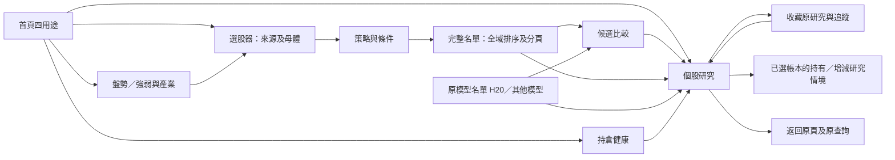

# Baldr 產品補完接續計畫

> 調查基準：2026-10-06，實際 Git 複核時間 22:36 UTC（台北 10/07 06:36）。
> 狀態：**使用者已授權啟動開發與 Luna Max 分工；先保護工作區，再分包實作**。2026-10-06 本機 checkpoint 為 `bf9207fb72cd3acebac17f4b7816994efa601226`；第 14 節追加 exe／Python 一致性要求與首波分工。第 13 節保留上一輪「只調查與規劃」的歷史驗證，不代表當前工作狀態。正式資料、私人持倉、Task、模型訓練／啟用、交易、push 與發布仍不在授權範圍。
> 唯一原始需求：[Danny Quant 原產品計畫](../../../output/plans/baldr_product_experience_plan_20261004.md)。本文件是它的差距對照、分工與驗收補件，不另建產品 Roadmap，不覆寫原文或原驗收收據。

## 0. 一頁接續摘要（開發已開始）

九個選股檔案已先保存於 `bf9207fb`，三位 Luna Max 葉片均已交回並逐包提交：啟動／版本 `92ed944e`（43案例）、H20投影 `cefef608`（12案例）、P01底層 `9330f7fb`（6案例）。中央整合與建置修正保存至 `4b40788b`；固定來源 M1 candidate 已通過 Python／exe 同版隔離比較。全母體 UI 與其餘工作包仍未完成。

**首波 M1 已交候選**：H20接首屏摘要／狀態／下一步，Python三入口共用設定，版本與commit可辨識；固定 `4b40788b`／195項依賴建置獨立candidate，與同commit來源快照的Python做四用途／模型／收藏／日期／錯誤／取消／子程序比較通過。[QA收據](../../06_qa/BALDR_COMPLETION_FIRST_WAVE_20261006.md)明列synthetic與canonical限制。下一驗收點先做小規模Native真人試用；M1不代表完整選股器、每策略績效或原模型品質完成。

**選股第一版 M2**：P01真正完整母體閉環加P02/P04首批既有MA交叉、KD、MACD、量能規則。有完整分母、全域篩選排序、比較／個股／收藏返回、新程序與candidate驗收，才稱可用選股第一版。其餘23條條件的B/C缺件明列，不把首波寫成14包完成。

**後續 M3**：復用原金融引擎，做持倉情境與每策略獨立帳本／歷史比較。Paper先沿原500000研究本金、8檔最大持倉的有版本政策；8是帳本持倉政策，不是研究母體上限。需提高時由中央另提有版本政策、金融驗證與接受收據，這輪不自行放寬。

目前無需額外決策才能完成M1。真正政策選擇仍只有§12的H20研究排序如何接配置情境；推薦沿使用者等權／明示目標情境，不能直接把毛報酬轉權重。正式資料、私人帳本、模型／Task、交易、push與發布保持原授權邊界。

### 0.1 M2 施工與真人回報（2026-10-07，未完成）

本輪[工程 QA](../../06_qa/BALDR_COMPLETION_M2_20261007.md)保存新增受控研究根、Windows 長路徑失敗與修正及 H20 真讀取器旅程。受控根實際17股兩批產製／全域查詢／新程序唯讀重開已通過；中央受影響 capture／parent／scope／長路徑回歸80 passed、2 skipped。H20三日期不同的保存來源UI旅程2案例通過，模型contract仍為明示合成邊界，不授真fit或Native資格。來源未知日期保留、盤中cutoff拒絕、aware時區正規化及kernel／frozen metadata契約最終重驗61案例通過，尚未接正常UI／保存新版本；固定e5026b3a的實際exe／Python同版技術來源probe已通過，僅證engine合成來源；完整query收藏／比較與全流程新candidate仍未完成。共享readonly session中央69例通過，17股跨批共用一個交易快照且只有finish可交付；v4快照語義紅測已修正，中央來源／session／方法／快照65例通過，封存原kernel SHA、套件版本與固定參數；v4正常保存鏈及UI仍在施工，不能沿局部綠燈標M2完成。

使用者已授權繼續 Luna Max 分工、由中央審核。新增排他範圍：P01 producer 葉片為 `app_module/daily_market_universe_producer.py`／同名測試；query 葉片為既有 `daily_market_universe_run.py`／新 `test_daily_market_universe_run_query.py`；P02 葉片為 `decision_module/factors/selection_technical_rules.py`／`test_baldr_completion_p02_methods.py`。中央擁有新增 `app_module/daily_market_universe_selection.py`、`ui_qt/views/daily_market_universe_view.py`、其 UI 測試及既有每日研究頁接線。使用者回報的個人推薦歷史版本窄欄排版另釋出 `recommendation_view.py`／新版面測試給啟動契約 Luna；不與中央同檔並寫。

- 多條件全域 AND／OR 與缺欄三態已由257碼、兩段真 parent writer 產物驗證；P02五項純 Decimal 規則20案例通過，但來源／保存新版本與 UI 尚未接線。中央完整母體頁到原 child 下鑽隔離案例通過；producer 正常外部根已有具名工程閉環，但仍缺 UI 產製、比較／收藏／重開完整 query、真 N 及候選版驗收。
- 全排除／零納入母體原 manifest 遺漏條件零計數，導致 reader 拒絕；writer／reader 現共用固定 source-clock 契約的條件 keys。v2／v3各300筆排除、兩段全域查詢與fresh reopen通過，中央連同原writer／reader重驗8 passed，排除300／未知0，未授真市場來源資格。producer的真納入17／257／1000與取消續跑另在驗證，不能由零納入案例宣稱完成。
- 原 parent capture writer 的預設 guard 僅允 QA／Temp，不能以此限制當正常 OUTPUT_ROOT 產品完成；後續需明示受控研究根契約，保留原預設防護、來源隔離、資源上限與 immutable 保存。
- 真人驗收先精確分來源：H20名單選2382→「研究選取股票」→個股「摘要」上方「第一眼先看五個問題」→「返回來源清單」。H20目前沒有已驗收藏入口，不能要求使用者找原排名或每日規則的收藏按鈕替代。現成M1呈現fixture不能從正常reader開H20，Native啟動／布局與canonical來源旅程分列。
- 使用者回報三個預設策略同時被官方日曆阻擋，及個人推薦歷史版本欄在窄視窗擠壓。固定來源 `2b6fda42` 已修外部日曆接線、失敗說明與窄欄布局；候選 `2026.10.06+2b6fda426b6f` 同版隔離比較通過，原exe保留。實際reader及推薦交易日邊界在相同外部synthetic cache下逐值一致，既有原官方cache唯讀核驗通過；未放寬hash／expiry／available-at，未執行真人三策略。H20缺摘要仍待版號／來源核對與保存旅程驗證，報告讀取失敗會阻止H20啟動的限制仍保留。詳見[真人回饋QA](../../06_qa/BALDR_RECOMMENDATION_HUMAN_FEEDBACK_20261007.md)。
- 其他排程／Paper／Snapshot／Manual未提交變更由別的工作保留，不順手納入本包；原exe、main、原計畫、失敗QA及正式Task均保持原邊界。

## 1. 先回答：現在能做什麼，真正還缺什麼

Baldr 已有可用的研究零件及數條有限閉環，但尚未形成完整的「看盤勢 → 選股 → 比較 → 個股 → 持倉情境 → 收藏追蹤」產品。優先補完使用者每天會走的路，再擴充條件與策略績效。自然結果等待成熟，與介面、接線、完整母體等可立即施工事項分開管理。

| 類型 | 現在的具體情況 | 接續處置 |
|---|---|---|
| 已有可用流程，但驗證有範圍 | 九個工作區、四用途捷徑；原保存推薦讀回；有限 MA／BB 規則快照；原研究收藏、同源圖表與返回；H20 十股名單排序、個股讀取與返回；手動持倉與日誌 | 保留既有入口、來源身分與驗收。新功能必須通過相同實際旅程，不能因重排畫面而破壞它們。 |
| 已有底層，尚非完整產品 | 多種技術計算、籌碼／營收／產業因子；Advice、配置與再平衡政策；Paper 成交與帳本；Backtest／Registry；八家族 catalog | 接成可選條件、具名策略、獨立研究帳本與可比較結果。catalog、API、DTO、單元測試各自都不算產品完成。 |
| 接線與體驗缺口 | 個股首屏工程資訊過多；H20 不參與五問摘要／下一步；來源切換與 root 注入不完整；daily view 仍以 child 為單位；比較／返回／重新開啟尚未覆蓋完整母體與擴充查詢 | P00–P06、P09–P10 優先處理，不等待自然樣本成熟。 |
| 資料或規則缺口 | 權證標的關係、完整注意／處置歷史、可驗證處置預警；完整 KDJ、VCP、形態確認、族群核心／新資金定義；部分基本面前期／可得日；H20→權重政策 | 每項有資料／規則交付包及失敗狀態，不偽造結果；詳見第 5 節與 P03／P07。 |
| 需要自然時間 | 已合法保存預測的未來交易日結果、真正下一次自動 Task、前瞻 Paper 績效及效果驗證 | 保留 pending／waiting／unknown；由既有 producer 與 reader 累積，不以 replay 或手動測試頂替。P11／P12 補的是可讀狀態及證據接線。 |
| 仍需人工實測 | 3–5 位非技術使用者能否理解與操作；全流程 Native／新 exe 是否等同來源版 | P13 真正驗收；本輪沒有冒稱完成真人或 exe 實測。 |

推薦開發順序是：**先讓 2382 看得懂、來源選得到、返回不丟失；再把全母體與既有公式接通；最後完成策略帳本與歷史比較。** 各階段可驗收交付，但不可把第一階段三條件版本標成完整 Danny 式選股器。

### 1.1 2382 核實結果

- `current_roster` 是官方當下上市名冊的證據種類，不是 H20 預測。日常畫面應寫「官方上市名冊」，原 token 留在來源詳情。
- 直接唯讀原 H20 reference、manifest 與十份 capture，manifest 及十份 capture 的 bytes hash 均相符。2382 的 `predicted_gross_return_bp=684`，即 **20 個交易日、未扣成本的報酬估計 +6.84%**。同份十股排序為第 **9／10**，不能顯示「全市場第九」。
- 日期分別是判讀／預測適用日 **2026-10-07**、來源交易日 **10/06**、模型特徵截至日 **10/05**。capture 另有 observed_at；feature available date 也不是 feature as-of。畫面不得用一個「資料日期」覆蓋它們。
- H5 的 **−100 bp** 是另一模型的成本後相對基準超額估計，表示落後基準 1.00 個百分點；不表示股價必跌 1%。H5 原成本情境 **80 bp＝買 25＋賣 55**，不是使用者實際成本，也不是 H20 的成本設定。H5 數值與成本依近期保存核對及現有 DTO／測試契約解讀，本輪未重新跑 H5 模型。
- 調查時 H20 已有名單、整數排序、同股 evidence、來源下鑽與返回，但 `set_personal_h20_evidence` 只更新獨立 label，缺 Advice 的下一步也擋住 H20 比較。首波已把合法 H20 接到五問摘要／狀態／下一步；原來源與 cutoff guards 保留，尚未通過 candidate 同版驗收前不算發布。
- H20 capture 原狀態是 `pending_exact_entry_capture_and_twenty_sessions`。若未取得精確 entry、日曆或合法結果 producer，屬工程／來源缺件；取得後仍未滿交易期，才屬純時間等待。不能籠統說「只等二十天」。
- H20 原 evidence 沒有逐特徵貢獻說明。可以並列價格、規則事實與反證，但不能編造「模型因為這三項理由估計 +6.84%」。canonical 機率 head 的 Brier 比較與此 gross head 的效果分開，不挪用結論。

### 1.2 五種狀態各自回答一個問題

| 使用者問題 | 顯示內容 | 不得替代的意義 |
|---|---|---|
| 這份資料讀得到嗎？ | 已核讀／缺檔／損壞／讀取中／已取消，附重試 | 讀得到不代表新鮮或完整。 |
| 日期是否適合現在用途？ | 各域資料日、可得時間、時效已核／未核／過期 | 一域未核不把其他域全標成無法使用。 |
| 模型有沒有有效的原估計？ | 已驗原估計、模型與目標／期間、適用名單；不可驗證時具名原因 | research-only 不等於沒有預測；也不等於投資有效。 |
| 實際結果已經出來嗎？ | 尚待 entry／日曆／結果來源、未到期、已成熟、評估失敗 | 未成熟不能補零，也不能拿 historical replay 代替。 |
| 我現在能拿它做什麼？ | 可研究排序／可比較／可檢視情境／仍缺哪一項輸入 | 研究用途不是正式 Advice、ML 配置或交易權限。 |

已核官方狀態原件包含 15 個 captured／parsed source、2382 listed；共同 freshness receipt 沒有 `official.current_market_status`，程式 alias 也沒有對應。這能解釋一部分降級，不能推論全份報告的每一個 partial 原因。`company.master_data` 讀的是 companies.csv，不能直接 alias 成同一份官方狀態快照；沒有 cadence／expected-period 契約就保留「時效未核」，不改成綠燈。

## 2. 調查基線、來源與保護範圍

### 2.1 Git、檔案與實際設定（歷史調查與開發更新分列）

| 項目 | 本輪實際讀回 |
|---|---|
| 工作分支／dev | 調查起點 `4f052beb`；開工checkpoint `bf9207fb`；葉片 `92ed944e`／`cefef608`／`9330f7fb`，整合與候選固定來源 `4b40788b`。其後為驗收文件增量，當前HEAD以git讀回為準；同版驗收使用4b固定archive，不使用當前dev冒充它。 |
| main | `305635642ecdf5f1331a24a0c81566d07f36cb0d` |
| 本機分支／worktree | 僅 dev、main；唯一 worktree 為本 repository。無須再做分支清理。 |
| 保留工作 | 第10節九檔已於`bf9207fb`提交；首波整合與三個葉片也已分包提交。候選及所有失敗輸出保留；文件收據另提交，不與原九檔未提交狀態混淆。 |
| 唯一原計畫 | 2,002 行，SHA256 `4f90d28051e91a2754466fd0ac4677eeb49a7c28e1de3cc419f78965716b9a55`；已完整讀取正文與追加收據。 |
| 可用 exe | `dist/baldr/baldr.exe`；SHA256 `ab0c72ef1c98f906e3d7ef14d440490ea4bf238aa53f959597636ddc2b1b263e`。整個資料夾保留；它未包含九檔未提交修改。 |
| source 的 root | 本工具程序無 DATA_ROOT／OUTPUT_ROOT 覆寫；依 `TWStockConfig` 預設為 `D:/Min/Python/Project/FA_Data` 與其 `output`。不實例化會建立目錄的 config 來做唯讀核對。 |
| exe 的 root | 唯讀 `%LOCALAPPDATA%/baldr/config.json`，DATA_ROOT／OUTPUT_ROOT 同為上述 FA_Data 與 output。實際啟動程序若有環境覆寫，仍以該程序解析值為準；本輪未啟動 exe。 |
| 私人 H20 | 已選 `FA_Data/personal/recommendation_h20`；reference revision 1，manifest 十股。不能因新 selector 再要求啟用、搬家或重選已授權私人根。 |

重要差別：`DailyMarketResearchScreenerService` 預設規則根仍是 **套件根/output/research_snapshots/daily_market**，不是 `TWStockConfig.output_root`。一般 `MainWindow()` 未明示注入規則 root／cohort；新 selector 雖能額外查 OUTPUT_ROOT 的固定位置，仍不是完整主入口／parent／重開接線。根沒有 MA/BB 快照，不等於沒有保存推薦或 H20。

上一輪調查只讀設定、程式、文件及必要的既有 JSON 證據，沒有開正式 DB、GUI 或 Task。當前授權開發的驗證改用隔離 fixture／GUI／未訓練 shadow artifact；仍不讀私人持倉明細，不修改原計畫、既有 exe、正式資料、排程或 main。

### 2.2 證據權重與來源登記

| 來源 | 本計畫如何使用／校正 |
|---|---|
| [原計畫](../../../output/plans/baldr_product_experience_plan_20261004.md) §§2–13、UX01–24 及全部追加收據 | 原產品意圖與既有有限接受的唯一需求依據；不重開已接受的單項修復，也不把有限接受擴成整項完成。 |
| [ML REPORT](../../../output/qa/ml_product_purpose_audit_20261006/REPORT.md)、[DISPATCH](../../../output/qa/ml_product_purpose_audit_20261006/DISPATCH_CONTRACT.md) | 回查 main、report view/service、Advice／Health caller，另核原 H20 bytes；提議 API 仍標提議。 |
| [Danny report](../../../output/qa/danny_selection_gap_audit_20261006/report.md)、[ownership](../../../output/qa/danny_selection_gap_audit_20261006/ownership_scope.md) | root／三種來源判斷仍成立；「強弱頁固定兩 MA AND」已被九檔部分修改，不能照抄為現況。 |
| [多因子精確盤點](../../../output/qa/multifactor_selection_inventory_20261006/INVENTORY_EXACT_SCOPE.md) | 回查 MA／KD／MACD／量能與分點公式；其 DB 日期／覆蓋數是該輪觀測，不冒充本輪重新查庫或完整合格母體。 |
| [全功能 GUIDE](../../../output/qa/baldr_full_function_audit_20261006/GUIDE.md)、[inventory.json](../../../output/qa/baldr_full_function_audit_20261006/inventory.json) | 85 筆功能索引，基線 `07da90c1…`；狀態只適用各 receipt。當前 D01／打包日期等後續修復不重列舊缺陷；未驗部分照留。 |
| [exe 最終收據](../../../output/packaging/DATE_HOVER_SPLASH_FINAL.md) | 保留背景圖、14 個真初始化階段、app_icon、日期／hover 修復和整包。offscreen／guarded startup 不等於真人完整旅程。 |
| [排程操作指南](../../07_guides/SCHEDULE_OPERATIONS_AND_MIGRATION.md) | 區分 Windows source Python、exe、Codex 任務及時區；本輪沒有重新查 live Task、修改或觸發任務。 |
| [Snapshot](../../00_core/PROJECT_SNAPSHOT.md)、[Roadmap Hub](../../00_core/DEVELOPMENT_ROADMAP.md)、[產品方向](../../00_core/PRODUCT_ROADMAP_POST_REFACTOR.md)、[6M](../../00_core/ROADMAP_6M_ENGINEERING.md) | 沿用 scoped authority；本計畫不把 proposal 寫成已完成，也不提升 maturity。 |
| [外部藍圖](../../00_core/EXTERNAL_REFERENCE_VERSION_BLUEPRINT.md)、[長期 maturity](../../00_core/VERSION_ROADMAP_V2_1_TO_V4_0.md)、[Carryover](../../00_core/LEGACY_ROADMAP_CARRYOVER.md) | 沿用外部參考／data acceptance 邊界及既有移交；不用第三方命名推造公式或報酬。 |
| [目前架構](../../01_architecture/system_architecture.md)、[FINAL 目標架構](../../01_architecture/target_architecture_2026_09_22/FINAL_TARGET_ARCHITECTURE.md)、[Manual](../../07_guides/APPLICATION_MANUAL.md) | UI→application→既有領域計算；資料 adapter 給標準事實，因子語意歸 domain。typed 契約／版本 decoder 先於擴充，不新建平行金融引擎。 |

使用 Graphify 既有圖定位 caller 後逐檔回查；圖不作當前實作真相。UI/UX 技能僅取漸進揭露、鍵盤焦點、可讀錯誤與長表格原則；保留 PySide6 現有主題與中文字型，不套網頁 landing-page 設計、不重做 splash。

## 3. 建議頁面與日常旅程

### 3.1 工作區職責

維持九個 workspace 的穩定 ID；側欄可用「日常／研究／工具」分組，不另外複製一套頁面或 producer。

| 頁面 | 第一屏回答 | 主要操作與邊界 |
|---|---|---|
| 首頁／決策工作台 | 今天盤勢如何？哪些持倉需檢視？從哪裡找候選？ | 四張用途卡＋全域股號／名稱搜尋；顯示各卡自己的資料日。無來源是「尚未載入／缺來源」，不是零風險。 |
| 市場探索：市場總覽／大盤／產業 | 市場強弱、廣度、產業變化及資料限制 | 保留既有 DecisionDesk 與市場 reader；可把已選母體送選股器。 |
| 市場探索：強／弱勢個股 | 原本日／本週價量排名是什麼？ | 預設保留原 StockScreener 方法與 eligible 分母。「套用我的研究條件」是另一明示模式，顯示同份查詢，不能把符合數冒充原排名。強／弱的差異是原排名方向，不是缺資料多少。 |
| 推薦分析：每日研究／選股器 | 選定策略與完整母體後，哪些符合、為什麼、風險何在？ | 來源／母體 → 策略及條件 → 名單 → 比較／研究／收藏；一份共享 query，不在強弱頁重算另一份。 |
| 推薦分析：模型名單 | 此模型對這份候選的研究估計與次序是什麼？ | H20、H5、保存推薦分清目標／名單／日期。H20 可直接進比較和個股，不要求先造一份 Advice。 |
| 觀察清單 | 我為何收藏？與收藏當時相比變了什麼？ | 「查看原研究」與「另開最新研究」分開；確認／稍後／理由沿既有 review 保存。收藏不是持倉。 |
| 個股研究 | 結論、可核理由、主要風險、與我的持倉關係、下一步 | 摘要先行；技術／基本面／籌碼產業／持倉／歷史按需展開。回原名單保留來源、頁碼、條件、排序與選股。 |
| 持倉／Portfolio | 哪筆持倉因何需要檢視？ | 手動交易帳、聲明研究帳、Paper 帳三者明示；Health 依論點、行情、限制及既有政策；未知不當續抱或賣出。 |
| Research Lab／回測 | 某個版本策略在相同假設下表現如何？ | 五種既有模式、Registry 原 run、近期策略追蹤與獨立歷史比較；不可混成一張總績效。 |
| 數據更新／系統狀態（工具） | 缺哪個來源？影響哪個功能？下一步可做什麼？ | 來源域、最近成功／最近嘗試／warning／failure 分列；長路徑、SHA、Task 詳細參數放進階。 |

### 3.2 首屏草圖（文字線框，待實作）

```text
2382 廣達                              [回原模型名單]
個人 H20 研究估計：20 交易日未扣成本 +6.84%
同份 10 檔名單第 9；這是一份研究估計，實際結果尚待成熟。

值得研究的已知事實          主要風險／限制
最多 3 項原規則／價格事實    最多 3 項反證或缺件與影響
（無模型歸因資料時直說）    （不重複堆滿每一區）

與我的持倉：依已選帳本顯示；未選／無持倉／健康未知分開
[比較同份候選] [核對持倉情境] [收藏此研究] [查看結果追蹤]

行情截至…｜特徵 10/05｜來源 10/06｜預測適用 10/07
▸ 另一份 H5 研究：成本後基準超額 −1.00 個百分點
▸ 全部研究資料與來源（模型、期別、保存時間、資格、SHA）
```

這是呈現順序，不硬塞四個同等醒目按鈕：依來源與持倉選一個主操作，其餘為次操作。錯源、檔案壞損及必要限制仍在操作旁可見；不能把會阻擋操作的錯誤只藏 tooltip。H20 晚到時摘要、狀態及下一步一起刷新；切股時立即清除舊 H20，不能只換股號。

### 3.3 四條必須打通的旅程



1. **看盤勢**：首頁→市場資料日期→市場／產業摘要→原強弱排名→選一組母體送選股→返回仍是原排名期間與模式。
2. **看持倉**：首頁持倉提醒→明示帳本與資料日→同股 Health／論點／成本→比較既有 target/current/gap 或人選情境→保存研究理由→回原帳本與股票。不寫真交易。
3. **選股**：策略／母體→加入分類條件→完整分母、符合／不符／未知→2–5 檔比較→個股→收藏→返回原頁碼與排序→結束程序→由收藏重開同份原研究。換最新必須另開。
4. **模型個股研究**：H20 原十股→2382→讀懂估計與限制→比較同 cohort／檢視持倉→收藏與回名單→新程序仍能核同 manifest。沒有 Advice 也可完成這條路。

## 4. 來源、日期與查詢的共用契約

以下是**待定版的契約要求**，不是已新增 API。

- 來源 descriptor 必須區別 `daily_market_research_snapshot`、完整 parent 規則來源、保存 Recommendation、`personal_h20_saved_cohort` 與明示最新個股。保存推薦不能冒充 MA/BB manifest，H20 不能偽裝 canonical result_id。
- 日常選單用「名稱／策略版本／母體／資料日／保存時間／完整或缺件」；hash、result_id、內部路徑只在詳情。選原檔是進階救援，不是正常流程前置。
- 首次來源目錄從已選root、既有收藏／來源descriptor及已知producer收據建立，不掃整顆磁碟或私人資料夾猜latest。若確實尚無daily規則產物，顯示「規則名單尚未保存」，提供明示母體的「建立研究名單」入口；只讀來源切換本身不產資料，也不把保存推薦轉造規則快照。
- 一次來源選擇傳到所有 consumer：實際 root、kind、manifest／內容 hash、parent／child 關係、母體版本、方法版本、clock、read mode。不得各頁猜 latest，或在包內建另一份資料。
- query 保存分類 AND、分類內明示 AND／OR、方法及參數版本、三態篩選、全域排序、股票搜尋、比較集合、選取股票、origin workspace/tab/mode、page anchor。清除条件代表無額外條件的母體瀏覽，不偽造一個「全符合」策略。
- 使用現有研究 session／watchlist extension 保存查詢；增加版本 decoder。v2/v3 舊收藏保持原語意；不自動遷移或用新公式重寫它們。來源失聯給「找回原來源」與「另開新研究」，不 silently fallback。
- `restore` 先核全部 enum／方法／pins，再原子套用 controls；目前九檔的逐欄套用若中途找不到 combo 項目，需有回復／拒絕測試，避免半套 query。
- 明確區別「查看已封存原研究」和「核對目前資料是否仍一致」。目前 daily strict reader 會重驗當前 DB；原研究重開應沿既有 sealed capture／parent readback 能力讀原保存 bytes，不把 mutable DB 的改動拿來重算舊結果，也不削弱現行 current-source 核驗。
- 所有 worker 結果攜帶 generation、query revision、來源 identity、股票／帳本身分；cancel、切股、切來源、close 後的晚到結果一律丟棄。查詢取消不刪原快照。

| 日期名稱 | 來源與用途 |
|---|---|
| 市場資料截至日 | 行情／技術等各來源自己的 as-of，不用模型日覆蓋。 |
| 模型特徵截至日 | 模型實際吃到的特徵截止日；另保留 available_at。 |
| 判讀／預測適用日 | 原 decision_date；可晚於資料日，須有原 clock 契約。 |
| 保存／觀測時間 | timezone-aware timestamp；完整時間可展開，不當成行情日期。 |
| 台北交易日期 | 由 Asia/Taipei 及已核官方交易日曆判定；不以美西系統日期當交易日。 |

首頁以卡片資料日為主，個股以該研究來源日期列為主；台北今天僅作頁面環境資訊。跨域日期不同時說明影響，不能把股票價格日期貼給營收或法人。

## 5. 選股條件與策略的完整盤點

分類：**A＝已有可驗證規則可接；B＝有原料但缺規則／確認時點／產品接線；C＝必要資料尚未找到完整可用契約。** A 仍需保存必要欄位與接到 UI，不代表目前選單已有。B/C 也有指定交付與驗收，不以「以後可以做」結案。

| ID／需求 | 分類與已存在內容 | 本輪建議的實作定義／不可冒充 | 包／關鍵驗收 |
|---|---|---|---|
| F01 均線黃金交叉 | A；`scoring_engine.py:650` 有前後日 MA5／MA20 交叉 | 今日 MA5>MA20 且昨日 MA5≤MA20；嚴格取 5、20，不沿模糊欄位 fallback | P02；昨日也在上方→不符合；缺昨日／暖機→未知。 |
| F02 均線轉強 | A 多頭排列；B MA20 上彎 | 先接精確 MA5>MA10>MA20>MA60；四項缺一不可縮成兩條。scorer 的「MA20 上彎」只有註解，若提供坡度版須另定期數／公式 | P02／P07；排列與坡度分方法、分版本。 |
| F03 KD／KDJ 黃金交叉 | A KD；B KDJ | KD 今日 K>D、昨 K≤D；低檔 K<30、中檔 30≤K<70 是現有版本；來源 STOCH 5/3/3 SMA。KDJ 的 J、平滑及交叉定義另立自有版本 | P02／P07；KD 不改名 KDJ；兩日同股、有限值、暖機。 |
| F04 MACD 黃金交叉 | A；`signal_combiner_support.py:117` | MACD>signal 且昨 MACD≤signal；核 12/26/9 與欄名。`reason_engine` 單日大於的金叉標籤不可沿用為真交叉 | P02；連續在上方不重複金叉；不讀會被其他指標覆寫的合成 Technical_Signal。 |
| F05 量能放大／排序 | A，存在三種不同口徑 | 優先接 20 日含當日均量比>1.5；另列 5 日含當日>2。原 StockScreener 前20日不含當日／短史 fallback／≥1.5 保留原名，不能混用 | P02；完整窗口、正分母；舊 min_periods=1 不當完整20日。log1p 顯示值不叫普通放量百分比。 |
| F06 波動收斂 | B；有 ATR／BB／OHLCV | 明定觀測窗口、比較基準、連續性、閾值來源及突破確認；先保存 bandwidth／ATR 原料，規則由 P07 定版 | P02／P07；低 ATR 一點不等於收斂，短史未知。 |
| F07 高／中／低價與價格排序 | A 價格排序；B 命名分段 | 現 dirty query 已允 close 排序，不能再說完全沒有。補 min/max 數值條件；高中低預設须顯示實際區間，沒定義前不用名稱冒造門檻 | P02／P04；Decimal、邊界含不含、未知置尾、穩定 tie-break。 |
| F08 籌碼偏多／排序 | A 有界分點語意 | `PortfolioChipService`：淨吸籌連續≥3日，或累計≥500000股且不抵觸連續出貨≤−3日；沿原期間及 coverage。這是主力分點，非三大法人 | P03；排序按具名原淨額／狀態，榜外／估算／缺日揭露。 |
| F09 法人連買 | B／C 當期完整性 | 原 institutional_flows 有外資／投信／自營資料；補法人範圍、連續官方交易日、日數參數及可得日。不得用分點替代 | P03／P07；缺一開市日不算連買；舊表不能當今天。 |
| F10 有掛牌權證 | C 關係資料 | taxonomy 能認 warrant，仍缺標的股→權證→掛牌／到期／終止日及可得時間的關係契約 | P03；as-of 查詢與終止／到期案例，無資料→未知而非無權證。 |
| F11 基本面成長 | B／C 前期、PIT | 定義是營收／EPS／營業利益哪個成長；保留同比基期、會計期間、修訂與 available_at；先接已有完整指標 | P03／P07；單季正 EPS 不等於成長；前期不足未知。 |
| F12 營收動能／排序 | A 年增門檻；B 複合動能 | 沿既有 `monthly_revenue_yoy_min`，先提供年增率數值排序；MoM、連續3月、新高分開版本，不新增任意預設門檻 | P03；ratio／百分比換算明確；現3m flag缺曆月連續核對、新高flag缺前史仍回1，不能直接作訊號。 |
| F13 族群強度／排序 | A 產業；B 自訂題材 | 沿 IndustryStrength 同層級5／20日相對TAIEX超額bp與穩定同值排序；固定分類及成分時點 | P03／P07；aggregate與leaf不可混排，現在分類不回填歷史。 |
| F14 族群核心 | B | 用既有同群成分、相對強度／流動性資料提出透明候選定義、主次排序與版本；工程提交規則卡，不引用私有稱號代公式 | P07；成分與排名可重建，缺群或資料不硬選核心。 |
| F15 新資金 | B | 先做明示「成交金額放大」或「已核淨流入」代理，兩者分開；沒有帳戶流量證據不稱真新增資金 | P03／P07；窗口、分母、單位、來源固定；爆量不自動解釋為資金流入。 |
| F16 注意股票 | C 歷史／完整 coverage；有當下官方狀態框架 | 重用 CurrentMarketStatusReader 的已驗當下註記；補官方注意公告資料與有效／可得時間。產品 attention_reasons 不是官方注意名單 | P03；當下與歷史限制分開；未覆蓋市場→未知。 |
| F17 處置股票 | B parser／當下 reader；C 完整事件史 | 既有 TPEx disposal parser與官方狀態框架可沿用，補跨市場有效起迄及可得日。舊盤點未見事件表不代表全 repo 沒有當下狀態資料 | P03；公告前／生效中／到期後；缺事件來源不能當安全。 |
| F18 處置預警 | C 規則史料 | 另列「依公開規則的預警估計」；資料 owner 取得可核版本、累積注意史料和觸發條件後才實作，與已公告處置分開 | P03／P07；缺任何必要史料即不可判，不能靠一般風險分數冒充。 |
| F19 資料日期／風險篩選 | A 框架；B 分域接線 | 每個條件有 as-of／available／freshness／原因；使用者可排除已知限制，未知另外顯示並明示是否納入瀏覽 | P03／P04／P05；未知不視作安全或不符合，不合併各域日期。 |
| F20 多欄排序 | A 部分欄；B 新欄 | 量能比、分點淨額、營收YoY、價格、族群強度分具名欄位；全域穩定排序後分頁，未知雙向均置尾；用股票代碼最後 tie-break | P01／P04；跨批極端值在正確位置，不能只排序可見頁。 |
| F21 完整母體／符合數／缺件／清除恢復 | A 三態基礎；B 完整流程 | 顯示已選母體、處理進度、排除、可評估／未知與已套用條件；清除和復原 query 都可保存 | P01／P04／P09；分母不隨篩選縮小，恢復含來源版本。 |
| F22 多策略共振 | B 聚合／真正策略不足 | 同股同一比較時點命中多套**已定義且有版本的策略**；列每套規則、match/no_match/unknown。MA20與MA60是兩方法同一趨勢家族 | P07／P04；方法數、家族數、策略數分開，不換算勝率。 |
| F23 三面向共振 | B／C 部分來源 | 技術／盤面、籌碼、基本面各有合格且在decision cutoff可得的 match；三面向齊全才顯示成立 | P03／P07；一域未知就不能標三面向成立；不同來源日照列，不假裝同日同義。 |

### 5.1 策略家族不等於三個條件，也不等於可交易策略

| 自有策略系列 | 可復用基礎 | 補完定義與版本成果 |
|---|---|---|
| 布林基礎／進階 | BBANDS30 上軌v3、價格／量能原料 | 現有版精確叫「收盤高於上軌」。真正突破須前後日；進階壓縮／量能／失效另立規則卡與參數版本，不改寫舊v3。 |
| 形態基礎／進階 | pattern_analyzer 的形態辨識 | 定義 pattern、觀測確認日、失效與先後順序。find_peaks 可能用右側資料；逐日 prefix 得到訊號後才記 confirmation_at，不能回標舊 end_idx 當當天已知。 |
| VCP 自有版本 | ATR、帶寬、OHLCV | 明定多段收縮、轉折／pivot、量乾、突破、失效、最短歷史；參數來源與敏感度試驗先封存。未定版顯示「規則待完成」。 |
| 族群連動基礎／進階 | 產業成分、相對強度、廣度／流動性 | 基礎先同群強度；進階再核心／跟隨／資金代理，清楚列出成分版本和市場基準。 |
| 其餘原八家族 | 原價量排名、趨勢、布林、量縮、形態、籌碼、營收、產業 | 每族具能力狀態，不把 catalog 八列叫八套完成策略；每套策略都必須有保存輸入、選股 predicate、版本、失效和研究用途。 |

P07 必須交付可執行 StrategySpec／版本卡／因果測試及 selector 接點；不足的條件明列 source blocker。SBA、Elite、VCP 2.1、族群 2.2 只保留為外部畫面參考，不沿用為我們公式名稱或績效。

沿用既有predicate但收緊暖機、固定alias或補因果確認時，必須有新的研究方法revision及差異測試；不能偷偷改舊scorer或把結果變化說成純UI接線。新技術方法由分析邊界提供已核指標值，再以Decimal／具名整數單位比較。

策略若要進 Paper／Backtest，還必須補齊進場時點、出場／失效、持有期、同時持倉、資金、成本、再平衡及缺件政策。單純篩選 preset 可以收藏研究，但不能憑空顯示 CAGR。

## 6. 完整母體：移除產品上限，保留資源邊界

### 6.1 現有上限核實

- `daily_market_research_screener.py` 的 produce／read／filter 都檢查 child 最多 16 檔；daily view 消費 child，不能靠多選頁面解除。
- `rule_research_parent_capture.py` 有同一唯讀 transaction、child pins、部分／取消收據及新程序 readback，值得沿用。但 `MAX_BATCHES=16`、每批最多16個納入代碼，總納入最多256；另有64MiB保存預算。它是有界 parent，還不是全市場服務。
- 新 `list_daily_research_sources` 每根最多列舉256個項目，逐份核整包；超量拋錯要求選 manifest。這是另一個歷史來源列表上限，不能忽略。
- 新 shared frame 在原排名 descending 時反轉「已排名＋排除」整串，靜態上會把排除／未知排到前面；要加排序反例驗收，不能只看 BB unknown 案例。

### 6.2 建議架構

1. **凍結完整母體。** 從明示母體設定／官方當下名冊／既有 universe service 得到全數代碼與來源版本，先去重並保留重複清冊，固定 decision cutoff、instrument／market 範圍及排除理由。現在名冊只能支持 current-observed 母體，不能冒充歷史存續成分。
2. **小批次可擴展協調。** 保留 child 的16檔限制作計算單位。新增有版本的完整母體 manifest／分段索引，可引用任意數量經核驗的既有有界 parent 段；256變成內部分段大小，而非使用者名單上限。舊 parent v1 與 child v2/v3 decoder 不變。
3. **一致來源。** 同次發布所有批次綁同一來源快照或受控一致讀取。已有 parent 的單一唯讀 transaction 可作一段基礎；跨段不能開獨立交易讀到不同 DB 版本卻聲稱同源。優先沿既有不可變 market capture；若只能用 live DB，須共同讀取交易／revision 核對，變動即失敗重建新 generation，不能拼湊。
4. **單一發布者。** worker 只產生有界結果，由協調者保存 child、段索引及最終母體收據。全部預定成員都有終態、hash／方法／clock相符後才原子發布 complete 指標；中途失敗保留 incomplete／cancelled 與可續跑資訊，原已完成版本仍可讀。
5. **全域查詢。** 建來源綁定、可重建的派生查詢索引，沿既有 SQLite／repository 模式保存必要欄位，UI 用 QAbstractTableModel 分頁。先全域篩選／排序再分頁；多欄穩定排序、空值雙向置尾、頁游標綁 query與generation。這是快取，不是第二套真相或金融帳本。
6. **取消／重試。** UI 持續顯示已處理／待處理／失敗。取消停止新批次、合作式收尾、保存準確狀態；只重試同 pins 的未完成批。來源變動另開 generation，不能把昨天缺件用今天值補到原名單。程序崩潰與正常取消分開驗。
7. **歷史列表。** 用已發布來源索引及游標呈現日期／名稱；先列 metadata，選中後 strict 核完整內容。壞檔具名隔離顯示，不能把局部列表說成全部，也不能只因一筆損壞令所有已核來源無法選。
8. **資源限制可理解。** 設 worker／in-flight／bytes／磁碟 reserve／快取條目／單次時間預算；超預算顯示具體原因和續跑入口。不得降低既有磁碟保留、刪原始資料或把 batch 數直接調極大。背景化不代表 CPU／RAM 下降。

完整性有兩軸：**母體處理完整**與**所需資料完整**。處理完所有股票但某些欄位缺件，可以是處理完整、資料部分；尚有未處理批次則不可顯示全母體結果或全域排名。

### 6.3 分母與三態

在每個保存版本固定以下不重複計數：

```text
去重後宣告母體 N = 納入研究 E + 明確排除 X
已完整處理後，E = 符合 M + 不符合 F + 無法判斷 U
處理中，E = 已核完成 T + 待完成 P；P包含未開始、失敗待重試及取消未完
缺件原因可多標籤，但缺件股票數以唯一代碼計，不把原因數當檔數
```

某股部分條件未知時，依有版本的三值 AND／OR 判斷整體；保留「部分證據缺件」計數，不硬把所有有缺欄股票都當 combined unknown。AND 已有明確 false 可判不符合；OR 已有 true 可判符合，但仍顯示未核項。三面向共振只在三域各自有合格 match 時成立。

至少測 17、257、1,000 檔及實際選定完整 N；其中17／257驗跨舊邊界，1,000驗多段和資源，真 N 驗真母體。另驗單股、完整清冊全部被排除而納入0檔，以及母體尚未讀取；後兩者不能顯示同一個「0檔」。需跨批重複股、跨批最大排序值、缺欄、未知、正式排除、不同資料日／方法版、最後一批失敗、取消重開、原來源後來變動。合成資料只能證明工程，實際母體覆蓋另有唯讀或受控快照收據。

## 7. ML、持倉情境與每策略績效

### 7.1 Advice／Portfolio／Health 復用邊界

| 既有入口 | 可以復用 | 還必須補的接線 |
|---|---|---|
| `AdvicePolicy.decide` | mode、promoted/candidate、品質、可執行性、risk budget、持倉數、cash、target、locked／disclosure | 它不讀 H20 gross。維持原資格；PROFESSIONAL candidate仍是RESEARCH，不因顯示模型而升權。 |
| `AdviceComposer.compose` | 既有配置結果和 current weights→target/current/gap，V2 executable／diagnostics | 個股 report 目前傳 `portfolio_result=None` 且沒有帳戶 current weights；改由明示來源的研究情境提供，缺 current 保持None。 |
| `PortfolioConstructionService.construct` | equal_weight、score_weight、inverse_volatility，Decimal資金、部位上限、lot sizing | 人選 cohort 的等權情境可接；gross不是score，不能偷偷套score_weight。 |
| `PaperPortfolioPolicy.evaluate` | cash／sector、band、minimum trade、turnover、cooldown與成本 | 先有合法明示target，才計差異；沿選定policy版本，不能拿 H5 80bp當帳戶或H20費率。 |
| `PortfolioAllocationService.project` | 現金、集中度、流動性／成交量、Health、lot、成本、rebalance，以及promotion guard | H20不是MLAllocationProposal；不可把模型權重放進rule_requested_weights繞過nonzero alpha驗證。 |
| `PositionHealthService`＋transition／Exit readers | 既有 condition、feedback、thesis、source trace 與不可執行狀態 | report簡化分支為WATCH／EXIT_CANDIDATE／HEALTHY，缺行情／論點可能覆為UNKNOWN；完整transition規則需沿原state machine，不聲稱H20已可決定增減。 |

先交付兩層：**(a) 並列同股模型看法與已選帳本的 current／既有 target／Health；(b) 使用者選候選與既有 policy 後，比較維持原樣、等權候選研究、明示調整 target 的假設。** H20改變研究檢視次序；情境差異來自人選假設及既有政策，不宣稱是模型配置。

情境讀回須綁帳本種類／portfolio_id／as-of、現金與總資產、持倉、quote與成本版本、候選名單及policy。沒有持倉與未載入持倉不同；未知資產不補0。輸出展示被現金、集中度、流動性、交易單位或cooldown擋下的原因、target/current/gap與估算成本，保存成原 Registry 可追溯研究記錄，不寫使用者交易帳。真正讓H20改變target須先完成第12節用途決策與獨立政策定義。

### 7.2 每策略兩張卡，兩種來源

| 項目 | 近期持續追蹤 | 獨立歷史回測 |
|---|---|---|
| 意義 | 從某日開始、按當時可得資料持續運作的研究帳 | 對選定歷史期間重播一個已定版策略 |
| 唯一身分 | strategy_id/version、研究portfolio_id、policy、起始資金、來源與日期 | Registry run_id、strategy/version、資料fingerprint、期間、母體、execution／cost／sizing |
| 首屏指標 | 期間報酬、起訖淨值／現金、實際持有與追蹤數、候選數、成本、最大回撤或風險狀態 | 股票／訊號／已完成交易樣本數分列、平均單筆、勝率、CAGR、最大回撤 |
| 細節 | 每日候選／未納入原因、目標與fill差異、獨立現金、成本、交易與估值；自然資料缺口 | 進出場、成交假設、持有期、成本明細、trades/equity、排除及取消、benchmark與樣本期間 |
| 不可混入 | 尚未成熟H20/H5 labels、未成交target、手動真交易、其他策略資金 | 第三方績效、事後補成的自然evidence、未完成run、現在成分回填歷史 |

復用路徑與需要的工程：

1. **Paper 已有 producer。** `data_module/paper_daily_execution_producer.py`／`scripts/run_paper_execution_daily.py` 已支持T+1官方session行情、Decimal fill、成本、queue及append-only ledger；不是重新造撮合器。但producer部分讀入與snapshot路徑仍拒絕非 `paper-main`。P08先引入明示且受驗的策略帳戶路由，保留原預設向後相容；不得全域替換字串而串帳。
2. **獨立本金與帳本。** 每個策略版本＋policy＋起始日有獨立portfolio_id、ledger／snapshot route、現金與benchmark。相同初始資金可公平比較，不共用現金、不把同股同日的不同策略事件當重複刪掉。沿 `portfolio_id:source_event_id` 冪等範圍。策略改版建立新比較線，不能重寫舊績效。
3. **研究本金不是帳戶資金。** 既有 `PaperPortfolioPolicyConfig` 預設500000、max_positions8等只是程式預設；原計畫100萬是研究比較例。UI須明示選定研究policy及initial capital，保存後固定；不要暗稱這是使用者資產或拿8當篩選母體上限。
4. **績效服務不再造一套。** 沿 PaperSnapshotRepository、PaperTradeLedger、PaperPortfolioWeeklyEvidenceService／WeeklyReportService與既有Decimal回報；沿 Backtest／PerformanceAnalyzer／PerformanceMetrics及 ResearchRunService 保存歷史。呈現 adapter要核metric validity；legacy empty metrics 的0不能在新卡冒充真零報酬／零回撤。
5. **口徑必須可比較。** 期間報酬取完整資金曲線，成本按原ledger與估值語意只扣一次；資金流入流出、未成交／部分成交／未平倉各按既有契約揭露。單筆報酬與平均交易不得代替組合CAGR；勝率分母為已完成交易，損益兩平另列。CAGR只有正起始值、合法期間與可比較資金曲線才可顯示；樣本不足說明，不外推收益保證。
6. **Registry 沿原讀回。** `ResearchRunComparisonService` 已檢查fingerprint、execution、sizing及期間／母體／成本差異；incompatible不排名，caution先顯示差異。不同期間的正規化圖只供視覺比較，不改原報酬。各策略百分比不相加；要合成組合必須另跑共享現金的portfolio實驗。
7. **完整策略才啟動帳本。** P07的研究filter尚缺出場等規格時，卡片顯示候選追蹤／待策略定版，績效空缺有原因；不能複製原 Recommendation 的分數假造策略Recommendation。先用typed adapter把策略決策送既有Paper邊界，所有來源與policy可驗。

既有歷史指標映射先凍結：`PerformanceMetrics.total_trades`是完成交易配對數、`expectancy`是配對報酬平均、`win_rate`以獲利配對數除全部配對、`annual_return`是原引擎CAGR、`max_drawdown`來自equity。各run若使用另一metrics schema，adapter要按schema明示轉譯；不得只看同名欄位。平均單筆需顯示原return_pct單位與成本口徑，已完成交易為0時顯示「尚無已完成交易」。股票數／候選數／訊號數另外計，不借total_trades當全部樣本數。

### 7.3 自然結果與模型改善

沿原 capture／forward store／outcome reader／label readiness／fair comparison／personalization reader，將「已保存預測、符合／不符／未知或控制組、待entry、待市場資料、到期未核、已成熟」分開。訓練資料凍結 feature／label／universe／source／clock；保留未入選與排除理由，避免只觀察贏家。Temporal split、purge／embargo、標準化只fit於訓練段；benchmark、停損／停利及成交只用當時可得資料。

目前可先展示研究估計與人選情境。模型有效性由後續公平比較回答，不以這次UI工作提升natural／formal credit、ML alpha或promoted狀態。本輪不訓練；後续也不把新增全市場條件自動接成線上重訓。

## 8. 原計畫與本次要求的完整需求對照

以下逐項保留原UX編号。狀態是可交付差距，不重新計算模糊完成百分比；歷史有限closed收據繼續有效。

| 原計畫 | 已有基礎／目前邊界 | 補完落點 | 必須看到的驗收成果 |
|---|---|---|---|
| UX01 基線與現況 | 原baseline、真資料／fixture區分與QA存在；新九檔不在exe | P00／P13 | 精確HEAD／dirty SHA／exe版本、四用途基準旅程、來源及資源基線；不覆寫舊失敗。 |
| UX02 白話與狀態 | 有部分readability修正，仍混大量工程詞／partial | P05／P10 | 五種狀態分開；2382五問可答；限制一次說清且可下鑽。 |
| UX03 導覽與共享來源 | 九workspace、搜尋、部分exactroute／bookmark已驗 | P00／P01／P04／P09 | 一個選定來源貫穿名單、比較、個股、收藏、返回與重開。 |
| UX04 每日候選呈現 | 有固定MA預設、摘要、原排名有限發布 | P04／P07 | 名單卡含策略版本、理由、反證、完整分母及全域排序，不混TopN與母體。 |
| UX05 互動條件 | 三條件及dirty跨頁query；非完整選股器 | P02／P03／P04／P07 | F01–F23每項有可選方法或具名資料／定義阻擋，清除／復原／保存全部狀態。 |
| UX06 個股工作區 | 六類研究內容、原來源路由與H20 label存在 | P05／P06／P09 | 首屏結論→理由→風險→持倉→操作；按需研究內容及exactreturn。 |
| UX07 圖表選型 | 已有原生同源圖表，外部圖為候選 | P09 | 先延續原生；同源、Decimal顯示邊界、授權／隱私與marker能力驗證；更換套件非本輪前置。 |
| UX08 價格／指標／事件圖 | 保存價格／MA與推薦writer有限閉環 | P02／P09 | 新方法同源圖、缺暖機／事件未確認提示、view range／CSV與原值一致；不拉最新覆蓋舊圖。 |
| UX09 名單生命週期 | 已有first/continuous/reentry/exit/unknown工程 | P01／P09 | 完整可比母體及官方session下比較；缺一期不宣稱退出，返回原事件／原股。 |
| UX10 多策略共振 | 方法／家族數及catalog有基礎 | P07／P04 | 真策略交集與三面向分欄，列來源、版本與unknown；不從兩MA推三獨立證據。 |
| UX11 規則及績效卡 | 規則、Paper、Registry分散存在 | P07／P08 | 每策略獨立本金／帳本追蹤＋獨立歷史卡，細節可查，缺績效不填0。 |
| UX12 回測與歷史 | 五模式、保存run、比較、legacy reader | P08 | 問題導向入口→固定版本實驗→真保存→Registry重開／比較→明細→返回。 |
| UX13 市場與觀察清單 | 市場多頁、COW收藏原研究與review已部分接通 | P04／P09／P10 | 原強弱／共享條件／收藏職責清楚；多股比較與跨程序回訪仍保同源。 |
| UX14 持倉與工具 | 三帳本、Health、更新／Runtime存在；範圍各異 | P06／P10／P12 | 明示帳本、健康原因、資料缺件處置、日期與最近成功，無假持倉／假安全。 |
| UX15 Manual／使用者接受 | 大量有限文件／Native收據存在 | P13 | Manual寫實際可達入口，3–5位非技術者完成四用途；未測與失敗保留。 |
| UX16 資料／方法矩陣 | 有exact inventory、availability與PIT邊界 | P02／P03／P11 | 每方法欄位、單位、暖機、as-of/available、coverage、consumer與source blocker可查。 |
| UX17 效能 | F1與Journey有已接受例外，非全面pass | P01／P04／P13 | 全母體程序樹CPU/RAM/I/O、取消／重開、頁面延遲；不改寫18.6219658%與8.109s原結果。 |
| UX18 共用features／方法 | v2 close/MA20/MA60、v3 BBupper；其他指標未全保存 | P02／P03／P07 | 一份核驗特徵供各頁與策略；公式版本、兩日證據、EMA／暖機一致，不多份重算。 |
| UX19 保存／發布 | immutable child／bounded parent與history具備 | P00／P01／P02／P09 | 完整母體原子發布、版本decoder、crash/retry、舊版保存回看與query持久化。 |
| UX20 全母體自然擷取 | 有界parent／capture已存在；仍非全市場 | P01／P11 | 全納入／控制／排除清冊與來源時計；處理未完整不可稱全母體，不能事後補歷史自然樣本。 |
| UX21 結果與labels | forward/outcome管線存在；自然成熟分域 | P11 | 真entry與官方session、horizon、benchmark、成本、缺件／到期狀態正確，保存再讀回。 |
| UX22 公平比較／ML研究 | readiness與fair comparison已有限驗證 | P07／P08／P11 | 同期間／母體／成本對照rule baseline；train-only標準化、purge/embargo；未fit可交可讀readiness。 |
| UX23 shadow／採用 | 原personal H20已接受並啟用；不等於formal promotion | P06／P11 | 不重開既有U2核准；用途、shadow結果、採用／rollback、權限分開，不為UI升alpha。 |
| UX24 全鏈與資源 | 多次有限union，曾有首紅精確重驗 | P13 | 每包端到端＋跨包四用途＋資源＋source/exe＋真人；原失敗、豁免及未驗不消失。 |

| 本次要求 | 對應章節／包 |
|---|---|
| 保護九檔、原計畫、exe；僅dev/main一worktree | §2、§9–10、§13；P00／P13 |
| 2382與H20/H5真正有用；分離可讀、時效、成熟與用途 | §1、§3–4、§7；P05／P06／P11／P12 |
| 完整Danny式條件、家族、排序與兩種共振 | §5 F01–F23；P02／P03／P04／P07 |
| 解除16／256限制、完整母體、全域查詢、取消重試 | §6；P01／P02／P04／P09 |
| 每策略獨立資金追蹤與歷史回測 | §7.2；P07／P08 |
| 頁面分工、日期一致、排程120秒問題保留 | §3–4、P10／P12、§11 |
| 原計畫UX01–24完整承接、精確ownership與Luna Max分派 | §8–9、§14；使用者後續已授權首波開發 |
| 要求十：exe／Python 共用入口、版本、根路徑、固定來源及同版驗收 | §14；P14跨P00／P13，唯一writer為中央；M1候選及每次後續交付都需同版比較 |
| 每包真保存→讀回→UI→操作→返回／新程序，異常分支 | §9每包出口、§11共用驗收矩陣 |
| 少量決策、單一接續文件與索引 | §12–13 |

## 9. 可執行工作包、依賴及排他 ownership

### 9.1 分派方法

使用者已授權，由 **中央root** 擔任唯一整合／產品與金融邊界 owner；**Luna Max** 實作已凍結契約葉片。原Sol Medium Fast是規劃的角色建議，不覆寫目前chat模型。三個Luna已啟動；未開新chat、branch或worktree。§9.3與§14.2均以當前實體檔名與writer為準。

- 保持dev/main、一個worktree。檔案是排他鎖的最小單位，不用「不同函式」當可共編理由。shared檔由中央收接口與測試後順序整合，不把各leaf整份覆蓋回來。
- 中央先保存當時HEAD與九檔新hash，再發每包：可寫檔、只讀依賴、輸入輸出契約、fixture根、禁止事項、驗收node、需接哪個consumer。下表是初始白名單；額外檔案由中央更新此表才分派，不給leaf整個目錄寫權。
- 同時最多三個互不共檔的Luna葉片，加一個Sol中央。共用Qt主入口、金融producer、型別契約、文件、打包與正式路徑驗證由中央排隊。單一worktree的測試輸出各有隔離根；不並跑會共用預設root／Qt全域狀態的測試。
- Sol審查數字語意、因果性、保存完整性及使用者旅程；Luna交代changed files、真讀回證據、未驗與阻擋。leaf測試成功只叫葉片可整合；主程式未接、缺新程序、缺Native時不叫產品完成。
- 每包都依第11節G0–G4驗收。無UI檔的backend包必須由中央接上consumer後才關閉。中央整合是P00持續職責，不能以「等別人接」讓底層包獨立done。

### 9.2 工作包內容與出口

| 包／主責 | 依賴 | 可交付結果 | 必須走完的保存與使用旅程 |
|---|---|---|---|
| **P00 契約、主入口與中央整合／Sol** | 起點 | 凍結source/query/date/account/version contracts、向後decoder、single-writer表；source與exe解析同root；主入口、導航與各leaf信號接通 | 真保存三類研究→各自reader→正常MainWindow選單→進個股／返回→新程序恢復；錯kind／root／identity拒絕，未選來源／取消／晚到不借最新。 |
| **P01 來源目錄與全母體／Luna** | P00；新feature接P02 | 完整母體manifest／分段、可續跑協調、唯讀全域查詢及來源索引；保留舊child／parent讀法，移除使用者16／256門檻 | 17／257／1000／真N保存→reader→名單全域排序分頁→跨批選股→返回／重開；缺尾批、重複、混日期／方法、cancel/crash/retry及超預算全部可見。 |
| **P02 技術方法與保存／Luna** | P00；P01可先以舊v3開發 | F01–F07、F20所需欄位、前後日及暖機；標準化單位／alias；新版本features和方法結果可讀，舊版不改 | 含交叉／持續在上方／等號／短史的真fixture保存→篩選→理由／圖表→返回／新程序仍相同；取消、錯source及舊版缺新欄保持未知。 |
| **P03 籌碼、基本面、族群與官方事件／Luna** | P00；method contract接P02 | F08–F19標準事實adapter、可得日、coverage、domain predicate；必要資料取得與更新接點的版本契約；不可取得者具名blocked | 多來源不同日期fixture保存→來源reader→條件／風險列→股頁→返回／重開；公告晚於cutoff、缺前期、缺交易日、缺權證關係、錯市場與晚到結果驗收。來源缺口不能用UIunknown永久結案。 |
| **P04 完整選股、比較與強弱共享query／Luna** | P00/P01/P02；擴充接P03/P07 | 策略／母體→分類條件→理由與風險→2–5股比較→研究／收藏；全域排序、count、清除／恢復、原排名模式；修dirty排序／選取風險 | 從正常入口讀完整母體→切條件／分頁→比較→個股→返回→同query收藏重開；取消、舊回呼、雙向未知置尾及source錯配；每一步不偷偷producer。 |
| **P05 個股摘要、H20與分域狀態／Luna** | P00；不等P01或自然成熟 | 新純presentation projection＋現有view/service接線；五問摘要、source-aware下一步、H20/H5分域、可展開原證據 | 原十股／2382保存來源→public reader→摘要+9/10→比較／持倉入口→原名單／新程序；缺capture、錯股／clock、H5未成熟、freshness缺mapping、切股晚到均正確。 |
| **P06 持倉與研究情境／Sol領域主導、Luna葉片** | P00/P05；用途決策不阻並列功能 | 已選帳本＋原Health／target/current/gap並列；人選等權／明示target情境沿既有policy、cost、cash、liquidity；保存研究結果 | 隔離帳本來源→情境真保存→讀回→個股／Portfolio比較→原帳本→新程序；不同帳本同股拒混、unknown不補0、現金不足／集中／成交量／cooldown擋下可見；cancel不寫真交易。 |
| **P07 自有策略定版及共振／Luna，Sol裁決規則** | P02/P03；可分家族逐版交付 | 布林基礎／進階、形態基礎／進階、VCP、族群系列與三面向組合的具名StrategySpec；新門檻需版本化提案、理由及敏感度檢驗，不向使用者丟一串參數問題 | 每個已定版策略逐日prefix→訊號真保存→selector／規則卡→命中股與反證→返回／新程序；加未來資料不改當時訊號，取消／錯版本／缺資料仍可核。完整策略可送Paper，filter-only明示差距。 |
| **P08 策略帳本、績效與歷史比較／Sol金融owner，Luna封裝與畫面** | P07；帳本契約P00/P06 | 明示多策略portfolio路由；保留原paper-main；每策略獨立capital／ledger／snapshot／benchmark；兩種績效卡、Registry比較與明細 | 至少兩策略同股同日各自保存fill／成本／估值及historical run→public readers→兩張卡→trade/run詳情→返回／新程序；一帳本損失、另一獲利仍獨立；缺成本／未成熟／cancelled run不填0。 |
| **P09 收藏、歷程、圖表與恢復／Luna** | P00/P04/P05；新features接P02 | 原query／比較集合／頁碼／origin持久化於既有session/watchlist；生命周期拓展完整母體；原圖range／CSV／event來源一致 | 收藏真保存→新程序從觀察清單重開原parent／query／股票→圖表／比較→返回；另開最新不污染原件，來源移失、版本不符、半批、取消、晚到與同股多書籤驗收。 |
| **P10 首頁、市場與日期呈現／Luna** | P00/P05；完整母體摘要接P01 | 四用途第一屏、共享日期語彙、原強弱／每日研究／模型／收藏清晰入口；工具錯誤導向具體資料域 | 讀保存市場／持倉／模型→首頁與市場畫面→跳正確workspace/stock→返回／重開；台北跨日／美西前日、週末、不同資料域日期、缺來源、取消與stale callback測試。 |
| **P11 自然追蹤與研究可用性／Luna** | P00；完整母體接P01、策略版本接P07 | prediction→entry→outcome→readiness／fair comparison狀態讀模型，完整納入／控制／排除及樣本漏失；效果／用途與promotion分開 | 隔離capture與outcome真保存→現有reader→模型／策略追蹤→原prediction／run→返回／新程序；自然真件另做唯讀核對。future label、缺entry／日曆、重試、取消、錯cycle及未成熟案例齊全。 |
| **P12 來源時效與DecisionDesk排程未完成項／Sol維運owner、Luna診斷葉片** | P00；狀態consumer接P05/P10 | 官方status自身freshness契約；DecisionDesk原120秒超時分段trace、重複讀取／deadline／retry方案與terminal狀態讀回 | 受控fixture跑原job保存terminal→原status reader→系統狀態／首頁→診斷→返回／新程序；missing dependency、timeout、取消、錯source與晚到terminal分列。真自動Task驗收另等自然執行，不能用fixture關閉。 |
| **P13 整合QA、文件與可攜包／Sol** | 每包階段性＋最終P00–P12 | 四用途完整旅程、金融／來源權限回歸、程序樹資源、Native／真人、Manual、candidate exe與source等價；保留現有exe | 同一版code和測試資料真保存→source及candidate exe讀回→四用途操作→返回→重開；本節及第11節反例全驗；現有整包不替換，除非另有交付授權與安全關窗條件。 |

### 9.3 精確檔案白名單

以下路徑均相對repo；`新`代表**本輪未建立、未實作**。現有金融引擎除P08指定的帳戶路由外先唯讀復用；若發現核心bug，中央另定有證據的窄修復範圍，不讓葉片順手重構。測試資料僅用各包隔離根。

| 包 | 排他可寫production／UI檔 | 排他測試檔（未註新者為既有） |
|---|---|---|
| P00 | 中央唯寫：`ui_qt/main.py`、`baldr_launcher.py`、`data_module/config.py`、`app_module/research_session/session_dtos.py`、`app_module/stock_research_report_dtos.py`、`decision_module/strategies/contracts.py`、基線已提交 `app_module/daily_research_source_selection.py`。入口由P00/P14共同驗收，只有root一個writer | `tests/test_baldr_launcher.py`、`tests/test_ui_qt_daily_market_research_main_routing.py`、`tests/test_ui_qt_personal_h20_cohort_integration.py`、`tests/test_baldr_common_entry.py`；未釋出部分維持待辦 |
| P01 | Luna首波唯寫新 `app_module/daily_market_universe_run.py`（run／catalog／全域index合併於此；驗收前審查模組大小）。中央後續接點：`app_module/rule_research_parent_capture.py`、`ui_qt/widgets/daily_research_source_selector.py`、`app_module/daily_research_source_selection.py`；未釋出前Luna不可修改 | 新 `tests/test_daily_market_universe_run.py`；既有 `tests/test_rule_research_parent_capture.py`、`tests/test_daily_research_source_selection.py`、`tests/test_ui_qt_daily_research_source_selector.py`由中央接線後驗收。底層、UI與新程序分列，不冒稱全市場產品完成 |
| P02 | `app_module/daily_market_feature_snapshot.py`；`app_module/daily_market_method_contract.py`；`app_module/daily_market_snapshot_source.py`；`app_module/daily_market_snapshot_producer.py`；`app_module/daily_market_snapshot_repository.py`；`app_module/daily_market_research_screener.py`；`app_module/daily_market_cohort_projection.py`；新 `decision_module/factors/selection_technical_rules.py` | `tests/test_daily_market_feature_snapshot.py`；`tests/test_daily_market_method_contract.py`；`tests/test_daily_market_research_screener.py`；新 `tests/test_baldr_completion_p02_methods.py` |
| P03 | 新 `data_module/selection_fact_readers.py`、`data_module/selection_official_events.py`、`data_module/selection_warrant_relations.py`；新 `decision_module/factors/selection_fundamental_chip_rules.py`、`app_module/selection_data_update_service.py`、`scripts/update_selection_research_sources.py`；`decision_module/factors/fundamental_adapters.py`（只修連月／前史旗標之具名邊界）。資料取得沿既有data ports；新增受控更新service／CLI，正常UI更新按鈕由P00主入口接入，不改正式Task | 新 `tests/test_baldr_completion_p03_sources.py`、`tests/test_baldr_completion_p03_clock.py` |
| P04 | dirty `ui_qt/shared_market_research_consumer.py`、`ui_qt/views/daily_market_research_view.py`、`ui_qt/views/strong_stocks_view.py`、`ui_qt/views/weak_stocks_view.py`；`app_module/daily_market_research_presets.py`；新 `ui_qt/widgets/research_candidate_compare.py`、`ui_qt/models/research_candidate_table_model.py` | dirty `tests/test_ui_qt_shared_market_method_query.py`；`tests/test_shared_market_research_consumers.py`；`tests/test_ux04_05_daily_market_research_view.py`；新 `tests/test_baldr_completion_p04_selection.py` |
| P05 | Luna純投影唯寫新 `app_module/stock_research_product_summary.py`（五問與分域availability合併）。UI/service中央唯寫：`ui_qt/views/stock_research_report_view.py`、`ui_qt/views/stock_research_workspace.py`、`ui_qt/widgets/personal_h20_research_widget.py`、`app_module/stock_research_report_service.py`；P06/P09/P12接點由root順序整合 | 新 `tests/test_stock_research_product_summary.py`與中央 `tests/test_ui_qt_stock_research_product_summary.py`；既有readability、ml_scope_context、model_cost_presentation與stock_research_report回歸。Luna不可共編UI |
| P06 | `ui_qt/views/portfolio_view.py`；新 `app_module/recommendation/personal_h20_portfolio_research_projection.py`、`app_module/portfolio_research_scenario_service.py`、`ui_qt/widgets/portfolio_research_scenario_widget.py`。AdvicePolicy／Composer／Allocation／Construction／Health各核心先唯讀；不讓Luna直接改權限 | 新 `tests/test_baldr_completion_p06_scenarios.py`、`tests/test_baldr_completion_p06_account_identity.py`；既有Advice／allocation／Health回歸唯讀執行 |
| P07 | `app_module/rule_research_family_catalog.py`；`app_module/daily_market_research_capabilities.py`；`decision_module/strategies/registry.py`；新 `decision_module/strategies/baldr_bollinger_executor.py`、`decision_module/strategies/baldr_pattern_executor.py`、`decision_module/strategies/baldr_vcp_executor.py`、`decision_module/strategies/baldr_group_executor.py`、`decision_module/strategies/baldr_multifactor_executor.py`。共享strategy contract由P00單寫，先發revision再接executor | 新 `tests/test_baldr_completion_p07_strategy_specs.py`、`tests/test_baldr_completion_p07_prefix_invariance.py` |
| P08 | Sol單寫：`data_module/paper_daily_execution_producer.py`、`app_module/paper_portfolio_daily_runner.py`、`app_module/paper_portfolio_snapshot_repository.py`、`app_module/paper_portfolio_weekly_evidence_service.py`、`app_module/paper_trade_ledger.py`、`scripts/run_paper_execution_daily.py`；Luna單寫：新 `app_module/strategy_performance_read_service.py`、`app_module/strategy_paper_account_service.py`、`ui_qt/widgets/strategy_performance_widget.py`，及 `ui_qt/views/backtest_view.py`、`ui_qt/views/backtest/result_panel.py`。原metrics／broker simulator／ResearchRunService／ComparisonService只讀 | 新 `tests/test_baldr_completion_p08_accounts.py`、`tests/test_baldr_completion_p08_performance.py`、`tests/test_baldr_completion_p08_saved_runs.py`；上述Sol／Luna子scope各自一writer，按契約先後整合 |
| P09 | `app_module/daily_market_research_bookmark.py`；`app_module/watchlist_service.py`；`app_module/research_session/session_store.py`；`app_module/research_membership_lifecycle_read_model.py`；`app_module/stock_research_chart_payload.py`；`ui_qt/views/watchlist_view.py`；新 `ui_qt/widgets/research_saved_chart_controls.py`。既有COW stores／migration唯讀 | `tests/test_daily_market_research_bookmark.py`；`tests/test_stock_research_chart_payload.py`；新 `tests/test_baldr_completion_p09_reopen.py`、`tests/test_baldr_completion_p09_history.py` |
| P10 | `ui_qt/views/workbench_view.py`；`ui_qt/views/workbench_presenter.py`；`ui_qt/views/decision_desk_view.py`；`ui_qt/views/market_regime_view.py`；新 `ui_qt/research_date_presentation.py`。strong/weak檔屬P04，不能同時改 | 新 `tests/test_baldr_completion_p10_dates.py`、`tests/test_baldr_completion_p10_home.py` |
| P11 | `app_module/recommendation_learning_evidence_projection_service.py`；新 `app_module/research_evidence_progress_projection.py`、`ui_qt/widgets/research_evidence_progress_widget.py`。原H20 hook、activation、forward writer／label／training／adoption只讀，缺caller以中央review小接點處理 | 新 `tests/test_baldr_completion_p11_evidence.py`、`tests/test_baldr_completion_p11_roundtrip.py` |
| P12 | `app_module/decision_desk_service.py`；`app_module/decision_desk_snapshot_support.py`；`app_module/runtime_services/scheduled_operations_service.py`；`scripts/capture_decision_desk_snapshot.py`；`scripts/scheduled/data_freshness_probe.py`。不改Windows/Codex註冊或正式status；必要clock policy先具名定版 | 新 `tests/test_baldr_completion_p12_job_status.py`、`tests/test_baldr_completion_p12_freshness.py` |
| P13 | 中央文件／QA唯一writer：本計畫、`docs/00_core/DOCUMENTATION_INDEX.md`、`docs/00_core/PROJECT_SNAPSHOT.md`、`docs/00_core/DEVELOPMENT_ROADMAP.md`、`docs/00_core/ROADMAP_6M_ENGINEERING.md`、`docs/01_architecture/system_architecture.md`、`docs/07_guides/APPLICATION_MANUAL.md`、`docs/07_guides/PORTABLE_WINDOWS.md`、`docs/07_guides/SCHEDULE_OPERATIONS_AND_MIGRATION.md`、`docs/02_features/UI_FEATURES_DOCUMENTATION.md`、`docs/02_features/BACKTEST_LAB_FEATURES.md`、`docs/02_features/USER_GUIDE.md`、`PROJECT_NAVIGATION.md`、`PROJECT_INVENTORY.md`；`packaging/portable_journey_probe.py`、`packaging/portable_configured_probe.py`由P14中央管理，P13負責整體QA驗收 | 新 `tests/test_baldr_completion_end_to_end.py`、`scripts/qa_baldr_product_completion.py`。既有Workbench／validator／mypy不為通過而刪檢查；新QA正式摘要一份，raw沿單一任務output根。 |
| P14 | 中央唯寫 `baldr_launcher.py`、`ui_qt/main.py`、`app_module/packaging_provenance.py`、`analysis_module/technical_analysis/technical_indicators.py`（僅共用日誌位置）、`packaging/build_windows.py`、`packaging/baldr.spec`、`packaging/windows-dependencies.lock.json`、`packaging/portable_probe.py`、`packaging/portable_journey_probe.py`、`packaging/same_version_product_probe.py`、`packaging/verify_same_version.py`；Luna已提交啟動／版本葉片，整合修正由root接收 | `tests/test_application_bootstrap.py`、`tests/test_build_identity.py`、`tests/test_baldr_launcher.py`、`tests/test_baldr_common_entry.py`、`tests/test_packaging_provenance.py`；P13整體QA共用，不開另一writer |

這張表不要求為無行為變更的檔案製造diff；它限制誰可以修改。現有測試檔若需修fixture且不在表內，先由Sol登記唯一owner。任何Financial核心新計算必須用Decimal／整數bp、股數或分；指標分析／圖表的浮點邊界維持明確隔離。

### 9.4 依賴波次與可平行範圍

P14是跨波次中央共用入口／建置驗收包，與P00／P13共享邏輯驗收但只有root一個writer。P01/P05的合併模組是明示實作調整，不保留不存在的新檔名；未釋出的後續檔案只可唯讀。中央每驗收一葉片即在dev本機commit，候選打包只取固定commit，不取其他lane的dirty內容。

| 波次 | 可同時進行 | 中央關卡／可交付增量 |
|---|---|---|
| A 契約與最短可用流程 | P00先凍結；P14與P05首波整合。Luna分開啟動契約、H20純投影、P01有界run；P02尚未釋出 | M1先交共同入口／版本與2382可讀摘要的candidate及同版比較，安排小規模Native真人試用；P01未驗收時不列全市場完成 |
| B 條件與入口 | P01 root接線及P02/P03/P04/P10；P07先依已齊全方法定版 | M2選股第一版：完整母體加第一批MA5/20、KD、MACD、量能，保持公式與版本。Native回饋納入P04，B/C缺件具名保留 |
| C 研究到持倉與追蹤 | P06與P09不同檔；P11的純projection可平行。P08金融路由由Sol順序審核，Luna先做read model／UI | 原研究收藏跨程序閉環、情境保存、每策略獨立ledger。P08a多帳戶先於P08b績效卡，不並改producer。 |
| D 全產品與維運 | P12診斷可提前；P13每次整合收旅程，P14每個候選版本做固定commit同版比較 | 四用途全鏈／每策略保存返回。Native真人在M1先試、M2再試，最後回歸；自然Task與成熟樣本保持獨立未驗狀態 |

沒有給固定日曆工期：P03資料取得與P07新規則需要先完成來源／規格實驗才能估工。Sol在A完成後，以每包實際檔案diff與測試成本給短週期排程；不得用未知工期把已可做的P05、P01、P02卡住。

## 10. 九個保留檔案的逐檔接續方案（已於 checkpoint 提交）

九檔已完整提交於 `bf9207fb`，下表是功能接續判定及原調查hash，不再表示未提交狀態。其後修改由中央按實際ownership與驗收逐包提交，不能reset回更早HEAD覆蓋成果。

已逐檔讀新檔、三份tests及四檔diff，沒有改寫。使用者提供的19原回歸、5新案例與局部mypy為**交接證據**；本輪不重新宣稱全套通過。

| 檔案／owner | 可以直接接續的成果 | 必須修改／補齊的內容與驗收 |
|---|---|---|
| `app_module/daily_research_source_selection.py`／P00 | frozen query、manifest雙pin、檔名hash／schema／link核驗、讀原repository、不猜latest | 目前query硬限三條件與child；sort/filter狀態未含母體、page、compare、origin及重開版；新source目錄查詢交P01，保留原facade相容。移除256列表產品限制、來源schema明示分流，與query版本codec一起驗。 |
| `ui_qt/widgets/daily_research_source_selector.py`／P01 | TaskWorker、generation、合作式取消、原來源失敗保留 | label目前露cohort／feature版本／root，browse主流程仍叫選manifest；換白話來源卡、parent來源、分頁目錄及正常入口自動列已知來源。worker完成後sourceLoaded必須真的被consumer接受才報成功；failed／busy／cancel重試要驗。 |
| `ui_qt/views/daily_market_research_view.py`／P04 | 接selector、更換service、current/restore query、_return_query與shutdown協作 | 仍以VerifiedDailyMarketSnapshot／child為中心；service換root後report／bookmark／主入口須一起收新descriptor。restore原子性、空條件瀏覽、完整parent、分頁／比較／新程序恢復；不能只改16常數。 |
| `ui_qt/shared_market_research_consumer.py`／P04 | query信號、generation／來源核驗、BB與三態列、控制項同步、共享下鑽 | 原排名反轉不能把排除列排前；QTable排序後選取必須映射正確代碼與query。避免逐次本地filter都重讀整份DB／全母體；保留完整分母、全域索引、origin模式。 |
| `ui_qt/views/strong_stocks_view.py`／P04 | 新doubleClicked轉共享研究方法 | 驗共享模式可下鑽且回強勢頁；原排名模式維持既有雙擊／排序行為、不出現重複handler。共享按鈕enable須對應當前row和已核read。 |
| `ui_qt/views/weak_stocks_view.py`／P04 | 同上，弱勢頁共享入口 | 另驗弱勢方向／原期間與來源；不能因共用daily opener只回推薦tab。無有效row與晚到read不可開錯股。 |
| `tests/test_daily_research_source_selection.py`／P01 | 2案例涵蓋真fixture保存／strict讀回、query pin、原件不變、錯schema | 擴parent／>256來源／壞來源／source與exe root／多版本／新程序；避免僅assert回傳型別。需取消後可重試。 |
| `tests/test_ui_qt_daily_research_source_selector.py`／P01 | 2案例涵蓋selector真service讀回與取消舊回呼 | 加真MainWindow caller、來源切換／busy拒絕／錯root、關閉後worker0、列表分頁、重開restore；offscreen不替代Native。 |
| `tests/test_ui_qt_shared_market_method_query.py`／P04 | 1案例涵蓋BB unknown、query及memory exactreturn | 補MA/KD等多方法、完整母體、強弱兩頁、全域排序選股、未知置尾、比較／收藏／獨立程序、wrong origin／source、query restore失敗不半更新。 |

保護基線SHA256如下。結束本輪規劃時逐一比對；後續真正實作從這些bytes接續，不能用HEAD版本覆蓋dirty成果。

| 檔案（簡名，完整路徑見上表） | 本輪起始SHA256 |
|---|---|
| daily_research_source_selection.py | `0b2347d6654f1eaf4e6f4eda8c9008e1efcbb4f8848034c443dac0b772867c47` |
| daily_research_source_selector.py | `2529e4d4ee86ec62b45e49ddfa52845f3f275cb896a448ed76f956bbfa641a08` |
| daily_market_research_view.py | `f63625f867960acc72ce7223acf91f5c1ee49c7b7f2bea80977f39370ae0603c` |
| shared_market_research_consumer.py | `d1a3816b247d7562b76e218fc4465cbf42e2790bd5fd32ae801d24b27ba5446a` |
| strong_stocks_view.py | `9369dfd57fb67b1372f0a1d1c07deb0360368e1ffb3dd4f6dc49674687257803` |
| weak_stocks_view.py | `b1178d0bef966594f2d22924c692b2d16fdd945de6d986c4fb86107bf3356041` |
| test_daily_research_source_selection.py | `7efde4cac5b2616acbb2aae8b5f688e0395041bdb5ec2c37d461942133aad647` |
| test_ui_qt_daily_research_source_selector.py | `0576a906dd7cf8d1c936cffcad931bb084a4bce8308b7faa6fd804f5e25140ea` |
| test_ui_qt_shared_market_method_query.py | `38b0b5c7a3944e534ca860972ad70116c0d95dc602ea3830264a8526a9a3ebb6` |

## 11. 驗收規格：功能必須被使用，不能只被測到

### 11.1 每包共同Gate

| Gate | 證據與判定 |
|---|---|
| G0 契約與因果自查 | 記明method／strategy／source／query／account版本與owner；逐項核訊號、篩選、feature、標準化、停損／停利、benchmark、entry、label的決策當時可得性。新財務計算不得裸float。 |
| G1 有效的定向測試 | 執行包內真正行為測試與受影響回歸；不能只assert dataclass欄位／mock返回值；錯股、錯來源、缺件及邊界有反例。失敗原紀錄保留，修正後以精確node重驗，不累加重複案例當更多證據。 |
| G2 保存→讀回→UI→操作→返回→獨立程序 | 隔離資料根用**真正writer**寫artifact／ledger／run，關閉writer；正常public reader重讀並核內容identity；完整MainWindow或實際composition的consumer呈現，操作、返回，再退出並用另一程序／PID重開。backend沒有自己的UI也必須走接收它的頁面。 |
| G3 真來源核對與Native | 對已授權原保存資料做唯讀驗證，記來源與clock、資料coverage、原件前後穩定；同版Native核可讀性／實際點擊。新模型不需要fit來證明UI；合成fixture不可算自然maturity。無該來源則如實列data blocker，不能把G2當真來源功能完成。 |
| G4 交付整合 | Manual實際入口、參數、結果、限制與排錯同步；source與candidate exe相同root與來源讀回；預設空root／缺件可理解；真人操作、資源、worker收尾均有證據。未做的項目保留「未驗」，不因package build成功而勾掉。 |

每份包收據保存：code SHA＋dirty hashes、fixture／真來源分類、source/manifest/query/account pins、writer與reader PID、操作序列、畫面／事件證據、預期與實際、異常分支、worker／子程序退出、資料前後變化及未驗事項。使用單一任務output根與一份正式QA摘要，不另生成互相競爭的總計畫。

### 11.2 跨包異常矩陣

| 情境 | 必須看到的行為 | 適用包 |
|---|---|---|
| 保存檔缺失／損壞、部分欄位缺件 | 原因具名；其他可讀域仍可用；未知不補0，不借latest；可找回／重試 | 全部；P02/P03另驗不足暖機與缺前期 |
| 取消後晚到、切股／切來源／切query | generation＋identity拒絕舊結果；新選擇不被覆蓋，重試正常；close後worker0 | 全部含UI／reader；P12另驗晚到terminal |
| query／source／account錯配 | 同股不同來源、不同帳本、不同日期／方法版均拒絕；不能只核stock_code | P00–P11 |
| 跨批完整性 | duplicates有紀錄、跨批一致clock／features；缺最後一批不稱complete；cancelled母體不當全市場 | P01/P02/P04/P09/P11 |
| 排序與選取 | 原排名、研究條件、價格／比率不同語意；未知雙向置尾，全域排序後分頁；點擊排序後正確股票 | P01/P04/P07/P08/P09 |
| 保存與最新來源分離 | 原研究重新開啟值不變；來源版本升級／DB變更不自動重算原快照；另開最新有新身分 | P00/P01/P02/P05/P09/P11 |
| Paper中途取消／部分成交 | 已合法append的fill仍在ledger；取消不抹掉已成交記錄，未成交部分按原狀態；重跑冪等，不借另一策略現金 | P06/P08 |
| 財務缺件／虧損 | 缺cost／quote／capital與真0有區別；真虧損照列；重複成本不二次扣；策略帳之間不相加 | P06/P08/P13 |
| 列表／reader超資源預算 | 明示處理未完與續跑，原結果保留；不顯示假全母體分母、不偷偷截斷 | P01/P04/P08/P09/P13 |
| 預測尚未成熟 | 估計可讀、actual pending；entry／日曆工程缺件另外列；沒有到期值不給accuracy／0報酬 | P05/P08/P11 |
| 時區／自然Task | 10/06美西與10/07台北可合理共存；scheduled、running、warning成功、failed、timeout分清 | P10/P11/P12/P13 |

### 11.3 強制命令與現有回歸

以下為**後續實作驗收要求，本輪規劃沒有執行或宣稱通過**。UI每次整合後按repo順序執行：

```powershell
.\.venv\Scripts\python.exe -m pytest tests/test_ui_qt_update_view_workbench.py -q -o addopts=
.\.venv\Scripts\python.exe scripts\qa_validate_update_tab.py
.\.venv\Scripts\python.exe -m mypy ui_qt app_module data_module analysis_module backtest_module decision_module portfolio_module runtime
.\.venv\Scripts\python.exe -m py_compile <本包變更的Python檔案>
```

`py_compile`最後一行是命令模板，由中央填入精確changed files，不能原樣貼上。測試依Testing/QA路由，所有會寫入的fixture須明示隔離root；不得用正式DATA_ROOT跑writer或為求綠燈提高權限。除各包列出的tests外，保持下列既有語意回歸：

- Advice未知current weight不捏造部位，V2 allocation preserving executable weight；非零ML alpha不能自行授權／經原promotion核驗。
- H20 public reader／cohort／widget的同股同日期與排序；H5模型成本呈現、wrong-db／future-clock／freshness unknown。
- Paper policy／execution／ledger／weekly cost、ResearchRun hash／replay／comparability、next-session-open、取消與部分成交；不改broker／cash政策來配合畫面。
- child／parent v2/v3、BB lineage／短史、原排名四模式、immutable收藏、COW、新程序、source mismatch、worker close。
- 依既有guard腳本檢查quant數字與ML邊界。新增失敗與既有具名baseline分列，不能把舊fail抹掉或把新fail塞進舊豁免。

### 11.4 易用性與資源

- 3–5位非技術者，不提供hash或內部路徑，**30秒**能說出結論、資料日期及主要限制，**2分鐘**內從候選進個股並收藏，能找到支持／反證及下一步。研究使用者可再鑽到規則、來源與交易明細。觀察「需人提醒的次數、開錯來源、返回丟失、誤讀預測」而非只問滿不滿意。
- 延續原計畫1366×768、1400×800、1920×1080及100／125／150／200%縮放驗證；沿既有1000×835外框／125%有限驗收，不另把1000×800當新硬Gate。鍵盤Tab／Enter／Esc、可見焦點、長文字、數字欄單位、非單靠紅綠、hover以外的日期入口均可用。
- 沿原計畫基線方法：5次冷啟動、30次代表性互動，記p50/p95、程序樹CPU／peak RAM／I/O／快取／磁碟成長。已載入本地查詢p95<300ms是原設計目標，完整N的首次建索引與頁面查詢分開量測；不拿小fixture成績代替全市場。
- 開工先鎖硬體、資料N、冷暖快取、worker/in-flight、保留容量及比較方法。歷史F1 **18.6219658%／20%**、Journey **8.109s／8s**的已接受例外照留，不重跑洗掉或改名成達標。若新流程觸同路徑造成回歸，另記新結果與處置。

### 11.5 DecisionDesk自然排程的關閉條件

目前只可說日期呈現、分段診斷與部分重複讀取效率已有修正；**原正式快照Task曾120秒逾時，整體是否解決尚未驗證。** P12先核原job argv／root／timeout與各階段耗時，處理真正熱點、deadline傳遞和單一terminal狀態；不能單純延長timeout或用GUI手動成功當結案。

受控測试必须含原120秒邊界、讀取慢／dependency missing、取消、重試、status讀回。自然關閉證據必須來自既有排程在預定時間自行執行的原 run：正式來源、完整快照、expected stages、terminal狀態、deadline及下游可讀均吻合。曾記載下一H20 calibration為2026-10-07 12:45UTC／05:45PDT／20:45台北；那不是本輪已核最新Task註冊或成功收據，也不是DecisionDesk修復證據。這輪不建立提醒、不改Task、不手動觸發。

## 12. 真正需要使用者決定的事項

只保留**一個政策方向問題**，供看完計畫後安排開發時決定；它不阻擋P05首屏、P01完整母體及已有情境的並列呈現。

| 問題 | 推薦選項與理由 | 另一選項與影響 |
|---|---|---|
| H20第一階段是否直接改變目標倉位？ | **先作研究排序＋候選比較＋人選等權／明示target情境**。可以立即把模型與持倉、成本、風險放在一起研究，沿既有政策，不需要發明gross→權重公式。 | 若要「H20直接影響target」，由Sol另提有限的轉換政策與驗證：負值／unknown、現金、風險上限、成本、benchmark及權限。先有可審查規格再實作；不能直接按gross比例配重或繞ML alpha。 |

其他由工程直接採以下建議，不再逐項追問：

- 技術第一批沿既有精確MA5/20、KD、MACD、具名量能版本；新策略規則由P07提出透明自有版本和反例，不借第三方私有名稱。
- 策略比較預設採同一**明示的研究policy／初始本金**。建立研究帳時讓使用者確認金額與帳本，既有真帳本不變；不把原100萬示例或程式50萬預設當本人資產。
- 價格先提供明確min/max與排序；高中低、VCP參數、族群核心等由工程做具名規則卡與敏感度證據，再作版本審查，不要求使用者先設計金融公式。
- 保留原生圖表、九workspace穩定ID、既有私人root和COW／append-only語意。全母體使用受限批次＋完整聚合，不新增使用者母體上限。
- 首期成果可以在自然結果未成熟時交付，但模型品質與正式action仍依原Gate；不再要求重答已接受的U1有限BB與U2 H20啟用。

## 13. 文件覆蓋、交接與本輪驗證

### 13.1 Coverage Pass

| 文件 | 本輪處理 | 理由／後續更新責任 |
|---|---|---|
| 本接續計畫 | Must：新增唯一一份 | 完整需求、差距、work packages、ownership、驗收及待決策，原計畫保持原bytes。 |
| `docs/00_core/DOCUMENTATION_INDEX.md` | Must：登記連結與規劃狀態 | 日常可找到本文件，同時連回唯一原計畫；不宣稱功能已完成。 |
| `docs/agents/shared_state/handoff_log.md` | Must：只追加短交接 | 依team中大型任務規範留入口與baseline；ignored本地協作紀錄不是第二計畫。既有active_task內容保留，不覆蓋其他任務owner。 |
| Snapshot／Roadmap Hub／6M／Product／maturity／Legacy | 本輪不改完成狀態／順序權威 | 本輪無產品行為變更，使用者尚未安排開發；P13於具體實作被接受後同步真實current與優先序，不回改歷史Gate。 |
| Architecture／Navigation／Inventory | 本輪唯讀對照 | 契約仍是提案，沒有新package／資料流已落地；P13在實作後記真caller與邊界。 |
| Manual／UI features／Backtest guide／可攜與排程指南 | 本輪不寫成可操作的新功能 | P13逐包更新實際入口、操作、參數、結果、限制、排錯及版本；修文案不能冒充Task／producer驗收。 |
| 原計畫、全部舊QA raw／失敗／打包receipt | 保留原檔 | 單項已接受、不足、首紅／重驗及來源時點均不得重寫。 |

一致性結論：本計畫採目前架構的既有service／repository、FINAL的typed contract與領域owner分層，沿產品／6M方向補四用途與evidence loop；未提升V4 maturity、未建立另一資料／金融真相來源。Snapshot仍是目前狀態權威；本文件負責「這次要求如何補完」，日後不得把整張提案表複製到Snapshot當Done。

### 13.2 本輪可宣稱的驗證

本輪只做文件／來源調查驗證：原計畫完整閱讀、九檔逐一對照、近期報告與現碼交叉核實、實際root唯讀讀回、原H20 manifest／十capture hash及684bp排序核對；文件連結、UX01–24／F01–F23／P00–P13覆蓋與保護hash在交付前再檢查。未跑UI／全repo測試、未啟動Native／exe、未讀私人持倉、未重驗模型推論、未執行自然Task。

交付核對：計畫與索引共67個本機連結均存在；UX01–24、F01–F23、P00–P13齊全，索引無重複登記。原計畫、九個保留檔案、現有exe共11個SHA256均與開工基線相同；Git仍僅dev/main、一worktree、原HEAD不變。新增計畫、索引登記與ignored交接紀錄以外，沒有本輪修改；沒有stage／commit／push。

上一輪於調查交付停止；後續接手先讀本文件§2、§9、§10、§14及原計畫，重核當時git與檔案hash。使用者後續已明確授權開發，依§14啟動首波；歷史驗證與當前實作分開記錄。

## 14. 新增要求十：exe／Python 同版、同設定與同結果

使用者要求同一發布版本、固定依賴、相同隔離設定與資料，在 Python 與 exe 中提供相同四用途。直接 `ui_qt/main.py` 必須進入共同 launcher；不能以相同日期版本號或開發版 Python 驗證冒稱現有 exe 已修復。

### 14.1 開工保護與新發現

- 原九個選股檔案、接續計畫與索引已逐檔提交為本機 checkpoint `bf9207fb72cd3acebac17f4b7816994efa601226`；五個新增定向案例通過，commit 後工作樹乾淨。`main` 保持 `305635642ecdf5f1331a24a0c81566d07f36cb0d`。僅 dev/main、一 worktree。
- 目前 launcher 解析 portable JSON，但直接 Qt 入口不解析；launcher 以 monkeypatch 改寫 `project_root`、ML registry 與視窗類別。改為共用設定解析、啟動前初始化及明確參數注入。
- 程式資源位置與可寫 runtime／研究紀錄位置分開；Python／exe 同時使用解析出的外部狀態位置。研究庫不得落入正式行情根目錄；舊來源記錄以可選原保存來源處理，不自動遷移或偽裝最新。
- 現有交付 `dist/baldr/baldr.exe` SHA256 為 `ab0c72ef1c98f906e3d7ef14d440490ea4bf238aa53f959597636ddc2b1b263e`，以 `output/packaging/active_delivery.json` 與實際檔案核對；修正 `PORTABLE_WINDOWS.md` 舊 SHA 與矛盾 registry 描述。現有整包保留，新 candidate 使用不同目錄。

### 14.2 P14 與首波排他 ownership

| owner | 排他檔案範圍 | 交付與中央依賴 |
|---|---|---|
| Luna Max／啟動契約 | 新增 `app_module/application_bootstrap.py`、`app_module/build_identity.py`、`tests/test_application_bootstrap.py`、`tests/test_build_identity.py` | 無 Qt 的共同設定解析與版本身分。環境變數優先於 JSON，兩種入口同外部預設；開發 dirty 與發布 metadata 可辨識。中央整合入口與 UI。 |
| Luna Max／P05 白話投影 | 新增 `app_module/stock_research_product_summary.py`、`tests/test_stock_research_product_summary.py` | 使用現有 report／H20 型別輸出結論、理由、風險、持倉關係與下一步。缺件與自然結果等待分開；不生成 Advice、權重或金融計算。中央負責畫面。 |
| Luna Max／P01 完整母體 | 新增 `app_module/daily_market_universe_run.py`、`tests/test_daily_market_universe_run.py` | 完整母體分段、來源身分、重複／排除／缺件計數、可取消保存與全域查詢；child／parent 原資源上限保持。中央接 writer、selector 與 UI，不以底層測試宣稱產品全閉環。 |
| 中央 root | `baldr_launcher.py`、`ui_qt/main.py`、`ui_qt/views/stock_research_report_view.py`、`app_module/packaging_provenance.py`、`analysis_module/technical_analysis/technical_indicators.py`（僅日誌）、`packaging/build_windows.py`、`packaging/baldr.spec`、`packaging/windows-dependencies.lock.json`、`packaging/portable_probe.py`、`packaging/portable_journey_probe.py`、`packaging/same_version_product_probe.py`、`packaging/verify_same_version.py`、`tests/test_baldr_launcher.py`、`tests/test_baldr_common_entry.py`、`tests/test_packaging_provenance.py`、`tests/test_ui_qt_stock_research_product_summary.py`，及本計畫、Manual、portable guide、Snapshot／架構／索引與 `docs/06_qa/BALDR_COMPLETION_FIRST_WAVE_20261006.md` | 共用入口與明確注入、版本可見、固定 commit 建置、依賴鎖核對、四用途整合與文件。葉片產物經審核後才接線。 |

所有 agent 在同一 dev checkout 操作，不 stage／commit、不新增分支／worktree、不碰其他 owner 檔案。首波完成後依第 9 節釋出後續工作包；P02–P13 未完成項維持 open，不把首波視為整份計畫完成。

### 14.3 同版建置與驗收

1. Python 開發版從目前 checkout 讀取 commit 與 dirty 身分。發布 candidate 從已驗證固定 commit 的唯讀來源快照建置，保留 source commit、版本、依賴鎖 SHA 與資源 SHA；來源快照不新增 worktree，不混入當前未提交變更。
2. exe 的內嵌發布身分與同 commit 的 Python 來源快照相同。畫面明示版本、commit、開發／發布、未提交狀態；沒有 Git 或 metadata 時顯示身分未核實，不能猜版本。
3. 使用同一隔離 JSON、資料、研究保存與固定依賴，執行四用途、ML 讀回、保存／返回／新 PID、各類日期、錯源／缺件、取消與晚到結果。比對可觀察結果與根路徑，另核資源、子程序 CLI dispatch、工作目錄差異。差異若為平台必要，介面／指南明示。
4. UI 修改後依序執行 workbench pytest、update-tab validator、repo 指定 mypy，再 py_compile；定向新測試補入口與狀態注入。任何未執行的 Native／真人／打包比較保持未驗證。
5. `active_delivery.json` 只記實際現有交付；新 candidate 使用自己的 receipt。未通過比較或未替換現有包時，不能宣稱 `dist/baldr` 已包含本輪修正。

### 14.4 回滾清單與驗證邊界

| 類型／範圍 | 摘要 | 回滾方式 | 回滾風險 |
|---|---|---|---|
| 新增葉片模組與定向測試 | 共同契約、摘要與全母體 run | 先解除中央 import，再逐檔回復本輪新增內容；不移除保存資料 | 需同步解除依賴與畫面接線。 |
| 入口／UI／build 修改 | 明確 settings 注入與同版 provenance | 依 checkpoint 比較後僅還原本輪 diff；保留其他工作者新變更 | 不可全樹 reset；舊入口差異會恢復。 |
| 文件 | 當前行為與驗收狀態 | 逐段回復本輪增補，保留上一輪原計畫 | 不能將已實作行為留成錯誤操作說明。 |
| ignored 隔離輸出／candidate | QA、固定 commit 快照、build receipt | 保留，另以 receipt 辨識；不清理現有交付 | 無正式資料回滾；避免誤發布 candidate。 |

回滾前核對 Git ownership 與當前差異；回滾後重新跑受影響旅程及必跑 UI 檢查。正式資料、模型、Task 與私人帳本沒有本輪修改，不能用工程 receipt 代替自然績效或正式排程驗證。

### 14.5 首波工程驗收結果（M1 candidate／P01底層分列）

- 啟動／版本葉片43案例、H20純投影12案例通過後分別本機提交，沒有累積待提交葉片。中央共用入口、建置provenance、H20畫面與可讀性定向合跑34案例通過。
- UI強制順序完成：Workbench 85 passed；update-tab 25 passed／0 failed／4 skipped；mypy 857檔0 error；本輪Python檔py_compile及精度／未來函數guard通過。兩則既有untyped notes與測試cache權限warning仍保留。
- Python隔離四用途、同一shadow artifact讀回與新PID、spawn、九工作區、H20摘要／錯cohort／清除晚到預檢通過。預檢修正了Python日誌仍落cwd的實際差異，以及probe欠缺main guard造成Windows spawn重進的問題；沒有刪失敗raw log。
- P01的257納入／300排除／2重複清冊、取消續跑、Decimal跨段排序與fresh reader已驗；Windows路徑與publication cancel gate修正後6案例／mypy0，保存 `9330f7fb`。其底層包含於新candidate，但未接全母體UI。既有parent21案例在TEMP與basetemp對齊的短隔離根全通過；原harness拒絕與失敗保留，不放寬guard。
- 固定 `4b40788bea9e74b5d5207d3d81b1e1c80394b7d6` candidate `2026.10.06+4b40788bea9e` 已建置，兩形態逐值比較為 `passed_isolated_fixture`；exe SHA `6015311ff93286fa045ff04ed2a82284f812ed009cd48db79db435a2ef344410`。初次96ec比較發現MPLCONFIGDIR不一致而拒絕，修正後新候選通過，失敗包／收據保留。實際範圍及原始連結見[正式QA](../../06_qa/BALDR_COMPLETION_FIRST_WAVE_20261006.md)；Native／正式Task／自然成熟／canonical推薦讀回仍未驗或保留原blocker。


### 2026-10-07 M2 完整來源下鑽與 v4 保存鏈補記

正常每日研究頁已掛載完整保存母體瀏覽；原257納入／1排除的完整來源經 DailyMarketResearchView 真發出個股 context，再精確返回，全域 query／第六頁／排序與選取保留。修正 child 接受後背景核驗造成立即下鑽被丟棄的實際紅測；取消按鈕與 query 改變撤回待開啟請求。中央 UI 88 passed、Update validator 25 passed／4 protected skips、全域 mypy 868 files 通過。v4 repository／batch producer／parent 中央92 passed／1 permission skip，仍是有界256股保存底層。完整 UI 產製、新五規則 full-N 聚合、query 收藏／比較／新程序、候選同版與 Native 驗收尚未完成；H20完整旅程仍在定位。所有 raw／原失敗沿[M2 QA](../../06_qa/BALDR_COMPLETION_M2_20261007.md)，不縮減 P00–P14／M1–M3 範圍。


2026-10-07 v4正常parent產製已接單一finish→真batch→strict parent→complete，中央連同舊batch／parent20例通過，明示原receipt續跑、取消前後狀態與逐批source pin重驗；這仍是256納入的child parent，完整N後續獨立store／aggregate/query（最多100000代碼沿原完整母體）不能縮成bounded成功。UI五規則產製、query收藏比較、候選與H20完整旅程尚在施工，完整驗收沿原M2及P00–P14，見[M2 QA](../../06_qa/BALDR_COMPLETION_M2_20261007.md)。


2026-10-07 H20回饋工程已接獨立保存摘要，原一般報告失敗依賴解除；來源指標變動返回保留原表／排序／選取，明示retry原來源及切股stale通過。中央96項UI、validator25 passed／4 protected skips、mypy870檔通過；Qt慢測為test pump飢餓，僅修等待、原失敗保留。真保存reader旅程的模型contract仍為合成邊界，不當原2382或Native通過；新固定候選與同版比較待整合，full-N五規則／query收藏比較／其餘P00–P14與M3仍未完成，見[M2 QA](../../06_qa/BALDR_COMPLETION_M2_20261007.md)。


### 2026-10-07 新候選驗證與接續邊界

固定commit `c589bc71e8f19d947ad414675cb140432d75f90c`的新候選 `2026.10.06+c589bc71e8f1` 已建置，Python／exe同版隔離比較及真保存source的H20名單→2382→報告失敗仍獨立摘要→重新核驗逐值相等。模型verifier為合成契約，沒有核驗原私人2382或執行原三個真策略。原exe不替換；新helper只供使用者明示啟動。前文候選尚未包含獨立摘要為歷史施工狀態；当前Native四項重測沿Manual新候選章。H20收藏尚未實作，full-N v4 store／producer／query新葉片仍由Luna Max分工、中央審核，完整P00–P14與M2／M3範圍未縮小、未宣布完成。詳見[工程QA](../../06_qa/BALDR_COMPLETION_M2_20261007.md)。


2026-10-07 v4 bounded query已由中央審核保存，真17股16+1與partial／fresh reopen／tamper共8例通過；修正逐批取消與缺raw／規則unknown分離。這是完整full-N查詢需要的單段consumer，明示full_n_aggregation=False，不替代M2全域跨段排序／分頁／比較／收藏／UI閉環。Luna接續full-N store／producer／aggregate query，中央保留審核；證據見[M2 QA](../../06_qa/BALDR_COMPLETION_M2_20261007.md)。


2026-10-07 M2讀回補完：zero-child公開parent讀回修正、同一read重複核驗去除已由中央六套67 passed／1 Windows symlink權限skip核驗；同17股固定pins診斷13.781→1.969s，不代替257／1000／真N效能。full-N store／producer中央整合、跨段query、歷史metadata／精確舊receipt仍在推進；之後接正常UI產製／比較／收藏，完整範圍不縮小。
